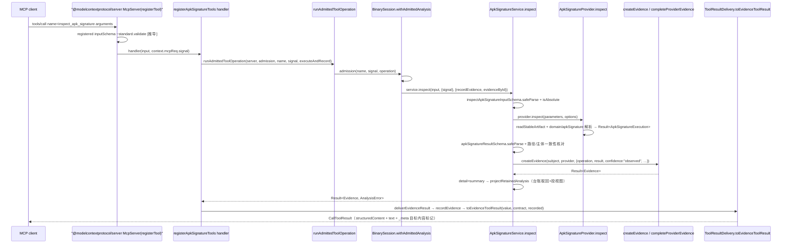

# 04 · 主链路拆解：请求到 Evidence

> 第三层核心篇。以「APK 签名检查」这条**纯 in-process** 链为主脊，拆开一次调用从 argv/JSON 进入、到 Evidence 离开进程之间**每一跳之间**发生的事。所述机制属 CLI/MCP 共用工作流，不绑定具体 provider 协议。
>
> 边界澄清：[03](03-最小例子-一次全路径走读.md) 只走通主路径；本篇讲每跳之间的分层机制，是全套文档「谁调用谁」的锚点篇。Evidence 字段语义与错误代数内部构造在 [06](06-域层-Evidence与错误代数.md)，本篇只引用不复述。全部结论来自源码静态阅读，**未实测**任何运行时行为。

## 0 速览

1. CLI 与 MCP 在 **`ApkSignatureService.inspect`**（`src/application/apkSignature/ApkSignatureService.ts 函数：inspect 偏移：+0`）这一个符号上汇合：MCP 经 handler 闭包调用（`src/server/registerApkSignatureTools.ts 函数：registerApkSignatureTools 偏移：+12`），CLI 在命令 run 体直接调用（`src/cli/apkSignatureCommands.ts 函数：registerApkSignatureCommands 偏移：+57`）。
2. 输入被校验**两处**：注册时把契约 zod `inputSchema` 交给 SDK（`src/server/toolRegistrationOptions.ts 函数：toolRegistrationOptions 偏移：+9~+13`），SDK 在派发前调用其 `~standard.validate`（[推导]，依据是 `src/server/DeferredEvidenceMcpServer.ts` 的占位 `函数：validate 偏移：+0~+8` 把校验委托给 canonical schema，及 `src/server/EvidenceMcpServerCore.ts` 传输层注释）；进入 service 后**无条件**再用域层 `inspectApkSignatureInputSchema.safeParse` 兜底（`ApkSignatureService 函数：inspect 偏移：+12`）。
3. 本链 MCP 侧的「准入」只做两件事：等会话迁移完成 + 检查 abort（`src/application/binary/BinarySession.ts 函数：withAdmittedAnalysis 偏移：+1~+13`、`函数：#waitForTransition 偏移：+5~+8`），拒绝形态统一是 `AnalysisCancelledError`。契约上的 `requiresActiveTarget: true` 只进能力清单报告（`src/application/CapabilityInventory.ts 函数：targetAvailability 偏移：+9~+13`，`target_required` + remediation 原文 "Call open_binary with a supported local target."），不在 `tools/call` 路径上拦截本工具。
4. `detail` 的**默认值是 `summary`**（`src/domain/apkSignature/apkSignatureQuery.ts Const：inspectApkSignatureInputSchema`）：默认 MCP 调用返回「保留摘要」，完整 Evidence 经 `recordEvidence` 进会话台账，`get_evidence_bundle`/`inspect_analysis_view` 可取回（§7）；无会话保留时**在分析之前**即被 `requireAnalysisViewRetention` 拒绝（`src/application/analysisView/AnalysisViewService.ts 函数：requireAnalysisViewRetention 偏移：+11~+23`）。
5. 应用层对 provider **不信任**：service 把返回值再用 `apkSignatureResultSchema.safeParse` 重解析，并核对「reader 报告的 artifact 路径 === 请求路径」且主体身份匹配，任一不符 → `AnalysisOutputError`（`ApkSignatureService 函数：inspect 偏移：+37~+48`）。
6. 本链没有工具级 deadline，只有取消：`context.mcpReq.signal` → `ExecutionOptions.signal`（`src/server/contractToolHandler.ts 函数：createEvidenceToolHandler 偏移：+16`）→ service 入口短路（`函数：inspect 偏移：+8~+11`）→ provider `assertArtifactReadActive`；资源释放责任在 `close()` 链与会话台账，见 §8。

## 1 主脊总览

主脊文件（体量为刻意事实，均可通读）：

```
contracts   src/contracts/apkSignature/apkSignatureToolContracts.ts (39 行)  INSPECT_APK_SIGNATURE_CONTRACT
server      src/server/registerApkSignatureTools.ts                (34 行)  registerApkSignatureTools
composition src/composition/apkSignature.ts                        (24 行)  apkSignatureModule / createApkSignatureService
application src/application/apkSignature/ApkSignaturePort.ts       (23 行)  ApkSignaturePort / ApkSignatureExecution
            src/application/apkSignature/ApkSignatureService.ts    (111 行) ApkSignatureService.inspect ← 汇合点
domain      src/domain/apkSignature/（query/report/schemes/block/v1…）
provider    src/apkSignature/ApkSignatureProvider.ts（in-process reader）
CLI         src/cli/apkSignatureCommands.ts                        (97 行)  registerApkSignatureCommands
```

### 1.1 MCP 一次 `tools/call` 全链



各节点锚点：`src/server/admittedToolOperation.ts 函数：runAdmittedToolOperation 偏移：+0`、`src/server/contractToolHandler.ts 函数：createEvidenceToolHandler 偏移：+11`、`src/application/binary/BinarySession.ts 函数：withAdmittedAnalysis 偏移：+0`。[未实测] 时序按源码调用关系推导。

### 1.2 两个入口的汇合（ASCII）

```
MCP（常驻进程）                                  CLI（一次性进程）
─────────────────────────────                   ─────────────────────────────
tools/call arguments(JSON)                      argv: ["inspect-apk-signature","/x.apk","--detail",…]
  │                                               │
  ▼                                             normalizeCliArguments        src/cliBuiltinArguments.ts
registerTool 的 ~standard.validate [推导]        │  --flag=value 拆分；值似 flag 的成对 token 整体保留
  │                                             ▼
  ▼                                           rejectSurplusCliArguments      src/cli/strictPositionals.ts
createEvidenceToolHandler 闭包                  │  Incur 0.6.1 静默丢未绑定位置参数 → 惰性 schema 捕获尾部
  │  input: unknown, options={signal}           │  多余者抛 Errors.ParseError
  ▼                                           ▼
runAdmittedToolOperation                        cli.serve 覆盖链             src/cli.ts 函数：createCli 偏移：+98~+105
  │  admittedToolOperation.ts                   │  补全 → strict → 敏感剔除 → 原 serve
  ▼                                           ▼
BinarySession.withAdmittedAnalysis              excludeDeclaredSensitiveArguments  src/cli/explicitSensitiveArguments.ts
  │  BinarySession.ts                           │  --sensitive-value 字面量从诊断文本打码（保留 code/退出码）
  │  #waitForTransition（迁移等待+abort）        ▼
  ▼                                           safeParseJson(view) + absoluteCallerPath + 域 schema.safeParse
  │                                           （src/cli/apkSignatureCommands.ts 函数：registerApkSignatureCommands 偏移：+24/+41）
        ┌──────────────────────────────────────────────────────┐
        │  ApkSignatureService.inspect(rawInput, options,        │ ← 唯一汇合符号
        │    retention) —— 同一实现、同一错误代数、同一 Evidence  │
        └──────────────────────┬───────────────────────────────┘
                               ▼
                  ApkSignaturePort（端口）→ ApkSignatureProvider（composition 注入）
```

CLI 侧最终形态差异：run 体把 `detail: "complete"` 硬编码进 service 调用（`src/cli/apkSignatureCommands.ts 函数：registerApkSignatureCommands 偏移：+56~+58`），摘要/分页视图交给 `deliverCliAnalysisEvidence` 投递层（属 [10 CLI 层](10-CLI层-一次性命令适配器.md)）。

### 1.3 「谁调用谁」边清单（第四层引用的权威表）

每条边 = 调用方符号 ↓ 被调用方符号 + 调用点锚点。全部为源码直接读到的调用点（观察级）。

| # | 边 | 调用点锚点 |
|---|---|---|
| E1 | `createServer` ↓ `apkSignatureModule.create` | `src/server/createServer.ts` |
| E2 | `createServer` ↓ `registerApkSignatureTools` | `src/server/createServer.ts` |
| E3 | `registerApkSignatureTools` ↓ `toolRegistrationOptions` / `createEvidenceToolHandler` / `server.registerTool` | `src/server/registerApkSignatureTools.ts 函数：registerApkSignatureTools 偏移：+9~+21` |
| E4 | `createEvidenceToolHandler` ↓ `runAdmittedToolOperation` | `src/server/contractToolHandler.ts 函数：createEvidenceToolHandler 偏移：+20~+27` |
| E5 | `runAdmittedToolOperation` ↓ `WithAdmittedAnalysis`（session 时为 `BinarySession.withAdmittedAnalysis`） | `src/server/admittedToolOperation.ts 函数：runAdmittedToolOperation 偏移：+8` |
| E6 | handler 闭包 ↓ `ApkSignatureService.inspect` | `src/server/registerApkSignatureTools.ts 函数：registerApkSignatureTools 偏移：+12` |
| E7 | `ApkSignatureService.inspect` ↓ `ApkSignaturePort.inspect`（实体=provider） | `src/application/apkSignature/ApkSignatureService.ts 函数：inspect 偏移：+34` |
| E8 | `ApkSignatureService.inspect` ↓ `apkSignatureResultSchema.safeParse` + `apkSignatureMatchesSubject` | `ApkSignatureService 偏移：+37~+41` |
| E9 | `ApkSignatureService.inspect` ↓ `createEvidence` / `completeProviderEvidence` | `ApkSignatureService 偏移：+49~+62` |
| E10 | `ApkSignatureService.inspect` ↓ `projectRetainedAnalysis`（summary） | `ApkSignatureService 偏移：+64~+72` |
| E11 | `executeAndRecord` ↓ `deliverEvidenceResult` | `src/server/contractToolHandler.ts 函数：createEvidenceToolHandler 偏移：+18` |
| E12 | `deliverEvidenceResult` ↓ `recordEvidence`（= `session.recordEvidence`）/ `toEvidenceToolResult` / `toPartialErrorToolResult` | `src/server/contractToolHandler.ts 函数：deliverEvidenceResult 偏移：+6~+13` |
| E13 | `projectRetainedAnalysis` ↓ `requireAnalysisViewRetention` / `resolveEvidenceInput` / `projectResolvedAnalysisView` | `src/application/analysisView/AnalysisViewService.ts 函数：projectRetainedAnalysis 偏移：+5~+21` |
| E14 | `registerApkSignatureCommands`(CLI) ↓ `apkSignatureModule.create` / `service.inspect` / `deliverCliAnalysisEvidence` | `src/cli/apkSignatureCommands.ts 函数：registerApkSignatureCommands 偏移：+54~+57` |
| E15 | `apkSignatureModule.create` ↓ `new ApkSignatureService(new ApkSignatureProvider())` | `src/composition/apkSignature.ts 函数：createApkSignatureService 偏移：+1~+2` |

## 2 环节一：argv / JSON → 分层类型

### 2.1 MCP 侧

- **契约声明**：`INSPECT_APK_SIGNATURE_CONTRACT`（`src/contracts/apkSignature/apkSignatureToolContracts.ts Const：INSPECT_APK_SIGNATURE_CONTRACT`）的 `inputSchema` 直接指向**域层**的 `inspectApkSignatureInputSchema`（`src/domain/apkSignature/apkSignatureQuery.ts Const：inspectApkSignatureInputSchema`：strict 对象 `path`（absolute 本地路径）、`detail ∈ summary|complete` 默认 `summary`（`偏移：+5`）、`view`（可选判别联合）；`superRefine` 拒「complete 带 view」（`偏移：+7~+14`，消息原文 "view requires summary delivery; omit it for complete Evidence"））。`outputSchema` 为 `evidenceResultOf(z.union([完整, 摘要视图, 分页视图]))`。契约文件不定义 schema —— 真相源在 domain，contracts 只做组合与文案。
- **注册投影**：`toolRegistrationOptions`（`src/server/toolRegistrationOptions.ts 函数：toolRegistrationOptions 偏移：+0`）把 title/description/inputSchema/outputSchema/annotations 直投 SDK。对照物：同文件 `applicationToolRegistrationOptions`（`函数：applicationToolRegistrationOptions 偏移：+6~+12`）把 StandardSchema 的 `validate` 换成恒等 `(value) => ({ value })`（vendor 改标 `"rea-application"`，注释 "workflow validates raw input before effects"）—— **存在一条「跳过 SDK 输入校验、由应用工作流自验」的注册方式**；本链用的是前者。
- **谁在派发前校验 arguments**：`EvidenceMcpServerCore.registerTool`（`src/server/EvidenceMcpServerCore.ts 函数：registerTool 偏移：+0`）只在有 compact 预算时替换**广告用 JSON schema 展示**，canonical parser 保持注册（类注释 "Canonical parsers and contracts remain registered"）。传输层只预验 `prompts/get / prompts/list / completion/complete / tools/list` 四类线请求（`函数：discoveryRequestSchema 偏移：+0`，tools/call 落入 `default: undefined`），onmessage 注释明言其余 "leaving callback failures and negotiated-era checks to it（SDK）"。[推导] tools/call arguments 由 SDK 调注册 schema 的 `~standard.validate` 把关 —— 最强证据是 deferred server 的占位 validate（`src/server/DeferredEvidenceMcpServer.ts Class：DeferredEvidenceMcpServer 偏移：+37~+46`，其 `函数：validate 偏移：+0~+8`：先 `await this.ensureRuntime()` 再委托 canonical schema 的 validate；若不发生在派发前就无法实现类头注释的「首次使用时安装异步 canonical 校验」）。SDK 内部实现未读取。→ P1。
- **兜底**：无论 SDK 是否校验过，service 无条件再 `safeParse`（`ApkSignatureService 函数：inspect 偏移：+12~+16`），失败用 `analysisInputErrorFromIssues`（`src/domain/inputIssueProjection.ts 函数：analysisInputErrorFromIssues 偏移：+0`）造 `AnalysisInputError`，保留 `rawInput` 与 `cause`；`projectInputIssues`（同文件 `偏移：+0`）注释给出口径 —— "Project Zod failures to secret-safe caller correction metadata"。
- **广告形状 ≠ 校验形状**：`src/contracts/compactInputSchema.ts 函数：compactAdvertisedInputSchema 偏移：+0` 三档投影（`inline` → 超字节预算降 `reduced` 浅投影 → 仍超则只留根属性形状），文件头与常量注释点名具体客户端事故（Kimi 展开引用、Gemini 拒 `items` 伴类型列表、严格客户端拒深度>10，`Const：COMPACT_SCHEMA_MAX_DEPTH`），但 `Const：REDUCED_ANNOTATION` 明言 "the server still validates complete canonical inputs"。`advertisedInputExamples`（`src/contracts/advertisedInputExamples.ts 函数：advertisedInputExamples 偏移：+0`）把广告样例里嵌入的完整 Evidence 换成其 `evidence_id` —— 文件头注释：「Hosts forward every advertised input schema to the model on each turn」，嵌入完整证据会把上次结果字节重复进每轮上下文。[推导] 两处都是 AGENTS.md「Agent tokens and context」在契约层的落点。

### 2.2 CLI 侧：三层包装各防一种事故

装配点在 `src/cli.ts 函数：createCli 偏移：+98~+105`：重写 `cli.serve` 为「补全命中即返回；否则 `serveStrict(normalizeCliArguments(argv))`，其内部再 `serveDeclared(tokens, …, serve)`」。

| 层 | 符号 | 防的具体事故 |
|---|---|---|
| ① `normalizeCliArguments` | `src/cliBuiltinArguments.ts 函数：normalizeCliArguments 偏移：+0` | Incur 只认**空格形式**的输出类 flag：`--format=json` 否则「reaches the command parser and fails as an unknown flag」（函数头注释）。本层拆 `flag=value`（`偏移：+15~+17`）、把值长得像 flag 的成对 token 整体保留（`偏移：+8~+13`）、把裸 `--update` 路由为 `update` 子命令（`偏移：+27~+29`） |
| ② `rejectSurplusCliArguments` | `src/cli/strictPositionals.ts 函数：rejectSurplusCliArguments 偏移：+0` | 函数头注释直书事故：「Incur 0.6.1 drops unbound positionals」—— 多余位置参数被**静默丢弃**。本层给每条命令挂惰性 middleware：`optionTokenShape`（`偏移：+0`）复制 flag 消费形状但不做真实校验，把未绑定尾部捕获进 `__rea_unbound_positionals`，非空即抛 `Errors.ParseError` 逐一点名多余 token（`偏移：+48~+50`）；原 schema 仍独占校验/默认值/目录 |
| ③ `excludeDeclaredSensitiveArguments` | `src/cli/explicitSensitiveArguments.ts 函数：excludeDeclaredSensitiveArguments 偏移：+0` | `--sensitive-value` 声明的字面量可能出现在**命令自己的 service 看到之前**的诊断文本。本层给声明了该选项的命令挂**最外层** middleware（`偏移：+17~+24`，注释 "Outermost, so later command middleware failures are covered as well as the parsing and run"），`withoutDeclaredText`（`偏移：+0`）在 `Errors.ValidationError/IncurError/ParseError` 的 message/fieldErrors/hint 上打码而保留类型、code、exit status（"codes, keys and rendering stay intact"） |

三层之后进入命令 run 体：`src/cli/apkSignatureCommands.ts 函数：registerApkSignatureCommands 偏移：+24~+28` 先 `safeParseJson(options.view)`（失败当场投影 `AnalysisInputError`，消息原文 "view must be a JSON APK signature selection"），`偏移：+41~+45` 用 `absoluteCallerPath(args.path)` + 域层 schema `safeParse` —— 与 MCP 汇合前 CLI 已完成同构规整（**同一个域 schema，两侧各自适配来源**）。

## 3 环节二：准入（admission）

- **谁在 service 之前有一票**：`createEvidenceToolHandler 偏移：+14~+27` 把真实工作包成 `executeAndRecord` 闭包交给 `runAdmittedToolOperation`（`src/server/admittedToolOperation.ts 函数：runAdmittedToolOperation 偏移：+0`）。`admission === undefined` 直通（`偏移：+7`）—— 无会话装配下没人有一票。
- **准入源**：`withAdmittedAnalysis(source)`（`src/server/analysisAdmission.ts 函数：withAdmittedAnalysis 偏移：+0`）把 `ServerAnalysisSource` 判别联合（session/fixed，同文件 `Type：ServerAnalysisSource`）收敛成一个函数类型，注释点名 "Select exactly one owner"；fixed 源只查 `signal?.aborted`（`偏移：+10~+13`）。createServer 以 `withAdmittedAnalysis(source)` 构造 admission 并注入所有 register（`src/server/createServer.ts`）。
- **session 源行为**：`BinarySession.withAdmittedAnalysis`（`src/application/binary/BinarySession.ts 函数：withAdmittedAnalysis 偏移：+1~+13`）：`#waitForTransition`（已 abort → `err(AnalysisCancelledError)`，`函数：#waitForTransition 偏移：+5~+8`；迁移期间 abort 同，`偏移：+21~+26`），并**同步**把调用登记进 `#calls`（`偏移：+15~+16`，注释 "Register synchronously before a lifecycle transition can snapshot calls"）。本链 operation 并不使用注入的 `AnalysisOperationPort` —— 它借的是「迁移等待 + 取消 + 在途快照」三个语义。
- **拒绝的形状**：`runAdmittedToolOperation 偏移：+11~+14` —— 准入失败走 `server.delivery.toErrorToolResult(admitted.error, toolReturnsTargetContent(operationName))`，与普通失败同一投影管线，只是带着按工具名的 target-content 溯源标记。
- **`externalMutationAdmission.ts`**：本 in-process 链**不经过**它；它服务于「可能改写绑定目标」的外部命令（`src/server/externalMutationAdmission.ts 函数：runWithExternalMutationAdmission 偏移：+0`）：命令成功但会话退役失败时构造 `AnalysisOutputError` 并挂 `partialObservation/cleanup/capturedOutput`（`偏移：+21~+40`，消息原文 "The external command may have changed the bound artifact…"），失败侧用 `retainSecondaryFailure` 保次级事实。第四层引用此行即可：外部命令准入在这里，artifact 工具准入在 `admittedToolOperation`。
- **availability 与 call 的分工**：`sessionAvailabilityPolicy`（`src/server/sessionAvailabilityPolicy.ts 函数：sessionAvailabilityPolicy 偏移：+0`）不拒任何 call，只定能力口径：无配置时给 target-free 默认（`偏移：+3~+32`，可选特性全 `false`，唯 `processCaptureEnabled: platform !== "win32"`），观测主机不支持与配置策略**取并集收紧**（`函数：combineHostUnsupported 偏移：+6~+8`）。`requiresActiveTarget` 的拒绝文案在 `CapabilityInventory`（§0 第 3 条）。
- **summary 前置拒绝（本链最常见的「到达 reader 之前被拒」）**：`detail` 默认 summary；当 server 无会话 recorder 时，service 在调用 provider **之前**返回 `requireAnalysisViewRetention` 的 `AnalysisCapabilityUnavailableError`（`src/application/analysisView/AnalysisViewService.ts 函数：requireAnalysisViewRetention 偏移：+11~+23`，reason 原文 "summary detail requires a server session that retains Evidence for later views"，userMessage 原文 "This server does not retain Evidence. Select detail complete to receive the complete analysis inline."）。
- **环境冻结**：`captureProviderEnvironment`（`src/server/providerEnvironment.ts 函数：captureProviderEnvironment 偏移：+0`）在 server 构造时对 provider 环境做 `snapshotEnvironment` 快照 —— 与 01 篇 §4 的 CLI 快照同一机制；此后改 `process.env` 不影响已装配 server。[推导]

## 4 环节三：装配与端口注入

- `src/composition/apkSignature.ts` 是**唯一 import provider 实体的生产文件**（`ApkSignatureProvider`）；`src/cli/apkSignatureCommands.ts` 也 import 该目录，但只取 `ApkSignatureRelease` 这份发行事实，不碰分析实现。application/server 只 import 类型端口。因此 02 篇表里 `src/apkSignature/` 的 fan-in 是 **2**，而「认识 provider 实体」的仍只有装配根一处。
- `apkSignatureModule`（`src/composition/apkSignature.ts Const：apkSignatureModule`）是三合一描述符：契约（MCP 名）+ `cliCommand`（CLI 名）+ `create(environment, injected?)`；`injected` 是测试替身缝，返回绑定后的 `{inspect, close}` 而非对象图。server 装配见 `src/server/createServer.ts`（create）与 （register 调用点，六个参数把 server/service/logger/recordEvidence/admission/evidenceById 一次交齐）。
- **Port + Service 成对模式**：`ApkSignaturePort`（`src/application/apkSignature/ApkSignaturePort.ts Type：ApkSignaturePort`，23 行）只声明 `close()` 与 `inspect({path}, options) → Result<ApkSignatureExecution, AnalysisError>`；`ApkSignatureExecution`（同文件 `Type：ApkSignatureExecution`）把 subject.format 收窄到 `"file"|"apk"|"zip"`。作用 [推导]：a) application 不 import provider 目录，满足 AGENTS.md 分层规则；b) service 的输入校验、输出重解析、身份核对、Evidence 构造全部与 reader 实现解耦，替换 reader 不动工作流。
- **provider 内部（本链事实边界）**：`src/apkSignature/ApkSignatureProvider.ts` 头部 import 清单即其触碰面：`readStableArtifact`（有界稳定读）、`assertArtifactReadActive`（读取中响应取消）、`bindArtifactFileCleanup` + `ArtifactResourceScope`（文件资源登记）、`apkOutputBudgetError`（输出预算拒）、`ProviderCleanupError`（关闭无法证明）；字节解析全部调用 `src/domain/apkSignature/` 纯函数（`apkSigningBlock`、`apkSignatureSchemes`、`apkV1Signature`、`apkContentDigest`），返回 `createAnalysisExecution` 构造的执行记录。无 spawn、无 bridge。

## 5 环节四：域层规整（本链实例）

Evidence 的产生是 service 内一次调用（`ApkSignatureService 函数：inspect 偏移：+49~+62`）：

```
completeProviderEvidence(createEvidence(execution.subject, execution.provider, {
  operation: "inspect_apk_signature", parameters: { path: input.data.path },
  result: report.data, rawResult?, confidence: "observed",
  locations: execution.locations, limitations: execution.limitations }),
  options?.signal)
```

- `confidence: "observed"` **写死**：链上无「推断」通道，reader 读出什么就承诺什么（对照 06 篇 §3 三态轴）。
- 契约 description 把域级限制**前置**给调用方（`apkSignatureToolContracts.ts` 原文）："Content-digest equality is not cryptographic signature verification: modified declarations can match modified bytes. Authenticity, signatures, lineage trust and v1 entry coverage remain unverified."；机制承载是 `APK_SIGNATURE_LIMITATIONS` 与 limitations 通道（`src/domain/apkSignature/apkSignatureReport.ts`，06 篇 §2.2）。
- 视图投影：`detail === "summary"` 时 `projectRetainedAnalysis(completed.value, retention, {kind: "apk-signature"}|{kind: "summary"})`（`ApkSignatureService 偏移：+64~+72`）—— **Evidence 不缩水，投影缩水**；完整记录已进台账（§7）。

## 6 环节五：错误传播

代数内部（27 tag → 20 code → 10 category、cleanup 并存、retryable 集）见 [06 篇 §4](06-域层-Evidence与错误代数.md)。本表只答「错误起源于哪层 → 调用方看到什么」：

| 起源 | 例（本链，锚点） | 投影 code | MCP 调用方看到 | CLI 调用方看到 |
|---|---|---|---|---|
| 入参 schema | `path` 缺失（`ApkSignatureService 偏移：+12~+16`） | `invalid_input` | `isError:true`；文本走 `encodeToolResult`，`structuredContent={error:projected}` 为 transport 私载（见下） | 同一投影进 CLI 错误信封（`src/contracts/errorSchemas.ts Const：analysisCliErrorEnvelopeSchema`）+ 非零退出 |
| 应用校验 | 相对路径（`偏移：+19~+28`，"Expected an absolute filesystem path on this host."） | `invalid_input` | 同上 | 同上 |
| 保留不可用 | 无会话 + `detail:summary`（§3 末条） | `AnalysisCapabilityUnavailableError`→静态表 code | 同上 + userMessage 指引换 `detail complete` | 同上（CLI 硬编码 complete，天然绕开） |
| provider 读取 | 非 APK/ZIP、越预算（`ApkSignatureAdmission`/`apkOutputBudgetError`） | 按 tag 静态映射 | 同上 | 同上 |
| provider 输出漂移 | reader 换身份（`偏移：+37~+48`，"…changed the selected artifact identity."） | `AnalysisOutputError` 映射 code | 同上 | 同上 |
| 取消 | abort/迁移期（`偏移：+8~+11`、`#waitForTransition`） | `cancelled`（retryable，06 篇；常量在 `src/domain/analysisErrorProjection.ts Const：RETRYABLE_CODES`） | 同上 | 同上 + 退出码 130/143（`src/cli/commandCancellation.ts 函数：withCommandCancellation 偏移：+6~+9`） |
| cleanup 未决 | 文件资源无法证明关闭（`ProviderCleanupError`） | `cleanup_incomplete`；底层 code 进 `details.cleanup.execution_failure` | 同上 + 恢复指引 | 同上 |
| 交付超预算 | 结果编码超 `resultBudgetBytes` | `resource_constraint`（`src/server/ToolResultDelivery.ts 函数：successResult 偏移：+32~+48` 造 `AnalysisResourceConstraintError`） | 「成功但装不下」被换成交付约束错误 + `nextStep` 续读指引（§7） | CLI 侧投递形状由 `deliverCliAnalysisEvidence`（`src/cli/analysisEvidenceDelivery.ts 函数：deliverCliAnalysisEvidence 偏移：+0`）先行校验（`cliEvidenceDeliveryInputError`，`偏移：+16~+19`），再经 `finishAnalysisCommand` 统一收尾并关闭 service |

- **MCP 文本形状**：`projectedErrorResult`（`src/server/ToolResultDelivery.ts 函数：projectedErrorResult 偏移：+0`）—— 注释明言 "Errors reach the wire as text only; the structured copy is a private carrier the transport removes after its own budget check"；`content[0].text` 编码文本 + `isError:true` + 按需 `TARGET_CONTENT_RESULT_META`。
- **文案属主在 domain**：`analysisErrorUserMessage`、`analysisErrorRemediationAction`（`src/domain/analysisErrorPresentation.ts 函数：analysisErrorUserMessage 偏移：+0`）；面向 MCP 代理的取回指引 `Const：MCP_TRANSPORT_EVIDENCE_DISCOVERY`（同文件）点名 `get_evidence_bundle` 与 `inspect_analysis_view`。
- **JSON 形状属主在 contracts**：`analysisErrorProjectionSchema`（`src/contracts/errorSchemas.ts Const：analysisErrorProjectionSchema`，按 `code` 的 discriminatedUnion）。
- **初始化注入的恢复教材**：`RECOVERY_INSTRUCTIONS`（`src/server/recoveryInstructions.ts Const：RECOVERY_INSTRUCTIONS`）：上方注释交代动机 —— "A host deadline can discard the response before error remediation reaches the agent. Teach that distinction at initialization"；正文区分 REA `provider_timeout`、客户端 `tool_timeout_sec`、服务侧 `analysis_timeout_ms` 三种 deadline，并规定「cleanup blocker 未清时按 remediation 行动」。挂载点：server instructions 拼接处（`src/server/createServer.ts`，与 `UNTRUSTED_CONTENT_INSTRUCTIONS` 同串追加）。

## 7 环节六：结果回传与保留

- **分发单点** `deliverEvidenceResult`（`src/server/contractToolHandler.ts 函数：deliverEvidenceResult 偏移：+1~+13`）：失败 → `toPartialErrorToolResult(error, contract.returnsTargetContent, recordEvidence)`（`src/server/ToolResultDelivery.ts 函数：toPartialErrorToolResult 偏移：+0`：错误携带的 `partialObservation` 若过得了 `evidenceSchema.safeParse` 就**先保留再引用**，`details.partial_observation = {kind:"retained-evidence", evidence_id}`）；成功 → `recordEvidence?.(value)` 先登记，再 `toEvidenceToolResult(value, contract, recorded)`（`函数：toEvidenceToolResult 偏移：+0~+18`：`recorded` 是错误时**成功也翻成错误** —— 注释 "Deliver Evidence using the producer's explicit recording acknowledgment"；登记成功时 recovery 带 `evidence_reference` 与 `nativeContinuation(evidence)`）。
- **编码与预算**：`encodeToolResult`/`measureMcpResultWithinBudget`（`src/server/toolResultEncoding.ts 函数：encodeToolResult 偏移：+0`）受 `MCP_RESULT_STRING_LIMIT`（`Const：MCP_RESULT_STRING_LIMIT` = Node `MAX_STRING_LENGTH − 1024`）与服务方 `resultBudgetBytes`（`ToolResultDelivery` 构造函数 `偏移：+9`）双重约束；溢出走 `mcpResponseOverflowProjection`（`函数：mcpResponseOverflowProjection 偏移：+0`）。
- **被截断的完整证据能不能取回 —— 能，机制链**：
  1. `registerApkSignatureTools 偏移：+12` 把 `{recordEvidence, evidenceById}` 作为 retention 传入 service；两者由 `createSessionRecorders`（`src/server/createServer.ts 函数：createSessionRecorders 偏移：+0`）绑自 **BinarySession**（`session.evidenceForAnalysis` / `session.recordEvidence`）；无 session 则皆 `undefined`（`偏移：+3~+15`）—— 这正是 §3「summary 前置拒绝」的来源。
  2. summary 视图生成时 `projectRetainedAnalysis`（`src/application/analysisView/AnalysisViewService.ts 函数：projectRetainedAnalysis 偏移：+0~+21`）：`recordEvidence(evidence)` 入台账 → `resolveEvidenceInput({kind:"retained-evidence", evidence_id}, evidenceById)` **从台账取回完整记录** → `projectResolvedAnalysisView` 按视图选择器切出摘要/分页（注释 "Callers page or select the rest through inspect_analysis_view with the view's parent Evidence ID"）。
  3. 源文件之后不可读也不影响：契约 description 原文 "Read retained pages with inspect_analysis_view kind apk-signature **after the source is removed**"。
  4. 溢出成功结果自带续读指引：`函数：successResult 偏移：+18~+31` 的 `nextStep` 分支（`continuation` → "Call inspect_analysis_view with the supplied continuation arguments…"；仅 `evidence_reference` → "Export retained evidence to consume the complete analysis, or use complete CLI JSON output."）。
  - **[未知]** 台账保留时长/逐出：记录归属 BinarySession 账本，会话关闭后经 bundle 落盘可否取回属 `InvestigationRecordPort`/23 篇；本篇未证。→ P3。
- **通用族对照**：`createRetainedSummaryToolHandler`（`src/server/contractToolHandler.ts 函数：createRetainedSummaryToolHandler 偏移：+0`）+ `retainedSummaryDelivery`（`src/server/retainedSummaryDelivery.ts 函数：retainedSummaryDelivery 偏移：+0`）在 handler 层做 **preflight**（`偏移：+11~+14`，注释 "refuse it before analysis when this server retains no Evidence"）与 `projectEvidence`（`偏移：+15~+22`）。本链没走它，summary 判定下放在 service 内（`ApkSignatureService 偏移：+30~+33`）→ P2。`withoutDeliveryDetail`（同文件 `偏移：+0`）把 `detail` 剥出进 Evidence 的参数 —— 注释 "Delivery detail selects a response shape; it never reaches tools or Evidence identity"。
- **目标内容标记**：`inspect_apk_signature` 不在 `TARGET_CONTENT_FREE_TOOLS`（全集仅 4：两个 settings 工具 + `export_evidence_bundle` + `record_unknown`，`src/contracts/toolEffects.ts Const：TARGET_CONTENT_FREE_TOOLS`），故 `returnsTargetContent=true`（`函数：toolReturnsTargetContent 偏移：+0` 注释：unknown names 一律按 target content，"an unaudited path never loses the untrusted marker"）→ 成功/失败结果都带 `_meta: TARGET_CONTENT_RESULT_META`。效果审计 `TOOL_EFFECTS` 中本工具取 `evidence` 预设（`Const：evidence` = 仅 `mutatesSession: true`）；`toolContractMetadata`（`函数：toolContractMetadata 偏移：+0`）缺审计条目直接抛错 —— 效果表是注册期强制。

## 8 deadline / 取消 / cleanup

- **谁持有截止时间**：本链**没有**工具级 deadline 字段，持有的只有取消信号。MCP 源 `context.mcpReq.signal`（SDK 请求级）；CLI 源 `withCommandCancellation`（`src/cli/commandCancellation.ts 函数：withCommandCancellation 偏移：+0`：SIGINT→130、SIGTERM→143，`finally` 摘监听器并把 exitCode 交给 host —— 注释 "Translate one-shot CLI interrupts into awaited cleanup and conventional exit codes"）。配置层 deadline 各归各位：`src/config/providerStartupTimeout.ts`、`src/config/mcpStartupBudgets.ts` 管 provider **启动**（消费方在 hopper/firmware 等引擎族，本链无启动动作）；`analysis_timeout_ms` 是**重引擎工具的按请求入参**（`src/config/analysisSettings.ts` 族，消费点在 firmware/browser/javascript），apk 契约无此字段；`src/domain/browserDeadline.ts` 属浏览器域。`src/domain/analysisResourceLimits.ts` 给 reader 供字节/条目上限常量。[推导] 主脊选它正因「无 deadline 变量」；deadline 专题归 06 篇 §6 与各 provider 篇。
- **取消传播（三连查）**：service 入口 `options?.signal?.aborted` 短路（`ApkSignatureService 偏移：+8~+11`）→ provider 读取中 `assertArtifactReadActive` → Evidence 完成时 `completeProviderEvidence(evidence, options?.signal)`（`偏移：+49~+62` 的第二实参）。半途取消的已保留观察与成功提交同一组事实（06 篇 §3 `AnalysisObservation` 约束）。
- **异常路径上谁负责释放**：本链资源面 =「有界文件读 + 会话台账」，无子进程/lease。文件资源由 `bindArtifactFileCleanup`/`ArtifactResourceScope` 绑定（`src/apkSignature/ApkSignatureProvider.ts` import 清单）；关闭无法证明即产出 `ProviderCleanupError`（永远 `cleanupIncomplete` 直到 resolve，06 篇 §4.3）→ 调用方见 `cleanup_incomplete` 而非静默泄漏（AGENTS.md "Retain ownership of resources whose cleanup failed" 的落点）。server 关闭链登记 `apkSignature.close()`（`src/server/createServer.ts`），close 失败重抛保留（同文件 `providerClose` 分支，见源索引）。`src/providers/AnalysisClientCleanup.ts` 是**客户端型 provider**（可 spawn 引擎）的清理底座，本 port 只有 `close()`，不经它；`src/process/` 的 lease 监督在本链零参与 → 归 [13](13-Process层-子进程监督与所有权.md)。

## 边界与失败模式

| 现象 | 根因位置 | 说明 |
|---|---|---|
| 多余 CLI 位置参数被吃掉不报错 | Incur 0.6.1（`strictPositionals.ts` 函数头注释） | 护栏只存在于 `createCli` 覆盖后的 serve；绕过装配链即丢 |
| 代理按精简广告 schema 传畸形形状 | service `safeParse` 兜住 | 广告≠校验；`reduced` 丢的是展示嵌套，不是运行时契约 |
| 无会话 server 上默认调用（summary）全被拒 | `requireAnalysisViewRetention` | 刻意 fail-closed：宁可在分析前拒，不产「无法取回摘要」的孤儿结果 |
| reader 升级产出新形状 | service 重解析 + 身份核对 | 「provider 返回不合法 = 拒绝」，而非尽力解释 |
| 成功结果超响应预算 | `successResult` 溢出分支 | 呈现为 `resource_constraint` 但 recovery 带 `evidence_reference` —— 证据已在台账，不算丢失 |
| 新增工具忘写效果审计 | `toolContractMetadata` 抛错 | 注册期即炸，不进入运行期 |

## 问题清单

- **P1｜SDK 校验层未定界**：tools/call arguments 在 `@modelcontextprotocol/server` 内部何时、以何消息形态调用 `~standard.validate`，属依赖内部实现（未读取，不臆测）。本篇 [推导] 基于 deferred 占位 validate 与传输层注释。需真实会话各发一发合法/非法参数实测。
- **P2｜summary 判定两处属主**：本链在 service 内（`ApkSignatureService 偏移：+30~+33`），通用族在 handler 层 preflight（`createRetainedSummaryToolHandler`）。并存原因源码未回答；收敛方向 → 待拍板。
- **P3｜保留 Evidence 的生命周期**：台账条目何时失效（进程退出/会话关闭/预算逐出）本篇未证 → 交 23 篇与 `InvestigationRecordPort`。
- **P3｜`fixed` 源出现场景**：`ServerAnalysisSource` fixed 分支（`src/server/analysisAdmission.ts 函数：withAdmittedAnalysis 偏移：+10~+13`）在生产哪些装配下生效，未逐路径查证。[假设] deferred materialize 后的某些无会话形态。

## 已知缺口

- 风险：P1 不实测则「谁先拒畸形 JSON」只能是双保险描述；但防线结论不受影响（service safeParse 恒在），变的只是错误消息口吻。
- 设计特性：本链刻意无 deadline 只有 signal（§8）；summary 默认 + 保留取回 + 广告压缩是「agent tokens 优先」的刻意路径（§2.1、§7）。

## 源码索引

| 事实 | 文件:符号:行号 |
|---|---|
| 汇合点 | `src/application/apkSignature/ApkSignatureService.ts:inspect:37` |
| MCP 注册 | `src/server/registerApkSignatureTools.ts:registerApkSignatureTools:12` |
| 契约 | `src/contracts/apkSignature/apkSignatureToolContracts.ts:INSPECT_APK_SIGNATURE_CONTRACT:13` |
| 域入参 schema | `src/domain/apkSignature/apkSignatureQuery.ts:inspectApkSignatureInputSchema:111` |
| 装配描述符 | `src/composition/apkSignature.ts:apkSignatureModule:11` |
| 端口 | `src/application/apkSignature/ApkSignaturePort.ts:ApkSignaturePort:17` |
| handler 工作流 | `src/server/contractToolHandler.ts:deliverEvidenceResult:32` / `createRetainedSummaryToolHandler:70` / `createEvidenceToolHandler:118` |
| 准入执行 | `src/server/admittedToolOperation.ts:runAdmittedToolOperation:15` |
| 准入源 | `src/server/analysisAdmission.ts:withAdmittedAnalysis:20` |
| 会话准入/迁移 | `src/application/binary/BinarySession.ts:withAdmittedAnalysis:1151` / `#waitForTransition:1470` |
| 外部命令准入 | `src/server/externalMutationAdmission.ts:runWithExternalMutationAdmission:14` |
| 可用性口径 | `src/server/sessionAvailabilityPolicy.ts:sessionAvailabilityPolicy:47` |
| 目标门文案 | `src/application/CapabilityInventory.ts:targetAvailability:765` |
| 注册投影 | `src/server/toolRegistrationOptions.ts:toolRegistrationOptions:9` / `applicationToolRegistrationOptions:26` |
| 广告压缩/样例 | `src/contracts/compactInputSchema.ts:compactAdvertisedInputSchema:620` / `src/contracts/advertisedInputExamples.ts:advertisedInputExamples:61` |
| 传输预验范围 | `src/server/EvidenceMcpServerCore.ts:discoveryRequestSchema:730` / `registerTool:235` |
| 延迟占位校验 | `src/server/DeferredEvidenceMcpServer.ts:DeferredEvidenceMcpServer:44` |
| 结果交付 | `src/server/ToolResultDelivery.ts:ToolResultDelivery:83` / `toEvidenceToolResult:113` / `toPartialErrorToolResult:151` / `successResult:201` |
| 结果编码上限 | `src/server/toolResultEncoding.ts:MCP_RESULT_STRING_LIMIT:10` / `encodeToolResult:95` |
| 保留台账 | `src/application/analysisView/AnalysisViewService.ts:requireAnalysisViewRetention:245` / `projectRetainedAnalysis:288` |
| 会话 recorder | `src/server/createServer.ts:createSessionRecorders:1162` |
| 效果审计 | `src/contracts/toolEffects.ts:evidence:46` / `TARGET_CONTENT_FREE_TOOLS:787` / `toolReturnsTargetContent:799` / `toolContractMetadata:803` |
| 错误投影 schema | `src/contracts/errorSchemas.ts:analysisErrorProjectionSchema:38` |
| 错误文案 | `src/domain/analysisErrorPresentation.ts:analysisErrorUserMessage:290` |
| 恢复教材 | `src/server/recoveryInstructions.ts:RECOVERY_INSTRUCTIONS:3` |
| 入参问题规整 | `src/domain/inputIssueProjection.ts:analysisInputErrorFromIssues:8` |
| CLI 三层包装 | `src/cli.ts:createCli:76` / `src/cliBuiltinArguments.ts:normalizeCliArguments:76` / `src/cli/strictPositionals.ts:rejectSurplusCliArguments:48` / `src/cli/explicitSensitiveArguments.ts:excludeDeclaredSensitiveArguments:97` |
| CLI 命令/取消 | `src/cli/apkSignatureCommands.ts:registerApkSignatureCommands:21` / `src/cli/commandCancellation.ts:withCommandCancellation:9` |
| createServer 装配/关闭/注册/instructions | `src/server/createServer.ts:557` / `582` / `659` / `1084` / `1162` / `424` |
| CLI 投递收尾 | `src/cli/analysisEvidenceDelivery.ts:deliverCliAnalysisEvidence:116` |

## 相关篇

- 主路径最小例子 → [03](03-最小例子-一次全路径走读.md)；模块地图与入度证据 → [02](02-模块地图与依赖方向.md)
- Evidence 与错误代数内部 → [06](06-域层-Evidence与错误代数.md)；契约层 → [08](08-契约层-工具契约与Schema.md)
- server 适配器 → [09](09-Server层-MCP适配器.md)；CLI 适配器 → [10](10-CLI层-一次性命令适配器.md)；装配根 → [11](11-Composition层-生产装配根.md)
- 进程所有权与 lease（本链刻意不涉及）→ [13](13-Process层-子进程监督与所有权.md)；调查记录与台账 → [23](23-调查记录与重建台账.md)
