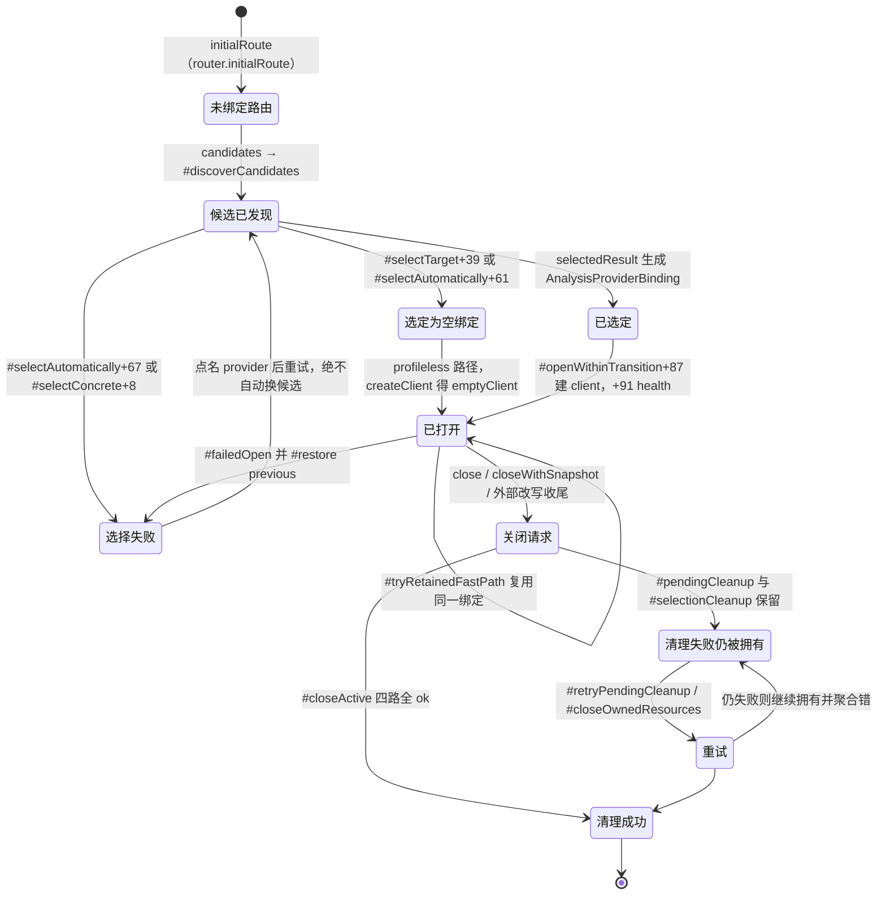

# 05 · 会话与 Provider 选择

> 第三层（L3）拆解：一个进程内**唯一**的 `BinarySession` 如何为「一个目标」选出**一个**深度分析 provider，并把这次选择固化成不可变绑定；以及为什么架构图说的 `deterministic selection, no fallback` 在源码里是**分支 + 抛错**，而不是注释。属于 CLI 与 MCP 共享的 application/composition 层，不启子进程、不碰引擎。
>
> 边界澄清：本篇讲「选谁、绑什么、谁负责关」；不讲 Evidence 内容（见 06）、不讲 provider 内部协议（见 15~21）、不讲 composition 全量装配根（见 11）。

## 0 速览

1. 架构图点名的五个符号**全部真实存在**，且全部集中在 `src/application/binary/`：`AnalysisProviderRegistry`、`SessionProviderRouter`、`BinarySession`、`BinarySessionRecords`、`AnalysisSnapshotCache`。生产构造点只有一个：`src/composition/binary.ts` 的 `composeDeepBinarySession` → `src/application/binary/BinarySessionComposition.ts` 的 `composeBinarySession`（锚点见 §1）。
2. 架构图里那四句措辞（`one immutable deep binding per target`、`disjoint auxiliary routing`、`sorted deep candidates`、`deterministic selection, no fallback`）中，只有 `disjoint auxiliary` 在源码注释里出现（`src/application/binary/SessionProviderRouter.ts` 类声明上方注释）；其余三句**源码中无此措辞**，只在 `docs/architecture.mermaid` 与 `docs/mcp-prompts.md` 里。逐字核对见 §1.4。
3. 深度候选的排序键是 **provider `identity().id` 的 Unicode 码点序**，用 `compareUnicodeCodePoints` 在注册时一次性排好（`src/application/binary/AnalysisProviderRegistry.ts 函数：constructor 偏移：+36~+39`）。排序**只影响枚举与诊断输出顺序，不参与择优** —— 见下一条。
4. 「无 fallback」的实现落点是 `#selectAutomatically` 的分支：可用候选数 `> 1` 时直接 `return err(selectionError("ambiguous", ...))`（`src/application/binary/AnalysisProviderRegistry.ts 函数：#selectAutomatically 偏移：+67~+73`）；可用候选数 `=== 0` 时返回 `binding: null` 的空绑定而不是「再试下一个」。排序靠前不会被选中，所以「退到下一个候选」这条代码路径根本不存在。
5. 不可变性的键是**两段的**：目标身份用 `sha256 + kind + format + architecture (+ entryPoint)`（`src/domain/analysisSnapshot.ts Type：AnalysisSnapshotTarget`），provider 侧用 RFC 8785 规范化的 **profile digest**（`src/domain/analysisProfile.ts 函数：profileDigest`）。重开同一目标是否复用绑定，判据是 `sameSessionTarget` 且 `sameProfile`（`src/application/binary/BinarySession.ts 函数：#openWithinTransition 偏移：+23~+27`、`+46`）。
6. 辅助（auxiliary）路由与深度路由的边界判据是**操作名集合不相交**，由 `SessionProviderRouter.selectable` 在构造期用两处 `throw new TypeError` 强制（`src/application/binary/SessionProviderRouter.ts 函数：selectable 偏移：+9~+13`、`函数：assertDisjoint 偏移：+6~+9`）。`optionalObservationProviders` 是**另一套东西**，不经过 router，见 §5.3。
7. 清理失败不会丢所有权：`BinarySession.#pendingCleanup` / `#pendingBundleResourceCleanup` / `AnalysisProviderRegistry.#selectionCleanup` 三处都保留失败对象，直到重试成功才清除（`src/application/binary/BinarySession.ts 函数：#retryPendingCleanup 偏移：+20`、`函数：#closeOwnedResources 偏移：+31~+34`）。

## 1 五个符号的真实位置

### 1.1 定义点与构造点

| 符号 | 定义文件 | 生产构造者 |
|---|---|---|
| `AnalysisProviderRegistry`（class） | `src/application/binary/AnalysisProviderRegistry.ts` | `src/composition/binary.ts 函数：composeDeepBinarySession 偏移：+28`；另有三个「空深度候选」装配点 `函数：createManagedBinarySession 偏移：+1`、`函数：createArtifactBinarySession 偏移：+6`、`函数：createNativeBinarySession 偏移：+6`，都传 `new AnalysisProviderRegistry([])` |
| `SessionProviderRouter`（class） | `src/application/binary/SessionProviderRouter.ts` | 唯一生产调用 `SessionProviderRouter.selectable`：`src/application/binary/BinarySessionComposition.ts 函数：composeBinarySession 偏移：+6` |
| `BinarySession`（class，继承 `BinarySessionRecords`） | `src/application/binary/BinarySession.ts` | `src/application/binary/BinarySessionComposition.ts 函数：composeBinarySession 偏移：+5`；进程入口链见 §1.2 |
| `BinarySessionRecords`（abstract class） | `src/application/binary/BinarySessionRecords.ts` | 不单独构造，只被 `BinarySession` 继承（`src/application/binary/BinarySession.ts` 类声明 `extends BinarySessionRecords`） |
| `AnalysisSnapshotCache`（class） | `src/application/binary/AnalysisSnapshotCache.ts` | 作为 `BinarySessionRecords` 的私有字段实例化：`src/application/binary/BinarySessionRecords.ts Type：BinarySessionRecords` 内 `readonly #snapshot = new AnalysisSnapshotCache()` |

`src/composition/` 是唯一认识 provider 具体类的层，provider 目录入度普遍为 1~2 —— 见 02。本篇复核到的证据一致：只有 `src/composition/binary.ts` 同时 `import` `HopperProvider` / `GhidraProvider` / `IdaProvider` / `KunaProvider` 四家并把它们塞进同一个 `AnalysisProviderRegistry` 构造参数（`src/composition/binary.ts 函数：composeDeepBinarySession 偏移：+9~+13` 构造、`+29` 传数组）。

### 1.2 从进程入口到 session

```
src/main/eagerRuntime.ts 函数：runEager 偏移：+16
   const session = createBinarySession(config.value, logger, environment, analysisSettings.read)
        ↓
src/composition/binary.ts 函数：createBinarySession 偏移：+6
        ↓
src/composition/binary.ts 函数：composeDeepBinarySession 偏移：+28  （new AnalysisProviderRegistry）
        ↓
src/application/binary/BinarySessionComposition.ts 函数：composeBinarySession 偏移：+6  （SessionProviderRouter.selectable）
        ↓
src/application/binary/BinarySessionComposition.ts 函数：composeBinarySession 偏移：+5  （new BinarySession）
```

**校正一处外部提示**：`createBinarySession(...)` 的调用行相对 `runEager` 签名行的偏移是 `+16`（签名行 `src/main/eagerRuntime.ts`，调用行 ），不是 `+15`。

### 1.3 `DirectAnalysis` 不持有 router

`src/application/DirectAnalysis.ts` 只 `import type { SessionProviderRoute }`（该文件 `函数：runAnalysis` 之前），**没有任何 `SessionProviderRouter` 或 `AnalysisProviderRegistry` 的运行时引用**。`grep -l "SessionProviderRouter"` 命中它纯粹是 `SessionProviderRoute` 的**子串假阳性**。CLI 直连路径拿路由的方式是走 session 的公开方法：`src/application/DirectAnalysis.ts 函数：runAnalysis 偏移：+79`（`session.previewTarget`）与 `函数：runAnalysis 偏移：+144`（`session.openResolvedTarget`）。

结论：**router 与 registry 是 session 的私有依赖，跨适配器不共享对象、只共享 session 语义**。

### 1.4 措辞级证伪（grep 范围：整个仓库，排除 `*.test.ts` 时另行标注）

| 架构图 / 提示里的措辞 | 源码里是否存在 | 实际落点 |
|---|---|---|
| `no fallback` | 源码中无此措辞 | 仅 `docs/architecture.mermaid:24`；`src/` 下唯一命中是 `src/ghidra/GhidraSessionRoot.test.ts` 的测试标题，属测试文件 |
| `one immutable deep binding per target` | 源码中无此措辞 | 仅 `docs/architecture.mermaid:23` |
| `sorted deep candidates` | 源码中无此措辞 | 仅 `docs/architecture.mermaid:24` 与 `docs/mcp-prompts.md:109` |
| `disjoint auxiliary` | **存在** | `src/application/binary/SessionProviderRouter.ts` 类声明上方注释、`src/application/binary/BinarySessionComposition.ts` 函数文档注释 |
| `BinarySession`（作为独立类） | 存在且唯一 | `src/rizin/RizinDebugSessionManager.ts` 的命中是注释里提及「independently from BinarySession」，非另一个同名类 |
| `analysisProfilesEqual` | 存在 | `src/domain/analysisProfile.ts` —— 比较已校验的 commitment，不解释 parameters |

写作口径：架构图是**意图描述**，不是符号清单。引用它必须标 `[推导]` 并回源码验证（依 00 §7 第 3 条）。

## 2 候选从哪来、怎么排序

### 2.1 注册：四个深度 provider + N 个辅助 provider

深度候选数组在 composition 层一次性给出：`src/composition/binary.ts 函数：composeDeepBinarySession 偏移：+29`，字面量 `[hopper, ghidra, ida, kuna]`。四家都实现 `AnalysisProviderCandidate`（`src/application/AnalysisProvider.ts Type：AnalysisProviderCandidate`），即 `AnalysisProvider` 加 `resolveAnalysisProfile` / `inspectAvailability` / `inspectTargetSupport`（`函数：resolveAnalysisProfile 偏移：+0` 于该 interface 内）。

注册期做四件「当场就抛 `TypeError`」的事（`src/application/binary/AnalysisProviderRegistry.ts 函数：constructor`）：

1. id 必须过 `analysisProviderIdSchema`，且不得等于保留字 `auto`（`+8`、`+13~+14`；schema 定义 `src/contracts/providerSelection.ts Type：analysisProviderIdSchema`）。
2. id 不得重复（`+15~+16`）。
3. 每个 `CapabilityDescriptor.provider` 必须与 `identity()` 三键（id/name/version）逐字相等，否则报 `published mismatched capability provenance`（`+19~+26`）。
4. 同一 provider 不得重复声明同一 operation（`+27~+31`）。

**这些是构造期异常，不是 `Result`** —— `[推导]` 装配错误会让进程直接起不来，而不是返回一条可诊断的分析错误。这与 AGENTS.md 的 fail-closed 口径一致。

### 2.2 排序键：只有两条，且都是码点序

```
#providers          = Object.freeze([...providers].sort(compareUnicodeCodePoints on identity().id))
#declaredOperations = Object.freeze([...declaredOperations].sort(compareUnicodeCodePoints on string))
```

锚点：`src/application/binary/AnalysisProviderRegistry.ts 函数：constructor 偏移：+36~+39` 与 `+42~+45`。比较函数 `compareUnicodeCodePoints`（`src/domain/unicodeCodePointOrder.ts`）显式声明「locale-independent」。

四个 id 的码点序 `[推导]`：`ghidra` < `hopper` < `ida` < `kuna`（id 字面量分别见 `GHIDRA_PROVIDER_IDENTITY`、`HOPPER_PROVIDER_IDENTITY`、`IDA_PROVIDER_IDENTITY`、`KUNA_PROVIDER_ID`）。

类文档注释直接写明「Registration order never affects selection or caller-visible output」（`src/application/binary/AnalysisProviderRegistry.ts Type：AnalysisProviderRegistry` 上方注释）。**排序的作用只有一个**：让 `candidates()` 输出、`declaredOperations()` 列表、以及错误里的 `candidateIds` / `rejections` 顺序可复现。见 §3 的择优选：它数的是「可用候选有几个」，从不取「第一个可用的」。

### 2.3 两级发现：baseline 与 evaluation

发现分两层，都在 registry 内：

- **baseline（不解析 profile、不启动 client）**：`#discoverCandidates` 用 `Promise.allSettled` 并发跑全部候选的 `candidateStatus(provider, target, context)`（`src/application/binary/AnalysisProviderRegistry.ts 函数：#discoverCandidates 偏移：+16`）。每个 status 含 `availability` 与 `targetSupport` 两个独立维度（`Type：AnalysisProviderCandidateStatus`）；`target === undefined` 时 `targetSupport` 恒为 `{status:"unknown", reason:"No target is open."}`（`函数：projectCandidateStatus 偏移：+12~+15`）。任一候选抛错 → 整体 `err(providerInspectionFailure(...))`（`函数：#discoverCandidates 偏移：+43`），**不会**把它当成「这个候选不可用」而继续。
- **evaluation（解析 profile）**：只有对目标可能可用的候选才进入 `evaluateAnalysisProviderCandidate`（`src/application/binary/AnalysisProviderEvaluation.ts`）。profile 为 `null`、schema 校验失败、或 profile 里的 provider 身份与 `identity()` 不一致，都被 `rejectedProfile` 归一化成 `availability = {status:"unavailable", code:"version_unresolved"}`（`函数：rejectedProfile 偏移：+9~+12`）。

对外只读发现走 `candidates()`（`src/application/binary/AnalysisProviderRegistry.ts 函数：candidates`），它在 `#closing !== undefined` 期间返回全部 `unknown` 而**不返回旧的评估结果**（`函数：candidates 偏移：+7~+36`），避免把过期就绪状态说成当前状态 —— 对齐 AGENTS.md「Validate freshness before reporting cached live state as current」。

## 3 无 fallback 到底怎么保证

### 3.1 选择入口与四条早退分支

`select(target, requestedSelector?, options)`（`src/application/binary/AnalysisProviderRegistry.ts 函数：select`）本身只做取消、收尾与准入，真正决策在 `#selectTarget`（`函数：select 偏移：+40`）：

| 分支 | 锚点 | 结果 |
|---|---|---|
| `selector === "auto"` 且 `canInspectWithoutDeepProvider?.(target)` | `函数：#selectTarget 偏移：+39~+43` | `ok({binding: null, candidates: baseline})` —— 深度 provider 被**整体跳过** |
| 未显式点名、默认 selector 是某个已注册 id、且 baseline 全部 `unsupported` | `函数：#selectTarget 偏移：+45~+57` | `ok({binding: null, ...})` —— 不报错，因为「本来就不需要深度分析」 |
| `selector !== "auto"` | `函数：#selectTarget 偏移：+58~+68` | 进 `#selectConcrete`，`selectionSource` 为 `"environment"`（未点名）或 `"request"`（点名） |
| `selector === "auto"` | `函数：#selectTarget 偏移：+69` | 进 `#selectAutomatically` |

`canInspectWithoutDeepProvider` 这个第三构造参数只在一处装配：`src/composition/binary.ts 函数：composeDeepBinarySession 偏移：+31`，值为 `isAppleDispatchMetadataTarget`，且仅当 `createNativeDispatchBinarySession` 传入 `inspection === "inspect_native_dispatch_metadata"` 且辅助声明里该 operation 可用时才非 `undefined`（同函数 `+14~+26`）。

### 3.2 显式点名：拒绝就是拒绝

`#selectConcrete` 的顺序是纯串行判定，任何一步不满足立刻 `err`，**绝不查下一个候选**（`src/application/binary/AnalysisProviderRegistry.ts 函数：#selectConcrete`）：

```
+8   provider === undefined                    → err(unknown_provider)
+13  #byId 有但 baseline 没有                  → throw TypeError("Registered provider is absent from discovery output")
+17  initial.targetSupport === "unsupported"   → err(target_unsupported)
+18  initial.availability  === "unavailable"   → err(provider_unavailable)
+20  initial.targetSupport === "unknown"       → err(provider_unavailable)   // unknown 当不可用，不当「赌一把」
+34~ provider 解析 profile 后拒绝（AnalysisUnsupportedTargetError 且清理已确认）
                                                  → err(target_unsupported, {refusal: {...}})  // 保留拒绝方的 reason/recovery/evidence
```

`+13` 那条是 `throw`，不是 `Result`：注册表与发现输出必须同集合，属于内部不变量。

### 3.3 自动选择：数个数，不排名次

`#selectAutomatically`（`src/application/binary/AnalysisProviderRegistry.ts 函数：#selectAutomatically`）先并发评估所有候选（`+4~+30`），然后：

```
+41~+46  任一评估抛错 / 任一错误 cleanupIncomplete / signal 已 abort
                                            → err(providerInspectionFailure(failures, {operation:"resolve_analysis_profile"}, signal))
+61~+66  usable.length === 0                 → ok({ requestedProviderId:"auto", binding:null, candidates:statuses })
+67~+73  usable.length  >  1                 → err(selectionError("ambiguous", "auto", usable.statuses, {rejectionCandidates: statuses}))
+76      否则 selected = usable[0]           → ok(selectedResult("auto","auto-single-candidate",selected,statuses))
```

这就是「deterministic selection, no fallback」的全部实现：**恰好一个可用才绑**；零个 → 空绑定；两个及以上 → `ambiguous` 错误。`#providers` 的码点序在此处只决定 `usable[0]` 在唯一元素情形下的恒等，没有择优含义。`+76` 之后紧跟一个 `throw new TypeError("Usable provider selection disappeared")` 作为不变量护栏。

### 3.4 调用方看到的错误形状

`ProviderSelectionError`（`src/domain/providerSelectionError.ts Type：ProviderSelectionError`）带五个字段：`operation`、`reason`、`requestedProviderId`、`candidateIds`、`rejections`。`reason` 是有限枚举 `ProviderSelectionFailureReason = "unknown_provider" | "provider_unavailable" | "target_unsupported" | "ambiguous" | "invalid_options"`。

诊断文本由 `providerSelectionDiagnostic` 生成（形如 `Analysis provider selection failed (ambiguous) for auto; candidates: ghidra, hopper, ida, kuna`），`userMessage` 由 `providerSelectionUserMessage` 的 switch 逐 reason 给出。`ambiguous` 的 userMessage 原文：`Multiple analysis providers support this target. Choose one with provider_id, --provider, or REA_ANALYSIS_PROVIDER.` —— 即**恢复动作是让用户点名，而不是系统自己点**。

`rejections` 由 `candidateRejections` 生成（`src/application/binary/AnalysisProviderRegistry.ts 函数：candidateRejections`）：把每个候选的 `availability === "unavailable"` 与 `targetSupport === "unsupported"` 摊平成 `{providerId, code, reason, diagnostics}`。code 取值受 `PROVIDER_REJECTION_CODES` 白名单约束（`src/contracts/providerSelection.ts Type：PROVIDER_REJECTION_CODES`，13 项）。`selectionError` 默认 `operation` 为 `"open_binary"`。

多候选并发评估里**部分失败**时，聚合由 `providerInspectionFailure` 完成：先挑一个「非取消」的主错（`函数：providerInspectionFailure 偏移：+13~+16`），把所有失败原样放进 `diagnostics.profile_errors` 或 `readiness_errors`，再用 `AggregateError` 包 cause，并把 `cleanupIncomplete` 的子错通过 `bindCleanupDependencies` 挂上（`函数：providerInspectionFailure 偏移：+30~+63`、`+85`）。单失败且上下文允许时直接透传原错（`+24~+29`）。

### 3.5 未绑定路由后的错误：`unboundOperationError`

`binding: null` 不代表一切正常：任何深度 operation 打到未绑定路由时，由 router 转成精确拒绝。

- `src/application/binary/SessionProviderRouter.ts 函数：unboundOperationError 偏移：+4~+9`：仅当「路由无 binding、有 selection、且该 operation 确属 registry 声明的深度操作」三者同时成立才返回错误，否则返回 `undefined`（表示这问题不该由选择层回答）。
- 落到 `src/application/binary/AnalysisProviderRegistry.ts 函数：unboundOperationError 偏移：+4~+11`：reason 在 `target_unsupported`（所有候选都明确不支持）与 `provider_unavailable` 之间二选一，并把 `operation` 带进错误。
- `SessionProviderRoute.createClient` 对未绑定且无辅助 provider 的路由返回 `emptyClient`，其对非 `health` 操作直接 `err(AnalysisCapabilityUnavailableError(..., "operation is not declared by this provider set"))`（`src/application/binary/SessionProviderRouter.ts 函数：emptyClient 偏移：+15`）。

### 3.6 确实存在的三类「降级」，它们不是深度绑定的 fallback

| 类型 | 锚点 | 为什么与「深度绑定无 fallback」不矛盾 |
|---|---|---|
| 未绑定路由（`binding: null`） | `函数：#selectTarget 偏移：+39`、`函数：#selectAutomatically 偏移：+61` | 这不是「换第二个深度候选」，而是「本次不需要深度 provider」；此时深度 operation 会精确报错（§3.5），没有任何深度工作被挪给别人 |
| 空路由里的 `CompositeProvider` 折叠 | `src/application/binary/SessionProviderRouter.ts 函数：selectableRoute 偏移：+10~+21` | 只在 `binding === null` 且辅助数量 `=== 1` 时省掉复合层；一旦有深度 binding 就必然走 `CompositeProvider`，不存在「主 provider 失败自动改用辅助」的分派 |
| 辅助声明的 `available` 过滤 | `src/composition/auxiliaryAnalysisProviders.ts 函数：auxiliaryAnalysisProviderDeclarations`、`LazyAnalysisProvider` | 判据是 capability 声明里的 `available` 布尔，属同一族的「声明即真相」，不涉及跨 provider 迁移 |
| MCP 观测端口加载失败 | `src/application/OptionalObservationProviders.ts 函数：optionalProviderUnavailable` | 完全不同的机制（§5.3），失败变成该端口的 `AnalysisCapabilityUnavailableError`，从不影响深度选择 |

另外一条**反向**的严格性值得记：`src/application/binary/BinarySession.ts 函数：withAdmittedExternalMutation 偏移：+48~+54` 在路由 binding id 为 `ghidra` 时**拒绝**外部改写，理由是重绑会丢弃其临时分析编辑（错误原文 `Close the active Ghidra session explicitly before an external mutation; rebinding would discard its ephemeral analysis edits.`）。即绑定不仅不自动退让，还会主动挡掉会破坏它的事件。

## 4 绑定为什么不可变

### 4.1 绑定的数据结构

`AnalysisProviderBinding`（`src/application/binary/AnalysisProviderRegistry.ts Type：AnalysisProviderBinding`）六个字段全是 `readonly`：`provider`、`identity`（`ProviderIdentity & { version: string }`）、`selectionSource`、`profile`、`createClient?`、`capabilities`。构造点 `函数：selectedResult 偏移：+22~+31`，其中：

- `identity` 取 `evaluated.profile.provider`（`函数：selectedResult 偏移：+9`），**不是**注册用的静态 `identity()`。静态常量的 `version` 允许为 `null`（如 `KUNA_PROVIDER_IDENTITY`），而绑定里的 version 必须是解析出来的实际版本 —— 这就是 `ProviderIdentity & { readonly version: string }` 这个收窄类型的含义。`[推导]` 效果是「绑定自带版本号，Evidence 的 provider 字段不可能落成 unknown」。
- `profile` 走 `structuredClone`，`capabilities` 逐条复制并把 `provider` 覆写成解析后的身份（`函数：selectedResult 偏移：+10~+13`）。
- `candidates` 里被选中那一条的 `selected` 置 `true`（`+15`），替换由 `replaceCandidate` 按 `provider.id` 定位（`函数：replaceCandidate`）。

路由侧 `SessionProviderRoute`（`src/application/binary/SessionProviderRouter.ts Type：SessionProviderRoute`）同样是全 `readonly` + 一个工厂方法 `createClient`；`profile` 字段是 `binding?.profile ?? null`（`函数：selectableRoute 偏移：+30`）。router 本身**不缓存可变状态**：`resolve()` 每次返回新建的路由（`函数：resolve 偏移：+12`），`initialRoute()` 返回构造期定下的那条（`函数：initialRoute 偏移：+1`）。

### 4.2 profile 的键是摘要，不是参数对象

`analysisProfileSchema` 在 `digest` 之外还做 `superRefine`：把 `digest` 剥掉后重新 `profileDigest(unsigned)` 比对，不等就报 `Analysis profile digest does not match its parameters`（`src/domain/analysisProfile.ts 函数：analysisProfileSchema 偏移：+2~+9`）。`profileDigest` 走 `digestCanonicalValue`（RFC 8785 规范化）。因此：

- 比较两个绑定是否同一个 profile，用 `analysisProfilesEqual`，只看 digest 三键 + provider 三键，明确「不解释 parameters」（`src/domain/analysisProfile.ts 函数：analysisProfilesEqual 偏移：+4~+8`）。
- 缓存/快照的分区键由 `analysisQueryId` 决定：`query_<sha256(canonicalJson({target, binding, operation, parameters}))>`（`src/domain/analysisSnapshot.ts 函数：analysisQueryId 偏移：+6~+8`）。**键里没有 provider 候选顺序，也没有会话 id**，所以「换一次打开顺序」不会污染键。

### 4.3 目标侧的键

`sameSessionTarget`（`src/application/binary/BinarySessionOpen.ts 函数：sameSessionTarget`）三条件与：

```
+5  current.path === target.path
+7  (current.sourcePath ?? current.path) === (target.sourcePath ?? target.path)   // 注释：原生准入绑的是请求路径，不只是 realpath
+8  snapshotMatchesTarget(snapshotTarget(current), target)
```

`snapshotMatchesTarget`（`src/domain/analysisSnapshot.ts 函数：snapshotMatchesTarget 偏移：+3~+13`）比较 `sha256 / kind / format / architecture`，并且**仅对 `raw-binary` 与 `gamecube-dol` 两种格式额外要求 `entry_point` 相等** —— `[推导]` 因为这两种格式的身份无法只靠字节定长推出入口。目标身份本身由 `src/domain/artifactIdentity.ts` 与 `src/domain/binaryTarget.ts` 的解析产出，`sha256` 在解析时算好（细节见 07）。

### 4.4 重开同一目标：会不会拿到同一绑定

会「复用」，但复用的是**上一轮已选定的路由**，不是重新选：

`src/application/binary/BinarySessionOpen.ts 函数：resolveSessionTarget 偏移：+4~+8`：

```
sameTarget = sameSessionTarget(current?.target, target)
resolvedRoute = (sameTarget && options.providerId === undefined && current !== undefined)
                  ? ok(current.route)                 // 完全不再调 registry
                  : await router.resolve(target, options.providerId, options.signal)
```

即：**同目标 + 没点名 provider ⇒ 一次选择都不做**，直接沿用旧绑定；一旦 `providerId` 被显式传入（哪怕目标相同），就会重新走完整选择，可能因歧义/不可用而失败。

随后在 `src/application/binary/BinarySession.ts 函数：#openWithinTransition` 里：

```
+23~+27  sameProfile = activeProfile 与 profile 双 null 或 analysisProfilesEqual(...)
+46      retained = sameTarget && sameProfile ? this.#active : undefined
+48      fastPath = await this.#tryRetainedFastPath(retained, target, options)   // 探活成功就直接返回，不新建 run
```

`#tryRetainedFastPath` 靠 `#retainedClientLive` 判活（`src/application/binary/BinarySession.ts 函数：#tryRetainedFastPath 偏移：+5~+12`），**探活失败就返回 `undefined` 落回慢路径**（`函数：#tryRetainedFastPath 偏移：+12`）。慢路径会先 `#active = undefined` 再 `#retireClient(previous)`（`函数：#openWithinTransition 偏移：+56~+58`），然后新建 `runId = randomUUID()`、`route.createClient(target, { runId })`、并发一次 `client.execute("health", ...)`，健康检查不过即 `#failedOpen`（`函数：#openWithinTransition 偏移：+86~+93`）。全部成功后才把 `#active` 指到新 binding（`函数：#openWithinTransition 偏移：+139~+147`）。

`[推导]` 「不可变」在源码里的真实含义是：**一次 open 选出的 binding 一旦装进 `#active`，运行期不再被重新选择或改写；换 provider 的唯一途径是换 target 或重新 open 并显式点名**。

### 4.5 改配置后旧绑定怎么失效

- **profile/配置变更**：新配置会解析出不同 digest 的 profile，于是 `sameProfile === false`（`函数：#openWithinTransition 偏移：+24`），慢路径重建 client；同时 `selectSnapshot` 因 `AnalysisSnapshotCache.select` 内 `matches` 失败而 `#clearEntries()`（`src/application/binary/AnalysisSnapshotCache.ts 函数：select 偏移：+1~+3`、`函数：matches 偏移：+5~+10`，profile 侧判据是 `snapshotMatchesProfile`）。
- **字节变更**：`sha256` 变 → `sameSessionTarget` 与 `snapshotMatchesTarget` 同时失败 → 绑定与缓存都换。
- **外部改写**：`withAdmittedExternalMutation` 在操作后 `invalidateSnapshot()` 并强制 `#closeActive`，注释明说「A protocol reply does not prove that background writers have stopped」，要求显式重新 open（`src/application/binary/BinarySession.ts 函数：withAdmittedExternalMutation 偏移：+56~+66`）。
- **快照与当前 profile 不匹配**：`validateSnapshot` 返回 `AnalysisSnapshotMismatchError`，消息原文含 `profile_mismatch`（`src/application/binary/BinarySessionOpen.ts 函数：validateSnapshot 偏移：+9~+21` 与 `+23~+29` 的 staged 分支）。
- **未实测，待补**：`config.analysisProvider` 来自 `REA_ANALYSIS_PROVIDER`（`src/config/environment.ts` 默认 `"auto"`，`src/config/parseConfig.ts` 写入 `AppConfig.analysisProvider`），但「进程存活期间改环境变量/配置文件后旧 session 的默认 selector 是否重新读取」源码没有热更新路径 —— `#defaultSelector` 在构造期一次 `parse` 冻结。`[未知]`：当前源码无法确定是否存在配置热重载入口；查证方向是 `src/config/` 与 doctor/update 工作流（见 22、12）。

## 5 辅助路由为什么可以 disjoint

### 5.1 判据：操作名集合，不是 provider 名字

`SessionProviderRouter.selectable` 在构造期做三次集合检查（`src/application/binary/SessionProviderRouter.ts 函数：selectable`）：

```
+5~+7   identities = registry.identities() ∪ auxiliaryProviders.map(identity)
+8      assertUniqueProviderIds(identities)      → 重复 id 直接 TypeError("Duplicate configured provider ID: ...")
+9      auxiliaryOperations = assertDisjoint(auxiliaryProviders)
                                        → 两个辅助 provider 声明同一 operation → TypeError("Multiple auxiliary providers declare operation ...")
+11~+13 for (operation of registry.declaredOperations()) if (auxiliaryOperations.has(operation))
                                        → TypeError("Deep and auxiliary providers both declare operation ...")
```

三条合起来给出「**disjoint**」的精确含义：一个 operation 只属于一侧。因此两侧可以各自演进、各自并发探测，路由层不需要优先级、不需要冲突消解，也不可能出现「深度 provider 挂了于是辅助顶上」。`declaredOperations()` 是注册期就冻结的排序列表（`src/application/binary/AnalysisProviderRegistry.ts 函数：declaredOperations`），这条检查**不需要探测任何候选**。

`[推导]` 这就是为什么 disjoint 是「允许」而不是「要求」：判据本身是构造期常量时间可验证的，成本极低，收益是把跨族歧义从运行期错误前移成装配失败。

### 5.2 装配：辅助走 `LazyAnalysisProvider`

辅助声明表由 `src/composition/auxiliaryAnalysisProviders.ts 函数：auxiliaryAnalysisProviderDeclarations` 返回三项固定声明（artifact graph / native macOS / managed static），每项是 `{ identity, capabilities, load }`，`load` 是动态 `import()`。它们在 `src/composition/binary.ts 函数：composeDeepBinarySession 偏移：+33~+35` 被逐个包成 `LazyAnalysisProvider` 后传给 `composeBinarySession` 的第二参数。

关键点：`capabilities` 在**声明期已知**（纯元数据函数 `artifactCapabilities(platform)` / `nativeMacOSCapabilities(platform)` / `managedStaticCapabilities()`），所以 §5.1 的 disjoint 检查、以及 `CompositeProvider` 的能力表，都能在**不加载任何辅助实现模块**的前提下完成。`LazyAnalysisProvider` 只在真正要执行操作时才 `#load()`（`src/application/binary/LazyAnalysisProvider.ts 函数：#load`）。

`[推导]` 深度 provider 不能用同一招：`AnalysisProviderBinding.identity.version` 必须是解析后的实际版本，profile 需要针对目标解析，天然无法 lazy 到执行期。

另有三侧「无深度候选」的辅助装配点（`new AnalysisProviderRegistry([])`，见 §1.1 表格），此时 router 仍然 `selectable`，只是深度侧为空 —— 说明 disjoint 检查对空集合天然成立。

### 5.3 与 `optionalObservationProviders` 的分工（易混点）

| | 深度 + 辅助（本篇） | 可选观测端口 |
|---|---|---|
| 类型 | `AnalysisProvider` / `AnalysisProviderCandidate` | `BrowserObservationPort` 等五个端口 |
| 容器 | `SessionProviderRouter` + `CompositeProvider` | `OptionalObservationProviders` 对象字面量 |
| 装配 | `src/composition/binary.ts` | `src/composition/optionalObservationProviders.ts 函数：loadOptionalObservationProviders` |
| 失败语义 | `Result<..., AnalysisError>` 或构造期 `TypeError` | 记录 `OptionalProviderLoadFailure{providerId, reason}`，被点到该端口时抛 `AnalysisCapabilityUnavailableError`，原因串原文 `Adapter could not load: ${failure.reason}`（`src/application/OptionalObservationProviders.ts 函数：optionalProviderUnavailable`） |
| 是否影响 provider 选择 | 是（唯一真相源） | **完全不影响**；`keyof OptionalObservationProviders | "fridaInstrumentation"` 都不出现在 registry/router 里 |

所以「`optionalObservationProviders` 的降级」和「深度绑定无 fallback」不构成矛盾：它们连同一张候选表都不共用。

### 5.4 bundle resource 侧路

`composeBinarySession` 第三参数 `bundleResourceFactory`（`src/composition/binary.ts 函数：createBundleResourceFactory`）为 app bundle 资源根单独造 client，能力用 `BUNDLE_ARTIFACT_RESOURCE_OPERATIONS` / `BUNDLE_NATIVE_RESOURCE_OPERATIONS` 两个集合过滤（同函数 `+21~+26`）。它按 `root` 而非按 target/profile 绑定，生命周期由 `#activeBundleResources` / `#pendingBundleResourceCleanup` 独立管理（`src/application/binary/BinarySession.ts 函数：openBundleResources`、`函数：#retryPendingBundleResourceCleanup`）。

## 6 会话生命周期与所有权

owner 视角一览（进程监督与 lease 细节见 13）：

| 资源 | owner | 打开者 | 关闭者 | 清理失败后保留什么 |
|---|---|---|---|---|
| 深度 provider 实例（4 个） | `AnalysisProviderRegistry` | 注册期即持有 | `函数：closeOwnedResources` → `#closeOwnedResources` 遍历 `provider.closeOwnedResources?.()` | 该 provider 若 `hasPendingOwnedResources?.() === true` 被 `函数：hasPendingOwnedResources` 计入，`#selectionCleanup` 里的错保留 |
| 一次选择/发现 attempt | registry 的 `#selections` / `#discoveries`（`SharedStartupAttempt`） | `函数：select`、`函数：candidates` | `函数：#closeOwnedResources 偏移：+3~+7` 先 `close()` 再 `Promise.allSettled` 等回执 | 收尾期间 `函数：candidates 偏移：+7` 拒绝返回旧就绪态 |
| profile 产生的文件 | `#profileResources`（`ArtifactResourceScope`），经 `#profileOwner` 转发 | `evaluateAnalysisProviderCandidate` 期间 retain | `函数：#closeOwnedResources 偏移：+10~+24` `retryCleanup()`，失败包成 `ProviderCleanupError("rea", ...)` | lease 由 `AnalysisCleanupLease.forCloseOwner` 持有，资源路径留在 `cleanupResources` |
| provider client | `BinarySession`（`#active` / `#pendingCleanup`） | `函数：#openWithinTransition 偏移：+87` | `函数：#retireClient` → `closeAnalysisClient` | `#pendingCleanup` 不清；`函数：#retryPendingCleanup 偏移：+20` 只有 `closed.ok` 才置 `undefined`；下次 open 起手就重试（`函数：#openWithinTransition 偏移：+35`） |
| bundle resource client | `BinarySession`（`#activeBundleResources` / `#pendingBundleResourceCleanup`） | `函数：openBundleResources` | `函数：#retryPendingBundleResourceCleanup` | 失败项 push 回 `retained` 再整体赋回（`函数：#retryPendingBundleResourceCleanup 偏移：+6~+28`），绝不从数组里丢 |
| Hopper 目标 lease | `src/process/HopperLease.ts`（`函数：acquireHopperTargetLease` 等，底层 `src/process/OwnedLease.ts 函数：acquireOwnedLease`） | provider 打开时 | provider 关闭时 | `[未实测]` 冲突/保留行为需真实 Hopper，见 13、15 |
| 会话记录 / Evidence | `BinarySessionRecords`（`#records`、`#snapshot`） | 每次执行 commit | `函数：#closeActive 偏移：+29` 的 `clearSessionRecords()` | open 失败路径**不**清记录：`函数：#openWithinTransition 偏移：+60~+64` 注释原文 `A failed open retires the provider cache, not the investigation. Preserve Evidence and Unknown history for export and recovery.` |

`close()` 与 `closeWithSnapshot()` 都走 `#serialize`（`src/application/binary/BinarySession.ts 函数：close`、`函数：closeWithSnapshot`、`函数：#serialize`），因此关闭与 open 天然互斥；`beginShutdown()` 只翻 `#shutdownStarted`，之后新目标获取一律 `AnalysisCancelledError`（`函数：beginShutdown`、`函数：#targetAcquisitionRefused`），已进入 transition 的照常完成。

`#closeActive` 的失败聚合是「合取」而非「短路」：`closed`、`fileResources`、`candidateResources`、`bundleClosed` 四路都跑完，再把非 `ok` 的用 `analysisErrorWithCleanupFailure` + `bindCleanupDependencies` 串起来（`函数：#closeActive 偏移：+31~+65`）。

CLI 一次性路径（`rea analyze ...` 单命令）另有一层「拥有关闭结果」的包装，owner 仍是 session，但**呈现**由 `src/application/DirectAnalysisCleanup.ts` 负责：

- `withSessionCleanup` 把 `session.close()` 放在执行之后（`函数：withSessionCleanup 偏移：+18`），执行本身抛异常时也先关再抛（`偏移：+9~+16`）；双失败时聚合成 `AggregateError([cause, closed.error], "Analysis and provider cleanup both failed")`（`偏移：+11~+15`）。
- 关闭失败但执行成功时，成功结果被改写成 `code: "cleanup_incomplete"` 且 `retryable: false`，同时把 `resources: error.cleanupResources` 与 `partial_observation: result.value` 一起留下（`函数：directAnalysisCleanupFailure 偏移：+10~+17`、`+25~+31`）。`[推导]` 语义即「清理未确认 ⇒ 这次答案不能当成功重放」，但仍保留部分观察。
- provider 侧客户端关闭统一经 `src/providers/AnalysisClientCleanup.ts 函数：closeAnalysisClient`（session 与 bundle resource 两处调用点在 `src/application/binary/BinarySession.ts`：`函数：#retryPendingCleanup 偏移：+11`、`函数：#retryPendingBundleResourceCleanup 偏移：+9`）。
- registry 的 profile 文件用 `src/artifacts/AnalysisCleanupLease.ts 函数：forCloseOwner` 绑定 owner（`src/application/binary/AnalysisProviderRegistry.ts` 类内 `#profileOwner` retain 分支），清理异常经 `ArtifactReaderFailure.cleanupObservation` 归一后包成 `ProviderCleanupError("rea", ...)`（`函数：#closeOwnedResources 偏移：+13~+23`）。

### 6.1 状态机



图中每个状态名对应的源码锚点：`initialRoute`、`candidates`、`#discoverCandidates`、`selectedResult`、`#selectTarget`、`#selectAutomatically`、`#selectConcrete`、`createClient`、`emptyClient`、`#openWithinTransition`、`#tryRetainedFastPath`、`#failedOpen`、`#restore`、`close`、`closeWithSnapshot`、`withAdmittedExternalMutation`、`#closeActive`、`#retryPendingCleanup`、`#retireClient`、`#retryPendingBundleResourceCleanup`、`closeOwnedResources`、`#closeOwnedResources`。

### 6.2 候选 × 排序键 × 失败可见形状 × 是否允许回退

| 族 | 成员与来源 | 排序键 | 失败对调用方的形状 | 允许回退？ |
|---|---|---|---|---|
| 深度候选（baseline） | `[hopper, ghidra, ida, kuna]`，`src/composition/binary.ts 函数：composeDeepBinarySession 偏移：+29` | `identity().id` 码点序（`src/application/binary/AnalysisProviderRegistry.ts 函数：constructor 偏移：+36`） | `Result` 里的 `ProviderSelectionError`，或 `providerInspectionFailure` 聚合的 `ProviderAdapterError("rea", ...)` + `AggregateError` | **否**（`src/application/binary/AnalysisProviderRegistry.ts 函数：#selectAutomatically 偏移：+67`） |
| 深度候选（evaluation） | `resolveAnalysisProfile` 成功的子集 | 同上（`#providers.map` 保序产出 `evaluations`） | profile 拒绝 → `rejectedProfile` 写 `version_unresolved`；`AnalysisUnsupportedTargetError` → `target_unsupported` 并保留 refusal 的 `remediationAction` | **否**；`usable.length>1` 直接歧义错 |
| 声明的深度操作 | `#declaredOperations`，注册期冻结 | 字符串码点序（`函数：constructor 偏移：+42`） | 未绑定时 `unboundOperationError`（`target_unsupported` 或 `provider_unavailable`） | 否 |
| 辅助 provider | 3 条 `LazyAnalysisProvider` 声明 | **无排序含义**；顺序只影响 `CompositeProvider` 内部遍历 | 执行期 `AnalysisCapabilityUnavailableError`（能力不可用） | 与深度族正交，无「回退」概念 |
| 辅助 operation 冲突 | `assertDisjoint` + 跨族检查 | 集合语义 | 构造期 `TypeError`（进程起不来） | 否，且不可能：装配即失败 |
| bundle resource | `createBundleResourceFactory` | 按 root 不按 profile | `Result<..., AnalysisError>`；关闭失败进 `#pendingBundleResourceCleanup` | 否 |
| 可选观测端口 | `loadOptionalObservationProviders` 五个 key + `fridaInstrumentation` | 无（对象字段） | `OptionalProviderLoadFailure` → `optionalProviderUnavailable` 抛错 | **允许「不加载」**，但从不跨端口替代 |
| CLI 直连路径 | `runAnalysis` / `runProviderAnalysis`（`src/application/DirectAnalysis.ts`） | 复用 session 的路由，不另立候选 | 与 MCP 同形；`cliError` 投影 `AnalysisError` | 否（只走 `previewTarget`→`openResolvedTarget`） |

## 边界与失败模式

1. **`grep` 子串假阳性**：`SessionProviderRouter` 命中 `DirectAnalysis.ts`、`BinarySession` 命中 `src/rizin/RizinDebugSessionManager.ts` 与 `src/contracts/sessionStatusContract.ts`。判归属必须看 import 与构造点，不能只 `grep -l`。
2. **静默把「未知」当「可用」**：`#selectConcrete` 对 `targetSupport === "unknown"` 走的是 `provider_unavailable`（`函数：#selectConcrete 偏移：+20`）。任何绕过这条判断的新代码都会把未探测目标当成受支持 —— 这是本篇看到的唯一「反向 fallback」风险位。
3. **`binding: null` 是合法状态而非错误**：调用方若把它渲染成「provider 不可用」会与 §3.1 前两条早退分支冲突；正确做法是只在深度 operation 被打时调 `unboundOperationError`。
4. **能力归属重指派**：`selectedResult` 把候选的 `capabilities` 全部改写成解析后的 identity（`函数：selectedResult 偏移：+10~+13`）。`[推导]` 若某 provider 的能力声明里混了别的 provider 的 provenance，注册期检查（`函数：constructor 偏移：+19`）会先抛 `TypeError`，不会静默改写。
5. **`selectableRoute` 的单辅助折叠**：`binding === null && providers.length === 1` 时直接用那一个 provider（`函数：selectableRoute 偏移：+10`）。此时路由 `identity` 就是该辅助 provider 的 identity，看起来像「绑定了一个 provider」，但它没有 profile、没有深度能力 —— 判据要看 `route.binding === null`，不要看 `route.identity.id`。
6. **收尾期间的 `unknown`**：`#closing !== undefined` 时 `candidates()` 返回全 `unknown`（`函数：candidates 偏移：+7`）。若上层把 `unknown` 缓存成「就绪状态」展示，会与被刻意回避的「stale live state」同类。
7. **open 慢路径的副作用顺序**：`#openWithinTransition` 先 `#drainCalls` → 重试 pending 清理 → 才决定 `retained`。中途任一 abort 检查都可能让已 retire 的 previous 变成需要 `#restoreAfterFailedOpen` 的状态；`#restore` 自身失败时通过 `analysisErrorWithCleanupFailure` 合并，返回给调用方的仍可能只是「取消」错。`[未知]` 双失败（retire 失败 + restore 失败）时 `#active` 的最终归属，需读 `函数：#restore` 全文并配回归测试确认，本篇未逐行验证。
8. **未实测，待补**：多深度 provider 同时可用（例如 Hopper 与 Ghidra 都装好且都支持目标）在真实环境下是否**总是**触发 `ambiguous`，本篇只证明代码路径存在，未运行任何引擎；需要真实 provider 的验收见 15/16 与 `docs/testing.md`。

## 问题清单

### P1
- 「不可变绑定」没有运行期断言保护：`#active` 是普通私有可变字段（`src/application/binary/BinarySession.ts` 类内 `#active`），不变量靠 `#serialize` 串行化 + `readonly` 结构体维持。是否有必要在 `SessionBinding` 上加 `Object.freeze`（或在 dev 构建里断言）？锚点：`Type：SessionBinding`、`函数：#serialize`。
- `#selectConcrete+13` 与 `#selectAutomatically` 内的 `throw new TypeError("Registered provider is absent from discovery output")` 属内部不变量破坏，会以非 `AnalysisError` 形式冒到调用方。是否应纳进 tagged error 代数（见 06）？

### P2
- 排序键只有 provider id。若两个 provider 的 id 顺序变化（改名），`ambiguous` 错里 `candidates` 的展示顺序会变，但**选择结果不变**（因为只数个数）。是否值得在契约测试里锁死「顺序无关」？锚点：`函数：constructor 偏移：+36`。
- `unboundOperationError` 用 `registry.declaredOperations().includes(operation)` 做线性查找；该列表已排序，可用二分。属性能优化项，依 AGENTS.md 的 agent-token/时间优先序排序靠后。锚点：`src/application/binary/SessionProviderRouter.ts 函数：unboundOperationError 偏移：+7`。
- `[未知]` 默认 selector 热更新（§4.5）。方向：查 `src/config/` 是否有 reload，以及 `rea doctor` 是否重新构造 session。

### P3
- `emptyProviderIdentity()` 用了字面量 id `"composite:none"`（`src/application/binary/SessionProviderRouter.ts 函数：emptyProviderIdentity`）。该串**不匹配** `analysisProviderIdSchema` 的 `^[a-z][a-z0-9\x2d]*$`（含冒号）。核对当前源码：`analysisProviderIdSchema` 只有两个消费者（`函数：constructor 偏移：+13` 与 `analysisProviderSelectorSchema` 的 union），`composite:none` 也只在 router 里出现一次，所以**目前不构成契约违例**，只是「路由身份」与「可选 provider id」两套命名空间恰好共用 `ProviderIdentity` 类型。`[未知]`：若将来把 `route.identity.id` 回灌进 `status()`/契约校验，需要先决定它算不算 provider id。方向：`src/contracts/sessionStatusContract.ts`、`函数：status`。

### 待拍板
- 是否把 §3.6 的四类「降级」在文档层面命名区分（建议：`unbound` / `折叠` / `声明过滤` / `端口缺席`），避免后续讨论里再次与「fallback」混用。需要 maintainer 口径。

## 已知缺口

| 缺口 | 性质 |
|---|---|
| 未运行任何真实 provider；`ambiguous` 的实际触发频率、profile 解析耗时未测 | 风险（但可接受：选择逻辑纯函数式、可在单测层覆盖） |
| `src/process/HopperLease.ts` 与 `OwnedLease.ts` 只看了导出符号，未逐行读 acquire/release 状态机 | 风险，留给 13 |
| `CompositeProvider`（446+ 行）只确认了它是能力并集容器，未读其 execute 分派与错误聚合 | 风险，留给 12/04 |
| `ProfilelessNativeWorkflowSnapshot.ts`（`profilelessNativeDispatchProfile` / `isProfilelessNativeDispatchSnapshot`）未展开 | 风险，属 §3.1 第一条早退分支的配套 |
| disjoint 判据只覆盖 `capabilities()` 声明的 operation，未覆盖「同一语义但不同 operation 名」的重叠 | 设计特性（判据就是名字，无法更严） |
| 排序不参与择优是「数个数」的自然结果，源码没有注释明说「priority 不存在」 | 设计特性 |

## 源码索引

```
src/application/binary/AnalysisProviderRegistry.ts:AnalysisProviderRegistry:105
src/application/binary/AnalysisProviderRegistry.ts:constructor:130
src/application/binary/AnalysisProviderRegistry.ts:declaredOperations:265
src/application/binary/AnalysisProviderRegistry.ts:candidates:270
src/application/binary/AnalysisProviderRegistry.ts:#discoverCandidates:341
src/application/binary/AnalysisProviderRegistry.ts:select:396
src/application/binary/AnalysisProviderRegistry.ts:#selectTarget:468
src/application/binary/AnalysisProviderRegistry.ts:unboundOperationError:549
src/application/binary/AnalysisProviderRegistry.ts:#selectConcrete:570
src/application/binary/AnalysisProviderRegistry.ts:#selectAutomatically:638
src/application/binary/AnalysisProviderRegistry.ts:selectedResult:794
src/application/binary/AnalysisProviderRegistry.ts:selectionError:838
src/application/binary/AnalysisProviderRegistry.ts:candidateRejections:867
src/application/binary/AnalysisProviderRegistry.ts:providerInspectionFailure:901
src/application/binary/AnalysisProviderRegistry.ts:closeOwnedResources:205
src/application/binary/AnalysisProviderRegistry.ts:hasPendingOwnedResources:192
src/application/binary/SessionProviderRouter.ts:SessionProviderRoute:24
src/application/binary/SessionProviderRouter.ts:SessionProviderRouter:37
src/application/binary/SessionProviderRouter.ts:selectable:45
src/application/binary/SessionProviderRouter.ts:resolve:84
src/application/binary/SessionProviderRouter.ts:unboundOperationError:115
src/application/binary/SessionProviderRouter.ts:selectableRoute:129
src/application/binary/SessionProviderRouter.ts:emptyClient:167
src/application/binary/SessionProviderRouter.ts:emptyProviderIdentity:192
src/application/binary/SessionProviderRouter.ts:assertDisjoint:203
src/application/binary/BinarySessionComposition.ts:composeBinarySession:12
src/application/binary/BinarySessionOpen.ts:resolveSessionTarget:110
src/application/binary/BinarySessionOpen.ts:validateResolvedSessionTarget:127
src/application/binary/BinarySessionOpen.ts:sameSessionTarget:146
src/application/binary/BinarySessionOpen.ts:validateSnapshot:168
src/application/binary/BinarySession.ts:BinarySession:158
src/application/binary/BinarySession.ts:SessionBinding:84
src/application/binary/BinarySession.ts:#tryRetainedFastPath:357
src/application/binary/BinarySession.ts:providerIdentity:378
src/application/binary/BinarySession.ts:open:488
src/application/binary/BinarySession.ts:#openWithinTransition:563
src/application/binary/BinarySession.ts:withAdmittedExternalMutation:728
src/application/binary/BinarySession.ts:close:816
src/application/binary/BinarySession.ts:#closeActive:855
src/application/binary/BinarySession.ts:#retryPendingBundleResourceCleanup:923
src/application/binary/BinarySession.ts:#retireClient:956
src/application/binary/BinarySession.ts:#retryPendingCleanup:974
src/application/binary/BinarySession.ts:#currentRoute:1369
src/application/binary/BinarySession.ts:#serialize:1373
src/application/binary/BinarySessionRecords.ts:BinarySessionRecords:70
src/application/binary/AnalysisSnapshotCache.ts:AnalysisSnapshotCache:97
src/application/binary/AnalysisSnapshotCache.ts:matches:105
src/application/binary/AnalysisSnapshotCache.ts:select:120
src/application/binary/AnalysisProviderEvaluation.ts:evaluateAnalysisProviderCandidate:31
src/application/binary/AnalysisProviderEvaluation.ts:rejectedProfile:135
src/composition/binary.ts:createBinarySession:28
src/composition/binary.ts:composeDeepBinarySession:55
src/composition/binary.ts:createBundleResourceFactory:95
src/composition/binary.ts:createManagedBinarySession:136
src/composition/binary.ts:createArtifactBinarySession:142
src/composition/binary.ts:createNativeBinarySession:163
src/composition/auxiliaryAnalysisProviders.ts:auxiliaryAnalysisProviderDeclarations:20
src/composition/optionalObservationProviders.ts:loadOptionalObservationProviders:69
src/application/OptionalObservationProviders.ts:OptionalObservationProviders:9
src/application/OptionalObservationProviders.ts:optionalProviderUnavailable:38
src/application/AnalysisProvider.ts:AnalysisProviderCandidate:338
src/application/AnalysisProvider.ts:AnalysisProvider:276
src/application/AnalysisProvider.ts:ProviderIdentity:207
src/domain/analysisProfile.ts:analysisProfileSchema:20
src/domain/analysisProfile.ts:analysisProfilesEqual:55
src/domain/analysisSnapshot.ts:snapshotMatchesTarget:434
src/domain/analysisSnapshot.ts:snapshotMatchesProfile:450
src/domain/analysisSnapshot.ts:analysisQueryId:580
src/domain/providerSelectionError.ts:ProviderSelectionError:41
src/domain/providerSelectionError.ts:ProviderSelectionFailureReason:9
src/domain/unicodeCodePointOrder.ts:compareUnicodeCodePoints:2
src/contracts/providerSelection.ts:analysisProviderIdSchema:4
src/contracts/providerSelection.ts:PROVIDER_REJECTION_CODES:19
src/main/eagerRuntime.ts:runEager:27
src/providers/AnalysisClientCleanup.ts:closeAnalysisClient:10
src/application/DirectAnalysisCleanup.ts:withSessionCleanup:11
src/application/DirectAnalysisCleanup.ts:directAnalysisCleanupFailure:34
src/application/DirectAnalysisCleanup.ts:managedAnalysisCleanupFailure:70
src/process/OwnedLease.ts:acquireOwnedLease:56
src/process/HopperLease.ts:acquireHopperTargetLease:17
src/artifacts/AnalysisCleanupLease.ts:AnalysisCleanupLease:7
```

## 相关篇

- 上游：[01 系统骨架](01-系统骨架.md)（双适配器共享一个 session）、[02 模块地图与依赖方向](02-模块地图与依赖方向.md)（provider 目录入度普遍为 1~2、`src/composition/` 是唯一装配者）、[04 主链路拆解](04-主链路拆解-请求到Evidence.md)（参数校验 → handler → session）。
- 同层交叉：[11 Composition 层：生产装配根](11-Composition层-生产装配根.md)（`createBinarySession` 家族全貌）、[12 Application 层：共享工作流](12-Application层-共享工作流.md)（`DirectAnalysis`、`CompositeProvider`）、[06 域层：Evidence 与错误代数](06-域层-Evidence与错误代数.md)（`ProviderSelectionError` 在 tagged 代数里的位置）、[07 制品身份与格式声明](07-域层-制品身份与格式声明.md)（`sha256` / `artifactIdentity` 的来源）。
- 下游：[13 Process 层：子进程监督与所有权](13-Process层-子进程监督与所有权.md)（`OwnedLease`、`HopperLease`、cleanup 重试）、[15 深度 Provider：Hopper 与 Ghidra](15-深度Provider-Hopper与Ghidra.md)、[16 深度 Provider：IDA / Kuna / JEB / Cutter](16-深度Provider-IDA-Kuna-JEB-Cutter.md)、[22 配置系统](22-配置系统.md)（`REA_ANALYSIS_PROVIDER`）。
