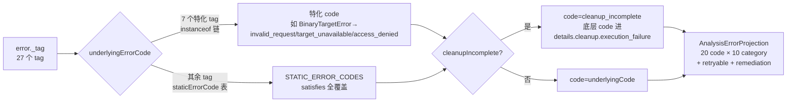

# 06 · 域层：Evidence 与错误代数

> 第四层（`src/domain/`）之证据与失败篇。本篇讲两件事：**一份事实如何被类型系统固化为 Evidence**（身份、三态、封存），以及**一次失败如何被组织成可投影、可组合的错误代数**（tag→code→category、cleanup 并存）。边界澄清：Evidence 的「传输与落盘」在 contracts/CLI 层，本篇只讲域内定义；01 篇已给出域层纯度统计（无 `node:fs`/`child_process`），本篇不重复，只在其上加深机制。

## 0 速览

1. Evidence 的 `evidence_id` 是**语义内容的 SHA-256 摘要**，不是随机号：`src/domain/evidence.ts 函数：computeEvidenceId 偏移：+1` 直接对 `evidenceSemanticContent` 取摘要；`caller_input_path`、`subject.name/local_path` 被排除在语义之外（`src/domain/evidence.ts 函数：evidenceSubjectIdentity 偏移：+4~+6` 只保留 digest/format/architecture）。
2. 观察/推导/未知三态**不是散落的字段约定，而是三个正交的类型轴**：`confidence ∈ observed|derived|inferred`（`src/domain/evidence.ts Const：evidenceBaseSchema` 内 `confidence` 枚举）、`relationship_coverage` 的 complete/partial/unknown 判别联合（`src/domain/relationshipCoverage.ts Const：relationshipCoverageSchema`）、残差未知 `ResidualUnknown` 的独立状态机（`src/domain/residualUnknown.ts`）。
3. 错误代数实际形状：**27 个 `_tag` → 20 个投影 code → 10 个 category**，映射函数是「7 个特化 tag 走 `instanceof` 链 + 其余 tag 走 `satisfies` 全覆盖表」（`src/domain/analysisErrorProjection.ts 函数：underlyingErrorCode 偏移：+28`、`函数：staticErrorCode 偏移：+11`）。
4. cleanup 失败与主失败**并存于同一个投影**：`code = cleanupIncomplete ? "cleanup_incomplete" : underlyingCode`（`src/domain/analysisErrorProjection.ts 函数：projectError 偏移：+29`），底层 code 不丢失而是进 `details.cleanup.execution_failure`；组合由 `src/domain/analysisErrorCleanup.ts 函数：analysisErrorWithCleanupFailure 偏移：+11`（`AggregateError`）构造。
5. 确定性摘要依赖一整套规范化机制：流式 SHA-256 + RFC 8785 键序（`src/domain/canonicalDigest.ts 函数：emitCanonical 偏移：+41` 用 `Object.keys(value).sort()`），数值精度用「拼写+回写双检」保（`src/domain/exactJsonNumber.ts 函数：isExactJsonNumber 偏移：+4~+7`）。
6. 预算不变量分两类：**有上限的资源**（`src/domain/analysisResourceLimits.ts` 的常量族）与**明确拒绝人为上限的工作流集合**（`src/domain/unboundedWorkflowCollections.test.ts`，无同名生产模块，测试即不变量载体，见 §6）。

## 1 选取判据：src/domain 太大，本篇覆盖什么

`src/domain/` 实测 156,964 行非测试代码（`find`+`wc -l` 口径：全部 `.ts` 排除 `*.test.ts`、`*.fixture.ts`；01 篇与任务口径引用 159,019 行，[推导] 两数差异来自邻近测试文件的取舍口径，不构成事实矛盾，本篇数字以自测为准）。目录结构为 218 个顶层非测试 `.ts` + 28 个主题子目录（`javascript/ native/ managed/ apple/ firmware/ …`；顶层 `.ts` 含测试共 322 个）。逐行读完不现实，本篇的选取判据：

- **点名簇**：任务点名的 `evidence*`、`analysisError*`、`residualUnknown`、`canonical*`、`jsonShape`、资源预算族文件，全部读。
- **闭包簇**：被上述文件的 import 图直接拉进来的小文件（`result.ts`、`digests.ts`、`relationshipCoverage.ts`、`safeJson.ts`、`immutableJson.ts`、`jsonSerialization.ts` 等），读。
- **深读规模**：本篇与 07 篇合计深读约 75 个文件，其中约 40 个自第 1 行读到末行。
- **明确未覆盖**：`javascript/`（最大子目录，`javascriptSemanticAnalysis.ts` 2380 行）、`native/`（`nativeAotPe.ts` 1844 行）、`analysisView/`、`captures/`、`pcap/`、`wasm/`、`evm/` 等 20 余个子目录只有接口级接触；各子目录属于 08~13 篇的候选主题。`[未知]` 未覆盖部分是否存在与本篇结论冲突的约定，只能靠后续篇目回补。

按上述判据聚类，`src/domain/` 的顶层主题簇与本系列的覆盖分配：

| 主题簇 | 代表文件 | 覆盖处 |
|---|---|---|
| 证据与 bundle | `evidence*.ts`、`relationshipCoverage.ts` | 本篇 §2–3 |
| 错误与投影 | `analysisError*.ts`、各 `*Error.ts` | 本篇 §4 |
| 规范化与 JSON | `canonical*.ts`、`json*.ts`、`immutableJson.ts`、`safeJson.ts` | 本篇 §5 |
| 预算与期限 | `analysisResourceLimits.ts`、`browserDeadline.ts`、`artifactExpansionBudget.ts`、`fixedAllowanceRemediation.ts` | 本篇 §6 |
| 制品身份与格式 | `artifact*.ts`、`binary*.ts`、`elf*/pe*/dos*/gamecube*`、`zipPackageFormat.ts` | 07 篇 §1–3 |
| 符号与调用图 | `symbolAnalysis.ts`、`callPath.ts` | 07 篇 §5 |
| 重建与调查记录 | `functionComparison*.ts`、`reconstructionUnknowns.ts`、`reconstructionVerification*.ts`、`reconstructionCoverage*.ts`、`reconstructionObligation*.ts`、`evidenceCompletionLedger.ts`、`completionLedgerGeneration.ts` | 23 篇 §3–6 |
| 输入契约 | `publicInput.ts`、`reverseEngineering.ts`、`absoluteAnalysisInputPaths.test.ts` | 两篇穿插 |
| JS/Electron、native/managed、captures 子目录 | `javascript/*`、`native/*`、`managed/*`、`captures/*`、`pcap/*` | 未覆盖（后续篇候选） |

## 2 Evidence 到底是什么

### 2.1 十七个字段，一条语义分界线

`evidenceBaseSchema`（`src/domain/evidence.ts Const：evidenceBaseSchema`）是一个 `z.object({...}).strict()`（该文件未用 `z.strictObject` 简写，而 `evidenceBundleSchema` 用了），字段清单固定为 17 项：`evidence_id / subject / provider / analysis_profile / predicate_type / operation / parameters / caller_input_path / raw_result / normalized_result / confidence / authority / environment / limitations / relationship_coverage / locations / evidence_links`。其中 `subject.format` 由 `Const：subjectFormatSchema`（约 30 个值的 `z.enum`）限定，`Const：evidenceLocationSchema` 的 location 只有 5 种形态（address、address-range、artifact-path、file-offset、file-offset-range）。

语义分界线写在 schema 自己身上：`caller_input_path` 的 `.describe("Verbatim direct-request path; not part of semantic identity.")`。也就是说「你用哪个路径请求的」是宿主展示事实，不是证据承诺。同一分界由 `函数：evidenceSubjectIdentity 偏移：+4~+6` 执行——subject 进摘要的部分只有 `digest`、`format`、`architecture`，`name` 与 `local_path` 被剔除。

authority 词表是域内一等枚举（`Const：evidenceAuthoritySchema`）：`shipped-artifact`（出厂工件）、`controlled-replay`（受控回放）、`historical-reference`（历史参考）、`external-service`（外部服务）、`analyst-inference`（分析者推断）。它回答「这个事实从哪个信任层来」，与 `confidence`（这个事实离观察多远）正交。

### 2.2 ID = 语义摘要：生成路径与兼容路径

`createEvidence` 的流程：先 `normalizeEvidenceObservation`（`src/domain/evidence.ts 函数：normalizeEvidenceObservation 偏移：+30` 默认 `predicate_type "rea.analysis"`、`偏移：+36` 默认 `authority "shipped-artifact"`），再 `函数：createEvidence 偏移：+13` 调 `computeEvidenceId(normalized)`。当 `target === undefined`（没有可绑定主体）时，规范化器注入一条 limitation（`函数：normalizeEvidenceObservation 偏移：+38~+41`：`subjectUnavailableReason ?? "Artifact identity is unavailable for this observation."`）——「保留部分事实与有意义的失败原因」在这里的落地是：**缺主体不丢记录，而是把缺主体的原因写进 limitations**。

两条生成路径共享同一语义核：普通路径同步取摘要（`函数：createEvidence 偏移：+13`）；协作路径 `函数：createImmutableEvidenceSteps 偏移：+5` 先要求 `isImmutableJsonSnapshot(observation.result)` 否则抛 `TypeError`，随后 `yield* canonicalJsonDigestSteps(...)` 分步计算同一个 `ev_${digest}`。

兼容细节：`函数：usesPre66NullCoverageIdentity 偏移：+6` 识别 6.6 版之前「删除 relationship_coverage 后取摘要」的旧 ID，**只用于诊断旧 bundle，绝不改写**（`src/domain/evidenceBundle.ts 函数：authenticateBundle` 一路拒绝非规范形态）。

schema 也分认证层级：`Const：evidenceSchema` 只做 base + analysis-profile/provider 一致性 refine；`Const：authenticatedEvidenceSchema` 在 parse 时**重算摘要**，不匹配即报 "Evidence semantic identifier does not match its record"，旧 pre-6.6 ID 在此处得到专属文案「re-exporting the old bundle cannot update its identity」。[推导] 设计意图明确：「ID 与内容一致」不是构造器担保，而是每个外来入口的强制关卡——`createEvidence` 的产物天然一致，外来的必须过闸。

### 2.3 不可变快照：WeakMap 与 WeakSet 两级登记

封存体系有两个登记表，不要混：`src/domain/evidence.ts Const：immutableEvidenceSnapshots`（`new WeakMap<object, Evidence>()`）登记「已封存的 Evidence 记录」；`src/domain/immutableJson.ts Const：immutableSnapshots` 是载荷层的 `new WeakSet<object>()`。零拷贝借用由 `函数：canBorrowParsedJsonSnapshot`（`src/domain/immutableJson.ts`）决定 [推导：读其函数体，语义为「parse 前后同形状才可借」]；`createEvidence` 在判定 `sharedResult || options?.immutable === true`（`src/domain/evidence.ts 函数：createEvidence 偏移：+17`）后走 `偏移：+20~+21`，`freezeOwnedJsonTreeSnapshot(evidence)` 紧接 `immutableEvidenceSnapshots.set(evidence, evidence)`——封一次，之后任何人再 parse 只能得到同一棵冻结树。

重绑路径保留封存：`函数：rebindEvidenceToTargetPath 偏移：+21` 换的是 `subject.local_path`（展示信息），而 `函数：rememberReboundEvidence`（被它调用）在 WeakMap 里把新记录指回原载体，[推导] 这样重绑不会触发对新树的重拷贝——因为被排除出语义身份的字段变了，ID 不该变。

### 2.4 inline 与 reference：bundle 里的两种可移植形态

`src/domain/evidenceReference.ts Type：EvidenceInput` 是判别联合：完整 inline Evidence，或 `{kind: "retained-evidence", evidence_id}` 的瘦引用。bundle 侧由 `src/domain/evidenceBundle.ts Const：evidenceBundleSchema` 收 7 个数组（artifacts、providers、environments、scenarios、captures、unknowns、records；`records` 的成员即这两种形态之一）；`函数：evidenceBundleForTarget` 决定哪些记录有资格进 bundle，删除依赖不满足的记录；`函数：authenticateBundle` 用 `equalJsonText(parsed, canonical)`（`src/domain/jsonSerialization.ts 函数：equalJsonText`）拒绝「语义相同但字节形态非规范」的重放。序列化用第三方 `canonicalize`（RFC 8785）：`函数：serializeEvidenceBundle 偏移：+1`。

摘要不读全量：`src/domain/evidenceRecordSummary.ts` 的 value_flow 是四态判别联合（`observed` / `unavailable` / `not-recorded` / `unknown`，且 `observed` 分支带 `omitted_operations_lower_bound` 等**下界**字段）——「我们没记全」和「记下来是空的」在类型上是两个分支。台账 `src/domain/evidenceCompletionLedger.ts` 的 `ecl_` ID 同样走 `digestCanonicalValue`（`函数：computeLedgerId 偏移：+2`）。

### 2.5 读取与落盘：Result 通道与类型化文件失败

`src/domain/evidenceValidation.ts 函数：readEvidence 偏移：+1~+2` 是 `Result<Evidence, EvidenceIntegrityError>` 通道：内部 `函数：safeParseEvidence` 解析，失败时把 `ZodError` 包成 `EvidenceIntegrityError` 返回而不抛；`函数：readImmutableEvidence` 走同一形状但要求认证过的不可变载体；`函数：readEvidencePayload` 把同一「校验后返回」模式复用给调用方 schema（07 篇的 `callPath.ts` 用它解析地址）。[推导] 通道分工：「载体不是合法 JSON」是产品内的返回值，「语义身份不匹配/非规范形态」（§2.4 `authenticateBundle` 的 `TypeError` 三兄弟）才是编程错误——前者可恢复，后者不可。

类型化文件失败在 `src/domain/evidenceErrors.ts Class：EvidenceFileError`：`operation ∈ read/write`、reason 7 值（`not-file / exists / wrong-kind / invalid-json / missing / path-limit / io`），可选 `published` 收据（写入成功时带回发布凭据）与 `contentIssues`——注释原文「Schema issues relative to the selected file's JSON root, never the request envelope」，即错误路径锚定文件根而非请求壳。`Class：EvidenceReferenceError`（继承 `EvidenceIntegrityError`）为会话内引用保留 4 值 reason（missing/wrong_operation/wrong_predicate/identity_mismatch）加 `expected/actual` 对照，供诊断而非重写（§2.2 的 pre-6.6 同族策略）。

台账把「记录即真相」做成四重互锁（`src/domain/evidenceCompletionLedger.ts 函数：ledgerIssues`）：records 按 claim_id 排序且唯一（`偏移：+22` 消息 "Completion records must be sorted by unique claim ID"）、每条 record 的 `evidence_ids` ASCII 排序唯一（`偏移：+25~+31`）、`summary` 与 `summarize(records)` 用 `JSON.stringify` 全文对拍（`偏移：+32~+38`）、`ledger_id` 重算比对（`偏移：+39~+44`）。创建侧 `函数：createEvidenceCompletionLedger 偏移：+13/+16` 对重复 claim/evidence id 直接抛 `TypeError`。[推导] summary 只是冗余视图不是真相源——对拍失败即拒绝，杜绝「先写 summary 再补记录」的漂移。

## 3 三态在类型系统的位置

三条轴之前先说底座：`src/domain/result.ts Type：Result` 是 `ok/err` tagged union（构造器 `ok`/`err` 各一行）。域内「预期内的失败」（解析、校验、预算）以 `Result<T, E>` 返回，语义违规才走 `Error` 类族（§2.5、§4）——双通道、一个汇聚点：两者最终都进 §4.2 的同一个投影。

| 轴 | 类型 | 语义 |
|---|---|---|
| 证据强度 | `confidence: observed/derived/inferred`（`Const：evidenceBaseSchema`） | 该条 Evidence 距观察几步 |
| 关系完整性 | `relationship_coverage: complete/partial/unknown`（`Const：relationshipCoverageSchema`） | 调用者/被调用者集合的枚举完整度 |
| 残差未知 | `UnknownRevision.status: open/investigating/blocked/contradicted/resolved`（`src/domain/residualUnknown.ts`） | 显式挂起的「还不知道」，可被证据推进 |

三者互相独立：一条 `observed` 的 Evidence 完全可以带着 `unknown` 的 coverage 存在；`contradicted` 状态要求 contradicting evidence（`src/domain/residualUnknown.ts 函数：refineRevision 偏移：+31~+33`），而 `resolved` 与 `resolution` 字段一一对应（`函数：refineRevision 偏移：+20~+24`）。残差未知的稳定 ID 由 `stableUnknownId(question, domain, scope_digest, …)` 重算校验（`函数：refineRevision 偏移：+1~+13`）；revision 链用 `previous_revision_digest` 锁「只有第 1 版无前驱」（`函数：refineRevision 偏移：+15~+19`）。

「verified 决议必须有资格证据」的比较逻辑是域内唯一的 rank 表：`src/domain/evidenceBundle.ts 函数：evidenceQualifies 偏移：+9` 的 `confidenceRank = { inferred: 1, derived: 2, observed: 3 }`，证据 rank 低于未知要求的 `required_confidence` 就不算数，此外还要求 authority/environment 匹配（同文件 `函数：validateResidualUnknownAddition` 与 `函数：validateUnknownGraph`）。乐观并发：`src/domain/residualUnknown.ts Const：updateUnknownInputSchema` 携带 `expected_revision` 字段，冲突抛 `src/domain/unknownRegistryError.ts Class：UnknownRegistryError`（reason 联合含 `"revision-conflict"`），投影为 `revision_conflict` code、且属于 5 个 retryable code 之一（§4.2）。

执行观察的输入形态见 `src/domain/analysisObservation.ts Type：AnalysisObservation`：`subject` 注释明确「缺省 = 由调用方绑定默认主体；显式 `null` = 无文件主体」——缺省与显式 null 是两种不同的承诺，`函数：createAnalysisExecutionEvidence` 的注释则把「成功与被取消的保留观察提交同一组事实」写成构造约束。

revise 精炼把集合级不变量焊在 schema 上（`src/domain/residualUnknown.ts 函数：refineRevision`）：三列证据 ID（supporting/contradicting/mutation）各自去重检查（`偏移：+46~+52`）；比较结论的 scope 所指 evidence 必须属于该未知的 supporting∪contradicting（`偏移：+56~+69`，消息 "Scoped comparison Evidence must support or contradict the unknown"）；带 scope 就必须 `domain === "function-comparison"`（`偏移：+70~+79`）；同一条 evidence 不能既支持又反对（`偏移：+80~+85`）；`(type, unknown_id)` 关系对唯一（`偏移：+90~+95`）。环检测不在 revision 层而在 bundle 层：`src/domain/evidenceBundle.ts 函数：validateUnknownGraph` 只对 `depends-on` 边做遍历（`偏移：+123` 处 filter），成环报 "Residual unknown dependency graph contains a cycle"（`偏移：+130`）；同函数 `偏移：+120` 的注释说明新增节点无需全图遍历、只有既有节点的 revision 才触发图检查。

## 4 错误代数：实际形状

### 4.1 27 个 tag

`src/domain/analysisErrorBase.ts Const：ANALYSIS_ERROR_TAGS` 是 27 项定长清单（Analysis 族 10 项，Provider/Browser/Artifact/Process/Evidence 族 7 项，UnknownRegistry/Configuration/NoBinaryOpen/BinaryTarget 族 4 项，Hopper 族 6 项——按源文件行序逐数得 27）。每个 `AnalysisError` 子类以 `abstract readonly _tag: AnalysisErrorTag` 判别（同文件 `Class：AnalysisError`）。`AnalysisPartialObservation` 是 37 员的具名类型联合（同文件 `Type：AnalysisPartialObservation`，成员含 `CutterBridgeDiscovery`、`WebNetworkCapture`、`FirmwarePartialObservation`、裸 `Evidence` 等），`retainPartialObservation`（同文件 `函数：retainPartialObservation 偏移：+1`，`??=` 保证首个观察不被后来的失败覆写）把它挂在错误上——「保留部分事实」在错误类型上的落点就是这个字段。

### 4.2 投影：tag → code → category



图节点全部对应源码：`src/domain/analysisErrorProjection.ts 函数：underlyingErrorCode 偏移：+18`（BinaryTargetError 三分支：`constraint === "load_selection_rejected"` → invalid_request；无 systemCode → target_unavailable；否则 access_denied）、`偏移：+28`（`return staticErrorCode(error._tag)` 兜底）；`函数：staticErrorCode 偏移：+4~+11` 对 7 个特化 tag（ArtifactOperationError、BinaryTargetError、BrowserObservationError、EvidenceFileError、ProcessCaptureError、ProviderSelectionError、UnknownRegistryError）抛 `TypeError("Unhandled specialized analysis error")`——表与 instanceof 链的分工是**编译期强制**的：`Const：STATIC_ERROR_CODES` 尾随 `as const satisfies Readonly<Record<Exclude<AnalysisErrorTag, 特化集合>, code>>`，新增 tag 不配 code 就编译不过。

`projectError` 的关键行：`src/domain/analysisErrorProjection.ts 函数：projectError 偏移：+5`（先 `resolvedAnalysisError` 剥掉已确认 cleanup 的壳）、`偏移：+29`（cleanup 覆盖 code）、`偏移：+66~+72`（`partial_observation` 进 details；已是 immutable snapshot 就不再 parse 拷贝）、`偏移：+79~+85`（retryable = 5 个静态 code ∪ CapabilityUnavailable.retryable ∪ resource_constraint 的条件式重试，`Const：RETRYABLE_CODES` 为 artifact_changed/provider_timeout/cancelled/revision_conflict/provider_unavailable）。投影终形的 code/category 清单见 `Type：AnalysisErrorProjection`（20 code、10 category，逐字抄自联合）。

`details` 的组装（同一函数 `偏移：+31~+57`）把三种因果分开装：`cleanup_report` 沿 `cleanupPrimary` 链取第一份存在的报告（`偏移：+18~+24`）；有 `diagnostics` 时同时保留主错误自己的 `provider_diagnostics`（`偏移：+38~+43`）；组合层的诊断另存为 `cleanup_history`（`偏移：+44~+46`）；cleanup 未决时 `cleanup.resources` 与 `execution_failure`（底层 code）成对写入（`偏移：+47~+57`）。[推导] 同一投影同时携带主因、次因与资源清单且互不合并，是「宁可并存不覆盖」原则在 details 层的体现。

### 4.3 cleanup 失败如何与主失败并存

组合构造函数 `analysisErrorWithCleanupFailure(primary, cleanup)`（`src/domain/analysisErrorCleanup.ts`，在 `函数：analysisErrorWithCleanupFailure 偏移：+6` 处构造一个新的 `ProviderAdapterError`）；`cleanupIncomplete:true` 不是手写的——基类构造把该标志定义为 `options?.cleanup !== undefined`（`src/domain/analysisErrorBase.ts Class：AnalysisError` 构造函数体），组合函数只要填了 `cleanup:` 字段错误就自动「未决」。

```
ProviderAdapterError { _tag:"ProviderAdapterError", cleanupIncomplete:true }
├─ cause: AggregateError([primary, cleanup])          ← +11
├─ cleanupPrimary: primary                            ← 主失败保留为「可剥壳的下层」
├─ capturedOutput: primary.capturedOutput             ← +18~+20 主失败输出原样带
├─ partialObservation: primary.partialObservation     ← +21~+23 主失败的事实原样带
├─ cleanup.resources: 两侧资源的去重并集               ← +24~+32
└─ diagnostics: { primary_error: <投影不含输出>,      ← +33~+39
                  cleanup_error: <cleanup 投影> }
```

读取侧两条互逆的剥壳函数：`src/domain/analysisErrorBase.ts 函数：resolvedAnalysisError 偏移：+1`（cleanup 已解决时穿到语义主错误）与 `函数：primaryAnalysisError`（无条件走到最底层主错误）。多依赖的延迟解决用**活引用+WeakRef 链**：`函数：bindCleanupDependencies 偏移：+14` 把组合错误以 `new WeakRef(this)` 挂到每个未决依赖上；`函数：resolveCleanup 偏移：+8~+10` 在自身全部依赖清完后置 `cleanupIncomplete=false`，然后 `reference.deref()?.resolveCleanup()` 级联唤醒——组合错误不轮询、不持有强引用，GC 回收即断开。[推导] 这保证「cleanup 状态是活的」：同一个 cleanup 错误后来被确认解决时，其上所有层 envelope 一起变 resolved，投影 code 从 `cleanup_incomplete` 还原为 underlying code。

`cleanupIncomplete` 的独立子类形态还有 `src/domain/providerCleanupError.ts Class：ProviderCleanupError`（`override cleanupIncomplete = true`——该类**永远**未决，直到显式 resolve；类注释「Provider resources could not be proven closed after bounded cleanup」）。

### 4.4 特化错误族怎么各自「说话」

- **输入**：`src/domain/analysisErrorCore.ts Class：AnalysisInputError` 携带 issues 数组；`Type：AnalysisInputIssue` 的 reason 为 6 值（`unknown_argument / missing_argument / invalid_type / out_of_range / invalid_value / invalid_format`），并允许 schema 作者的纠正指引 `message` 与生产者检查过的事实 `expected / observed / minimum / maximum`。`src/domain/inputIssueProjection.ts 函数：analysisInputErrorFromIssues` 把 zod issues 折成该形状：域内 `src/domain/callPath.ts` 的 `函数：buildCallPath`（输入信封 safeParse 失败即抛，偏移：+3）直接用它产出 `AnalysisInputError`；`absoluteAnalysisInputPaths.test.ts` 锁死的 8 个 `inspect*/decode*` schema 的相对路径拒绝（issue code `invalid_format`、path `["path"]`）在工具入口（`src/server/contractToolHandler.ts 函数：createRetainedSummaryToolHandler` 偏移：+25）同样汇入这条投影。
- **资源**：`Const：ANALYSIS_RESOURCE_KINDS` 5 值（memory/cpu/file-size/transport/capacity）；`Type：ResourceConstraintRecovery` 是互斥联合——要么自定义 `remediationAction`（`fixedAllowance?: never`），要么带 `fixedAllowance`（`remediationAction?: never`），两分支各有 `retryable?`。[推导] 类型层面禁止「固定配额错误再自拟恢复文案」，恢复话术只能来自 §6 的 fixedAllowanceRemediation。
- **注册表**：`src/domain/unknownRegistryError.ts Class：UnknownRegistryError` reason 6 值（not-found/already-exists/revision-conflict/invalid-transition/integrity/limit）。
- **选择**：`src/domain/providerSelectionError.ts Type：ProviderSelectionFailureReason` 5 值（unknown_provider/provider_unavailable/target_unsupported/ambiguous/invalid_options），每个候选的拒绝保留 `ProviderSelectionRejection`（providerId/code/reason）进 caller diagnostics——[推导] 这是「哪个 provider 为什么没被选」可复盘的类型保证。
- **Hopper**：6 个 tag 同族；`src/domain/hopperErrors.ts` 的构造函数注释原文「Argument presence matters: an explicit undefined is the caller's reason.」——显式传 `undefined` 与不传参数是两种不同的失败归因。- **展示**：用户文案与修复动作分别出自 `src/domain/analysisErrorPresentation.ts 函数：analysisErrorUserMessage` 与 `函数：analysisErrorRemediationAction`（返回给 §4.2 投影的 `remediation.action`）；`Const：INTEGRITY_POLICY_OPERATIONS` 限定提及完整性策略话术的 4 个操作（inventory_artifact/inspect_artifact/extract_artifact/analyze_javascript_application）；`Const：KNOWN_ERROR_TAGS` 配合 `函数：assertKnownAnalysisErrorTag` 拒绝未注册 tag 出现在用户面。

## 5 规范化与身份

### 5.1 为什么需要确定性 JSON 摘要

同一事实的两种键序/数值拼写若不先规范化，摘要就会漂移、`ev_`/`art_`/`ecl_` ID 全部失效。`src/domain/canonicalDigest.ts 函数：digestCanonicalValue` 用 `createHash("sha256")` 流式写：键序 `Object.keys(value).sort()`（UTF-16 code-unit 序，`偏移：+73`，与 RFC 8785 对齐）；`偏移：+16/+22` 的 8192 批处理只 flush 到 part 边界，注释明言「hashed byte stream is unchanged」；`偏移：+50~+51` 尊重 `toJSON()`；稀疏数组行为对齐第三方 `canonicalize` 库（文件头注释）。协作分步版 `src/domain/canonicalJsonDigestSteps.ts 函数：canonicalJsonDigestSteps` 走同一词序，供 `createImmutableEvidenceSteps` yield 让出事件循环。键序的另一处落点：`src/domain/unicodeCodePointOrder.ts` 的 `compositeKey` 用 `JSON.stringify` 包段，注释解释是防 `a|b` 与 `a\0|b` 类 NUL 碰撞 [推导：函数体短小，语义即「编码分隔符以保单射」]。

### 5.2 number/bigint 精度坑

`isExactJsonNumber(value, source)` 的双检：`isSafeNumber(source) && isSafeNumber(String(value))`（`src/domain/exactJsonNumber.ts 函数：isExactJsonNumber 偏移：+5~+6`）——记录的拼写和「把该 number 序列化回去的拼写」都必须无损，因此 `1e20` 与 `100000000000000000000` 同判；`!Object.is(value, -0)`（`偏移：+7`）单独拒绝 `-0`（JSON 回写会把 `-0` 变 `0`，往返不一致）。`parseExactJson` 用 reviver 拿到原生解析器保留的原始拼写做同一判定。落点：HAR/Evidence 里凡是可能被当作 ID 的数不许被静默舍入。超过 safe-integer 的量走 bigint 域（07 篇 §3.1 的 `elfDeclaredRanges`）；`Const：MAX_JSON_DEPTH`（`src/domain/jsonValue.ts`）固定 1000、注释明言「This release has no runtime override」。

### 5.3 jsonShape 的 admission 语义

`src/domain/jsonShape.ts` 的 `inferJsonShape(source, maximumBytes)` 回答的不是「结构长什么样」而是「**在本调用者剩余输出预算内，结构能可靠观察到什么程度**」：累加字节用闭包内 `reserve(bytes)`（`函数：inferJsonShape 偏移：+36`），在任何累加器对象分配**之前**按序列化字节增量预留；一旦 `requiredBytesAtLeast > maximumBytes` 即返回 `Type：JsonShapeCapacityFailure` `{kind:"capacity", maximumBytes, requiredBytesAtLeast}`（`偏移：+42` 的首个 `capacity()` 早退）。失败里 `requiredBytesAtLeast` 是「至少需要这么多」的下界——[推导] 与 evidenceRecordSummary 的 omitted 下界同一设计语法：不谎报精确值。拒绝面：`maximumBytes` 非 safe integer 直接 `RangeError`（`偏移：+4~+7`），非 UTF-8/非法 JSON 返回 `{kind:"invalid-json"}`。

### 5.4 序列化的 surrogate 安全

`src/domain/jsonSerialization.ts` 用显式栈编码（非递归，防深树爆栈），字符串转义按 surrogate pair 处理；`equalJsonText` 是「两个值规范化后是否逐字节相等」的判据，bundle 认证与测试断言共用它。

### 5.5 规范化 helper 族（全域共用的微机制）

- `src/domain/canonicalOrdering.ts 函数：uniqueSorted` 处理字符串数组的「排序+去重」；`src/domain/evidenceBundle.ts 函数：uniqueSorted`（bundle 内私有版，按 key selector 泛型化）与之并存，[推导] 因为前者只按 code-unit 排字符串。
- `src/domain/compactStringIdentity.ts 函数：compactStringIdentityKey 偏移：+3~+5`：短字符串原样保留；长度超过摘要键、或已经带 `value-sha256:` 前缀的输入改用 `value-sha256:${digest}`——前缀检查防「输入本身长得像键」的两义性。
- `src/domain/paddedBase64.ts 函数：paddedBase64ByteLength`：从带填充 Base64 拼写直接算字节数，避免为量尺寸做全量解码。
- `src/domain/safeJson.ts 函数：safeParseJson`：返回失败原因而非抛错的 JSON 入口，支持 reviver——`parseExactJson` 靠 reviver 的 `context.source` 拿到数字原始拼写（§5.2）。
- `src/domain/jsonValue.ts`：校验守卫拒绝「带访问器的数组数据属性」与「含 getter/setter 的对象」（消息 "JSON arrays require dense data properties without accessors"、"JSON objects cannot contain accessors" 为源文本），确保进入摘要域的永远是纯数据。

## 6 资源与预算

`src/domain/analysisResourceLimits.ts` 的常量组（全部 `Const：` 锚点）：`DEFAULT_ASAR_MAX_HEADER_BYTES = 16 MiB`、`MAXIMUM_ASAR_MAX_HEADER_BYTES = 256 MiB`、`MAX_PROVIDER_STARTUP_TIMEOUT_MS = 2_147_483_647`、`MAXIMUM_REGEX_MATCHING_DEADLINE_MS = 2_147_483_647`、`MINIMUM_REGEX_WORKER_HEAP_REQUEST_MIB = 7`、`CAPTURE_DECODER_SEMI_SPACE_MIB = 8`。文件头注释声明 7 MiB floor 是「measured」、8 MiB 对齐 semi-space；注释里列的 Node 版本矩阵**未在本篇复测**（[未知] 实测有效性：需按注释矩阵跑 Node 22/24 对比，本篇未执行）。`2_147_483_647`（Node timer 32-bit 上限）在 `analysisResourceLimits.ts` 两处、`src/domain/browserDeadline.ts Const：MAX_BROWSER_DEADLINE_MS` 与 `src/domain/reverseEngineering.ts Const：MAX_REVERSE_COMMAND_TIMEOUT_MS`（注释「Node timer ceiling. Larger deadlines would be clamped instead of honored」）共四处重现，[推导] 意图是让「可配置超时」永远不可能触发 Node 的静默钳制。`Const：COMMAND_TIMEOUT_OPERATIONS` 列出 9 个可选 CDP 命令超时的操作。deadline 话术族同在 `browserDeadline.ts`：`Const：browserDeadlineRetry` 的措辞「Applies on the next call. Allow execution, cleanup and delivery headroom…」把重试建议绑上 cleanup 余量；`函数：noRuntimeOverrideSentence 偏移：+4~+9` 组装「This release has no runtime override. X does not raise it.」句式，专用于「兄弟设置抬不高这个配额」的场景；`函数：cdpCleanupGraceExpired` 给出清理宽限期耗尽的固定文案。

`src/domain/artifactExpansionBudget.ts` 的展开预算：`Const：ARTIFACT_EXPANSION_RATIO = 500`、`Const：MINIMUM_ARTIFACT_EXPANDED_BYTES = 256 MiB`（注释明言沿用 ZIP 政策「256 MiB floor、500× 编码体积」），`函数：artifactExpansionBudgetBytes` 据此计算本档案的最大明文字节；文件头注释还写明「每个可读逻辑 occurrence 都计费、含重复物理范围」与「不给单个成员固定配额」，safe-integer 上限保住 JSON number 记账的精确性。`src/domain/fixedAllowanceRemediation.ts Type：FixedAllowanceKind` 8 值（parser/count/bytes/report/input/capture/live/work），配套 `Const：unchangedRequest` = `"Repeating the unchanged request fails the same way."`——固定配额的恢复建议是**改请求，不是重试**，与 `RETRYABLE_CODES`（§4.2）互斥，重试语义由错误的 `retryable` 字段单独承载；同文件 `函数：fixedAllowanceOptions` / `函数：fixedProducerInputAllowance` 把该文案组装进错误 options。

最尖锐的不变量在测试里：`src/domain/unboundedWorkflowCollections.test.ts` **没有同名生产模块**（`find src/domain -name 'unboundedWorkflowCollections.ts'` 为空），它锁的是「工作流集合无人为上限」：单条 bundle 接受 101 个 supporting/contradicting evidence、101 条 relationships、21 个 probes、501 条 >500 字符的 mappings、101+101 comparisons、501 correlations、20101 个 evidence_links。[推导] 这些 >100/>500 的规模若命中任何生产 slice 上限，测试会当场失败——上限必须留在 provider/应用层，不许渗进域。两个仅以测试存在的不变量文件（此篇与 07 篇 `absoluteAnalysisInputPaths.test.ts`）说明同一事实：**域层部分契约只有测试这一个载体**。[未知] 生产侧谁消费「无上限」保证（哪些 workflow 真的会超 100），当前源码无法确定；查证方向是 `src/application/` 对 `evidenceBundle` 规模的引用。

## 边界与失败模式

- **静默漂移防线**：手工规范化漂移曾经发生过——`src/domain/digests.ts` 头注释记录这些摘要/ID 形状「曾被手抄为约 30 个模块里的正则副本（32 个本地 `digestSchema` 定义加约三十个前缀哈希字面量），没有任何机制让它们同步」，现收敛为单一所有者。失败模式：新增摘要字段忘了进 `evidenceSemanticContent` → ID 不随该字段变，[推导] 同 ID 不同事实；防线是 `authenticateBundle`/`equalJsonText` 在 bundle 层拒非规范形态。
- **借用越界**：`canBorrowParsedJsonSnapshot` 只允许「parse 前后同形状」的快照借用；若上游把可变树冒充快照，`createImmutableEvidenceSteps` 的 `TypeError`（`偏移：+5`）立即终止。
- **cleanup 级联断裂**：`WeakRef` 链意味着组合错误若先被 GC，其依赖解决时不再唤醒它——这正是「活引用」语义：没人看这条错误时不需要正确性。反过来，只要还有人持有，状态必然最终一致（`函数：resolveCleanup 偏移：+9~+10`）。
- **`-0` 与溢出拼写**：凡进摘要的 number 都被 `isExactJsonNumber` 双检拦下；绕过它（直接构造 JS number 不经 parse）的 `-0` 会被拒绝而不是被舍入。
- **特化 tag 漏配 instanceof**：新增 7 特化 tag 之一而忘了在 `underlyingErrorCode` 加分支 → `staticErrorCode` 的 `TypeError` 在第一次投影时即爆，属响亮失败。
- **旧 ID 诱饵**：`usesPre66NullCoverageIdentity` 只诊断不改写；试图「顺手升级」旧 bundle 的 code 会撞上 `authenticateBundle` 的规范文本校验。
- **台账漂移**：`ledger_id`、`summary`、`records` 三处互锁（`src/domain/evidenceCompletionLedger.ts 函数：ledgerIssues 偏移：+4~+25`），对不上时 schema 直接拒绝而非修正。
- **零预算 JSON shape**：`inferJsonShape` 只拒非 safe-integer 与负数，`maximumBytes = 0` 合法并立刻命中 `capacity()` 早退（`src/domain/jsonShape.ts 函数：inferJsonShape 偏移：+42`），[推导] 调用方靠 `kind: "capacity" | "invalid-json"` 区分「预算太小」与「数据不合法」，不会把预算问题误报成格式问题。
- **代理对踩 regex**：`src/domain/reverseEngineering.ts` 的 objdump symbol 字段先用 `regex(/^[^\x00]*$/u)`，再单独 `refine`「不含 surrogate」，注释原文「Keep UTF-16 checks out of patterns consumed by scalar Unicode engines」[推导]——`u` 标志 regex 在标量引擎上会直接抛，这类检查只能放 refine，不能并进主 pattern。

## 问题清单

- **P1** `ANALYSIS_ERROR_TAGS` 27 项中 Hopper 族占 6 项，投影后全部收敛到 4 个 code；tag 细分的价值在 presentation 层（`src/domain/analysisErrorPresentation.ts Const：KNOWN_ERROR_TAGS` 及其后的 `assertKnownAnalysisErrorTag` 断言）——若未来 tag 继续膨胀，satisfies 表与 instanceof 链的双轨维护成本会先显形。待拍板：tag→code 表是否生成化。
- **P2** `confidenceRank`（`src/domain/evidenceBundle.ts 函数：evidenceQualifies 偏移：+9`）的 rank 相邻即允许覆盖；`inferred` 决议 `inferred` 未知是否过松，域内无更多约束。`[未知]` 是否有业务规则要求「同 rank 不可互相验证」，需问作者或查 `docs/` 规范文档。
- **P2** `AnalysisPartialObservation` 的 37 员没有集中 kind 注册表，新增成员的评审面散在各 provider。
- **P3** `evidenceRecordSummary` 的 `omitted_*` 下界在 UI 如何呈现「下界」语义，属 contracts/CLI 篇（第三层）主题。
- **P3** `reverseCommandTimeoutSchema` 的 describe 声明「preflight 的 stat+digest 共享一份预算，one-shot command 再次获得同一预算（default 120000 each）」——预算复用只写在文案字符串，类型层不强制；调用方若理解成总预算会把墙钟低估一半。`[未知]` 上层是否有总预算守卫，本篇在 `src/domain/` 内未见。

## 已知缺口

- 未覆盖：`javascript/`、`native/`、`managed/` 等 20+ 子目录的内部规范化约定（它们复用本篇机制的具体证据链未读，不臆测）。
- `analysisResourceLimits.ts` 注释中的 Node 版本矩阵未复测（风险 vs 特性：注释本身是文档化的**特性**，复测属读者可选动作）。
- `unboundedWorkflowCollections` 无生产模块是**特性**（不变量由测试承载）还是**待补的缺口**，源码未回答；本篇按现状记录。

## 源码索引

```
src/domain/evidence.ts:computeEvidenceId:304
src/domain/evidence.ts:evidenceSemanticContent:283
src/domain/evidence.ts:evidenceSubjectIdentity:273
src/domain/evidence.ts:usesPre66NullCoverageIdentity:308
src/domain/evidence.ts:createEvidence:417
src/domain/evidence.ts:createImmutableEvidenceSteps:444
src/domain/evidence.ts:authenticatedEvidenceSchema:190
src/domain/evidence.ts:normalizeEvidenceObservation:470
src/domain/evidence.ts:rebindEvidenceToTargetPath:340
src/domain/evidence.ts:immutableEvidenceSnapshots:210
src/domain/evidenceBundle.ts:evidenceBundleSchema:46
src/domain/evidenceBundle.ts:authenticateBundle:345
src/domain/evidenceBundle.ts:evidenceBundleForTarget:164
src/domain/evidenceBundle.ts:validateResidualUnknownAddition:472
src/domain/evidenceBundle.ts:evidenceQualifies:543
src/domain/evidenceBundle.ts:serializeEvidenceBundle:630
src/domain/evidenceReference.ts:retainedEvidenceReferenceSchema:5
src/domain/evidenceRecordSummary.ts:value_flow(内联联合):38
src/domain/evidenceCompletionLedger.ts:createEvidenceCompletionLedger:126
src/domain/evidenceCompletionLedger.ts:ledgerIssues:84
src/domain/evidenceCompletionLedger.ts:computeLedgerId:80
src/domain/relationshipCoverage.ts:relationshipCoverageSchema:29
src/domain/result.ts:Result:2
src/domain/reverseEngineering.ts:MAX_REVERSE_COMMAND_TIMEOUT_MS:8
src/domain/reverseEngineering.ts:reverseCommandTimeoutSchema:11
src/domain/analysisObservation.ts:createAnalysisExecutionEvidence:33
src/domain/residualUnknown.ts:refineRevision:128
src/domain/unknownRegistryError.ts:reason(联合):11
src/domain/analysisErrorBase.ts:ANALYSIS_ERROR_TAGS:5
src/domain/analysisErrorBase.ts:AnalysisError:73
src/domain/analysisErrorBase.ts:AnalysisPartialObservation:298
src/domain/analysisErrorBase.ts:bindCleanupDependencies:191
src/domain/analysisErrorBase.ts:resolveCleanup:213
src/domain/analysisErrorBase.ts:retainPartialObservation:229
src/domain/analysisErrorBase.ts:resolvedAnalysisError:236
src/domain/analysisErrorBase.ts:primaryAnalysisError:243
src/domain/analysisErrorCore.ts:ANALYSIS_RESOURCE_KINDS:25
src/domain/analysisErrorCore.ts:ResourceConstraintRecovery:90
src/domain/analysisErrorCore.ts:AnalysisInputIssue:129
src/domain/analysisErrorProjection.ts:projectError:62
src/domain/analysisErrorProjection.ts:underlyingErrorCode:173
src/domain/analysisErrorProjection.ts:STATIC_ERROR_CODES:272
src/domain/analysisErrorProjection.ts:staticErrorCode:300
src/domain/analysisErrorProjection.ts:RETRYABLE_CODES:635
src/domain/analysisErrorProjection.ts:AnalysisErrorProjection:643
src/domain/analysisErrorCleanup.ts:analysisErrorWithCleanupFailure:9
src/domain/providerCleanupError.ts:ProviderCleanupError:6
src/domain/canonicalDigest.ts:digestCanonicalValue:9
src/domain/canonicalJsonDigestSteps.ts:canonicalJsonDigestSteps:23
src/domain/exactJsonNumber.ts:isExactJsonNumber:10
src/domain/jsonShape.ts:inferJsonShape:75
src/domain/jsonValue.ts:MAX_JSON_DEPTH:6
src/domain/jsonSerialization.ts:equalJsonText:46
src/domain/immutableJson.ts:canBorrowParsedJsonSnapshot:44
src/domain/immutableJson.ts:freezeOwnedJsonTreeSnapshot:148
src/domain/evidenceValidation.ts:safeParseEvidence:9
src/domain/evidenceValidation.ts:readEvidence:20
src/domain/evidenceValidation.ts:readEvidencePayload:48
src/domain/evidenceErrors.ts:EvidenceReferenceError:31
src/domain/evidenceErrors.ts:EvidenceFileError:47
src/domain/evidenceBundle.ts:validateUnknownGraph:384
src/domain/evidenceBundle.ts:uniqueSorted:637
src/domain/residualUnknown.ts:stableUnknownId:22
src/domain/residualUnknown.ts:recordUnknownInputSchema:243
src/domain/residualUnknown.ts:updateUnknownInputSchema:265
src/domain/analysisErrorPresentation.ts:INTEGRITY_POLICY_OPERATIONS:473
src/domain/analysisErrorPresentation.ts:analysisErrorUserMessage:290
src/domain/analysisErrorPresentation.ts:KNOWN_ERROR_TAGS:543
src/domain/analysisErrorPresentation.ts:assertKnownAnalysisErrorTag:573
src/domain/inputIssueProjection.ts:analysisInputErrorFromIssues:8
src/domain/providerSelectionError.ts:ProviderSelectionFailureReason:9
src/domain/unknownRegistryError.ts:UnknownRegistryError:4
src/domain/compactStringIdentity.ts:compactStringIdentityKey:4
src/domain/canonicalOrdering.ts:uniqueSorted:4
src/domain/safeJson.ts:safeParseJson:7
src/domain/paddedBase64.ts:paddedBase64ByteLength:4
src/domain/jsonValue.ts:(accessor 守卫):125
src/domain/artifactExpansionBudget.ts:artifactExpansionBudgetBytes:16
src/domain/fixedAllowanceRemediation.ts:fixedAllowanceOptions:50
src/domain/browserDeadline.ts:MAX_BROWSER_DEADLINE_MS:6
src/domain/analysisResourceLimits.ts:MAX_PROVIDER_STARTUP_TIMEOUT_MS:38
src/domain/analysisResourceLimits.ts:CAPTURE_DECODER_SEMI_SPACE_MIB:90
src/domain/browserDeadline.ts:COMMAND_TIMEOUT_OPERATIONS:70
src/domain/fixedAllowanceRemediation.ts:FixedAllowanceKind:5
src/domain/unboundedWorkflowCollections.test.ts:(顶层用例):27
src/domain/digests.ts:(Module 头注释):1
```

## 相关篇

- 上游：01 系统骨架（域层纯度统计）；04/05（contracts/CLI 如何消费投影）。
- 平行：07 域层·制品身份与格式声明（`art_/occ_/agm_` ID 代数与本篇 §5 的摘要机制共用同一规范化核）。
- 下游：provider 篇族（08~）看 `AnalysisPartialObservation` 各 kind 的生产者；`src/domain/` 子目录主题篇待立。
