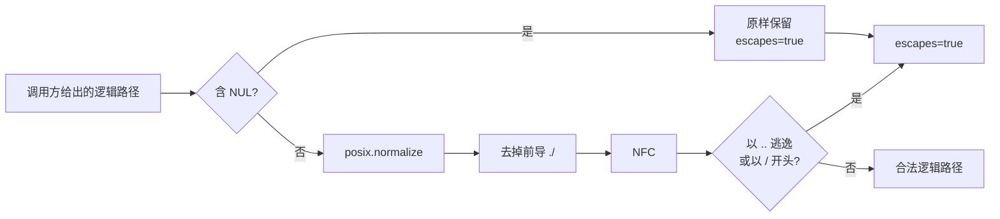
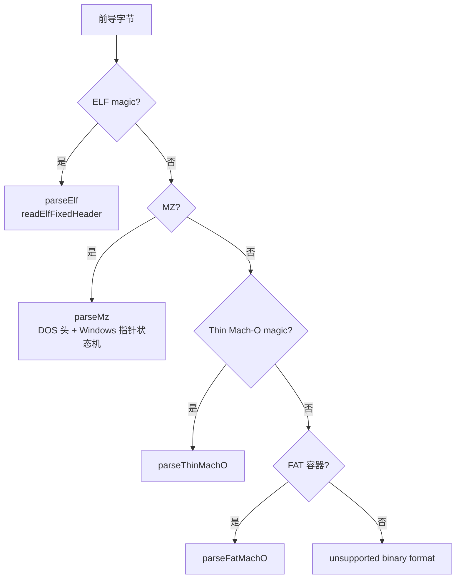

# 07 · 域层：制品身份与格式声明

> 第四层（`src/domain/`）之制品篇。06 篇讲「一条事实如何成为 Evidence」，本篇讲「一个制品如何被命名、被遍历、被声明格式、被判定完整性」，以及这些声明如何从字节走到可执行的二进制头。核心分界只有一句：**身份（identity）、位置（occurrence）、关系（edge）、声明（claim）是四类不同的事实，任何一层都不许代替另一层说话**。本篇不启动任何引擎、不执行目标文件；所有结论都来自纯函数与 `Result` 通道。

## 0 速览

1. 制品有五族稳定 ID，全部由 `digestCanonicalValue` 计算：内容 `art_`、出现位置 `occ_`、关系 `edge_`、图承诺 `agm_`、完整性矛盾 `ic_`（`src/domain/artifactIdentity.ts 函数：artifactIdForContent 偏移：+0`、`函数：occurrenceIdForLocation 偏移：+0`、`函数：artifactEdgeId 偏移：+0`、`函数：artifactManifestId 偏移：+0`、`函数：artifactContradictionId 偏移：+0`）。
2. 逻辑路径先做 NFC，再做词法归一；根是 `"."`。逃逸判定把 NUL、`..`、`../` 与前导 `/` 单独建模，而不是悄悄修正（`src/domain/artifactIdentity.ts 函数：normalizeJoinedLogicalPath 偏移：+0`、`函数：logicalPathEscapesRoot 偏移：+0`）。
3. 图由三类成员组成：`ArtifactNode`（内容身份）、`ArtifactOccurrence`（位置事实）、`ArtifactEdge`（7 种关系）。格式词表约 30 项，但「可从字节证明」的内容格式只有 11 项（`src/domain/artifactGraph.ts Const：artifactNodeSchema`、`Const：artifactOccurrenceSchema`、`Const：artifactEdgeSchema`、`Const：artifactContentFormatSchema`）。
4. 声明完整性（sha256/md5 claim）与观测字节摘要**从不合并**；矛盾记录固定携带 `trust: "observed-untrusted"` 与 `provenance: "container-integrity-metadata-versus-observed-bytes"`（`src/domain/artifactIntegrity.ts Const：artifactIntegrityClaimSchema`；`src/domain/artifactGraph.ts Const：integrityContradictionSchema`）。
5. `inventory_artifact` 只做遍历；`inspect_artifact` 把遍历结果投影成「观察 + 低置信假设 + 下一步探针 + 未探索分支」，并明确标注分类不是语义证明（`src/domain/artifactInspection.ts 函数：createArtifactInspection 偏移：+0`）。
6. 二进制格式声明各有一个 owner：ELF 固定头、PE 可选头与 COFF machine、DOS MZ 的 Windows 指针状态机、无头 raw 的调用方声明、ZIP 尾部 EOCD 定位。读取字节的入口统一在 `binaryTarget` 的 dispatcher（`src/domain/binaryTarget.ts 函数：parseExecutableHeader 偏移：+0`）。
7. 展开预算沿用 ZIP 政策：500 倍编码体积、256 MiB 下限、safe-integer 上限（`src/domain/artifactExpansionBudget.ts Const：ARTIFACT_EXPANSION_RATIO`、`Const：MINIMUM_ARTIFACT_EXPANDED_BYTES`）。
8. 清单 Evidence 可以分页；合并时要求同一 manifest/coverage/矛盾集，逐成员「同 ID 必须同内容」，合并完整后**重算图摘要与 manifest ID**（`src/domain/artifactInventoryEvidence.ts 函数：assembleInventoryResults 偏移：+0`、`函数：validateCompleteInventory 偏移：+0`）。

## 1 覆盖判据与本篇边界

`src/domain/` 的制品相关文件远多于一篇能逐行读完的规模。本篇按「身份 → 图 → 检查 → 格式头」的调用闭包选取：

| 层次 | 文件 | 本篇处理 |
|---|---|---|
| 身份代数 | `artifactIdentity.ts` | 逐函数读 |
| 图与清单 schema | `artifactGraph.ts`、`artifactIntegrity.ts`、`artifactIntegrityPolicy.ts`、`artifactFormatMetadata.ts` | 逐字段读 |
| 检查投影 | `artifactInspection.ts`、`artifactInventoryEvidence.ts` | 逐函数读主路径 |
| 二进制格式 | `binaryTarget.ts`、`elfFixedHeader.ts`、`peOptionalHeader.ts`、`peMachine.ts`、`dosMz.ts`、`dosCom.ts`、`rawBinary.ts`、`zipPackageFormat.ts` | 逐函数读 |
| 符号与调用路径 | `symbolAnalysis.ts`、`callPath.ts` | 逐函数读 |
| 预算 | `artifactExpansionBudget.ts` | 逐行读 |
| 未覆盖 | `artifactComparison.ts`（683 行）、`artifactPathSyntax.ts`、`artifactOperationError.ts`、`artifactPartialObservation.ts`、`artifactInventorySnapshot.ts` | 只在相关处点名，不臆测 |

Machine-O 的 FAT 细节、Mach-O 各 load command 的语义、DOL/GameCube 头属于 `binaryTarget.ts` 的相邻函数与 17 篇的 provider 主题，本篇只在 dispatcher 处交代边界。

## 2 身份代数：内容、位置、关系

### 2.1 逻辑路径只有两种状态



`normalizeJoinedLogicalPath` 的注释写明 `"."` 是归档根；NUL 直接返回原值，交给 `logicalPathEscapesRoot` 判定，而不是在归一化里静默丢弃。后者只认四种逃逸形态：含 NUL、等于 `..`、以 `../` 开头、以 `/` 开头。这样「调用方给了一个坏路径」与「这个路径指向别处」是两个可报告的事实（`src/domain/artifactIdentity.ts 函数：logicalPathNfc 偏移：+0`）。

### 2.2 五族 ID 的输入各不相同

| 前缀 | 函数 | 摘要输入 | 回答的问题 |
|---|---|---|---|
| `art_` | `artifactIdForContent` | `{sha256}` | 这是哪份字节内容 |
| `occ_` | `occurrenceIdForLocation` | 根、逻辑路径、entry_kind、（可选）重复序号 | 这份内容出现在哪个父容器的哪个位置 |
| `edge_` | `artifactEdgeId` | 父内容、子内容、关系、occurrence、逻辑路径 | 父子之间以什么关系相连 |
| `agm_` | `artifactManifestId` | 根内容、图摘要 | 这一整张图被哪一个承诺固定 |
| `ic_` | `artifactContradictionId` | 根、逻辑路径、声明/观测摘要对 | 哪一处声明与字节冲突 |

`occurrenceIdForLocation` 有一个必须点名的特例：根 occurrence（`logicalPath === "."`）的摘要只含 `{root: rootArtifactId}`，不含 entry_kind 与 duplicate ordinal（`src/domain/artifactIdentity.ts 函数：occurrenceIdForLocation 偏移：+5`）。[推导] 因为根在定义上只有一个，位置信息没有区分力；把 entry_kind 放进根 ID 会让同一根在不同遍历器下产生不同身份。

内容 ID 与位置 ID 的分离带来一个直接结论：同一份字节被两个路径引用时，`art_` 相同而 `occ_` 不同；反之，两个不同字节出现在同一路径时，`occ_` 相同而 `art_` 不同。`validateOccurrence` 与 `validateEdge` 在读取侧重算这两族 ID（`src/domain/artifactInventoryEvidence.ts 函数：validateEdge 偏移：+0`）。

### 2.3 图摘要是「成员 + 顺序」的承诺

`artifactGraphDigest` 的输入是四个数组，且**不排序**：注释原文「Commit to graph members in the ordering established by the inventory owner」（`src/domain/artifactIdentity.ts 函数：artifactGraphDigest 偏移：+0`）。排序发生在读取侧的 `orderedInventory`：节点按 `artifact_id`、边按 `edge_id`、occurrence 先按逻辑路径再按重复序号（`src/domain/artifactInventoryEvidence.ts 函数：orderedInventory 偏移：+0`）。[推导] 这是「生产者拥有顺序」与「消费者可重放顺序」的分工：摘要在生产顺序上封存，校验时用同一套确定性排序还原，二者不一致就失败。

## 3 图、清单与检查

### 3.1 三类成员各记什么

`ArtifactNode` 只记内容：`format`（11 项内容格式）、`sha256`、`size`、`media_type`、`architecture`、`content_state ∈ materialized|embedded|virtual`、`limitations`。

`ArtifactOccurrence` 只记位置与声明：`logical_path`、`entry_kind ∈ file|directory|symlink|slice|metadata`、`artifact_kind`（13 类）、`artifact_format`（约 30 项）、`declared_size`/`compressed_size`、`executable`/`encrypted`、`unpacked`（只允许字面 `true`）、`hash_status ∈ verified|mismatched|not-hashed|unavailable`、`source_location`（字节区间）、`source_path`、`declared_integrity`、`format_metadata`、`limitations`。两处 `exactOptional` 是刻意的：`source_path` 注释说「including an observed empty key」——观测到空键与没有观测到该字段不是一回事（`src/domain/artifactGraph.ts Const：artifactOccurrenceSchema`）。

`ArtifactEdge` 记关系：`contains`、`extracts`、`slice-of`、`embeds`、`loads`、`maps-source`、`derived-from`；可选 `producer` 是外部命令来源，含 `tool/arguments/tool_version/executable_sha256/exit_code/effects ∈ read|write|mount`。`ordinal` 只用于稳定排序，不参与 `edge_` 身份。

13 类 `artifact_kind` 与 30 项 `artifact_format` 的差别值得单独记：`kind` 回答「它在应用中扮演什么角色」（container/executable/dynamic-library/framework/native-addon/javascript/source-map/plist/entitlements/resource/universal-slice/package-metadata/unknown），`format` 回答「字节或目录树说明它是什么」。`artifactContentFormatSchema` 再从 format 中抽出能被内容直接证明的 11 项，`ArtifactNode.format` 只接受这 11 项——[推导] 于是「apk 是 ZIP 容器」这类路径角色判断不能污染内容身份（`src/domain/artifactGraph.ts Const：artifactKindSchema`、`Const：artifactFormatSchema`）。

清单本身由 `artifactInventoryResultSchema`（manifest + 四个成员数组 + provenance + 矛盾 + coverage + limitations）与 `artifactExtractionResultSchema`（额外含提取清单、输出根、containment、cleanup）表达。提取清单的 `output_root_alias` 固定为字面 `"$OUTPUT_ROOT"`——路径无关的承诺，输出根变化不改变提取身份（`src/domain/artifactGraph.ts Const：artifactExtractionResultSchema`）。

### 3.2 声明完整性 vs 观测字节

`artifactIntegrityClaimSchema` 是 `algorithm` 判别联合：sha256 或 md5。两个「摘要对」的字段形状不对称：SHA-256 对是 `declared_sha256/observed_sha256`，MD5 对额外带 `algorithm: "md5"`。注释解释这是为了「Keep existing SHA-256 Evidence and its identities unchanged」——历史身份不能因为新增算法而漂移（`src/domain/artifactIntegrity.ts Const：artifactIntegrityClaimSchema`）。

`artifactIntegrityPairOf` 只从一对里挑摘要字段，丢掉任何外来字段；`artifactIntegrityDetails` 在内部用 camelCase，`projectArtifactIntegrityDetails` 再投影成 snake_case。这段「同名不同形」的转换不是装饰：内部错误载体沿用旧字段名，外部 JSON 必须保持稳定（`src/domain/artifactIntegrity.ts 函数：artifactIntegrityPairOf 偏移：+0`、`函数：projectArtifactIntegrityDetails 偏移：+0`）。

矛盾记录不是「一个错误」，而是一条**受污染的观察**：`trust` 只能是 `observed-untrusted`，`provenance` 只能是 `container-integrity-metadata-versus-observed-bytes`，`limitations` 至少一条。schema 用 `integrityContradictionBaseSchema` 与 sha256/md5 两个 pair shape 做联合，因此矛盾一定带齐「声明值 + 观测值」（`src/domain/artifactGraph.ts Const：integrityContradictionSchema`）。

调用方对矛盾的处理是显式策略：`fail`（默认）拒绝操作；`record-and-continue` 把观测字节保留为明确不可信的 Evidence，并逐条报告（`src/domain/artifactIntegrityPolicy.ts Const：artifactIntegrityPolicySchema`）。

### 3.3 从清单到检查报告

`createArtifactInspection` 的输入必须是 `inventory_artifact` Evidence；它先 `parseEvidence` 再按 `artifactInventoryResultSchema` 解析，然后依次生成观察、假设、探针、未探索分支（`src/domain/artifactInspection.ts 函数：createArtifactInspection 偏移：+0`）。

- **观察**：根 manifest 一条 + 每条完整性矛盾一条。注释明确「Artifact, occurrence, and edge records stay in the nested inventory Evidence」——检查报告不重复整张图（`函数：allObservations 偏移：+0`）。
- **假设**：只有两种格式产生低置信假设——PE（「可能含 managed CLI 元数据或原生代码，字节本身不能区分」）与 asar/javascript-bundle（「可能含可恢复的 JavaScript 应用图」）。每条假设都带 limitation「Format classification proposes a bounded follow-up; it is not semantic proof.」
- **探针**：按根格式分派（`函数：probesForFormat 偏移：+0`）：

| 根格式 | 下一步操作 | authority |
|---|---|---|
| asar / javascript-bundle | `analyze_javascript_application` | `ast-static-analysis` |
| pe | `inspect_managed_artifact`，再 `open_binary` | `managed-static-analysis`、`native-analysis-provider` |
| mach-o / mach-o-universal / elf | `open_binary` | `native-analysis-provider` |
| plist | `inspect_plist` | `artifact-bytes` |
| node-sea | 仅当存在「main-script 且路径是 JS 源」的条目时给 `analyze_javascript_application` | `ast-static-analysis` |
| directory | 按成员格式聚合（固定顺序 `asar/js/mach-o-universal/mach-o/elf/pe/plist`），同 operation 只保留第一条 rational | 同成员格式 |

`node-sea` 的特例值得注意：JavaScript 分析器按源文件后缀选文件，若 SEA 主脚本名叫 `main`（无后缀），后续分析器根本读不到它，所以这里宁可**不给探针**（`函数：probesFor 偏移：+0`）。`directoryProbes` 还单独过滤了「符号链接的 JavaScript 条目」：JS 采集不跟随符号链接，但 plist 检查会跟随可读链接——不同探针有各自的适用规则（`函数：directoryProbes 偏移：+0`）。

- **未探索分支**：每个探针生成一条 `format-specific-analysis-required`；根格式为 `unknown` 时再加一条 `unknown-format`。分支 ID 是 `aib_` 语义摘要（`函数：allUnexploredBranches 偏移：+0`）。
- **覆盖**：有省略即 `truncated`；inventory coverage 不是 complete 即 `partial`；否则 `complete-within-substeps`（`函数：inspectionCoverage 偏移：+0`）。这个三态刻意不把「子步骤完成」说成「整体完整」。
- **限制**：在 inventory 的 limitations 之后追加一句固定文本，声明检查只推导有界静态假设与下一步探针，不执行制品、不主张格式语义。

报告 ID 是 `ai_`，子步骤 `ais_`，观察 `aio_`，假设 `aih_`，矛盾 `aic_`。`artifactInspectionSources` 只选出每个子步骤的 Evidence，并用不可变快照成员校验所有权；`readArtifactInspectionSources` 面向未知输入，解析后再决定能否零拷贝借用（`src/domain/artifactInspection.ts 函数：artifactInspectionSources 偏移：+0`）。

### 3.4 分页合并与重校验

`parseArtifactInventoryEvidence` 接受单个载体或数组；每个载体先过 `readEvidence`，再按 `inventory_artifact` 或 `inspect_artifact` 解析出清单页。校验失败被统一包成 `EvidenceIntegrityError`；组装失败在多页场景下包成 `ArtifactInventoryCarrierError`（`src/domain/artifactInventoryEvidence.ts 函数：parseArtifactInventoryEvidence 偏移：+0`）。

`assembleInventoryResults` 的合并规则是「**同 ID 必须同内容**」：`mergeExact` 对重复 ID 用 `canonicalJson` 对拍，不同即拒绝；所有页必须共享同一 manifest、同一 coverage、同一矛盾集。合并后 `complete` 只是「成员数与 manifest 计数相等」；只有 complete 才进入 `validateCompleteInventory`，未完整的清单保留为可继续合并的部分事实（`src/domain/artifactInventoryEvidence.ts 函数：assembleInventoryResults 偏移：+0`）。

完整校验做五件事：根节点摘要等于 manifest、根 occurrence 指向同一制品与格式、每个 occurrence/edge 的 ID 可重算、每条矛盾的 ID 可重算、图摘要与 manifest ID 可重算（`函数：validateCompleteInventory 偏移：+0`）。`hasCompleteInventoryCoverage` 额外要求 coverage 的 scope 与 status 都满足调用方要求——「图完整」与「遍历覆盖完整」是两个问题（`函数：hasCompleteInventoryCoverage 偏移：+0`）。

### 3.5 展开预算

`artifactExpansionBudgetBytes` 返回 `max(256 MiB, min(MAX_SAFE_INTEGER, archiveBytes × 500))`。文件头注释写明三条政策：按每个可读逻辑 occurrence 计费（含重复物理范围）、不给单成员固定配额、safe-integer 上限保住 JSON number 记账的精确性；PCK 调用方用实际 pack span，排除嵌入的可执行载体（`src/domain/artifactExpansionBudget.ts 函数：artifactExpansionBudgetBytes 偏移：+0`）。

## 4 二进制格式声明

### 4.1 一个 dispatcher，四类头



`claimsExecutableHeader` 只回答「这些前导字节是否属于本函数会解释的头族」，即使头本身无效也算；`parseExecutableHeader` 再按 magic 分派（`src/domain/binaryTarget.ts 函数：claimsExecutableHeader 偏移：+0`、`函数：parseExecutableHeader 偏移：+0`）。FAT 的宿主切片选择使用调用方传入的 `hostArchitecture`；`readFatArchitectureFamilies` 则只读声明、不选切片，因此能证明「这张表不含宿主」而不必先选一个切片（`函数：readFatArchitectureFamilies 偏移：+0`）。

### 4.2 ELF：固定头只承诺固定字段

`readElfFixedHeader` 校验 magic、class（32/64）、字节序、identification version，再按 class 要求最小 52/64 字节。`e_version` 必须是 1，唯一例外是 NVIDIA CUBIN：`e_machine = 190` 且 OSABI 字节为 `0x33`。`e_ehsize` 必须落在 `[minimumSize, totalBytes]` 内——注意上界是**文件总长**，不是本次前缀长度，因此有界前缀也能校验声明范围（`src/domain/elfFixedHeader.ts 函数：readElfFixedHeader 偏移：+0`）。

`elfArchitecture` 只映射能命名的 CPU 族：x86、x86_64、mips、powerpc、arm、hexagon、arm64、riscv。`arm64_32` 被类型系统排除（它是 Mach-O 专属 CPU 类型）。MIPS/RISC-V/PowerPC 的 `e_flags`、字节序、ABI 仍作为独立事实保留，不在这里折叠成「一个架构结论」（`函数：elfArchitecture 偏移：+0`）。`parseElf` 对这三族额外保留 `type/flags`，对 hexagon 只给架构（`src/domain/binaryTarget.ts 函数：parseElf 偏移：+0`）。

### 4.3 PE：machine、可选头与 managed 声明

PE 的读取分两层。`readPeOptionalHeaderStructure` 只解结构：PE32/PE32+ magic、`directoryOffset`（96/112）、目录计数上界、`sizeOfHeaders`（偏移 60）、每条 data directory 的 `{address,size,offset}`。它明确不承认 machine、文件范围或目录地址（`src/domain/peOptionalHeader.ts 函数：readPeOptionalHeaderStructure 偏移：+0`）。

`decodePeMachine` 先做直接映射（0x014c/0x8664/0x01c0/0x01c2/0x01c4/0xaa64），再尝试 ReadyToRun 的 OS override：COFF machine 与 `NATIVE_OS_OVERRIDES` 中六个常量异或后若得到已知架构，就标记 `nativeOsOverride: true`（`src/domain/peMachine.ts 函数：decodePeMachine 偏移：+0`、`Const：NATIVE_OS_OVERRIDES`）。

关键取舍在 `peSubjectArchitecture`：带 OS override 的 machine **不**直接命名主体架构，因为它需要 managed 头证明；未知 machine 或可选头宽度冲突也保持 unknown（`src/domain/peMachine.ts 函数：peSubjectArchitecture 偏移：+0`）。`readPeOptionalHeader` 则用 CLI 目录（第 14 项）非空来判定 `managed`；带 override 但无 CLI 声明的 machine 被降为 `null`——[推导] 「编码过的 machine」只是一条候选，不是身份（`函数：readPeOptionalHeader 偏移：+0`）。

`parsePeRecord` 在 PE 签名、COFF machine、可选头尺寸（≤4096）都成立后，再从 characteristics 派生 `executableRole`：无 `0x0002` 为 non-executable；有 `0x0002` 无 `0x2000` 为 application；否则 shared-library。`managed` 与 CodeView 记录一并带出（`src/domain/binaryTarget.ts 函数：parsePeRecord 偏移：+0`）。CodeView 解析支持 RSDS 与 NB10，`pdbFileName` 取路径最后一段，但 `pdbPath` 原样保留（`函数：parseCodeViewData 偏移：+0`）。

### 4.4 DOS MZ：把「不知道」做成状态

`MzWindowsHeaderObservation` 是五态判别联合：`absent`、`header-needed`、`signature-needed`、`candidate`、`declared`。这不是过度设计，而是为了拒绝两种常见误判：把 DOS 模块数据里的 dword 当 `e_lfanew`，以及把「有非零指针」直接当成「存在 Windows 头」。

`observeMzWindowsHeader` 的规则可以概括为：

1. 前缀不足 64 字节：文件够 64 字节则 `header-needed`，否则 `absent`。
2. 完整 DOS 头里，若重定位表起点落在 60 附近且表尾越过 60，则该字段不可信，直接 `absent`。
3. 指针为 0 → `absent`；能看到 PE/NE/LE/LX 签名 → `declared`。
4. 签名为其他值、且重定位表在完整 DOS 头内结束 → 该 dword 是 DOS 数据，`absent`。
5. 否则：还能读到足够字节就请求一次有界补读（`signature-needed`），否则保留 `candidate`。

`mzWindowsHeaderLayoutLimitation` 单独处理「声明的 Windows 头落在 64 字节 DOS 头内」的布局限制：这是读取器的限制，不是签名无效（`src/domain/dosMz.ts 函数：observeMzWindowsHeader 偏移：+0`、`函数：mzWindowsHeaderLayoutLimitation 偏移：+0`、`Type：MzWindowsHeaderObservation`）。

`parseDosMzHeader` 独立解析 DOS 结构：页数/末页字节算镜像长度、头大小必须落在 `[28, imageBytes)`、重定位表必须在头内且每条记录指向模块内、入口 `segment*16+offset` 必须落在模块内。`overlayBytes` 是 `fileSize - imageBytes`，显式保留而不是并入加载模块（`src/domain/dosMz.ts 函数：parseDosMzHeader 偏移：+0`）。`parseMzHeaderEvidence` 把「DOS 结构结果」与「Windows 指针观察」并排返回，二者互不覆盖（`函数：parseMzHeaderEvidence 偏移：+0`）。

`parseMz` 消费这份证据：需要补读或仅见候选时直接失败（不猜）；声明为 NE/LE/LX 时报「不支持」；PE 则把 `offset` 之后的字节交给 `parsePeRecord`；没有任何 Windows 头时按纯 DOS MZ 返回，架构固定 x86（`src/domain/binaryTarget.ts 函数：parseMz 偏移：+0`）。

### 4.5 无头格式：raw、COM 与调用方声明

`ExecutableFormatHint` 只有三项：`dos-com`、`raw-binary`、`gamecube-dol`。DOL 没有 magic，所以永远不自动识别，必须由调用方点名（`src/domain/dosCom.ts Const：executableFormatHintSchema`）。COM 的长度上界是 `0xff00`（64 KiB 段减去 256 字节 PSP）（`函数：validateDosComLength 偏移：+0`）。

`admitRawBinary` 的输入只有架构、入口、文件字节数，但检查顺序很讲究：

1. 架构必须是 `BINARY_ARCHITECTURES` 之一；入口必须是 `0x…` 十六进制。
2. ARM/ARM64 入口必须 4 字节对齐；m68k 必须 2 字节对齐。
3. 文件至少 1 字节。
4. `entry + fileBytes - 1` 必须落在该架构地址宽度内。

前两类与地址宽度失败归为 `load_selection_rejected`（调用方选择问题），空文件归为 `file_format_rejected`（目标文件问题）。这个二分直接决定上层错误投影到 invalid_request 还是 target_unavailable（`src/domain/rawBinary.ts 函数：admitRawBinary 偏移：+0`、`Type：RawBinaryAdmissionRejection`）。`rawBinarySelectionError` 只做「格式与参数是否配对」的无 I/O 预检：DOL 不许带 architecture，raw 必须同时给 architecture 与 entry，其他格式两者都不许出现（`函数：rawBinarySelectionError 偏移：+0`）。

### 4.6 ZIP：分类是后缀，定位是字节

`zipPackageFormatForPath` 刻意只看完整后缀：`.zip/.ipa/.apk/.msix(bundle)/.appx(bundle)/.hap/.hsp`。`.har` 被有意排除（同名后缀也可能是 HTTP Archive JSON）；`.app` 也不在此处，因为它只对根输入生效——嵌套在 IPA 里的 `.app` 条目不是 HarmonyOS App Pack（`src/domain/zipPackageFormat.ts 函数：zipPackageFormatForPath 偏移：+0`）。

`zipRootPackageFormat` 只对已验证 ZIP 的根输入把 `.app` 映射为 `app-pack`，其余回落到后缀分类或 `zip`（`函数：zipRootPackageFormat 偏移：+0`）。

`locateTrailingZipArchive` 处理「前置了非 ZIP 字节的自解压器/脚本桩」：从文件尾部向前找 EOCD，逐个候选校验注释长度恰好到文件尾、单盘、非空、非 Zip64（`0xffff`/`0xffffffff` 哨兵一律拒绝），再用「实际目录位置 − 声明目录位置」算前置字节偏移，最后验证中央目录头与第一个本地文件头。找不到就返回 `undefined`，不猜（`src/domain/zipPackageFormat.ts 函数：locateTrailingZipArchive 偏移：+0`）。

清单只列中央目录条目，这是显式限制：前置字节、APK Signing Block、ZIP 注释都不是 occurrence（`Const：ZIP_NON_ENTRY_LIMITATION`）。

## 5 从制品到符号：地址与调用路径

格式头回答「这是什么、怎么加载」，符号层回答「里面有哪些名字」，调用路径再回答「从 A 到 B 怎么走」。这三层共享一条纪律：**每个结论都要能追到某个地址上的 Evidence**。

### 5.1 符号分类：只按已解码的 mangling 投票

`categorizeSwiftTypes` 把一个过程名归入 classes/structs/enums/protocols/extensions/other 之一。它只让「已解码的 Swift mangling 类别」参与投票；同地址的别名若类别解不出来，只作为证据保留，不会抹掉另一个已解码类别。多个类别冲突或无法解码的条目进入 `unclassified`，原因分别是 `conflicting_categories` 与 `category_not_decoded`，且无论类别过滤如何都内联保留（`src/domain/symbolAnalysis.ts 函数：categorizeSwiftTypes 偏移：+0`）。

Objective-C 侧的类候选也先做「地址 + 名字」去重再过滤，而不是按名字去重——同名不同槽位在导入绑定被证明之前不能合并（`函数：selectObjcClassCandidates 偏移：+0`）。只有 `coalesceBoundClassAliases` 在导入绑定事实完全一致时，才把多个槽位合并成一个条目，并保留 `slot_addresses`（`函数：projectObjcClassCandidates 偏移：+0`）。协议发现同时接受 `OBJC_PROTOCOL_$_` 标记与 Swift 协议身份，但注释提醒 `PROTOCOL_REFERENCE` 也含该子串，是使用不是定义（`函数：discoverObjcProtocols 偏移：+0`）。

### 5.2 调用路径：完整性由 coverage 拥有，而不是由「有没有限制」猜

`buildCallPath` 的输入是一组 `analyze_function` Evidence。它先解析每份快照，要求所有快照共享同一 artifact subject 与同一 provider，否则抛 `AnalysisInputError`；起始地址必须有对应 Evidence（`src/domain/callPath.ts 函数：assertCompatible 偏移：+0`）。

搜索本身是 BFS：`inspectSearch` 从起点扩展 callee 边，记录 `explored.nodes/edges/depth_reached`；目标节点是终端，它的出边不参与本次搜索，因此它的 dossier 限制不会把「起点到目标的闭包」判成不完整。完整性判定优先读 `relationship_coverage`：只有「非 complete 且不是仅 caller 不可观察」才算不完整；旧 Evidence 没有该元数据时，退回「有 limitation 即保守不完整」。任何可达函数缺少 Evidence 都会加一条 limitation 并标记探索不完整（`src/domain/callPath.ts 函数：inspectSearch 偏移：+0`）。

路径枚举只走「到目标距离严格递减」的边，按 Unicode code point 排序，保证同样的图得到同样的路径顺序（`函数：enumeratePaths 偏移：+0`）。每条路径的每条边与每个节点都必须能拿到支持 Evidence，拿不到就抛 `TypeError`——「每个调用路径主张都需要支持 Evidence」（`函数：buildCallPath 偏移：+0`）。

## 边界与失败模式

- **把内容身份当地点身份**：同一 `art_` 在两个路径出现是合法的；若读取侧按 `artifact_id` 去重 occurrence，会丢掉位置事实。防线是 `occ_` 独立计算与 `validateOccurrence` 重算。
- **根 occurrence 的 ID 特例**：给根补 `entry_kind` 会改变 ID，进而改变整张图摘要。任何「统一 ID 公式」的重构都必须先处理 `logicalPath === "."`。
- **分页顺序漂移**：图摘要在生产者顺序上封存，消费者若先排序再比对摘要，必然失败。正确做法是 `orderedInventory` 排序后仍用 `artifactGraphDigest` 对原始顺序的承诺做校验——[推导] 当前读取侧正是这样分工（摘要由 manifest 携带，成员顺序由 `orderedInventory` 重建）。
- **不完整清单被当完整**：`complete` 只看成员计数，`hasCompleteInventoryCoverage` 才看 coverage；跳过后者会把「遍历未知」误报成「图完整」。
- **声明摘要当观测摘要**：`declared_integrity` 是容器自己说的，`sha256` 是读取器算的；矛盾记录是唯一把两者并置的地方，且固定标记为不可信。
- **DOS 指针幻觉**：短 DOS 头里的任意 dword 都可能像 `e_lfanew`；只有观察到 PE/NE/LE/LX 签名才 `declared`，其余是 `candidate` 或 `absent`。
- **PE OS override 越权**：ReadyToRun 的异或 machine 不能单独命名架构，必须有 managed 声明；否则 unknown 比错误命名更安全。
- **raw 入口溢出**：地址宽度检查用 `entry + fileBytes - 1`，不是 `entry + fileBytes`；差一就会把「恰好装满地址空间」误判为越界。
- **ZIP 前置字节**：自解压器的本地头偏移可能「含前置字节」或「不含前置字节」，`locateTrailingZipArchive` 用 `shift` 同时接受两种；只按声明偏移读会漏掉另一类。
- **调用路径的假完整**：`relationship_coverage` 缺失时退回 limitation 启发式；若上游把「没有 limitation」当成「已证明完整」，会把未知当已知。

## 问题清单

- **P1** 图摘要在生产者顺序上封存，但 `artifactGraphManifestSchema` 不携带成员顺序，读取侧必须靠 `orderedInventory` 重现。若未来出现第二种生产顺序（例如并发分页合并），同一张图会产生两个摘要。待拍板：manifest 是否应显式记录排序规则或成员清单摘要。
- **P2** `occurrenceIdForLocation` 的根特例只认 `"."`；若上层传入 `"./"` 或空串，会走普通公式。`normalizeJoinedLogicalPath` 会去掉前导 `./`，但直接调用 ID 函数的路径没有这层保护。当前所有调用点都先归一化，属潜在脆点而非现网缺陷。
- **P2** `artifactFormatSchema` 约 30 项，`artifactContentFormatSchema` 只抽 11 项；两套词表的对应关系散落在 schema 的 `extract` 调用里，没有集中表。新增格式时容易只改前者。
- **P2** `inspect_artifact` 的探针表把 `pe` 映射为「先 managed 再 native」，但 `probesForFormat` 只是静态建议；它不检查目标是否真的有 CLI 头。真正的分派在后续工具，检查报告无法证明这条建议对该目标成立。
- **P3** `node-sea` 探针依赖 `format_metadata.kind === "node-sea-entry"`，而该字段是 `exactOptional`；旧清单没有 metadata 时永远不给探针。这是兼容性取舍，但报告里只表现为「没有 next_probes」，未附原因。
- **P3** `MzWindowsHeaderObservation` 的 `candidate.signature` 允许 `"unobserved"`，而 `signature-needed` 也表示「未观察」；两者语义相邻，调用方若只按 state 分支容易把「还能补读」与「已读但没有签名」混为一谈。

## 已知缺口

- `artifactComparison.ts`（683 行）是制品比较工作流的核心，本篇未读；比较语义、差异分类与 Evidence 引用方式未覆盖。
- Mach-O 的 FAT 切片选择、load command 游标、`arm64_32` 特殊路径只读了 dispatcher 与部分解析，未逐命令展开；属 17 篇 provider 主题。
- GameCube DOL 头（`gamecube-dol`）只确认了「必须由调用方声明」，其头部字段与准入规则未读。
- `symbolAnalysis.ts` 的 Objective-C 绑定合并依赖 `native/objcSwiftMetadata.ts` 的 `MachoImportBinding`；该模块未读，绑定来源的完整语义不臆测。
- `callPath.ts` 的 `FunctionSnapshot` 来自 `functionDossierEvidence.ts`；快照内部字段（callees、facet_availability）的生产者未读，本篇只按类型使用。

## 源码索引

```
src/domain/artifactIdentity.ts:logicalPathNfc:16
src/domain/artifactIdentity.ts:normalizeJoinedLogicalPath:24
src/domain/artifactIdentity.ts:logicalPathEscapesRoot:30
src/domain/artifactIdentity.ts:artifactIdForContent:37
src/domain/artifactIdentity.ts:occurrenceIdForLocation:41
src/domain/artifactIdentity.ts:artifactGraphDigest:62
src/domain/artifactIdentity.ts:artifactManifestId:79
src/domain/artifactIdentity.ts:artifactContradictionId:89
src/domain/artifactIdentity.ts:artifactEdgeId:107
src/domain/artifactGraph.ts:artifactKindSchema:41
src/domain/artifactGraph.ts:artifactFormatSchema:58
src/domain/artifactGraph.ts:artifactContentFormatSchema:93
src/domain/artifactGraph.ts:artifactNodeSchema:127
src/domain/artifactGraph.ts:artifactOccurrenceSchema:139
src/domain/artifactGraph.ts:integrityContradictionSchema:176
src/domain/artifactGraph.ts:artifactEdgeSchema:185
src/domain/artifactGraph.ts:artifactGraphManifestSchema:203
src/domain/artifactGraph.ts:artifactInventoryCoverageSchema:215
src/domain/artifactGraph.ts:artifactInventoryResultSchema:224
src/domain/artifactGraph.ts:artifactExtractionResultSchema:254
src/domain/artifactIntegrity.ts:artifactIntegrityClaimSchema:7
src/domain/artifactIntegrity.ts:artifactIntegrityPair:30
src/domain/artifactIntegrity.ts:artifactIntegrityPairOf:39
src/domain/artifactIntegrity.ts:artifactIntegrityDetails:69
src/domain/artifactIntegrity.ts:projectArtifactIntegrityDetails:86
src/domain/artifactIntegrityPolicy.ts:artifactIntegrityPolicySchema:9
src/domain/artifactFormatMetadata.ts:godotPckMetadataSchema:7
src/domain/artifactFormatMetadata.ts:pyInstallerMetadataSchema:34
src/domain/artifactFormatMetadata.ts:pyInstallerEntryMetadataSchema:54
src/domain/artifactFormatMetadata.ts:nodeSeaMetadataSchema:96
src/domain/artifactFormatMetadata.ts:pyInstallerEntryDeclaration:126
src/domain/artifactFormatMetadata.ts:artifactFormatMetadataSchema:135
src/domain/artifactExpansionBudget.ts:ARTIFACT_EXPANSION_RATIO:12
src/domain/artifactExpansionBudget.ts:MINIMUM_ARTIFACT_EXPANDED_BYTES:13
src/domain/artifactExpansionBudget.ts:artifactExpansionBudgetBytes:16
src/domain/artifactInspection.ts:artifactInspectionResultSchema:79
src/domain/artifactInspection.ts:createArtifactInspection:127
src/domain/artifactInspection.ts:allObservations:219
src/domain/artifactInspection.ts:allHypotheses:252
src/domain/artifactInspection.ts:contradictions:281
src/domain/artifactInspection.ts:probesFor:298
src/domain/artifactInspection.ts:DIRECTORY_MEMBER_FORMATS:328
src/domain/artifactInspection.ts:directoryProbes:339
src/domain/artifactInspection.ts:probesForFormat:363
src/domain/artifactInspection.ts:allUnexploredBranches:410
src/domain/artifactInspection.ts:inspectionCoverage:458
src/domain/artifactInspection.ts:artifactInspectionSources:468
src/domain/artifactInspection.ts:readArtifactInspectionSources:482
src/domain/artifactInventoryEvidence.ts:InventorySet:35
src/domain/artifactInventoryEvidence.ts:hasCompleteInventoryCoverage:48
src/domain/artifactInventoryEvidence.ts:parseArtifactInventoryEvidence:91
src/domain/artifactInventoryEvidence.ts:parseArtifactInspectionInventoryResult:155
src/domain/artifactInventoryEvidence.ts:parseArtifactInventoryResult:260
src/domain/artifactInventoryEvidence.ts:assembleInventoryResults:333
src/domain/artifactInventoryEvidence.ts:orderedInventory:390
src/domain/artifactInventoryEvidence.ts:validateCompleteInventory:468
src/domain/artifactInventoryEvidence.ts:validateOccurrence:542
src/domain/artifactInventoryEvidence.ts:validateEdge:572
src/domain/elfFixedHeader.ts:readElfFixedHeader:29
src/domain/elfFixedHeader.ts:elfArchitecture:76
src/domain/peOptionalHeader.ts:readPeOptionalHeaderStructure:33
src/domain/peMachine.ts:peOptionalHeaderMagic:35
src/domain/peMachine.ts:NATIVE_OS_OVERRIDES:45
src/domain/peMachine.ts:decodePeMachine:51
src/domain/peMachine.ts:peSubjectArchitecture:68
src/domain/peMachine.ts:readPeOptionalHeader:92
src/domain/dosMz.ts:dosMzImageByteLength:4
src/domain/dosMz.ts:DosMzHeader:15
src/domain/dosMz.ts:MzWindowsHeaderObservation:26
src/domain/dosMz.ts:mzWindowsHeaderLayoutLimitation:49
src/domain/dosMz.ts:observeMzWindowsHeader:65
src/domain/dosMz.ts:windowsHeaderSignature:131
src/domain/dosMz.ts:parseDosMzHeader:150
src/domain/dosMz.ts:parseMzHeaderEvidence:206
src/domain/rawBinary.ts:BINARY_ARCHITECTURES:12
src/domain/rawBinary.ts:parseRawBinaryEntryPoint:41
src/domain/rawBinary.ts:validateRawBinaryLength:55
src/domain/rawBinary.ts:admitRawBinary:89
src/domain/rawBinary.ts:rawBinarySelectionError:148
src/domain/dosCom.ts:executableFormatHintSchema:8
src/domain/dosCom.ts:validateDosComLength:17
src/domain/zipPackageFormat.ts:locateTrailingZipArchive:50
src/domain/zipPackageFormat.ts:zipPackageFormatForPath:111
src/domain/zipPackageFormat.ts:zipRootPackageFormat:131
src/domain/zipPackageFormat.ts:ZIP_NON_ENTRY_LIMITATION:139
src/domain/binaryTarget.ts:claimsExecutableHeader:92
src/domain/binaryTarget.ts:parseExecutableHeader:109
src/domain/binaryTarget.ts:parseThinMachO:137
src/domain/binaryTarget.ts:readFatArchitectureFamilies:239
src/domain/binaryTarget.ts:parseElf:387
src/domain/binaryTarget.ts:parseMz:444
src/domain/binaryTarget.ts:parsePeRecord:486
src/domain/binaryTarget.ts:parseCodeViewData:527
src/domain/binaryTarget.ts:peDebugDirectoryEntry:562
src/domain/symbolAnalysis.ts:selectObjcClassCandidates:37
src/domain/symbolAnalysis.ts:projectObjcClassCandidates:55
src/domain/symbolAnalysis.ts:discoverObjcProtocols:71
src/domain/symbolAnalysis.ts:categorizeSwiftTypes:98
src/domain/symbolAnalysis.ts:coalesceBoundClassAliases:231
src/domain/callPath.ts:CallGraph:21
src/domain/callPath.ts:distancesToGoal:51
src/domain/callPath.ts:buildCallPath:89
src/domain/callPath.ts:parseSnapshots:157
src/domain/callPath.ts:assertCompatible:197
src/domain/callPath.ts:inspectSearch:240
src/domain/callPath.ts:enumeratePaths:333
src/domain/callPath.ts:citePath:388
```

## 相关篇

- 上游：06 域层·Evidence 与错误代数（本篇所有 `_` 前缀 ID 共用同一 `digestCanonicalValue` 规范化核）。
- 下游：04 主链路（inventory → inspect → 探针如何进入工具调用）；12 Application 层（检查报告如何被工作流组合）；15~18 Provider 篇（`open_binary`/`inspect_managed_artifact` 的实际执行者）；20 移动与桌面 App（APK/IPA/MSIX 的容器语义）。
- 平行：23 调查记录与重建台账（`reconstructionUnknowns`、函数比较与 obligation ledger 的重建侧承诺）。
