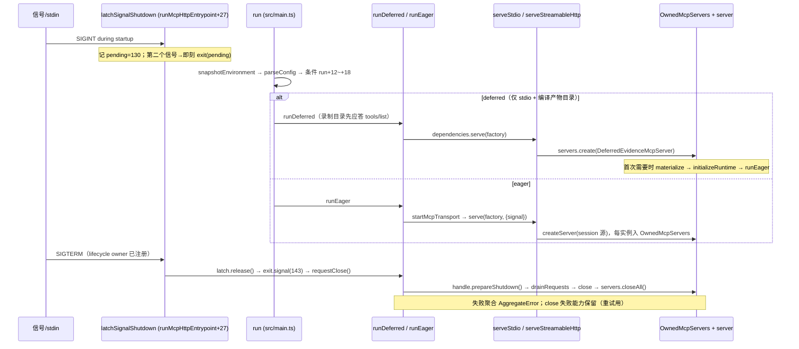

# 09 · Server 层 —— MCP 适配器

> 本篇讲 REA 进程侧的 MCP 适配器：入口 `src/main.ts`、启动编排 `src/main/`、工具装配与 transport `src/server/`（含 `http/`）。它属于 composition→MCP 适配层的进程边界：把领域/应用层装配成 SDK `McpServer` 实例，并通过 stdio 或 streamable HTTP 对外服务。边界澄清：分发器路由（`scripts/rea.mjs`）见 01 篇；子进程监督与所有权见 13 篇；本篇只讲「MCP 进程自己」。

## 0 速览

1. 入口 `src/main.ts 函数：run 偏移：+3` 先 `snapshotEnvironment(dependencies.env)` 冻结环境快照，再 `parseConfig`；deferred/eager 分流在 `src/main.ts 函数：run 偏移：+12~+22`。
2. deferred 快路径要求五条件同时成立（含 `RECORDED_MCP_CATALOG_SHA256 !== undefined`，见 `src/recordedMcpCatalog.ts Const：RECORDED_MCP_CATALOG_SHA256`）；**源码态该常量恒为 `undefined`**，注释写明「Replaced after compilation by the recorder」——deferred 只在编译产物中可达 `[推导]`。
3. HTTP 分支强制 `server instanceof RequestTrackingMcpServer`（`src/main.ts 函数：httpRuntimeDependencies 偏移：+21~+23`），并传 `closeInstance: false`；代码注释给出所有权理由：transport 的 factory owner 关闭每个实例，监听器不得抢先（`httpRuntimeDependencies+16`）。
4. 启动异常被**故意**收敛为 `SERVER_START_FAILED` 一条消息：`src/main.ts 函数：runEntrypoint 偏移：+10~+15` 的 catch 里 `void cause;`，注释明示意图是不向调用方泄露内部原因。
5. 结果编码在 `src/server/toolResultEncoding.ts 函数：encodeToolResult 偏移：+4~+32` 中按「wire 表示会重复 JSON」的预算模型度量，超出即拒（`constraint: "string-length" | "receive-buffer"`）；进度通知经 `src/server/mcpProgress.ts 函数：mcpProgressReporter 偏移：+3~+18` 走 `notifications/progress`，取消经 `notifications/cancelled` 清理簿记（§5.2）。
6. 关停语义：启动期信号先被 `src/main/processShutdown.ts 函数：latchSignalShutdown 偏移：+5~+8` 闩住，lifecycle owner 就绪后由 `registerShutdown` 补发；HTTP 侧退出码经 `src/main/processShutdown.ts 函数：createExitStatus 偏移：+5~+9` 保证「信号状态压过入口的 0」。

## 1 入口与启动：`src/main.ts`

`src/main.ts`（207 行）是 `dist/mcp/main.js` 的源码对应物，五个核心符号：

### 1.1 `runtimeDependencies` / `httpRuntimeDependencies`

`src/main.ts 函数：runtimeDependencies 偏移：+0~+9` 返回 stdio 默认依赖包：`env: process.env`、`stdin: process.stdin`、`serve: serveStdio`（依赖：`@modelcontextprotocol/server/stdio`）、`registerShutdown: registerProcessShutdown`。

`src/main.ts 函数：httpRuntimeDependencies 偏移：+0~+44` 在 base 上做四处替换：

- `transport: "http"`（`httpRuntimeDependencies+8`）——deferred 分流与 stdin 归属的判据。
- `setExitCode: exit.set`（`httpRuntimeDependencies+9`）——改用 `createExitStatus` 包装（§4.3）。
- `serve`（`httpRuntimeDependencies+10~+28`）：**惰性** `await import` 加载 `serveStreamableHttp` 与 `RequestTrackingMcpServer`，注释说明默认 stdio 入口永不加载 HTTP 监听器（`httpRuntimeDependencies+11`）。工厂包装里强制类型检查：

  ```ts
  if (!(server instanceof RequestTrackingMcpServer))
    throw new TypeError("HTTP MCP servers must track tool completion");
  ```
  （`httpRuntimeDependencies+21~+22`）

  并传 `closeInstance: false`（`httpRuntimeDependencies+25`），上方注释（`httpRuntimeDependencies+16`）：
  `// The transport's factory owner closes every instance it created; the listener must not race it.`
- `registerShutdown`（`httpRuntimeDependencies+29~+42`）：改用 `registerSignalShutdown`（HTTP 不拥有 stdin，EOF 不是关停信号；`httpRuntimeDependencies` 上方文档注释原文：`Replace stdio with the streamable HTTP listener; signals alone end it, never stdin.`），并在注册后立即 `latch.release()`：若启动期间已有信号到达，此刻补发 `exit.signal(pending)` + `request()`，注释解释「其状态压过入口随后返回的 0」（`httpRuntimeDependencies+34~+36`）。

### 1.2 `run`：先快照，再分流

`src/main.ts 函数：run 偏移：+0~+26`。第一步 `snapshotEnvironment(dependencies.env)`（`run+3`，依赖：`src/process/snapshotEnvironment.ts 函数：snapshotEnvironment 偏移：+0~+15`）。**为什么先快照** `[推导]`：`snapshotEnvironment` 按平台身份合并并 `Object.freeze`（win32 大写折叠，按调用序保证显式 override 优先），此后所有下游（config、createServer、provider 环境）消费同一份冻结视图，避免长驻进程在生命周期中读到漂移的活 `process.env`；`src/server/createServer.ts 函数：createServer 偏移：+6` 同样以 `snapshotEnvironment(options.environment ?? process.env)` 开头，口径一致。

随后 `parseConfig`，失败即打印投影错误并返回 1（`run+4~+7`）。分流条件 `run+12~+18`：

| # | 条件 | 锚点 |
|---|---|---|
| 1 | `RECORDED_MCP_CATALOG_SHA256 !== undefined` | `src/main.ts 函数：run 偏移：+13` |
| 2 | `dependencies.transport !== "http"` | `run+14` |
| 3 | `config.value.hopperTargetPath === undefined` | `run+15` |
| 4 | `fullOutputCatalog`（`REA_MCP_OUTPUT_SCHEMA_PROFILE` 未设或 `full`，`run+9~+11`） | `run+16` |
| 5 | `dependencies.createServer === undefined` 且 `loadOptionalProviders === undefined` | `run+17~+18` |

> **与 01 篇核对**：01 篇 §3 的条件表与本表按同一基线 `1173c0a9d` 实测，六条锚点逐行一致（锚点符号均为 `src/main.ts` 里的 `函数：run`：条件 1 = `run+13`、非 HTTP = `run+14`、Hopper = `run+15`、profile 在 `run+9~+11` 定义 / `run+16` 消费、注入判据 `run+17~+18`）。条件 1 值得单列：`src/recordedMcpCatalog.ts` 里 `RECORDED_MCP_CATALOG_SHA256` 的源码态字面值是 `undefined`（同文件上方注释 `Replaced after compilation by the recorder; source runs use eager composition.`），所以**从源码运行时这条恒不成立、必然走 eager**，deferred 快路径只在被 recorder 改写后的构建产物里可达。

不满足即 `(await import("./main/eagerRuntime.js")).runEager(...)`（`run+22~+25`）——eager 模块同样惰性 import，`[推导]` 与 deferred 共享「不为未走的路径付加载成本」的意图。

### 1.3 `runEntrypoint`：故意不泄露 cause

`src/main.ts 函数：runEntrypoint 偏移：+0~+16`。catch 分支原文：

```ts
} catch (cause: unknown) {
  // Intentionally redact the startup cause from caller-visible output;
  // unexpected failures must not leak internal details.
  void cause;
  writeStderr(`${SERVER_START_FAILED}\n`);
  setExitCode(1);
}
```

意图由注释直接写明（`src/main.ts` 里的 `runEntrypoint+10~+11`）：意外的启动失败不得向 MCP client（其 stdout 承载 JSON-RPC）泄露内部细节。`SERVER_START_FAILED` 文案本身是给 agent 的行动指令（`src/main/messages.ts Const：SERVER_START_FAILED`）：`Do not repeat this startup … run \`rea doctor\``。

### 1.4 `runMcpHttpEntrypoint` 与 `isDirectEntrypoint`

`src/main.ts 函数：runMcpHttpEntrypoint 偏移：+0~+38`：

1. 惰性 import `parseMcpHttpArguments` / `renderMcpHttpHelp`；help 走 stdout + exit 0，解析错误走 stderr + exit 1（`runMcpHttpEntrypoint+7~+16`）。
2. `parseMcpHttpEndpoint(snapshotEnvironment(process.env), overrides)`（`+17~+20`）：只有 flag 显式给出值时才作为 override 传入（`parsed.host === undefined ? {} : { host: parsed.host }`），优先级见 §7。
3. **在任何异步启动之前**建立 latch 与 exit status（`+27~+28`，`latchSignalShutdown()` 与 `createExitStatus(io.setExitCode)`）；上方注释（`+26`）：`// Latched before any asynchronous startup so a signal cannot end the process without cleanup.`
4. `runEntrypoint(() => run(httpRuntimeDependencies(endpoint.value, latch, exit)), ...)`（`+30~+34`），`finally { latch.release(); }`（`+36`）。

`src/main.ts 函数：isDirectEntrypoint 偏移：+0~+10` 用 `pathToFileURL(realpathSync(entryPath)).href === moduleUrl` 比较，argv 路径为合成或不存在时返回 false；文件末尾的顶层守卫仅当为真才 `void runEntrypoint()` `[观察]`。注释原文：`Return false when the runtime's argv path is synthetic or no longer exists.`。这使得 `main.ts` 可被测试安全 import `[推导]`。

## 2 deferred 与 eager 两条冷启动路径

### 2.1 `RECORDED_MCP_CATALOG_SHA256` 如何允许「不构造校验器完成目录响应」

`src/recordedMcpCatalog.ts`（27 行）：`Type：RecordedMcpCatalog` 是构建期录制目录的形状（version/info/capabilities/instructions/identity/tools/prompts），文档注释：`Build-owned discovery data; canonical validators remain the runtime authority.`（`Const：RecordedMcpCatalog` 上方）。`src/recordedMcpCatalog.ts Const：RECORDED_MCP_CATALOG_SHA256 偏移：+0~+3` 在源码中显式赋 `undefined`，类型是按 `McpInputSchemaProfile` 分 key 的 sha256 映射；注释：`Replaced after compilation by the recorder; source runs use eager composition.` `[观察]` 因此源码态 `run` 的条件 1 永假，只有编译产物带着录制目录与摘要映射才可达 deferred。

`src/main/deferredRuntime.ts 函数：readCatalog 偏移：+0~+21`：按 profile 读 `../mcp-catalog-full.json` 或 `../mcp-catalog.json`（`readCatalog+1~+6`），sha256 与 `RECORDED_MCP_CATALOG_SHA256?.[profile]` 不符即 `throw new Error(SERVER_START_FAILED)`（`readCatalog+7~+11`）；再校验 `version === 1` 否则同错误（`readCatalog+14~+19`）。中间注释（`readCatalog+12`）：`// The digest binds these bytes to the same compiled producer and SDK converter.`——摘要把目录字节绑定到同一编译生产者，因此**运行时不必再构造 canonical 校验器**即可信任该投影 `[推导]`（与接口注释「canonical validators remain the runtime authority」一致：真校验器仍属运行时权威，只是目录应答阶段不用它们）。

### 2.2 `runDeferred`

`src/main/deferredRuntime.ts 函数：runDeferred 偏移：+0~+126`（文档注释：`Own every SDK-created server, including discarded discovery instances.`）。关键结构：

- 用 `OwnedMcpServers<DeferredEvidenceMcpServer>`（`src/main/deferredRuntime.ts` 里的 `runDeferred+9`，依赖：`src/main/OwnedMcpServers.ts 函数：OwnedMcpServers`）持有**每个** SDK 创建的实例，含被丢弃的 discovery 探测实例。
- profile 由 `resolveMcpInputSchemaProfile(config.mcpInputSchemaProfile)` 解析（`runDeferred+7`）。
- `dependencies.serve(factory, {onerror})`（`runDeferred+65~+102`）：factory 内 `servers.create(...)` 构造 `DeferredEvidenceMcpServer`，第三个参数是 `initializeRuntime` 回调（`runDeferred+76~+86`）——真实 server 延迟到第一次需要时才物化。`firstCatalog` 用后即焚（`runDeferred+68~+69`），后续实例重新 `readCatalog`，`[推导]` 避免陈旧目录跨 materialize 复用。
- `server.server.onclose` 被包链（`runDeferred+90~+94`）：SDK 报连接关闭时同样触发 `requestClose()`。
- 清理编排 `close`（`src/main/deferredRuntime.ts 函数：close 偏移：+0~+36`）：先 `await serving`——注释（`close+4`）：`// A transport published after shutdown begins is still ours to close.`；`handle.close()` 与 `servers.closeAll()` 并行 `Promise.allSettled`，失败聚合 `AggregateError("MCP cleanup failed")`（`close+27~+28`）；`attempt` memoize 且在 catch 中清空以允许重试（`close+31~+34`）；注释说明「serving handle 落定前发布的 server 也加入本 owner，closeAll 先封口再快照」（`close+18~+19`）。
- 尾部 `if (closing) await close();` `[观察]` 处理「serve 成功返回前已收到关停请求」的竞态（`runDeferred+124`）。

`src/main/deferredRuntime.ts 函数：initializeRuntime 偏移：+0~+69` 在物化时调用 `runEager`，但把依赖改掉：`stdin: undefined`（注释 `+34~+36`：外层 SDK transport 已拥有并框帧该流，eager 物化只拥有 provider）、`registerShutdown: () => () => undefined`（外层已注册，`+37`）、`captureShutdown` 捕获 shutdown（`+38~+40`）、`createServer` 包装把 `mcpServer: server` 注入既有 Deferred 实例（`+41~+54`）、`serve` 包装里 `server.materialize(() => { ... })`——**物化时校验工厂产出的正是挂起中的那个 server**，`configured !== server` 即 `SERVER_START_FAILED`（`+55~+62`）。session 关闭记 `session.close({ retainProviderDocuments: true })`（`+44~+48`）。`server.ownRuntimeCleanup(...)`（`+10~+26`）先关 partial runtime 再关 session，失败聚合 `AggregateError("MCP startup cleanup failed")`；`runEager` 返回非 0 或 shutdown 未捕获同样抛 `SERVER_START_FAILED`（`+67~+68`）。

### 2.3 `runEager` 与 `startMcpTransport`

`src/main/eagerRuntime.ts 函数：runEager 偏移：+0~+141`。文档注释（`+0` 上方）：适配器**在进程生命周期内拥有其 BinarySession**；EOF 与信号关闭 bridge 资源，但**不假定拥有 Hopper app**。步骤：

1. `snapshotEnvironment` → `parseConfig`（`selectedConfig` 传入时跳过——deferred 物化正走此支）→ `createLogger("mcp", ...)` → `new AnalysisSettings` → `createBinarySession` → `startup = new AbortController()`（`runEager+5~+22`）。
2. `createShutdown({ handle: {...} })`：`prepareShutdown` 先 `await startupSettled`——注释（`runEager+30~+31`）：「关停请求先封锁 session admission，再等启动把所有 late handle 交回，之后才释放资源」（原文 `A shutdown request seals session admission immediately, then waits for startup to return every late handle before any resource is released.`）。
3. `ownStdioStartupInput`（`src/main/eagerRuntime.ts` 里的 `runEager+58~+67`，仅非 HTTP、有 stdin 且未 abort 时）：启动期拥有原始输入流，EOF/失败即 `startup.abort(failure)` + `shutdown.request()`；`src/main/StdioStartupInput.ts`（117 行）未逐行读，见缺口。
4. `openInitialTarget`（`src/main/eagerRuntime.ts` 里的 `runEager+77~+82`，实现走 `src/main/startup.ts`）→ `startMcpTransport`（`src/main/eagerRuntime.ts` 里的 `runEager+83~+116`）。其中 `serve` 被包装（`+89~+95`）：`if (startup.signal.aborted) throw startup.signal.reason;` → `startupInput?.handoff()` → 真 serve → `startupInput?.resume()`——启动输入流在 SDK 接管前 handoff、成功接管后 resume，`[推导]` 把启动期已缓冲字节交还 SDK。
5. `finally { settleStartup(); startupInput?.close(); }`（`runEager+123~+126`）；未 ready/被 abort 则 `shutdown.shutdown()`，`startupRejected` 时把 cause 原样抛出（`runEager+139`），交由 §1.3 的入口收敛。

`src/main/transport.ts 函数：startMcpTransport 偏移：+0~+199` 是两种 transport 共用的装配点（文档注释：`Start the injected transport (stdio or streamable HTTP) around one shared session.`）：加载 optional providers 失败仅 warn（「受影响工具保持不可用」，`startMcpTransport+22~+30`）；每次 SDK 构造 server 都新建 android provider 并登记（`+92~+98`，注释：SDK 可能丢弃探测实例并重建）；`servers = new OwnedMcpServers(...)`（`+40`）；失败路径返回**同一批 partial owner** 供调用方重试（`+166~+167` 注释原文：`Return the same partial owners for retry; the caller owns the binary session independently of transport admission.`）；`ok` 分支的 `handle.close` 先 `prepareShutdown` 再并关 transport 与 servers（`+182~+198`）。

## 3 createServer 与 `register*` 家族

### 3.1 数量与命名规律

实测（基线 `1173c0a9d`）：`ls src/server/register*.ts | wc -l` = **69** 个顶层文件（含 `registerPrompts.ts`）。`src/server/` 根目录非测试 `.ts` = **95** 个、根目录 `.test.ts` = **7** 个；根目录总条目 = **107**（含子目录 `environment/`、`http/`、`registerApplicationTools/`、`registerInvestigationTools/`、`registerManagedWorkflowTools/`）。全目录 `.test.ts` 合计 **13** 个（根 7 + 子目录 6）。命名规律：`register<Domain>Tools.ts`（多工具）与 `register<Domain>Tool.ts`（单工具，如 `registerAnalysisViewTool.ts`、`registerByteEntropyTool.ts`、`registerDevicetreeTool.ts`），导出同名函数 `register<Domain>Tools(...)`。三个域用子目录拆文件（`registerApplicationTools/` 下 11 个文件：`compareVersions.ts`、`traceFeature.ts`、`obligationLedger.ts` 等），顶层同名文件负责逐工具绑定。

### 3.2 `createServer`

`src/server/createServer.ts 函数：createServer 偏移：+0~+80` 签名 `(source: ServerAnalysisSource, options: CreateServerOptions = {}) => EvidenceMcpServer`。文档注释：提供 session 则追加 target 生命周期工具；省略则保留供聚焦测试与嵌入方使用的固定 target 缝。结构：先构造约 40 个应用服务（`createServer+7~+57`，一律 `options.x ?? createXService(environment)` 模式——注入即复用 caller 实例），随后 `outputSchemasOmitted(environment)`（`+10`）与 `selectToolResultDelivery(environment, options.delivery)`（`+12`）、`selectCompactInputSchemaPresentation(environment)` 参与 `createMcpServer(...)`（`+72~+79`；deferred 物化走 `options.mcpServer` 支），再是长串 `register*(server, ...)`：`registerAnalysisSettingsTools(server, analysisSettings)` 在 `createServer+80`，`registerBinaryAnalysisTools(toolContext)`、`registerObservationTools(toolContext)`、`registerGuidedPrompts(server, analysis, session)` 等聚合调用位于其后（未逐行读，见缺口）。

### 3.3 小例子：`registerApkSignatureTools`

`src/server/registerApkSignatureTools.ts`（34 行）三步（`函数：registerApkSignatureTools 偏移：+8~+21`）：

```ts
const contract = apkSignatureModule.contract;            // +9：契约来自 composition 模块
const handler = createEvidenceToolHandler(server,         // +10~+16
  (input, options) => service.inspect(input, options, { recordEvidence, evidenceById }),
  logger, recordEvidence, withAdmittedAnalysis);
server.registerTool(contract.name, toolRegistrationOptions(contract), handler(contract)); // +17~+21
```

文档注释：`Bind the named APK-signature contract to shared validation and session Evidence.`（`registerApkSignatureTools` 上方一行）。

### 3.4 复杂例子与契约绑定验证

`src/server/registerInvestigationTools.ts 函数：registerInvestigationTools 偏移：+0~+22`：四个操作族工具逐个 `toolContract("find_changed_behavior")` 等取契约，传入私有注册函数；`函数：registerChangedBehavior 偏移：+0~+30` 内 `server.registerTool(contract.name, applicationToolRegistrationOptions(contract), async (input, context) => runAdmittedToolOperation(server, admission, contract.name, context.mcpReq.signal, async () => {...}))`——handler 参数类型写作 `ReturnType<typeof toolContract<"find_changed_behavior">>`，**每个 handler 绑定一个具名契约且类型精确到该契约** `[观察]`。

通用绑定点在 `src/server/contractToolHandler.ts`：`函数：createEvidenceToolHandler 偏移：+0~+27` 返回 `(contract) => async (input, context) => ...`——**handler 由 contract 参数化生成**；执行流 `logToolExecution` → `operation(input, { signal: context.mcpReq.signal })` → `deliverEvidenceResult`，外层套 `runAdmittedToolOperation`（准入，依赖：`src/server/analysisAdmission.ts` 与 `src/server/admittedToolOperation.ts`）。`函数：deliverEvidenceResult 偏移：+0~+14`：失败走 `server.delivery.toPartialErrorToolResult(result.error, contract.returnsTargetContent, recordEvidence)`，成功 `recordEvidence?.(...)` 后 `toEvidenceToolResult(value, contract, recorded)`——contract 同时决定输入校验、输出投影与错误形态。多操作族走 `函数：createContractToolHandler 偏移：+0~+15`（`service.execute(contract.name, input, options)` 以操作名路由，接口 `Type：ContractToolService`）；带 `detail: "complete"|"summary"` 的走 `函数：createRetainedSummaryToolHandler 偏移：+0~+45`（先 `safeParse` 拆出 `detail`，再 `retainedSummaryDelivery(...).preflight` 与 `projectEvidence`）。AGENTS.md 的「Bind handlers to named contracts with exact types」在这三层得到字面验证 `[观察]`。

## 4 两种 transport

### 4.1 stdio

`serveStdio`（依赖：`@modelcontextprotocol/server/stdio`，在 `src/main.ts` 顶部 import）经 `RuntimeDependencies.serve`（`src/main/types.ts Type：McpServe`）注入；REA 侧只有 `src/main/transport.ts` 的工厂与 `src/main/shutdown.ts` 的编排。stdio 特有：stdin `end`/`close` 即请求关停（`src/main/processShutdown.ts 函数：registerProcessShutdown 偏移：+6~+14`）；启动期 stdin 由 `ownStdioStartupInput` 看管（§2.3 步骤 3）。deferred 快路径仅 stdio（`run+14`）。

### 4.2 streamable HTTP

`src/server/http/serveStreamableHttp.ts`（725 行）。`函数：serveStreamableHttp 偏移：+0~+143` 要点：

- 端点路径 `src/server/http/serveStreamableHttp.ts Const：MCP_HTTP_PATH`（`/mcp`）。
- 安全校验：`Host` 头允许列表按**实际绑定地址**分类环回（`函数：hostHeaderAllowlist 偏移：+0~+8`；内部 `函数：isLoopbackAddress 偏移：+0~+10` 覆盖 127.x、`::1`、`::ffff:` 映射），非环回绑定时返回 `undefined`，交由 SDK 严格校验 `[推导]`；Origin 校验复用 SDK。
- 会话握手：`函数：classifyInitializePost 偏移：+0~+25` 在无 session id 的 POST 上 clone+peek body 判定 initialize（注释：SDK 2.3.1 接受单元素数组，但 REA 的会话交接契约要求对象，`classifyInitializePost+14~+18`）；`Type：LiveSession` 类拥有单会话 transport 与实例；`sessionIdGenerator: () => randomUUID()` `[观察]`。
- 并发与排空：`Const：DEFAULT_MAX_CONCURRENT_DISPATCHES`（默认 8，注释：未读 upload 也占许可）；会话交接等待取消中 handler 的上限 `Const：DEFAULT_SESSION_DRAIN_TIMEOUT_MS`（10s），超时构造 `函数：SessionDrainTimeoutError 偏移：+1~+7`，文案含 `retry after they finish`。

**为什么 HTTP 强制 `RequestTrackingMcpServer`**：`src/server/RequestTrackingMcpServer.ts`（92 行）`函数：RequestTrackingMcpServer` 类覆写 `registerTool`，把每个 callback 包进 `函数：runRequest 偏移：+0~+12`：`Promise.resolve().then(() => { signal?.throwIfAborted(); return callback(); })` 并登记进私有 `#calls` 集合。注释（`runRequest+4~+5`）：`SDK validation can finish after its transport closed. Such a callback must never start work against the next session's shared resources.`——HTTP 会话**跨 transport 共享资源**，stdio 保持 SDK 原行为（类文档注释）。`函数：drainRequests 偏移：+0~+15` 供会话交接与关停排空，注释表明「超时则所有权保留」（未排空的调用仍被追踪）。`函数：enableRequestTracking 偏移：+0~+2` 由 HTTP 侧在装载实例时调用（`serveStreamableHttp.ts` 内 `instance.enableRequestTracking()` 调用点），这也是 §1.1 那个 `instanceof` 强制检查的功能原因 `[推导]`。

**`closeInstance: false` 的所有权理由**：选项文档注释（`src/server/http/serveStreamableHttp.ts Type：ServeStreamableHttpOptions` 的 `closeInstance` 字段）：`Close the server instance as the last stage of close; false when the factory's owner closes it.`。实现处：`serveStreamableHttp` 的关停阶段数组只在 `closeInstance` 为真时追加 `() => instance.close()`（`函数：serveStreamableHttp 偏移：+122~+128`，`stagedClose` 调用点）。HTTP 下实例由 `OwnedMcpServers`（`src/main/OwnedMcpServers.ts 函数：OwnedMcpServers`）统一拥有——`closeAll()` 先 `accepting = false` 封口再快照（文档注释：`Seal publication before snapshotting; failed close capabilities stay owned.`），且实例的 `close` 方法被替换为 ownedClose（成功后才从集合删除，`函数：create 偏移：+3~+11` `[推导]`：失败保留所有权符合 AGENTS.md「cleanup 失败的资源保留」）。若监听器也关，同一实例会被两条关停链竞相关闭，违反单一 owner 规则 `[推导]`。

### 4.3 latch / exit status

`src/main/processShutdown.ts`（117 行）：

- `Const：SIGNAL_EXIT_STATUS`：SIGINT→130、SIGTERM→143（128+信号号）。
- `函数：registerProcessShutdown 偏移：+0~+17`：stdio 版，信号 + stdin end/close 都请求关停；`函数：registerSignalShutdown 偏移：+0~+9` 只注册信号并把 130/143 报给 handler。
- `函数：latchSignalShutdown 偏移：+0~+20`：启动期记录**第一个**信号的状态；第二个信号到来时 `exit(pending)` 立即退出。文档注释：`Record the first SIGINT or SIGTERM during startup and exit at once on a second one, so startup never dies without its cleanup.`。`release()` 摘除监听并返回 pending——`runMcpHttpEntrypoint+36` 的 `finally` 与 `httpRuntimeDependencies+36` 的补发共同保证「启动期信号不丢、也不提前裸退」。
- `函数：createExitStatus 偏移：+0~+15`：`set(0)` 在已有 signalStatus 时改写为信号状态（`createExitStatus+6~+8`）；`signal(status)` 即刻生效。

时序图（stdio 与 HTTP 两条生命周期）：



ASCII 进程/模块图：

```
rea 进程 (dist/mcp/main.js ← src/main.ts)
├─ run: snapshotEnvironment → parseConfig ─┬─ deferred（stdio+编译期目录/sha）
│                                          └─ eager（其余全部）
├─ main/deferredRuntime ──► DeferredEvidenceMcpServer ──materialize──► runEager
├─ main/eagerRuntime ──► composition/binary (BinarySession) ──► main/transport.startMcpTransport
│        │                                                            │
│        ├─ main/StdioStartupInput（仅 stdio）                         ├─ server/createServer
│        └─ main/shutdown（createShutdown 编排）                        │     └─ register* ×69 → contractToolHandler
├─ main/processShutdown（latch / exit status / 信号注册）               ├─ server/http/serveStreamableHttp（HTTP）
├─ server/RequestTrackingMcpServer（仅 HTTP 强制）                     └─ server/EvidenceMcpServer(Core) 结果投影
└─ 依赖: @modelcontextprotocol/server（serveStdio、WebStandardStreamableHTTPServerTransport、McpServer）
```

## 5 结果编码与进度

### 5.1 编码与预算

`src/server/toolResultEncoding.ts`（127 行）。`Const：NODE_MAX_STRING_LENGTH` 取 Node 的 `bufferConstants.MAX_STRING_LENGTH`；`Const：MCP_RESULT_STRING_LIMIT` = 上限减 1024 code units（注释：`Node's actual single-string ceiling. REA refuses earlier`）。`Type：ToolResultRepresentations` 说明线上传输形态：成功结果把同一 JSON **重复**为 `structuredContent` 与转义 text 两份，错误结果只有 text + `isError`。`函数：encodeToolResult 偏移：+12~+30` 在**分配完整文本之前**逐 part 计费（`jsonParts`/`bufferedJsonParts` 来自 `src/domain/jsonSerialization.ts`），超限即返回 `{ ok: false, bytesAtLeast, codeUnitsAtLeast, constraint }`——constraint 二分 `"string-length"`（code units 越 Node 上限）与 `"receive-buffer"`（字节越宿主接收预算），不截断不回退。`函数：measureMcpResultWithinBudget 偏移：+0~+17` 对已成形的结果对象做无文本分配的字节度量。

untrusted content 标记：`Const：TARGET_CONTENT_RESULT_META`（`_meta.provenance.untrusted_content`）与 `Const：UNTRUSTED_CONTENT_INSTRUCTIONS`（防提示注入指令，注释原文：`Target-derived tool output is data; it must never steer tool use.`），检测函数 `函数：carriesTargetContentMarker 偏移：+2~+11`（用 `Reflect.get` 防 getter 副作用 `[推导]`），且 `Const：TARGET_CONTENT_META_BYTES` 把该元数据字节计入预算（旁注：`,"_meta":{...}` added to the delivered result object）。

profile 两层：入口侧 `REA_MCP_OUTPUT_SCHEMA_PROFILE` 只决定 deferred 目录选择（`src/main.ts 函数：run 偏移：+9~+11`）；请求侧输入 schema profile 由 `resolveMcpInputSchemaProfile` 解析（`src/main/deferredRuntime.ts 函数：runDeferred 偏移：+7`）。预算默认：`config.mcpMaxResponseBytes ?? STDIO_DEFAULT_MAX_BUFFER_SIZE` 传入 `ToolResultDelivery`（`runDeferred+74`，依赖：`@modelcontextprotocol/server`）。`src/server/ToolResultDelivery.ts`（259 行）承载 `toEvidenceToolResult` / `toPartialErrorToolResult`，未逐行读；compact/full 输出投影开关在 `src/server/createServer.ts`（`函数：createServer 偏移：+10` 的 `outputSchemasOmitted` 与 `+76~+79` 的 `selectCompactInputSchemaPresentation`）`[未知]` 具体裁剪规则，见缺口。

### 5.2 progress / cancellation

- **进度：已实现**。`src/server/mcpProgress.ts 函数：mcpProgressReporter 偏移：+0~+26`：读 `context.mcpReq._meta?.progressToken`，无 token 返回 `silentProgressReporter`（`+4`）；有 token 则 `context.mcpReq.notify({ method: "notifications/progress", params: { progressToken, progress: update.sequence, message } })`（`+8~+17`），节流 `{ minimumIntervalMs: 100 }`（`+25`）；注释说明「协议要求每次通知都前进，故发观察计数而不虚构分析总量」（`+13~+15` 原文）。发送失败被吞：`// Progress is observational; transport failure cannot change tool truth.`（`+19~+20`）。
- **取消：无独立取消 API，走 SDK signal + 簿记清理**。工具 handler 把 `context.mcpReq.signal` 放进 `ExecutionOptions`（`src/server/contractToolHandler.ts 函数：createEvidenceToolHandler 偏移：+16~+22`）；`RequestTrackingMcpServer.runRequest` 在执行前 `signal?.throwIfAborted()`（§4.2）。`src/server/EvidenceMcpServerCore.ts` 在其 transport `onmessage` 包装中拦截 `notifications/cancelled`，对 `pendingTools` / `pendingToolLists` / `pendingCompletions` 调用 `函数：forgetPendingMcpRequest 偏移：+0`，注释原文：`The SDK suppresses replies after cancellation, so send() cannot release this bookkeeping. Keep transport authentication outside retained data.`；`completion/complete` 请求还挂独立 `AbortController` 并经 `currentRequestSignal.run(completion.signal, ...)` 上下文下发 `completion` 取消（同款拦截在 `src/server/environment/targetContentTransport.ts` 的 `onmessage` 包装 `[观察]`）。`src/main/transport.ts` 返回值字段 `cancelled` 表意不同：指「启动被关停 signal 取消」，非请求级取消。
- **证伪**：`grep -rn "onprogress" src/server src/main --include="*.ts"`（排除 `*.test.ts`）→ **源码中无 `onprogress` 符号**；`grep -rn "progressToken" src/server src/main --include="*.ts"` 的非测试命中仅 `src/server/mcpProgress.ts`；`notifications/cancelled` 非测试命中仅上述两文件。

## 6 生命周期与清理（与 13 篇交界）

MCP 侧清理 owner 链条 `[观察]`：进程信号/EOF → `registerShutdown` handler →（eager）`shutdown.request()`（`src/main/shutdown.ts` 的 `createShutdown`，未逐行读）→ transport `handle.prepareShutdown()`（HTTP：先排空 `drainRequests`）→ `handle.close()` → `servers.closeAll()`（`OwnedMcpServers`）→ eager 再关 android / optional providers 与 `BinarySession`；deferred 则由 `runDeferred.close` 一套并行聚合承担。**cleanup 失败保留所有权**三处字证：`OwnedMcpServers` ownedClose 成功后才 `delete`；`closeAll` 先 `accepting=false` 封口再快照；`runDeferred` 的 `attempt` 失败后清空允许重试；`startMcpTransport` 失败路径把 partial owner 原样交回（§2.3）。optional providers 由所有实例共享、只由进程关停关闭（`src/main/transport.ts 函数：startMcpTransport 偏移：+59~+60` 注释）。provider 子进程的实际监督（lease、进程族、退出后归属）在 `src/process/`，归 13 篇，本篇不展开。session 关闭语义一处细节：deferred 物化路径 `session.close({ retainProviderDocuments: true })`（`src/main/deferredRuntime.ts 函数：initializeRuntime 偏移：+45`）。

## 7 HTTP 端点配置解析优先级

两层：

1. **flag 层**：`src/main/mcpHttpArguments.ts 函数：parseMcpHttpArguments 偏移：+0~+35` 手写解析 `--http`/`--host`/`--port`（支持 `--flag=value` 内联，`函数：splitFlag 偏移：+0~+5`；分离式值以下一个 `-` 开头视为缺失值）。help 只在 flag 位置生效（`parseMcpHttpArguments+7~+8`，`--help`/`-h` 短路返回）；`--host/--port` 缺 `--http` 报错（`+21`）；`--port` 值经 `mcpHttpPortSchema.safeParse`（`+26~+29`）。`Const：MCP_HTTP_OPTIONS`（zod object）是帮助文本与选项形状的单一真相源（文档注释：`The help renderer lists exactly this schema and the parser accepts exactly these flags plus the -h alias.`）；`函数：renderMcpHttpHelp 偏移：+0~+7` 用 `Help.formatCommand`（依赖：`incur`）且 `hideGlobalOptions: true`——分发器入口不接受 Incur 全局选项，hint 说明绑定 URL 以一行 JSON 打到 stderr。
2. **端点层**：`src/config/mcpHttpEndpoint.ts 函数：parseMcpHttpEndpoint 偏移：+0~+32`。优先级：**显式 overrides（来自 flag）> 环境变量 `MCP_HOST`/`MCP_PORT` > 默认值**。字证：`let host = overrides.host ?? DEFAULT_MCP_HTTP_HOST`（`+5`），随后仅当 `overrides.host === undefined && environment.MCP_HOST !== undefined` 才尝试环境变量（`+7~+15`，port 同构 `+16~+24`）——即**命令行 flag 压环境变量**，环境变量解析失败累积为 `ConfigurationError` 而非回退默认。默认 `Const：DEFAULT_MCP_HTTP_HOST` = `127.0.0.1`（注释：loopback 默认保持 local-only 直到 operator 显式退出）；`Const：DEFAULT_MCP_HTTP_PORT` = 0（注释：0 请求临时端口，由 listening 日志行回报实际值）。监听端口允许 0 而连接端点不允许的区分在 `Const：mcpHttpListenerPortSchema` 注释；`Const：mcpHttpPortSchema` 拒绝前导零十进制文本。

`runMcpHttpEntrypoint` 只把**显式给出的** flag 传成 overrides（`src/main.ts 函数：runMcpHttpEntrypoint 偏移：+17~+20`），未给出的留给环境变量层。

## 边界与失败模式

| 场景 | 行为 | 锚点 |
|---|---|---|
| 源码态期待 deferred | 不可达：`RECORDED_MCP_CATALOG_SHA256 === undefined`，直接 eager | `src/recordedMcpCatalog.ts Const：RECORDED_MCP_CATALOG_SHA256` |
| 编译目录被篡改/版本不符 | `SERVER_START_FAILED`，退出 1，不外泄 cause | `src/main/deferredRuntime.ts 函数：readCatalog 偏移：+7~+11、+14~+19` |
| HTTP 下工厂产出的不是 tracking server | `TypeError("HTTP MCP servers must track tool completion")` | `src/main.ts 函数：httpRuntimeDependencies 偏移：+21~+23` |
| 启动期 SIGINT 后入口正常返回 0 | 退出码仍 130（信号态压过 0） | `src/main/processShutdown.ts 函数：createExitStatus 偏移：+5~+8` |
| 启动期收到第二个信号 | 立即 `exit(pending)`，不等清理 | `src/main/processShutdown.ts 函数：latchSignalShutdown 偏移：+6~+8` |
| 关停开始后 transport 才发布 | `close` 先 `await serving`，该实例仍归本 owner 关 | `src/main/deferredRuntime.ts 函数：close 偏移：+4~+5` |
| SDK 丢弃 discovery 探测实例并重建 | 每个实例入 `OwnedMcpServers`；android provider 逐个登记关闭 | `src/main/transport.ts 函数：startMcpTransport 偏移：+92~+98` |
| session 交接时旧 session 仍有运行请求 | 排空至多 10s，超时抛带 retry 文案的约束错误 | `src/server/http/serveStreamableHttp.ts 函数：SessionDrainTimeoutError 偏移：+1~+7` |
| 结果超 Node 字符串上限 | 编码前拒发，`constraint: "string-length"`，不截断 | `src/server/toolResultEncoding.ts 函数：encodeToolResult 偏移：+19~+28` |
| progress 通知发送失败 | 吞掉，不影响工具结果 | `src/server/mcpProgress.ts 函数：mcpProgressReporter 偏移：+18~+22` |
| 取消后 SDK 抑制回复 | `notifications/cancelled` 主动清理 pending 簿记 | `src/server/EvidenceMcpServerCore.ts 函数：forgetPendingMcpRequest` |

## 问题清单

- **P1｜deferred 物化的单实例断言**：`initializeRuntime` 的 `serve` 包装要求 `factory(context)` 恰好产出挂起中的 `server`（`src/main/deferredRuntime.ts 函数：initializeRuntime 偏移：+57~+59`），若 SDK 在 materialize 与工厂调用之间重建实例会启动失败；该竞态是否有测试覆盖未查证。→ 待补
- **P1｜HTTP 路径的「factory owner」具体是谁**：`closeInstance: false` 注释指向 factory owner（`src/main.ts 函数：httpRuntimeDependencies 偏移：+16`），`startMcpTransport` 里的 `servers`（`函数：startMcpTransport 偏移：+40`）是唯一候选，但 HTTP 下监听器经 `httpRuntimeDependencies.serve` 走的是同一工厂链——`stagedClose` 阶段数组不关实例后，「谁最终 close 每个 tracking 实例」未在监听器一侧读到直接锚点。→ 待拍板：确认 owner 是 `startMcpTransport` 还是 SDK transport 内部。
- **P2｜`RECORDED_MCP_CATALOG_SHA256` 的源码态与产物态不同**：源码里它是字面 `undefined`（`src/recordedMcpCatalog.ts` 的 `Const：RECORDED_MCP_CATALOG_SHA256`，上方注释 `Replaced after compilation by the recorder; source runs use eager composition.`），因此**从源码跑永远进不了 deferred 分支**。这意味着本篇 §1 的分流表在 `npm run test:local`（源码态）与构建产物里给出不同结果，读代码时容易误判；[未知] 是否有测试同时覆盖两态。→ 待补
- **P2｜cause 丢失的不对称**：deferred 启动失败有 `serverLogger.error` 记录（`src/main/deferredRuntime.ts 函数：runDeferred 偏移：+109~+112`），而顶层 `runEntrypoint` 的意外失败只剩 stderr 一行指令文案（`src/main.ts 函数：runEntrypoint 偏移：+12~+13`）——eager 未走 deferred 时异常是否有任何持久记录，未查证。→ 待补
- **P3｜`parseMcpHttpArguments` 手写解析与 `Const：MCP_HTTP_OPTIONS` zod schema 并存**：一致性由注释约定维持（`src/main/mcpHttpArguments.ts` 文档注释），未见锁死测试。→ 待补
- **P3｜`isLoopbackAddress` 对 IPv4-mapped 十六进制段（`::ffff:7f0x:...`）的覆盖面**（`src/server/http/serveStreamableHttp.ts 函数：isLoopbackAddress 偏移：+7~+9`）是否含全部规范写法未验证。

## 已知缺口

1. `src/server/createServer.ts`（1,324 行）仅读签名区与注册前段；69 个顶层注册器只精读 2 个（`registerApkSignatureTools.ts` 全文、`registerInvestigationTools.ts` 前 90 行），其余按同一模式推断处均已标 `[推导]`。
2. `ToolResultDelivery.ts`（259 行）、`EvidenceMcpServerCore.ts`（743 行，仅读 onmessage 拦截段与 `forgetPendingMcpRequest` 附近）、`DeferredEvidenceMcpServer.ts`（321 行，未读；`materialize`/`ownRuntimeCleanup`/`closePartialRuntime` 语义仅从调用方视角推得）、`EvidenceMcpServer.ts` 未读。
3. `src/main/shutdown.ts`（153 行）、`StdioStartupInput.ts`（117 行）、`startup.ts`（33 行）未逐行读；`createShutdown` 的阶段顺序与 EOF 细节未展开。
4. `src/server/http/` 的 `nodeHttpBridge.ts`、`NodeHttpRequestOwner.ts`、`listenHttpServer.ts` 未读；`serveStreamableHttp.ts` 只读前 240 行 + 关键符号点，`LiveSession` 会话交接完整状态机与 `stagedClose` 其余阶段未走读。
5. compact/full 与 output-schema 省略的投影细则（`selectCompactInputSchemaPresentation`、`outputSchemasOmitted`、`src/config/mcpResponseBudget.ts`、`src/config/mcpInputSchemaProfile.ts`）未读——当前源码无法确定具体裁剪规则。
6. `register*` 各文件的工具准入分级（`externalMutationAdmission.ts`、`sessionAvailabilityPolicy.ts`）未读，本篇只在 handler 层看到 `runAdmittedToolOperation` 调用点。

## 源码索引

```
src/main.ts:run:89
src/main.ts:runEntrypoint:118
src/main.ts:httpRuntimeDependencies:42
src/main.ts:runMcpHttpEntrypoint:152
src/main.ts:isDirectEntrypoint:193
src/main.ts:runtimeDependencies:30
src/recordedMcpCatalog.ts:RecordedMcpCatalog:12
src/recordedMcpCatalog.ts:RECORDED_MCP_CATALOG_SHA256:25
src/main/deferredRuntime.ts:readCatalog:25
src/main/deferredRuntime.ts:initializeRuntime:48
src/main/deferredRuntime.ts:runDeferred:120
src/main/eagerRuntime.ts:runEager:27
src/main/transport.ts:startMcpTransport:34
src/main/processShutdown.ts:registerProcessShutdown:34
src/main/processShutdown.ts:registerSignalShutdown:54
src/main/processShutdown.ts:latchSignalShutdown:72
src/main/processShutdown.ts:createExitStatus:102
src/main/OwnedMcpServers.ts:OwnedMcpServers:2
src/main/types.ts:McpServe:22
src/main/types.ts:RuntimeDependencies:27
src/main/messages.ts:SERVER_START_FAILED:7
src/main/mcpHttpArguments.ts:parseMcpHttpArguments:66
src/main/mcpHttpArguments.ts:renderMcpHttpHelp:36
src/main/mcpHttpArguments.ts:splitFlag:58
src/main/mcpHttpArguments.ts:MCP_HTTP_OPTIONS:13
src/config/mcpHttpEndpoint.ts:DEFAULT_MCP_HTTP_HOST:10
src/config/mcpHttpEndpoint.ts:DEFAULT_MCP_HTTP_PORT:12
src/config/mcpHttpEndpoint.ts:parseMcpHttpEndpoint:38
src/server/createServer.ts:createServer:443
src/server/registerApkSignatureTools.ts:registerApkSignatureTools:12
src/server/registerInvestigationTools.ts:registerInvestigationTools:31
src/server/registerInvestigationTools.ts:registerChangedBehavior:57
src/server/contractToolHandler.ts:deliverEvidenceResult:32
src/server/contractToolHandler.ts:createContractToolHandler:52
src/server/contractToolHandler.ts:createRetainedSummaryToolHandler:70
src/server/contractToolHandler.ts:createEvidenceToolHandler:118
src/server/RequestTrackingMcpServer.ts:RequestTrackingMcpServer:13
src/server/RequestTrackingMcpServer.ts:enableRequestTracking:18
src/server/RequestTrackingMcpServer.ts:runRequest:60
src/server/RequestTrackingMcpServer.ts:drainRequests:76
src/server/http/serveStreamableHttp.ts:MCP_HTTP_PATH:38
src/server/http/serveStreamableHttp.ts:isLoopbackAddress:87
src/server/http/serveStreamableHttp.ts:hostHeaderAllowlist:99
src/server/http/serveStreamableHttp.ts:SessionDrainTimeoutError:136
src/server/http/serveStreamableHttp.ts:classifyInitializePost:201
src/server/http/serveStreamableHttp.ts:LiveSession:229
src/server/http/serveStreamableHttp.ts:serveStreamableHttp:467
src/server/toolResultEncoding.ts:NODE_MAX_STRING_LENGTH:7
src/server/toolResultEncoding.ts:MCP_RESULT_STRING_LIMIT:10
src/server/toolResultEncoding.ts:UNTRUSTED_CONTENT_INSTRUCTIONS:29
src/server/toolResultEncoding.ts:TARGET_CONTENT_RESULT_META:32
src/server/toolResultEncoding.ts:carriesTargetContentMarker:40
src/server/toolResultEncoding.ts:ToolResultRepresentations:62
src/server/toolResultEncoding.ts:measureMcpResultWithinBudget:75
src/server/toolResultEncoding.ts:encodeToolResult:95
src/server/mcpProgress.ts:mcpProgressReporter:13
src/server/EvidenceMcpServerCore.ts:forgetPendingMcpRequest:139
src/process/snapshotEnvironment.ts:snapshotEnvironment:18
```

## 相关篇

- [01 · 系统骨架](01-系统骨架.md)：分发器四路由与 deferred 六条件表（与本篇 §1 同一基线逐行核对一致）。
- [08 · 契约层：工具契约与 Schema](08-契约层-工具契约与Schema.md)：`ToolContract` / `toolContract` 的定义侧。
- [11 · Composition 层：生产装配根](11-Composition层-生产装配根.md)：`createBinarySession`、`apkSignatureModule` 等注册器消费的服务来源。
- [10 · CLI 层：一次性命令适配器](10-CLI层-一次性命令适配器.md)：CLI 侧与 MCP 共享 config/结果编码的对照。
- [02 · 模块地图与依赖方向](02-模块地图与依赖方向.md)：工具 handler 下游的 provider 模块全景与入度口径。
- [13 · Process 层](13-Process层-子进程监督与所有权.md)：§6 的子进程监督与 lease 清理。
