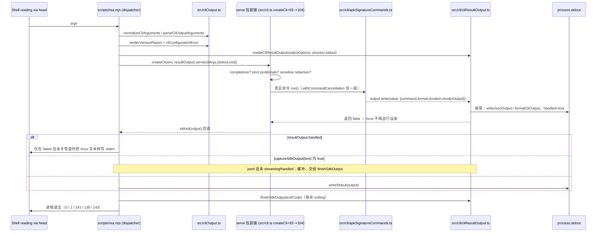

# 10 · CLI 层：一次性命令适配器

> 一句话定位：本篇讲的是「一条 `rea <cmd>` 从可执行文件分发器到结果落地」的完整机制——`scripts/rea.mjs`（dispatcher，Node 顶层脚本）+ `src/cli.ts`（纯装配根）+ `src/cli/`（49 个命令注册器与 4 层 `serve` 包装）+ `src/cli*.ts` 根文件（输出参数、内置参数切分、日志、配置预检）。它属于分层依赖的最外层（`composition ← CLI`），与 MCP 适配器并列、共用同一份领域契约。
> 边界澄清：① 本篇**不**讲 provider 怎么跑分析（见 03/04/15~21），只讲命令怎么拿到分析能力；② 不讲 MCP 会话生命周期（见 08）；③ `incur` 是外部框架，本篇只描述 REA 对它的**补偿与包装**，框架内部实现未读取、不臆测。

版本基线同 [00 · 文档规范](00-docs-style-guide.md) 第 9 节：提交 `1173c0a9d`、`rea-agents@6.8.0`。CLI 侧非测试代码实测 13,951 行（`src/cli/*.ts` + `src/cli*.ts`，排除 `*.test.ts`）；其中 `*Commands.ts` 共 51 个文件 / 9,181 行（`src/cli/` 内 49 个 / 8,956 行，根目录 2 个 / 225 行）。

## 0 速览

1. **dispatcher 只做四件事**：确认编译产物存在 → 按 `args[0]` 分出 MCP stdio / MCP HTTP / `mcp doctor` / 一次性 CLI 四条路 → 在 CLI 路里**先于** `createCli` 消费 `--json`/`--format`/`--version`/输出参数错误 → 把 `stdout`/`exit` 两个回调交给 Incur，由回调决定最终进程状态。管道关闭时状态固定为 **141**（`scripts/rea.mjs` `Const：SIGPIPE_EXIT_STATUS`、`函数：guardClosedStdout 偏移：+3~+4`）。
2. **`createCli` 是纯装配，没有业务逻辑**：冻结环境快照（+7）、拿一次性分析能力（+8）、建 logger（+15）、`Cli.create`（+19）、47 个 `registerXxxCommands`（+39~+90）、然后把 `cli.serve` 换成四层包装链（+91~+104）。与 [01 篇](01-系统骨架.md) 的逐偏移走读一致，本篇把每层拆开读。
3. **包装链顺序不可换**：completions（拦截整个 argv，命中即出脚本）→ `rejectSurplusCliArguments`（在真实解析**之前**抓多出来的位置参数）→ `excludeDeclaredSensitiveArguments`（最外层 middleware，覆盖解析/校验/抛错诊断文本的脱敏）→ 真正的 `serve`；`presentCliArgumentErrors` 不在链上，它只重写每个 command 的 middleware（`src/cli.ts 函数：createCli 偏移：+93~+104`）。
4. **命令有三种注入形态**：`cli + logger + environment`（自己组 composition）、`cli + logger + analysis.runDirectAnalysis`（深度分析入口）、`cli + logger + analysis.runProviderAnalysis`（provider 复用入口），另有第四种 `cli + logger`（纯本地/文件计算，如 `registerEvidenceCommands`、`registerBrowserCommands`）——见 `src/cli.ts 函数：createCli 偏移：+39/+42/+50/+63/+76`。
5. **`--json` 不是「给 Incur 的选项」，而是 CLI 边界的接管协议**：`createCliResultOutput`（`src/cli/cliResultOutput.ts 函数：createCliResultOutput 偏移：+4~+5`）按解析后的输出控制决定接管范围，接管时 `handled` 置真，dispatcher 的 `stdout` 回调把 Incur 自己的输出**丢掉**；未接管时退化为 Incur 的 human/toon 渲染（`src/cli/cliResultOutput.ts 函数：writeResult 偏移：+29/+57`）。
6. **取消是被逐个命令显式接上的**：`src/cli/commandCancellation.ts 函数：withCommandCancellation` 把 `SIGINT`→exit 130、`SIGTERM`→exit 143 翻译为 `AbortSignal` + `process.exitCode`；它被 **46 个** CLI 文件消费（实测 `grep -rl`），dispatcher 与 `src/cli.ts` 本身**不装任何信号处理器**（整读确认，见 §5）。

## 1 dispatcher：`scripts/rea.mjs` 与 CLI 的交接

`scripts/rea.mjs` 是 `#!/usr/bin/env node` 的 ESM 顶层脚本（276 行，无导出、无主函数），所有逻辑写在顶层语句里，靠 top-level await 串起来。本篇按 `Module：scripts/rea.mjs` + 说明性符号名描述，绝对行号只出现在文末索引。

### 1.1 分支拓扑

启动序列（观察）：

1. `const args = process.argv.slice(2)`；`import("../package.json", { with: { type: "json" } })` 拿包名/版本（`Module：scripts/rea.mjs 启动前奏`）。
2. `prepareCliProcessEnvironment(process.env, process.platform, packageJson.version)` —— 来自 `scripts/lib/cli-process-environment.mjs`（**未读取，不臆测**其内容，见「已知缺口」）。
3. 条件导入 `dist/cli-runtime/cliBuiltinArguments.js`（`compiledRuntimeExists` 判存在）；不存在时 `builtinArguments` 为 `undefined`，后续 `cliCompletionShell`/`productionMcpDoctorArguments` 走可选链，`isShellCompletion`/`isMcpDoctorMode` 退化为 false（[推导] 由两处 `?.` 与 `!== undefined` 组合得出）。
4. 模式判定：`isShellCompletion`（由环境变量注入的补全请求）→ `isMcpEntry`（`args[0]` 是 `--mcp` 或 `mcp`）→ `isMcpMode`（entry 且 `args.length === 1`）→ `isMcpDoctorMode` → `isMcpHttpMode`（entry 且第 2 个 token 以 `-` 开头且后面含 `--http`）。注释说明为什么 `mcp add --http` 仍归 Incur 的 `mcp add`：**只有 flag 能跟在 entry 后面**（`Module：scripts/rea.mjs 模式判定`）。
5. `runtimeFiles` 按模式**只列该模式需要的编译产物**，一次性 CLI 需要三件：`dist/cli-runtime/cli.js`、`cliOutput.js`、`cliResultOutput.js`；缺任一件就写 stderr「REA's compiled runtime is missing…」、`process.exitCode = 1` 并结束（`Module：scripts/rea.mjs 产物存在性守卫`）。

非 MCP 分支（`else` 块）是本篇主线。

### 1.2 一次性命令的准备序列：五个「先于 createCli」的动作

```
guardClosedStdout()                         # 装 stdout error 监听（§1.5）
cliArgs = isShellCompletion ? args : normalizeCliArguments(args)
outputOptions = parseCliOutputArguments(isShellCompletion ? [] : cliArgs)
versionOutput = renderVersionReport(outputOptions, {packageName, packageVersion, versions, platform, arch}, isTTY)
configurationError = cliConfigurationError(process.env)
```

- `normalizeCliArguments`（`src/cliBuiltinArguments.ts`，被 `src/cliOutput.ts` 再导出）把 `--flag=value` 拆成空格形式，使后续所有消费者看到同一形态；dispatcher 与包装链（`src/cli.ts 函数：createCli 偏移：+102`）**各调用一次**，注释在 `src/cliBuiltinArguments.ts 函数：normalizeCliArguments` 处未直接说明幂等性，[假设] 该函数对已归一输入是幂等的（因为第二次的输入已来自第一次的输出）。
- **补全词是传输数据**：`isShellCompletion` 时故意用空数组解析输出参数，注释原文「Completion words are transport data, including partial output flags」，避免 `--format` 之类的残缺词被当成真参数而报错。
- `renderVersionReport` 的三分支：只有根 `--version` **且** 显式给过 format **且** 无解析错误 **且** 值合法时，才由 REA 自己渲染文档；否则返回 `undefined`，把 `--version` 留给 Incur 打印裸版本串（`src/cliOutput.ts 函数：renderVersionReport 偏移：+5`；准入条件在 `src/cliOutput.ts 函数：parseCliOutputArguments 偏移：+14` 的 `parsed()` 闭包里合成 `versionReportFormat`）。
- `cliConfigurationError`（`src/cliConfiguration.ts 函数：cliConfigurationError 偏移：+3~+6`）在**加载任何命令实现之前**校验 `REA_LOG_LEVEL`：`parseLogLevel` 失败时返回投影后的 message。dispatcher 用它做准入（`Module：scripts/rea.mjs 配置准入`），`createCli` 用它做级别兜底（`src/cli.ts 函数：createCli 偏移：+11~+15`：解析失败 → level 传 `"silent"`）。两处**同一契约、两种后果**，注释解释 doctor 例外：「Doctor is the readiness report for this failure」，所以配置错误时只有 `doctor` 继续跑，好让就绪报告能点名 `REA_LOG_LEVEL`（判定式用 `builtinArguments.splitIncurBuiltinArguments(cliArgs).command[0] !== "doctor"`）。

随后的准入顺序（观察，短路即不再分发）：

| 顺序 | 条件 | 动作 |
|---|---|---|
| 1 | `configurationError !== undefined` 且非 doctor | stderr 写错误、`exitCode = 1`，**不导入 cli.js** |
| 2 | `!outputArguments.ok` | `writeStdout(renderCliOutputArgumentError(...))`、`exitCode = 1` |
| 3 | `versionOutput !== undefined` | `writeStdout(versionOutput)`，`exitCode` 保持 0 |
| 4 | 其余 | `await import("../dist/cli-runtime/cli.js")` → `createCli(process.env, resultOutput).serve(cliArgs, {stdout, exit})` |

第 2 条把错误写到 **stdout**（不是 stderr），因为错误本身要符合被请求的机器可读格式（`src/cliOutput.ts 函数：renderCliOutputArgumentError 偏移：+3~+9` 按 `error.format` 产 json/yaml/jsonl 文档）。

### 1.3 stdout 回调的三种走向

`createCli(...).serve(...)` 的第二个参数里，`stdout` 回调决定「Incur 想写出去的文本」的去向（`Module：scripts/rea.mjs stdout 回调`）：



三条走向的语义（观察 + 少量 [推导]）：

1. **`resultOutput?.handled`** → 直接 `return`：结果文档已由 `cliResultOutput` 写出，Incur 的那份（人读提示或它的错误渲染）必须丢弃；**唯一例外**是 `resultOutput.failed && !stdoutClosed`，此时把文本转投 stderr——即「管道写失败」的诊断不能丢，但也不能污染 stdout 的机器文档。
2. **`captureSdkOutput(output)`** → 返回 true 表示这条输出属于「SDK 自己的一次性输出」，先缓冲进 `sdkParts`（`src/cli/cliResultOutput.ts 函数：captureSdkOutput`，条件为 `format !== "jsonl" || streaming || handled` 时返回 false，即**只在 jsonl、非流式、未接管**时才缓冲），由 `finishSdkOutput` 在拿到权威退出码后统一发牌。注意 `wroteOutput = true` 的判定发生在捕获**之前**，所以「被缓冲的输出」也算「写过输出」，进而影响 §1.6 的 `recoverFormattingFailure` 触发条件与空结果补 `{}`。
3. **`writeStdout(output)`** → 未接管时的普通路径，`writeStdout` 里再判一次 `stdoutClosed`（`函数：writeStdout 偏移：+1`），保证关管道后一条也不发。

### 1.4 exit 回调的清理顺序

Incur 可以在 `serve()` **返回之前**直接从 `exit` 回调退出进程，所以清理必须在回调里做，而不是在 `finally` 里做（注释原文「Incur can exit from the callback below before this function returns. That callback owns the status, including a closed-pipe exit of 141.」）。顺序固定（观察）：

```
exiting = true
status = code
1. await closeCliJavaScriptResources()   # 失败 → stderr 打印 stack/message，status 为 0 时改成 1
2. await resultOutput?.finishSdkOutput(code)   # 失败 → 未关管道才 stderr 打印，status 为 0 时改成 1
3. process.exit(stdoutClosed ? SIGPIPE_EXIT_STATUS : status)
```

两个 `try` 是**串行且互不短路**的：清理 1 失败不会跳过清理 2；但 1 的失败原因只写 stderr、不进 `AggregateError`（此处与 `finally` 分支不同，因为本回调是真正退出者，没有上层再收集异常）。`finishSdkOutput` 用 `sdkCompletion ??=` 做**幂等**（同一 promise 复用），所以 exit 回调与 §1.6 的 `!exiting` 分支不会重复 flush（`src/cli/cliResultOutput.ts 函数：finishSdkOutput`）。

### 1.5 SIGPIPE → 141 的完整链路

`guardClosedStdout`（`函数：guardClosedStdout 偏移：+1~+8`）在 CLI 分支与 `mcp doctor` 分支各装一次监听：

1. `process.stdout.on("error", ...)`：`cause.code === "EPIPE"` → 置 `stdoutClosed = true`、`process.exitCode = 141`、`return`（**吞掉**该错误）。
2. 其它 stdout 错误：仅当自己是**唯一**监听者时 `throw`（`listenerCount("error") === 1`），否则让给别的持有者；注释「Other failures stay unhandled unless a pending JSON write reports them」。
3. 141 的三处出口：① `writeStdout` 的守卫让后续写静默；② `exit` 回调最后一步 `process.exit(stdoutClosed ? 141 : status)` 用管道状态**覆盖**命令状态；③ 顶层 `catch` 里 `cause?.code === "EPIPE"` 同样置 `stdoutClosed` 与 `exitCode = 141`，并在末尾的抛出守卫里被排除（`!(stdoutClosed && dispatchFailure?.code === "EPIPE")` 时**不再向上抛**，即读者拒收不算失败）。
4. `recoverFormattingFailure` 的恢复写也遵守同一约定：恢复写抛错且 `stdoutClosed` 时 `return true` 而不 rethrow，最终 `process.exitCode = stdoutClosed ? 141 : 1`。
5. MCP stdio 分支**不装**这个守卫——注释「MCP stdio keeps its own client lifecycle」，因此 141 语义只属于一次性 CLI（观察）。

141 = 128 + 13，`Const：SIGPIPE_EXIT_STATUS` 的 JSDoc 明写「Exit status of a writer terminated by SIGPIPE」。

### 1.6 分发失败 + 清理失败 = `AggregateError`

`serve()` 与输出渲染可能在「worker 已 parked」之后抛出，所以 `finally` 里也要关一次（注释原文「Serve and output rendering can throw after a worker is parked. Stop it on that path too, and keep the dispatch failure when both fail.」）：

- `closeCliJavaScriptResources?.()` —— 可选调用：只有走到第 4 条准入分支并成功导入 `cli.js` 后才有值（`Module：scripts/rea.mjs 清理句柄取回`）。前面 3 条短路与 MCP 分支都停在 `undefined`，这正是「两条路径都调用」不冲突的原因。
- 清理失败且 `!exiting`：`dispatchFailure === undefined ? cleanup : new AggregateError([dispatchFailure, cleanup], "CLI dispatch failed and the JavaScript analysis worker remained owned")`。
- `exiting` 为真时**不**合并：exit 回调才是退出者，它已经报过同一个清理失败（注释「The exit callback reports this same shared failure and then exits」）。
- 末尾 `if (!exiting && dispatchFailure !== undefined && !(stdoutClosed && EPIPE)) throw dispatchFailure` —— 让进程以未捕获异常结束（Node 会给非 0 状态并打印栈）。

`closeCliJavaScriptResources` 由 `src/cli.ts` 顶层再导出、实现源是 `src/cli/javascriptApplicationAnalysis.ts`（观察：`export { closeCliJavaScriptResources } from "./cli/javascriptApplicationAnalysis.js";`）。JS 分析 worker 之所以需要「两处都调」，是因为它跨越 `serve()` 的正常返回与 Incur 的提前退出两种结局；owner 是 dispatcher，不是命令。

## 2 `createCli` 的 serve 包装链

### 2.1 ASCII 分层图：一次 `serve` 穿过什么

```
调用方 rea.mjs dispatcher (cliArgs, {stdout, exit})
        │
        ▼  cli.serve  ← 已被 src/cli.ts createCli+98~+104 替换
┌────────────────────────────────────────────────────────────────────┐
│ L1 createCliCompletions(cli, environment)            createCli+97  │
│    REA_COMPLETION_* 命中 → 写补全脚本/候选，返回 true → Promise.resolve()
│    否则 → 返回 false，继续 L2                                       │
├────────────────────────────────────────────────────────────────────┤
│ L2 rejectSurplusCliArguments(cli) → serveStrict      createCli+93  │
│    invocation.run(纯 command tokens, () => serve(...))             │
│    └ 给每个已注册命令**前插**一个 strict middleware（ALS 读回 tokens）│
│    └ 多出来的位置参数 → Errors.ParseError（不进命令 run）            │
├────────────────────────────────────────────────────────────────────┤
│ L3 normalizeCliArguments(arguments_)                 createCli+102 │
├────────────────────────────────────────────────────────────────────┤
│ L4 excludeDeclaredSensitiveArguments(cli) → serveDeclared           │
│    createCli+95                                                    │
│    · 无 --sensitive-value → 直通 serveDeclared(tokens, selected, L5)│
│    · 有：先复验输出参数（不合法→写错误+exit(1)，**不再分发**）        │
│    · declarations.run(values, …) + 给接受该选项的命令前插脱敏 mw     │
├────────────────────────────────────────────────────────────────────┤
│ L5 原 cli.serve.bind(cli)                            createCli+96  │
│    Incur 自身：help / --schema / manifests / mcp add / 命令路由      │
└────────────────────────────────────────────────────────────────────┘
   旁挂（不在链上，注册期改写 command.middleware / command.run）：
     presentCliArgumentErrors(cli)          createCli+94
     presentOmittableDefaults(cli)          createCli+91
     streamCliCommandResults(cli, output)   createCli+92（仅当有 resultOutput）
```

### 2.2 L1：completions —— 为什么必须最外

`src/cliBuiltinArguments.ts 函数：cliCompletionShell` 从环境判定「这是不是一个 shell 补全请求」；dispatcher 也读同一个判定来决定 `isShellCompletion`（即补全时**跳过** `normalizeCliArguments` 与输出参数解析）。

`src/cli/completions.ts 函数：createCliCompletions 偏移：+11~+17`：`cliCompletionShell(environment) !== undefined` 时，先按 `--` 分隔取 `words`；`words.length === 0` → 直接写脚本（`script(shell)`）并返回 true。有 words 时按 `_COMPLETE_INDEX` 求候选，越界/非法 index 返回 true 但**不写任何候选**（`偏移：+20~+22` 的守卫：`!Number.isSafeInteger(index) || index < 0 || index > words.length` → `return true`）。

候选树由 `Const：completionCommands`（`函数：completionCommands 偏移：+1~+24`）补出 Incur 未导出的内建命令：`mcp`（含 `add`、`doctor` 子命令与其 option schema）、`completions`（按 `CLI_COMPLETION_SHELLS` 展开）。注释「Pinned Incur builtins are not exported in its registered command map」；`mcp add` 的 option（`agent`/`command`/`noGlobal`）在这里**手写**了一份 schema，属 [未知]：是否与 Incur 实际内建完全一致，本篇未核对 Incur 源码（见「已知缺口」）。

非补全请求时的第二段（`函数：createCliCompletions 偏移：+43~+69`）处理 `rea completions <shell>`：**故意**让位于框架的既有语义——若 command 路径上出现 help/manifest/schema/version 或 server 控制 flag（`INCUR_BUILTIN_FLAGS` 减去 `OUTPUT_SWITCHES`，再排除 `--version` 之外的情形），或输出参数校验不通过，就 `return false` 交回链的下游（`偏移：+56~+66`）。ROOT_FLAGS（`Const：ROOT_FLAGS`）与 `standardGlobals(root)` 一起控制「根命令才暴露 `--mcp/--update/--version`」。

结论 [推导]：L1 必须在最外，因为它是**唯一一个可能完全不调用下游**的层；若在 strict/敏感层之后，`rea completions bash --sensitive-value x` 之类会被前面的检查先拒掉，补全词又被明确定义为「传输数据」不能参与校验。

### 2.3 L2：strict 位置参数 —— 为什么要用 `AsyncLocalStorage`

注释是硬证据（`src/cli/strictPositionals.ts` 的 JSDoc）：「Incur 0.6.1 drops unbound positionals. Its public parser owns token binding, but provides neither a strict-count option nor raw argv in middleware. Capture its unbound tail with inert schemas, before the real command parse. The original schemas still own validation, transforms, defaults and catalog.」

做法（观察）：

- `函数：rejectSurplusCliArguments 偏移：+7`：`const invocation = new AsyncLocalStorage<readonly string[]>()`；`偏移：+8` 用 `visitRegisteredCommands` 给每个命令装 middleware。
- `偏移：+13`：若最后一个已声明的 positional 是数组类型，**整个命令跳过**——「A declared final array already consumes every remaining positional」。
- `偏移：+16~+17`：为捕获尾巴，构造一个**惰性重复键名** `__rea_unbound_positionals`（while 循环避开与真实字段冲突）。
- middleware 内部（`偏移：+19` 起）：只在**被解析出的那个命令**上准备惰性 schema（`偏移：+24~++29` 附近：`z.object({...entries.map(name => optional), [tail]: z.array(z.string()).optional()})`），`options` 用 `函数：optionTokenShape`（`src/cli/strictPositionals.ts 函数：optionTokenShape 偏移：+13` 处 `field.meta()?.count === true ? token.meta({count:true}) : token`）保留 `count` 元数据，从而正确消费可重复 flag 的值。
- `偏移：+38`：`Parser.parse(tokens.slice(context.command.split(" ").length), {...})` —— 按 Incur 解析出的命令路径长度裁掉前缀，注释明确「No second router decides which command receives the tokens」。
- `偏移：+48`：尾巴非空则 `throw new Errors.ParseError({message: "Unexpected positional arguments: ... Use '<displayName> <command> --help' for the declared argument shape."})`。
- `偏移：+57~+58`：返回的 serve 用 `invocation.run(splitIncurBuiltinArguments(arguments_).command, () => serve([...arguments_], options))`，并把 `arguments_` **复制**成可变数组再交给 Incur（下游可能就地改）。

要点 [推导]：strict 层必须位于**真实解析之前**、且必须把 tokens 通过 ALS 而不是参数传给 middleware，因为 Incur 的 middleware 签名拿不到 raw argv。它也必须在敏感层之前，因为严格性错误的文本里可能包含用户多打的位置参数值——那条脱敏由 L4 的最外层 middleware 负责，L4 前插的位置比 L2 的前插**更外**（见下）。

### 2.4 L4：敏感值剔除 —— 三层协作

`--sensitive-value`（选项名在 schema 侧是 `sensitiveValue`，`src/cli/explicitSensitiveArguments.ts` `Const：explicitSensitiveValueOptions 偏移：+1~+7`，可重复、默认 `[]`）。本层只处理**命令自己的服务看到之前**的诊断文本（JSDoc 原文「Apply `--sensitive-value` declarations to diagnostics produced before the command's own service sees them」）；命令结果自己的脱敏另有 owner（「command results keep their own redaction owners」）。

- `函数：excludeDeclaredSensitiveArguments 偏移：+7`：`AsyncLocalStorage<readonly string[]>` 存声明值。
- `偏移：+8~+9`：`excludeFromFailures` middleware：无 store → 直通 `next()`；有 store → `catch` 后用 `函数：withoutDeclaredText` 重写异常再抛。
- `偏移：+17~+24`：只给**options schema 里真的有 `sensitiveValue`** 的命令前插，注释解释「Outermost, so later command middleware failures are covered as well as the parsing and run that Incur executes inside the chain」。
- `偏移：+26~+31`：serve 层：无声明值 → 直通；有 → 先 `函数：reportDeclaredOutputRejection`（`偏移：+4~+9`：复用 `parseCliOutputArguments` + `renderCliOutputArgumentError`，写 stdout 并调 `options.exit(1)`），再 `declarations.run(values, …)`。
- `函数：withoutDeclaredText 偏移：+4~+42` 保持**类型、code、exitCode 不变**，只脱文本：`ValidationError` 连 `fieldErrors[].received/message` 一起脱；`IncurError` 连 `hint`；非 Error 值只在文本真的变了时才替换；其余退化成 `ParseError`/`Error`。这与 AGENTS.md 的「保留 caller 选择的输入与本地证据、只脱传输凭证与显式敏感值」一致。

### 2.5 旁挂两层：为什么 `presentCliArgumentErrors` 在链中「看不见」

`src/cli/argumentErrors.ts 函数：presentCliArgumentErrors 偏移：+1~+14`：给每个命令前插一个 `try { await next() } catch` 中间件，把 `Errors.ValidationError` 换成一句固定引导（`Const：ARGUMENT_GUIDANCE`「REA could not read the command arguments. Check the named argument and its expected type, then try again.」），**保留 `fieldErrors`**，并用 `Object.defineProperty(failure, "cause", { value: cause })` 单独挂原始错误。注释解释动机：Incur 的构造器会把 `cause.message` 追加进 display details，直接透传会把内层序列化细节灌进用户可见文本（[推导] 这也是与 §2.4 脱敏层配合的顺序约束——脱敏层在外，能看到已经归一后的 `ValidationError`）。

注册期改写的**共同底座**是 `src/cli/visitRegisteredCommands.ts 函数：visitRegisteredCommands 偏移：+1~+2`：它从 `Cli.toCommands` 这个 WeakMap 读出命令树（`Const：registeredCommands`），`函数：visitCommands` 深度遍历，按「children 先于 group 的 root」顺序访问，并且**跳过** `_alias`/`_fetch` 条目，同时把 group 的 `outputPolicy` 沿树继承下去。strict、argumentErrors、sensitive、result-output 四个改写器共用它，因此它们看到的命令集合必然一致——这是「同一份命令表被多重包装」的机制保证 [推导]。

### 2.6 顺序不能换的完整论证

| 若交换 | 破坏什么 | 证据 |
|---|---|---|
| L1 挪到 L2 之后 | 补全词参与 strict 检查 → 半截命令行被判「意外的位置参数」；补全词按注释是「transport data」 | `src/cli/completions.ts 函数：createCliCompletions 偏移：+16`（`words.length===0` 也要出脚本）、`Module：scripts/rea.mjs 补全特例` 同源 |
| L2 挪到 L4 之后 | 意外位置参数值在 strict 报错前未脱敏 | `src/cli/explicitSensitiveArguments.ts` JSDoc「before the command's own service sees them」 |
| L4 挪到 L2 之前 | L2 的 `ParseError` 文本不再被脱敏（L4 是 middleware 的**最外层**） | `src/cli/explicitSensitiveArguments.ts 函数：excludeDeclaredSensitiveArguments 偏移：+24` 的 outermost 注释 |
| `presentCliArgumentErrors` 前插次序改后 | 它包不住 strict/sensitive 层的错误，引导语与 `fieldErrors` 丢失 | `src/cli/argumentErrors.ts 函数：presentCliArgumentErrors 偏移：+2`、`src/cli/explicitSensitiveArguments.ts 函数：excludeDeclaredSensitiveArguments 偏移：+24` 都写 `[x, ...(command.middleware ?? [])]`，最后前插者最外 |

观察到的实际前插次序：`createCli+93`（strict）→ `createCli+94`（argumentErrors）→ `createCli+95`（sensitive）。所以**最外层是 sensitive**，其次 argumentErrors，最内是 strict。[推导] 这是刻意安排：脱敏是最后一道出口，必须包住所有其它诊断。（`src/cli.ts` 里没有注释明说这个次序理由，故标 [推导] 而非观察。）

## 3 命令注册家族

### 3.1 49 个注册器分组清单

行数按 `wc -l` 实测（非测试）。`createCli` 直接调用的 47 个里，`registerCoreAnalysisCommands`、`registerUtilityCommands` 是**扇出聚合器**（分别再调 `registerCoreBinaryCommands`/`registerCoreNativeCommands`，与 `registerNativeCallCommands` 等），故 `export const registerXxxCommands` 共 50 个。

| 域 | 文件（`src/cli/` 除注明外） | 行数 | createCli 偏移 |
|---|---|---|---|
| setup/doctor/uninstall/update | `setupCommands.ts` | 318 | +39 |
| 逆向总入口/会话 | `reverseEngineeringCommands.ts` | 465 | +40 |
| Cutter 集成 | `cutterCommands.ts` | 93 | +41 |
| 核心深度分析（聚合） | `coreAnalysisCommands.ts` | **16（最小）** | +42 |
| ├ 核心二进制 | `coreBinaryCommands.ts` | 542 | 经 +42 扇出 |
| └ 核心原生 | `coreNativeCommands.ts` | 465 | 经 +42 扇出 |
| 工具族（聚合） | `utilityCommands.ts` | 445 | +48 |
| └ 原生调用 | `nativeCallCommands.ts` | 57 | 经 +48 扇出 |
| WASM | `wasmCommands.ts` | 92 | +49 |
| APK 签名 | `apkSignatureCommands.ts` | 97 | +50 |
| 抓包 | `captureCommands.ts` | 124 | +51 |
| 信号解码 | `signalCommands.ts` | 126 | +52 |
| EVM | `evmCommands.ts` | 53 | +53 |
| 桌面应用 | `desktopApplicationCommands.ts` | 70 | +54 |
| Go | `goCommands.ts` | 62 | +55 |
| IL2CPP | `il2cppCommands.ts` | 118 | +56 |
| 模型 | `modelCommands.ts` | 114 | +57 |
| GPU | `gpuCommands.ts` | 138 | +58 |
| Rust | `rustCommands.ts` | 120 | +59 |
| Python pyc | `pythonPycCommands.ts` | 78 | +60 |
| Erlang | `erlangCommands.ts` | 76 | +61 |
| SQLite | `sqliteCommands.ts` | 87 | +62 |
| Artifact（provider 复用） | `artifactCommands.ts` | 269 | +63 |
| Managed（provider 复用） | `managedCommands.ts` | 235 | +64 |
| ├ managed 项目图 | `managedProjectGraphCommand.ts` | 35 | 经 +64 |
| Android | `androidCommands.ts` | 126 | +65 |
| apktool | `apktoolCommands.ts` | 91 | +66 |
| pcap | `pcapCommands.ts` | 55 | +67 |
| Flutter | `flutterCommands.ts` | 88 | +68 |
| JEB | `jebCommands.ts` | 86 | +69 |
| ADB | `adbCommands.ts` | 415 | +70 |
| Firmware | `firmwareCommands.ts` | 101 | +71 |
| 二进制诊断 | `binaryDiagnosticsCommands.ts` | 490 | +72 |
| 分析视图 | `analysisViewCommands.ts` | 128 | +73 |
| 原生函数匹配 | `nativeFunctionMatchingCommands.ts` | 108 | +74 |
| Frida（端口注入） | `fridaCommands.ts` | 291 | +75 |
| Evidence 包（根文件） | `../cliEvidenceCommands.ts` | 114 | +76 |
| AgentEnv/环境清单（**最大**） | `environmentCommands.ts` | **729** | +77 |
| 进程 | `processCommands.ts` | 50 | +78 |
| 浏览器 | `browserCommands.ts` | 288 | +79 |
| Web 脚本 | `webScriptCommands.ts` | 78 | +80 |
| Web 模块 | `webModuleCommands.ts` | 74 | +81 |
| Web 源码定位 | `webSourceLocationCommands.ts` | 69 | +82 |
| Web 运行时 | `webRuntimeCommands.ts` | 118 | +83 |
| Web 网络抓包 | `webNetworkCaptureCommands.ts` | 124 | +84 |
| JS 恢复 | `javascriptRecoveryCommands.ts` | 72 | +85 |
| 浏览器高级 | `browserAdvancedCommands.ts` | 316 | +86 |
| 浏览器场景（根文件） | `../cliBrowserScenarioCommands.ts` | 111 | +87 |
| Electron | `electronCommands.ts` | 407 | +88 |
| JS 运行时观测 | `javascriptRuntimeCommands.ts` | 138 | +89 |
| 应用 | `applicationCommands.ts` | 207 | +90 |

不在 `createCli` 直接注册表内、但同目录的辅助文件（不数进 49）：`finishAnalysisCommand.ts`(94)、`decompileDirectoryCommand.ts`(117)、`sourceToBundleCommand.ts`(77)、`javascriptApplicationAnalysis.ts`(153)、`cliResultOutput.ts`(675)、`cliOutputFormatter.ts`(182)、`jsonLines.ts`(374)、`jsonOutput.ts`(76)、`jsonLinesOutput.ts`(116)、`tokenWindow.ts`(89)、`options.ts`(89)、`completions.ts`(149)、`strictPositionals.ts`(109)、`argumentErrors.ts`(31)、`explicitSensitiveArguments.ts`(130)、`omittableDefaults.ts`(52)、`visitRegisteredCommands.ts`(47)、`commandCancellation.ts`(32)、`bashCompletionRegistration.ts`(37)、`browserCliError.ts`(10)、`types.ts`(3)、`javascriptRouteDelivery.ts`(35)。

### 3.2 逐行走读 A：`apkSignatureCommands.ts`（97 行，最小完整形态）

它是「一个命令 = 一个 composition 模块」的样板，与 03/04/08 篇的 apkSignature 链在同一处对接。注册器签名 `src/cli/apkSignatureCommands.ts 函数：registerApkSignatureCommands 偏移：+0~+4`：`(cli, logger, environment)` —— 第三种注入形态（拿 environment 自己建服务）。

| 偏移 | 代码 | 作用与依据 |
|---|---|---|
| +5 | `cli.command(apkSignatureModule.cliCommand, {...})` | 命令名**不写字面量**，取 composition 模块描述符；`src/composition/apkSignature.ts` 的 `Const：apkSignatureModule` 同时给出 `contract: INSPECT_APK_SIGNATURE_CONTRACT` 与 `cliCommand: CLI_COMMANDS.inspectApkSignature`（§6 的对称性证据） |
| +6 | `description: "Inspect declared APK signing schemes, signers and content digests"` | 唯一进 `--help`/catalog 的一句话 |
| +8 | `args: z.object({ path: localPathStringSchema.describe(...) })` | 位置参数用领域 schema（`src/domain/localPath.js`），不在 CLI 层重述路径校验 |
| +11~+13 | `options: {...analysisEvidenceDeliveryOptions, view: z.string().optional().describe(...)}` | 把 Evidence 投递选项（`--detail`/`--evidence-output`/…）**展开复用**，注释：「CLI shares selected delivery and complete-Evidence publication with other artifact tools」；`view` 声明的是 JSON 字符串而非对象，把「视图选择」保持在传输层 |
| +20~+22 | `run: ({args, options}) => withCommandCancellation((signal) => logCliCommand(logger, apkSignatureModule.cliCommand, async () => {...}))` | 三层包裹顺序：取消 → 日志/exitCode → 业务体。`logCliCommand` 收到的是**命令名**（用于日志字段），`isCommandFailure` 未传，故失败判定靠 `inferCliOperationFailure` |
| +23~+26 | `decoded = options.view === undefined ? {ok:true,value:undefined} : safeParseJson(options.view)` | 先解 JSON，`undefined` 时**不产生** `{view: undefined}` |
| +28 | `!decoded.ok → projectAnalysisError(new AnalysisInputError("inspect_apk_signature", {cause}, [{path:["view"], reason:"invalid_format", message:"view must be a JSON APK signature selection"}]))` | 用领域错误代数（06 篇）而非 CLI 专属错误；operation 名是字符串 `"inspect_apk_signature"`，与 `apkSignatureModule.contract.name`（+55 用到）分属两套命名，见问题清单 P2 |
| +41 | `inspectApkSignatureInputSchema.safeParse({path: absoluteCallerPath(args.path), detail: options.detail, ...(decoded.value === undefined ? {} : {view: decoded.value})})` | `absoluteCallerPath` 在 CLI 边界做「调用者视角路径→绝对路径」归一（06/11 篇概念）；条件展开保持「缺省即不传」，让 schema 的默认值 owner 不被绕过 |
| +54 | `apkSignatureModule.create(environment)` | **每次调用新建 service**，一次性命令无跨命令缓存 [推导]：`create` 在 run 内部而非注册期，注册期只留模块引用 |
| +55~+71 | `deliverCliAnalysisEvidence({run: () => service.inspect({path, detail:"complete"}, {signal}), service, providerId: APK_SIGNATURE_PROVIDER_IDENTITY.id, operation: apkSignatureModule.contract.name, signal, detail: options.detail, evidenceOutput: options.evidence_output, ...view})` | 关键不对称：传给 provider 的 `detail` **恒为 `"complete"`**，`options.detail` 只用于投递投影 —— 即「取全量 Evidence、按需投出去」。这与 AGENTS.md 的「保留完整 Evidence 可访问」一致 |

`[未知]` `deliverCliAnalysisEvidence` 的内部（`src/cli/analysisEvidenceDelivery.ts`，未整读）如何写 Evidence 文件、如何选投影，本篇不展开；只确认它接受 `signal` 并因此受取消影响。

### 3.3 逐行走读 B：`setupCommands.ts`（318 行，一个注册器挂 4 个命令 + 审批闸门）

`函数：registerSetupCommands 偏移：+5~+7` 是三分支扇出：`registerSetupCommand`（setup）、`registerDoctorCommand`（doctor）、`registerMaintenanceCommands`（uninstall + update）。命令名一律取 `Const：CLI_COMMANDS`（`src/cliCommandNames.ts` 首行 `Object.freeze({...})`），注释「Canonical names used by every one-shot CLI command registration」。

setup（`函数：registerSetupCommand`）：

- `偏移：+5` `cli.command(CLI_COMMANDS.setup, {...})`；`偏移：+7` **`outputPolicy: "agent-only"`** —— 这是 `visitRegisteredCommands` 继承并传给 `wrapCommand` 的策略，直接决定 §4 里 `renderOutput` 的取值。
- 选项（`偏移：+8~+39`）：`yes`（`alias: {yes:"y"}`，+44）、`installHopper`、`client[]`、`skillClient[]`、`allDetected`、`skill?`、`dryRun`、`accessible`。`Const：supportedClientIds` 与 `Const：supportedClientSchema`（`src/cli/setupCommands.ts` 顶部两个顶层常量）由 `SUPPORTED_CLIENT_DEFINITIONS` 派生，即**agent 清单由 application 层供给，CLI 只做 zod enum 包装**。
- `函数：runSetupCommand 偏移：+8`：`interactive = setupIsInteractive(options, formatExplicit)`；`偏移：+9`：`hasExplicitScope`。
- `偏移：+16~+24`：`runSetup(setupRunOptions(...), systemSetupHost(createSystemDoctorHost(environment), environment), interactive ? (actions, context) => confirmInteractiveSetup(actions, options.accessible, context) : undefined)` —— **第三个参数就是审批闸门**：只有交互式才传确认回调，非交互且未 `--yes` 时传 `undefined`。
- `偏移：+30`：`if (result.status === "planned") renderSetupDryRun(result.plannedActions)`。

审批闸门的完整链条（与 AGENTS.md「`rea setup` 必须写文件/装 Hopper 前先展示计划并要审批」对照）：

| 要求 | 代码证据 |
|---|---|
| 展示计划 | `src/cli/setupCommands.ts 函数：runSetupCommand 偏移：+30` 的 `renderSetupDryRun(result.plannedActions)`；`dryRun` 时 `structured: true`（`函数：setupRunOptions 偏移：+19`）且 `approved: options.yes && !options.dryRun`（`偏移：+17`）—— **dryRun 永远不批准** |
| 要审批 | 交互式（三个 stdio 都是 TTY、无 `--yes`、无 `--dry-run`、未显式 format，`函数：setupIsInteractive 偏移：+4~+7`）时把 `confirmInteractiveSetup` 作为 setup 的确认回调传入（`函数：runSetupCommand 偏移：+21~+23`） |
| Hopper 单独批准 | `installHopper` 选项（+13）→ `setupRunOptions 偏移：+22` `proposeHopper: interactive \|\| options.installHopper`，注释文本「Also approve Hopper installation with --yes」把「`--install-hopper` 必须配 `--yes`」写成文档而非代码断言；实际是否强制由 `application/Setup.js` 判定（**未整读，属缺口**） |
| 非 tty 的行为 | `interactive` 为 false 且未 `--yes` 时 `approved: false`，`runSetup` 的返回 `status` 不是 `"planned"`，走 `renderInteractiveSetupResult(result, environment)`（`偏移：+24~+27`）；**是否等价于拒绝执行，未在 CLI 层证实** |

doctor（`函数：registerDoctorCommand 偏移：+5~+30`）：选项 `target`/`client[]`/`provider[]`/`skill?`；`run` 用 `withCommandCancellation` 把 `signal` 交给 `createSystemDoctorHost(environment, signal)`（`偏移：+23/+30`），说明 doctor 的探测**可被取消**；`函数：doctorScope` 在三个作用域都缺省时返回 `undefined`（表示「全域检查」）。注意 doctor **没有** `outputPolicy: "agent-only"`，与 setup 不同。

uninstall / update（`函数：registerMaintenanceCommands 偏移：+5~+44`）：两者都用 `logCliCommand(logger, name, execute, isUninstallFailure / isUpdateFailure)` 显式传**失败谓词**——即这些命令的返回值不是抛异常，而是结构化的 failure 值，谓词负责把它翻译成 `process.exitCode = 1`（§4/§5）。`update` 还把 Incur 的 `--update` 别名在 `src/cli.ts 函数：createCli 偏移：+28~+32` 用 `install: () => { throw ... }` 封掉：注释原文「Incur's update:false only suppresses notices. Reject its explicit installer so ambiguous flags cannot bypass REA's verified workflow.」

`[推导]` 所有 run 体都用 `await import("../application/X.js")` 动态导入（setup/doctor/uninstall/update 四处可见），配合 `src/cli.ts` 的 JSDoc「Build the one-shot Incur CLI without starting Hopper at import time」，说明**注册期零副作用**是设计约束：只有真正执行那条命令才加载其 application 模块。

### 3.4 三种注入形态的差异

| 形态 | createCli 锚点 | 代表文件 | run 里怎么用 |
|---|---|---|---|
| `(cli, logger, environment)` | +39/+50/+65/+77 | `apkSignatureCommands.ts`、`environmentCommands.ts`、`setupCommands.ts` | 命令自己 `module.create(environment)` 建 service；不接触分析编排 |
| `(cli, logger, runDirectAnalysis, environment)` | +42（`registerCoreAnalysisCommands` 再扇出） | `coreBinaryCommands.ts`(542)、`coreNativeCommands.ts`(465) | 深度分析入口：需要 provider 会话/会话复用的那条路；environment 仍用于 provider 选择 |
| `(cli, logger, runProviderAnalysis)` | +63/+64 | `artifactCommands.ts`、`managedCommands.ts`（`run: (...) => runProviderAnalysis(...)` 共 6 处调用点） | provider 分析复用入口；`managedCommands.ts` 里还挂 `managedProjectGraphCommand` |
| `(cli, logger)`（第四种，无 environment） | +54/+55/+76/+79 | `desktopApplicationCommands.ts`、`goCommands.ts`、`cliEvidenceCommands.ts`、`browserCommands.ts` | 纯本地计算/文件级操作，`evidence-import` 直接调 `importEvidenceBundleCommand(args.path)` |
| `cli + logger, fridaInstrumentation`（端口注入） | +75 | `fridaCommands.ts` | **端口注入**：`FridaInstrumentationPort` 类型来自 `src/application/frida/`，是 `createCli` 的第三个参数（`src/cli.ts 函数：createCli 偏移：+5`），测试可替换 |

`runDirectAnalysis` / `runProviderAnalysis` 的类型都由 `DirectAnalysis["..."]` 索引取型（`src/cli/coreAnalysisCommands.ts 函数：registerCoreAnalysisCommands 偏移：+3`、`src/cli/artifactCommands.ts 函数：registerArtifactCommands 偏移：+3`），owner 是 `src/composition/directAnalysis.ts`（11 篇）。共同点：`logger` 由装配根**建一次**（`函数：createCli 偏移：+15~+19`，组件名 `"cli"`）后按引用传递，故所有命令共享同一 pino 实例与同一级别。

## 4 输出格式化：同一份结果如何投给终端与 `--json`/过滤

`src/cliOutput.ts` 是**边界解析器**（谁在用哪些输出 flag），`src/cli/cliResultOutput.ts` 是**接管渲染器**（结果由谁写出去）。两者都不碰业务语义。

### 4.1 `parseCliOutputArguments`：一次扫描产出控制面 + 校验面

`函数：parseCliOutputArguments 偏移：+3` 起默认 `format = "toon"`（与 `Const：CLI_OUTPUT_FORMATS = ["toon","json","yaml","md","jsonl"]` 对应，注释「Output formats Incur renders, in its documented order」）。主循环（`偏移：+51~+102`）手工扫描 token，逐个 `continue` 消费带值 flag（`--format`、`--filter-output`、`--token-limit`、`--token-offset`），并**镜像 Incur 的行为**：注释「Incur scans builtins across `--` and reads spaced value forms, which normalizeCliArguments has produced. Mirror those effective values.」

产出字段（`Type：CliOutputControls` / `Type：ParsedCliOutputArguments`）关键三项：`formatExplicit`（`--json` 或合法 `--format` 才算显式，`偏移：+63/+68`）、`tokenWindow`（`偏移：+14` 的 `parsed()` 里：无解析错误且 limit/offset 至少一个有值）、`versionReportFormat`。

校验 `函数：validateCliOutputControls 偏移：+7~+41` 的四条错误码，顺序即优先级：`INVALID_OUTPUT_VALUE`（含非法 format / 非法 token 坐标）→ `INVALID_OUTPUT_FILTER`（`函数：hasUnclosedFilterSlice`：Incur 的过滤语法「消费到下一个 `]`」，故不能自创语法）→ `UNSUPPORTED_OUTPUT_COMBINATION`（token 窗口 + json/jsonl/yaml 互斥，消息 `Const：UNSUPPORTED_OUTPUT_COMBINATION_MESSAGE`）→ `MISSING_OUTPUT_VALUE`（把「有值 flag 后面没值」翻译成人类可懂的提示而不是 Incur 的 unknown flag）。`invalidValue` 在返回前**过一遍 `redactExplicitText`**（`偏移：+14` 内部），敏感值声明不参与错误文本泄漏。

### 4.2 `createCliResultOutput` 的接管判定

`函数：createCliResultOutput 偏移：+4~+5`：`if (!options.validation.ok) return undefined` —— 校验失败时**根本不构造接管器**，dispatcher 已经在准入表第 2 条短路，因此这条是防御性的（[推导]：`createCli` 也可能被别的入口以不合法 options 调用）。

`函数：streamCliCommandResults 偏移：+4` 只在 `createCli+92` 且 `resultOutput !== undefined` 时遍历命令、`函数：wrapCommand` 换掉每个 `command.run`：

- `函数：wrapCommand 偏移：+6~+9`：记录 `performance.now()`，同步调用原 run。
- `偏移：+16`：结果对象含 `Symbol.asyncIterator` → `output.delegateStreaming()`（把 `streaming` 置真，从此 `captureSdkOutput` 不再缓冲）并**原样返回**，生成器协议归 Incur。
- `偏移：+19~+22`：Promise 解析后，含 `Symbol.for("incur.sentinel")` 的值（Incur 的 help/schema 哨兵响应）也原样返回。
- `偏移：+27~+36`：`await output.write(value, {command: name, format: context.format, renderOutput: context.agent || inheritedPolicy !== "agent-only", duration})`；`write` 返回 false（未接管）就把**原值**交回 Incur 渲染；返回 true 且 `output.error` 非空则调 `context.error({code, message})`（把边界自有 typed failure 送进 Incur 的 sentinel 通道），否则返回 `undefined`（表示「已写，无需再渲染」）。

`函数：writeResult`（`偏移：+4` 起，共 ~250 行）里的**所有权判定**是本篇最密的逻辑，按代码顺序：

1. `偏移：+8~+16`：`filterPaths = Filter.parse(options.filterOutput)`；`operationFailure`（typed failure 载荷）在 jsonl / fullOutput / 有 filter 时才提取；`ownsFilteredOutput` = 「没有 typed failure、且 filter 非空」。
2. `偏移：+29`：`renderOutput === false`（agent-only 策略 + 非 agent 调用）且非 jsonl/fullOutput/tokenCount → `return false`，**把人类展示让给 Incur**。
3. `偏移：+30`：`selected = operationFailure ?? applyCliOutputFilter(value, filterPaths)`。
4. `偏移：+57`：非 md/json/jsonl、且既没接管 filter 也没接管 token 窗口 → `return false`（toon 等 human 格式仍归 Incur；注释解释 Markdown 留在这里「so admission and emitted table text use the same safe formatter」）。
5. `偏移：+58~+61`：jsonl → 交 `writeCliJsonLines`（`src/cli/jsonLinesOutput.ts`，未整读），它返回 `error` 投影并被存入 `error` 字段。
6. `偏移：+106~+140`：`--token-count` 且 format 为 json 时**先逐片累加字符数做容量预检**，注释「Measure its UTF-16 expansion before allowing that allocation, independently of UTF-8 bytes」；未超 `MAX_STRING_LENGTH` 才拼接并用 `estimateTokenCount`（依赖：`tokenx`）写出计数；超了则产出 `AnalysisResourceConstraintError("memory", ...)`（`函数：writeResult 偏移：+150~+151`）并附 `remediationAction`。
7. `偏移：+166`：`--token-limit/--token-offset` 的成功路径由这里接管（`sliceTextByTokenWindow`），截断时追加 `[truncated: showing tokens a–b of c]`，`fullOutput` 下把窗口信息放进 `meta.nextOffset`。
8. `偏移：+229~+236`：最后 `handled = true`；有 `formattedText`（md / 被接管的 filter / failure）就写文本，否则走 `writeJsonOutput`（json/jsonl，终端缩进 vs 管道紧凑由 `src/cli/jsonOutput.ts` 决定）。任何写失败：`failed = true` 并 rethrow，让 §1.3/§1.6 决定最终状态。

`fullFailureEnvelope`（`函数：fullFailureEnvelope 偏移：+7`）与 `--full-output` 一起把失败也做成 `{ok:false, error, meta}` 信封，并按 token 窗口截断 error 文本。

过滤器实现（`函数：applyCliOutputFilter 偏移：+1~+22`、`函数：projectObjectPaths`、`函数：projectArraySlices`、`函数：normalizeSliceIndex`）：单键路径返回 `{[key]: subtree}` 或裸标量；多路径时按 key 分组、**父选择吞掉子选择**（注释原文「Selecting a parent retains its complete original subtree and dominates any narrower selections below it, independent of path order」）；数组切片按原始 index 取并集再按源序输出；`normalizeJsonArrayValues`（`函数：normalizeJsonArrayValues 偏移：+2~+14`）只复制需要归一的数组分支，把 `undefined`/函数/symbol 变 `null` 以满足流式 JSON writer，且**绝不改动父选择拿到的源对象**。

### 4.3 `recoverFormattingFailure`：格式化失败的恢复分支

触发条件写得很窄（`函数：recoverFormattingFailure 偏移：+3~+10`）：`completed !== undefined`（命令已算出结果但**尚未写出**）、`!handled`、`cause instanceof RangeError` **且** `cause.message === "Invalid string length"`（V8 字符串长度上限）。四条件同时成立才接管：把它投影成 `AnalysisResourceConstraintError(command, "memory", "The <format> result could not fit in a runtime string. The original result was not written.", {formatted_characters: null, max_string_characters: MAX_STRING_LENGTH, original_failure?})`，`remediationAction` 建议「`--format json` 流式输出 或 `--filter-output` 收窄；token 限制在格式化之后应用，避不开这个约束」。

恢复文档**故意不应用** token 窗口/计数（注释「Recovery must remain actionable even when a token window/count was requested. Do not apply those controls to this small typed failure.」）。

两条入口（观察）：① `write()` 内部 `catch` 里 `await recoverFormattingFailure(cause)` 成功即返回 true（`函数：write 偏移：+8~+10`）；② dispatcher 在 `serve()` 抛出后、且 `wroteOutput === false` 时才尝试（`Module：scripts/rea.mjs 恢复分支`），注释「Recover only before any delegated stdout has been written」（`src/cli/cliResultOutput.ts Type：CliResultOutput 偏移：+12` 的 JSDoc）。② 的 `.catch` 里若 `stdoutClosed` 则 `return true`（读者已拒收，静默 141），否则 rethrow。

### 4.4 空结果与错误文档

`函数：renderEmptyFilteredCliOutput 偏移：+5~+10`：校验通过、且 `filterOutput` 生效、且格式是 json/jsonl/yaml 时返回 `"{}\n"`，dispatcher 在 `!wroteOutput && !resultOutput?.handled` 时补写 —— 语义是「过滤把整个结果滤掉了」而不是「命令没产出」，与注释「Preserve a complete document when Incur filters the entire result away」一致（[推导] 这就是为什么 `wroteOutput` 判定要先于 `captureSdkOutput` 计数）。

`src/cli/omittableDefaults.ts`（`函数：presentOmittableDefaults 偏移：+1`）：注册后把「解析器会填默认值」的输入在**展示面**上标成可省略，依据是 `函数：fillsOmission`（`field._zod.optin === "optional" && field._zod.optout === undefined`），并保留 default/constraints/meta/parsed value；只重写 `args/env/options` 三组（`Const：INPUT_GROUPS`）。JSDoc 直接点名动机：「Incur derives `--schema`, the `--llms` manifests, and help synopses from Zod's output view」——这是 catalog/help 与真实可选性不一致的根因修复（与 08 篇的 schema 校验主题相接）。

## 5 取消与生命周期

**CLI 侧确实支持取消**，且实现位置在命令层而非 dispatcher（观察）：

`src/cli/commandCancellation.ts 函数：withCommandCancellation 偏移：+4~+21`：`AbortController` + 两个监听器，`interrupt` 把 `exitCode ??= 130`（SIGINT 惯例）后 `abort()`，`terminate` 用 `??= 143`（SIGTERM 惯例）；`??=` 保证**第一个**信号决定状态；`finally` 里 `off` 两个监听器并把 `exitCode` 写回 `host.exitCode`（`偏移：+21`）——注意它**不调用 `process.exit`**，退出码靠 dispatcher/Incur 的 exit 路径落地，因此 `finally` 的清理（`off`）一定会执行。`Type：CommandCancellationHost` 把 `on/off/exitCode` 抽象出来，JSDoc 说明动机是「injectable without emitting signals into a test runner」。

消费面：`grep -rl withCommandCancellation src/cli/ src/cli*.ts`（排除 `*.test.ts` 与定义文件本身）实测 **46** 个文件；`apkSignatureCommands.ts`（`偏移：+21`）与 `setupCommands.ts` 的 doctor（`偏移：+23`）都在用。

**证伪清单（grep 范围：`scripts/rea.mjs`、`src/cli.ts`、`src/cli/*.ts`、`src/cli*.ts`，排除测试）**：

- `scripts/rea.mjs` 与 `src/cli.ts` 中**源码中无** `SIGINT`、`SIGTERM`、`AbortController`、`AbortSignal` 任一符号；dispatcher 只处理 stdout 的 `EPIPE`（`函数：guardClosedStdout`）。也就是说 Ctrl-C 的**默认 Node 行为**（立即终止、不留清理）在「命令未被 `withCommandCancellation` 包住」时是生效的 [推导]。
- `src/cli/` 与 `src/cli*.ts` 中**源码中无** `handleCancel`、`$/cancel` 之类的 MCP 式取消协议符号（MCP 侧的取消属 08 篇）。
- **未证实**：SIGINT 到达时 Incur 是否会让 `serve()` 的 promise 也 reject，因此 `finally` 与 exit 回调谁先跑属 [未知]（需实测，未实测）。

`closeCliJavaScriptResources` 必须在两条路径调用的原因（观察 + [推导]）：

1. **exit 回调**路径：Incur 可在 `serve()` 返回前直接调 `exit(code)`，此时顶层 `finally` 还没轮到（注释「Incur can exit from the callback below before this function returns」）。这里由回调自己关，并且**负责报清理失败**（写 stderr、必要时把 0 抬成 1）。
2. **`finally`** 路径：`serve()` 正常返回、或输出渲染/分发抛出异常时（注释「Serve and output rendering can throw after a worker is parked」）。
3. 二者不重复：`finally` 分支只在 `!exiting` 时把异常并入 `dispatchFailure`/`AggregateError`；exit 路径靠 `process.exit` 结束进程，`finally` 即便执行也不再影响状态。owner 是 dispatcher（`Module：scripts/rea.mjs 清理句柄取回` 从 `dist/cli-runtime/cli.js` 取回该函数），cleanup 失败时资源**保留 owned** —— `AggregateError` 的消息原文即「the JavaScript analysis worker remained owned」，符合 AGENTS.md「Retain ownership of resources whose cleanup failed」。

## 6 CLI 与 MCP 的对称性

同一命令在两侧的**名字、契约、服务工厂**来自同一份 composition 描述符，而不是两份各自维护的定义（观察）：

| 事实 | CLI 侧 | MCP 侧 |
|---|---|---|
| 契约对象 | `src/composition/apkSignature.ts` `Const：apkSignatureModule` 携 `contract: INSPECT_APK_SIGNATURE_CONTRACT` | `src/server/registerApkSignatureTools.ts` 读同一 `Const：apkSignatureModule` 的 `contract` 字段 |
| 契约定义地 | 唯一来源 `src/contracts/apkSignature/apkSignatureToolContracts.ts` `Const：INSPECT_APK_SIGNATURE_CONTRACT`（`grep` 全仓仅 2 个非测试文件引用：contracts 自身与 composition） | 同左，无第二份 schema |
| 命令/工具名 | `apkSignatureModule.cliCommand`（值来自 `Const：CLI_COMMANDS`） | 由 `contract` 侧派生（**MCP 侧命名细节属 08 篇，本篇不展开**） |
| 服务工厂 | `apkSignatureModule.create(environment)`（`src/cli/apkSignatureCommands.ts 函数：registerApkSignatureCommands 偏移：+54`） | `src/server/createServer.ts` 同样调 `apkSignatureModule.create` |
| Evidence 投递实现 | `src/cli/analysisEvidenceDelivery.ts` 与 `src/cliEvidenceCommands.ts` 都 import `src/application/EvidenceBundleCommands.js` | `src/application/DirectAnalysis.ts` 亦 import `deliverAnalysisEvidence`（同一模块） |

三点边界澄清：

1. **CLI 不重述领域 schema**：注册器只 `import { z } from "incur"` 包装**展示面**（`--view`、`--detail`），把输入合法性交回 `inspectApkSignatureInputSchema`（`src/cli/apkSignatureCommands.ts 函数：registerApkSignatureCommands 偏移：+41`）。`[推导]` 因此两侧参数差异只可能出现在「CLI 传输形态」（如 `view` 是 JSON 字符串）而非校验规则。
2. **同一个 Incur 实例还负责 MCP 注册**：`src/cli.ts 函数：createCli 偏移：+19~+27` 的 `mcp: { command: npxRegistrationCommand().join(" "), instructions: "..." }` 是 `rea mcp add` 的数据源；`rea.mjs` 只在 `args[0]` 恰为 `mcp`/`--mcp` 时才抢下路由（`Module：scripts/rea.mjs 模式判定`）。
3. **一次性 CLI 的入口在 `src/main.ts`**（`Const：runEntrypoint`，MCP stdio/HTTP 的 `runEntrypoint`/`runMcpHttpEntrypoint`），与本篇 `src/cli.ts 函数：createCli` 是**并列的两个适配器入口**，互不 import [推导]：`scripts/rea.mjs` 的 `dist/mcp/main.js` 与 `dist/cli-runtime/cli.js` 是两条独立产物（`runtimeFiles` 分支）。
4. `[未知]` 两侧的 **output schema/预算**是否同一份：`src/config/mcpOutputSchemaProfile.ts`、`src/config/mcpInputSchemaProfile.ts` 存在且未被 `src/cli*` 引用（本次 grep 范围内无引用点），其与 CLI `--json` 投影的关系需 08 篇判定。

## 边界与失败模式

| 场景 | 实际行为 | 锚点 | 级别 |
|---|---|---|---|
| `rea ... \| head` 读者提前关管道 | 后续写全静默，最终状态固定 141，命令失败与否不改变它 | `scripts/rea.mjs 函数：guardClosedStdout 偏移：+3`、`exit 回调第 3 步` | 观察 |
| 编译产物缺失 | stderr 一句可执行指引 + `exitCode=1`，**不**导入任何 runtime | `Module：scripts/rea.mjs 产物存在性守卫` | 观察 |
| `REA_LOG_LEVEL` 非法 | 除 `doctor` 外所有命令在导入 `cli.js` 前拒绝；doctor 继续（其报告要点名该变量） | `Module：scripts/rea.mjs 配置准入`、`createCli+11~+15` | 观察 |
| `--json --token-limit 5` | `UNSUPPORTED_OUTPUT_COMBINATION`，按 json 文档形态输出，exit 1，不进命令 | `validateCliOutputControls+22` | 观察 |
| 多打一个位置参数 | `Unexpected positional arguments: ... Use '<cmd> --help' for the declared argument shape.`，不进命令体 | `rejectSurplusCliArguments+48` | 观察 |
| 末位 positional 是数组的命令 | strict 层**整体跳过**该命令（`[1,2,3]` 全被吃掉，无法报「多余」） | `rejectSurplusCliArguments+13` | 观察 |
| `--sensitive-value` 出现在诊断里 | 只脱文本，保留 type/code/exitCode/hint 结构；未声明值不参与脱敏（不推断秘密） | `withoutDeclaredText+4~+42` | 观察 |
| `--format toon`（默认） | REA 不接管人类渲染，`writeResult` 提前 `return false`；`--filter-output` 非空时**例外**，被接管 | `writeResult+29/+57` | 观察 |
| agent-only 命令 + 非 agent 调用 | 人类展示让给 Incur（`return false`），但 jsonl/fullOutput/tokenCount 仍接管 | `writeResult+29` | 观察 |
| 结果大到超 V8 字符串上限 | 若尚未写出：`AnalysisResourceConstraintError("memory")` 代替原文档；已写过则**不恢复**，异常继续上抛 | `recoverFormattingFailure+3~+10` | 观察 |
| 命令成功但没写任何东西 | json/jsonl/yaml + filter 时补 `{}\n`；其它情况补空串 | `renderEmptyFilteredCliOutput+5~+10` | 观察 |
| worker 关闭失败 + 分发失败同时发生 | `AggregateError([dispatch, cleanup])`，消息「…remained owned」；exit 路径已报则不重复合并 | `Module：scripts/rea.mjs finally 分支` | 观察 |
| SIGINT 打到未包 `withCommandCancellation` 的命令 | 走 Node 默认终止，本篇未见 CLI 层的统一兜底清理（`finally` 只在 dispatcher 顶层，进程被信号杀死时不执行） | `commandCancellation.ts` 消费面 46 文件 | [推导] |
| `--update` 别名 | 装配期就把 Incur 的安装器换成 `throw`，强制走 `rea update` | `createCli+28~+32` | 观察 |
| `rea mcp add --http` | entry 后非纯 flag 时**不**进 HTTP 模式，留给 Incur 的 `mcp add` | `Module：scripts/rea.mjs 模式判定` | 观察 |

## 问题清单

**P1（会误导读者或掩盖失败）**

1. `stdout` 回调第 1 走向在 `resultOutput.handled` 为真时把 Incur 文本**转投 stderr**，判定依赖 `resultOutput.failed`；而 `failed` 只在「写目的地失败」时被置真（`src/cli/cliResultOutput.ts 函数：writeResult 偏移：+247` 等多处 `failed = true`），typed failure 不算 failed。语义上「接管成功但结果是 ok:false」与「写不出去」都叫失败，值得在文档/代码里区分。锚点：`Module：scripts/rea.mjs stdout 回调`、`src/cli/cliResultOutput.ts 函数：writeResult 偏移：+247`。
2. `closeCliJavaScriptResources` 的清理与 `--json` 缓冲的 flush 顺序是**硬编码串行**（先 worker 后 flush）。若 flush 因管道关闭失败，前面已做的 worker 清理无法回滚，且此时 `status` 被忽略、直接 `process.exit(141)`。锚点：`Module：scripts/rea.mjs exit 回调`。
3. `withCommandCancellation` 只写 `host.exitCode`，不主动 `process.exit`；若命令体在 abort 后仍长期不返回，进程不会退出。是否有上层超时兜底未在 CLI 层看到。锚点：`src/cli/commandCancellation.ts 函数：withCommandCancellation 偏移：+21`。

**P2（一致性/命名）**

4. `apkSignatureCommands.ts` 里 operation 名有两个来源：`"inspect_apk_signature"`（字符串字面量，`偏移：+28`）与 `apkSignatureModule.contract.name`（`偏移：+13` 区段）。二者是否恒等本篇未证；若漂移，错误投影与 Evidence 归属会不一致。
5. `completions.ts` 手写的 `mcp add` option schema 与 Incur 内建实现无自动比对（`函数：completionCommands 偏移：+2~+17`）；Incur 升级时可能静默漂移。
6. 三种注入形态（environment / runDirectAnalysis / runProviderAnalysis / port）没有统一注册器签名类型，`CliInstance` 只做 `cli` 的类型别名（`src/cli/types.ts` 仅 3 行），因此「哪个命令该拿哪种能力」只能靠约定。

**P3（可读性）**

7. `writeResult` 单函数 ~250 行、8 处所有权判定，注释密度高但分支互锁（`format`/`filter`/`token*`/`fullOutput`/`operationFailure`/`renderOutput` 六轴）。若继续加轴，建议先抽「所有权决策」为独立函数。
8. `src/cli.ts` 的 `import` 顺序与注册顺序不一致（文件顶部的 import 块是零散顺序，如 `registerGpuCommands` 排第一、`registerApkSignatureCommands` 排第六，而注册顺序把它们放在 +49/+50），阅读时容易误判装配次序。

**待拍板**

- 是否给 dispatcher 装一个**全局** SIGINT 兜底（例如把未包 cancellation 的命令也纳入 130/143 + 清理语义）。这是行为改变，需 maintainer scope 决定；本篇只描述现状，未提出实现。

## 已知缺口

1. **未读取**：`scripts/lib/cli-process-environment.mjs`（dispatcher 第一步调用的环境准备，负责什么变量未知）；`src/cli/analysisEvidenceDelivery.ts`（Evidence 投递/投影的实际 owner）；`src/cli/jsonOutput.ts`、`jsonLines.ts`、`jsonLinesOutput.ts`、`tokenWindow.ts`、`cliOutputFormatter.ts`、`options.ts`（只在引用处出现，未整读）；`src/application/Setup.ts`（审批闸门的另一半：`approved` 为 false 时到底拒绝还是继续，CLI 层无法判定）；`src/cli/interactiveSetup.ts`（`confirmInteractiveSetup`/`renderSetupDryRun` 的实现）。
2. **未整读的注册器**：本篇只逐行走读了 `apkSignatureCommands.ts` 与 `setupCommands.ts` 全文；§3.1 表格里其余 47 个只核到「文件存在 + 行数 + `createCli` 注册偏移」，其内部命令数、选项面、是否使用 `withCommandCancellation` 未逐个核对（46 这个数字是文件级 grep，不等于命令级覆盖）。
3. **`createCli` 直接调用只核到 47 处 `registerXxx`**（与 01 篇一致）；`registerCoreBinaryCommands`/`registerCoreNativeCommands`/`registerNativeCallCommands` 属扇出子注册器，它们的调用点已确认，但**子级还有更深扇出未穷举**。
4. **MCP 侧的注册细节**：本篇只证到「两侧共用一份 composition 描述符与同一 `create` 工厂」（§6），MCP 侧如何由同一 `contract` 派生 tool 名、inputSchema、progress/预算（`src/config/mcpInputSchemaProfile.ts`、`src/config/mcpOutputSchemaProfile.ts`、`src/server/mcpProgress.ts`）**均未读取**，`src/main.ts` 编译为 `dist/mcp/main.js` 也只在「导出名一致」层面 [推导]；细节指向 08 篇，属跨篇待验证。
5. **未实测**：本篇所有分支/顺序均为源码阅读结论；没有跑过任何 `rea` 子命令（dist 未构建且任务禁止副作用），因此 141/130/143 的实际观测值、以及 SIGINT 与 `serve()` promise 的竞速结果，均未实测。
6. 01 篇与本篇对照未发现矛盾：`createCli` 的 +7/+8/+11/+19/+28~+32/+39~+90(47 个)/+91/+93/+95/+97/+98 偏移与 SIGPIPE/`guardClosedStdout` 叙述均与当前源码一致。一处可补强：01 篇把 `+91~+98` 概括为「包装链」，未提 `createCli+92` 的 `streamCliCommandResults` 是**条件装配**（仅当 dispatcher 传入了 `resultOutput`），也不提 `createCli+94` 的 `presentCliArgumentErrors` 不在链上；这属补充而非纠错，不改 01。

## 源码索引

```
scripts/rea.mjs:module:1                        # shebang 与顶层脚本形态
scripts/rea.mjs:SIGPIPE_EXIT_STATUS:42
scripts/rea.mjs:stdoutClosed:44
scripts/rea.mjs:runtimeFiles:45
scripts/rea.mjs:isMcpHttpMode:37
scripts/rea.mjs:guardClosedStdout:241
scripts/rea.mjs:writeStdout:253
scripts/rea.mjs:cleanupFailureText:236
scripts/rea.mjs:compiledRuntimeExists:257
scripts/rea.mjs:isMissing:269
src/cli.ts:closeCliJavaScriptResources(re-export):69
src/cli.ts:createCli:76
src/cli.ts:createCli:95                          # Cli.create
src/cli.ts:createCli:104                         # update.install throw
src/cli.ts:createCli:115                         # registerSetupCommands
src/cli.ts:createCli:166                         # 第 47 个 register
src/cli.ts:createCli:169-181                     # serve 包装链
src/cliOutput.ts:CLI_OUTPUT_FORMATS:28
src/cliOutput.ts:renderCliDocument:45
src/cliOutput.ts:cliOutputValueRejection:57
src/cliOutput.ts:parseCliOutputArguments:110
src/cliOutput.ts:hasUnclosedFilterSlice:216
src/cliOutput.ts:missingCliOutputValueMessage:234
src/cliOutput.ts:validateCliOutputControls:238
src/cliOutput.ts:renderEmptyFilteredCliOutput:283
src/cliOutput.ts:renderCliOutputArgumentError:298
src/cliOutput.ts:renderVersionReport:314
src/cliConfiguration.ts:cliConfigurationError:8
src/cliLogging.ts:logCliCommand:104
src/cliLogging.ts:cliOperationFailurePayload:82
src/cliLogging.ts:cliOperationFailureIdentity:98
src/cliBuiltinArguments.ts:splitIncurBuiltinArguments:47
src/cliBuiltinArguments.ts:normalizeCliArguments:76
src/cliBuiltinArguments.ts:declaredSensitiveValues:135
src/cliBuiltinArguments.ts:cliCompletionShell:161
src/cliCommandNames.ts:CLI_COMMANDS:2
src/cliEvidenceCommands.ts:registerEvidenceCommands:20
src/cliBrowserScenarioCommands.ts:registerBrowserScenarioCommands:25
src/cli/completions.ts:ROOT_FLAGS:18
src/cli/completions.ts:standardGlobals:20
src/cli/completions.ts:completionCommands:45
src/cli/completions.ts:createCliCompletions:79
src/cli/bashCompletionRegistration.ts:bashCompletionScript:2
src/cli/strictPositionals.ts:tokenType:12
src/cli/strictPositionals.ts:optionTokenShape:23
src/cli/strictPositionals.ts:rejectSurplusCliArguments:48
src/cli/argumentErrors.ts:ARGUMENT_GUIDANCE:6
src/cli/argumentErrors.ts:presentCliArgumentErrors:10
src/cli/explicitSensitiveArguments.ts:explicitSensitiveValueOptions:18
src/cli/explicitSensitiveArguments.ts:reportDeclaredOutputRejection:32
src/cli/explicitSensitiveArguments.ts:withoutDeclaredText:46
src/cli/explicitSensitiveArguments.ts:excludeDeclaredSensitiveArguments:97
src/cli/visitRegisteredCommands.ts:RegisteredCommand:7
src/cli/visitRegisteredCommands.ts:visitRegisteredCommands:14
src/cli/visitRegisteredCommands.ts:visitCommands:26
src/cli/omittableDefaults.ts:presentOmittableDefaults:19
src/cli/omittableDefaults.ts:fillsOmission:44
src/cli/cliResultOutput.ts:CliResultOutput:42
src/cli/cliResultOutput.ts:streamCliCommandResults:59
src/cli/cliResultOutput.ts:wrapCommand:68
src/cli/cliResultOutput.ts:createCliResultOutput:114
src/cli/cliResultOutput.ts:writeResult:274
src/cli/cliResultOutput.ts:fullFailureEnvelope:528
src/cli/cliResultOutput.ts:applyCliOutputFilter:553
src/cli/cliResultOutput.ts:projectObjectPaths:579
src/cli/cliResultOutput.ts:projectArraySlices:619
src/cli/cliResultOutput.ts:normalizeJsonArrayValues:657
src/cli/commandCancellation.ts:CommandCancellationHost:2
src/cli/commandCancellation.ts:withCommandCancellation:9
src/cli/apkSignatureCommands.ts:registerApkSignatureCommands:21
src/cli/setupCommands.ts:registerSetupCommands:31
src/cli/setupCommands.ts:registerSetupCommand:41
src/cli/setupCommands.ts:registerDoctorCommand:96
src/cli/setupCommands.ts:registerMaintenanceCommands:136
src/cli/setupCommands.ts:runSetupCommand:202
src/cli/setupCommands.ts:setupRunOptions:238
src/cli/setupCommands.ts:setupIsInteractive:284
src/cli/setupCommands.ts:hasInteractiveTerminal:293
src/cli/coreAnalysisCommands.ts:registerCoreAnalysisCommands:8
src/cli/artifactCommands.ts:registerArtifactCommands:18
src/cli/javascriptApplicationAnalysis.ts:closeCliJavaScriptResources:71
src/composition/apkSignature.ts:apkSignatureModule:11
src/contracts/apkSignature/apkSignatureToolContracts.ts:INSPECT_APK_SIGNATURE_CONTRACT:13
src/server/registerApkSignatureTools.ts:apkSignatureModule:5
src/server/createServer.ts:apkSignatureModule:26
src/main.ts:runEntrypoint:118
```

§5 引用的 `closeCliJavaScriptResources` 在 `src/cli/javascriptApplicationAnalysis.ts` 定义（实测 `grep -n` 命中 `export const closeCliJavaScriptResources = (): Promise<void> =>`），并由 `src/cli.ts` 顶部再导出。

## 相关篇

- [01 · 系统骨架](01-系统骨架.md)：`createCli` 逐偏移走读与 SIGPIPE 概览（本篇是其加深，方向一致）。
- [02 · 模块地图与依赖方向](02-模块地图与依赖方向.md)：`composition ← CLI` 的分层归属。
- [03 · 最小例子：一次全路径走读](03-最小例子-一次全路径走读.md)：同一 `inspect-apk-signature` 请求在域/服务侧的形态。
- [04 · 主链路拆解：请求到 Evidence](04-主链路拆解-请求到Evidence.md)：apkSignature 领域与服务链，对接 `src/cli/apkSignatureCommands.ts 函数：registerApkSignatureCommands 偏移：+54` 的 `apkSignatureModule.create` 与 `deliverCliAnalysisEvidence`。
- [06 · 域层 Evidence 与错误代数](06-域层-Evidence与错误代数.md)：`AnalysisInputError`/`AnalysisResourceConstraintError`/`projectAnalysisError` 的语义 owner。
- [08 · 契约层：工具契约与 Schema](08-契约层-工具契约与Schema.md)：`INSPECT_APK_SIGNATURE_CONTRACT` 与 schema 派生（本篇 §6 只证到「两侧共用一份 contract」）。
- [09 · Server 层：MCP 适配器](09-Server层-MCP适配器.md)：`src/server/registerApkSignatureTools.ts` 与 `src/server/createServer.ts` 侧的对称实现；`src/main.ts` 的 `runEntrypoint` 归属该篇。
- [11 · Composition 层：生产装配根](11-Composition层-生产装配根.md)：`createDirectAnalysis`（`runDirectAnalysis`/`runProviderAnalysis`）与 `snapshotEnvironment` 的 owner。
- [12 · Application 层：共享工作流](12-Application层-共享工作流.md)：`runSetup`/`runDoctorOwned`/`runUninstall`/`runUpdate` 的实现侧，即 §3.3 审批闸门的另一半。
- [15 · 深度 Provider：Hopper 与 Ghidra](15-深度Provider-Hopper与Ghidra.md)：`--update`/`rea setup` 涉及的 provider 安装边界。
