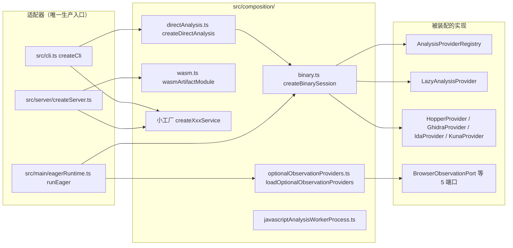

# 11 · Composition 层：生产装配根

> `src/composition/` 是 REA 唯一的生产装配点：它把 `src/<provider>/` 的具体实现类绑成 `src/application/` 需要的端口/会话对象，交给 CLI 与 MCP 两个适配器。**它属于层级的第 5 层**（`domain ← contracts ← provider ← application ← composition ← CLI/MCP`），只做「谁用谁的哪个实现」这一件事。
>
> 边界澄清：本篇**不**讲 BinarySession 的 provider 选取算法（见 [05](05-会话与Provider选择.md)）、**不**讲 MCP 工具注册（见 [09](09-Server层-MCP适配器.md)）、**不**讲子进程所有权语义（见 [13](13-Process层-子进程监督与所有权.md)）。装配根里出现的 Hopper/Ghidra/JEB 等名字，本篇只关心「在什么时机、以什么参数被构造」，不关心它们内部做什么。

实测环境：提交 `9541eb1f26cd7d3895b62d515e0edbbae554fcde`（本库 [00 规范](00-docs-style-guide.md) 的 `1173c0a9d` 基线之上追加文档的那一次提交，`src/` 未变）、Node `v24.10.0`（会话实际解释器；`.nvmrc` 钉的是 24.22.1，本篇结论不依赖两者差异）、darwin、2026-10-27。下文文件数/行数由 `wc -l src/composition/*.ts` 与 `ls` 得到。

## 0 速览

1. `src/composition/` 共 **41 个 `.ts` 文件、1157 行**，且**本目录内没有任何 `*.test.ts`** —— 装配正确性由 `tests/composition/`（如 `directAnalysisFactories.test.ts`、`evmModuleContract.test.ts`、`resolveWindowsProviderExecutable.test.ts`）承担。
2. 文件头注释把这一层的地位写成了字面事实：「这是唯一的生产装配点，因此两个适配器共享相同的 provider 选取、profile、生命周期与 Evidence 语义」（`src/composition/binary.ts`，`函数：createBinarySession` 签名上方文档注释）。
3. 装配有**六种不同形状**，不是一种：一次性绑定（`createDirectAnalysis`）、常驻深度会话（`createBinarySession`）、单操作静态描述符（`wasmArtifactModule` 等 3 个）、细粒度小工厂（20+ 个 `createXxxService()`）、可选观测端口独立加载（`loadOptionalObservationProviders`）、退化替身（`unconfiguredJebProvider`）。
4. 「独立可选加载」在源码里是可证的三点：每个端口一个 `try/catch` 包装（`src/composition/optionalObservationProviders.ts 函数：loadPort 偏移：+4`）、并发但互不阻塞（`Promise.all`，`函数：loadOptionalObservationProviders 偏移：+3`）、失败与成功同时保留在返回对象里（`偏移：+31`）。
5. 「静态 WASM/EVM 描述符」这句话**不在 AGENTS.md**，它是架构图节点文案：`docs/architecture.mermaid` 的 `Production Composition` 子图（`src/composition/binary.ts` 之外的第 11 行，见文末索引）；实现落点是 `wasmArtifactModule`、`evmInterfaceModule`、`apkSignatureModule` 三个 `as const` 对象。
6. 两个 JavaScript 分析 worker 之所以是**进程**而不是 `worker_threads`，直接证据是它们的入口文件放在装配根：`src/composition/javascriptAnalysisWorkerProcess.ts` 顶层 `await serveJavaScriptAnalysisWorker(analyze)`，通过 `package.json` 的 `imports` 子路径 `#javascript-analysis-worker` 被 `import.meta.resolve` 解析后用 `process.execPath` 重新派生（`src/javascript/analysis/JavaScriptAnalysisWorker.ts`，`Const：WORKER_HEAP_FLAGS_ENFORCED` 同文件）。
7. worker 的内存上限有**两个来源**：V8 堆由命令行 `--max-old-space-size` 表达，进程 commit 由 `src/process/JavaScriptWorkerMemoryLimit.ts 函数：javaScriptWorkerMemoryLimitBytes 偏移：+4` 计算 —— 只有 win32 + Bun 运行时才给非 null 值。

## 1 装配根的六种形状



节点都是真实导出符号，锚点见 §2 表格。

| 形状 | 代表 | 特征 |
|---|---|---|
| 一次性绑定 | `src/composition/directAnalysis.ts` | 把一个 environment 冻结后，绑成三个「不需要首参」的操作 |
| 常驻深度会话 | `src/composition/binary.ts` | 构造 4 个深度 provider + 懒辅助 provider + bundle 资源工厂 |
| 静态描述符 | `wasm.ts` / `evm.ts` / `apkSignature.ts` | `contract` + `cliCommand` + `create()` 三件套，CLI/MCP 共用 |
| 细粒度小工厂 | `go.ts`、`sqlite.ts`、`binaryDiagnostics.ts` … | 一行 `new XxxService(new XxxProvider())`，构造时零 I/O |
| 可选端口独立加载 | `optionalObservationProviders.ts` | 失败隔离，产出成功端口 + 精确失败表 |
| 退化替身 | `jeb.ts` | 配置非法时返回一个「永远 unavailable」的同类型对象，而非抛错 |

## 2 工厂清单

### 2.1 深度会话与一次性绑定

| 文件:导出 | 入参 | 返回 | 何时被调 |
|---|---|---|---|
| `src/composition/binary.ts` `函数：createBinarySession 偏移：+0` | `AppConfig`、`Logger`、环境快照、可选 `AnalysisSettingsReader` | `BinarySession` | MCP 启动：`src/main/eagerRuntime.ts` 内 `createBinarySession(` 调用点；CLI 侧经 `createDirectAnalysis` 的 `dependencies.createBinarySession` 动态导入 |
| `src/composition/binary.ts` `函数：createNativeDispatchBinarySession 偏移：+5` | 同上但无 settings | `BinarySession`，`inspection` 固定为 `"inspect_native_dispatch_metadata"` | 只在 `src/composition/directAnalysis.ts` 的 `dependencies.createNativeDispatchBinarySession` 里被调用 |
| `src/composition/binary.ts` `函数：createManagedBinarySession 偏移：+0` | 无 | `BinarySession`，深度候选为空数组、辅助只有 `ManagedStaticProvider` | 同上（`runManagedProviderExecution` 也用它） |
| `src/composition/binary.ts` `函数：createArtifactBinarySession 偏移：+4` | 环境、可选 platform | `Promise<BinarySession>`，**动态 import** `ArtifactProvider` | `createDirectAnalysis` 的对应依赖项 |
| `src/composition/binary.ts` `函数：createNativeBinarySession 偏移：+4` | 环境、可选 platform | `Promise<BinarySession>`，动态 import `NativeMacOSProvider` | 同上 |
| `src/composition/directAnalysis.ts` `函数：createDirectAnalysis 偏移：+0` | `Readonly<Record<string, string \| undefined>>` | `{ runDirectAnalysis, runProviderAnalysis, runSessionStatus }` | CLI 入口：`src/cli.ts` 里紧接 `snapshotEnvironment` 之后 |
| `src/composition/directAnalysis.ts` `函数：runManagedProviderExecution 偏移：+4` | 原函数去掉首参 `dependencies` | 同原返回 | 顶层导出，供「无配置、无原生候选」的托管元数据命令 |
| `src/composition/auxiliaryAnalysisProviders.ts` `函数：auxiliaryAnalysisProviderDeclarations 偏移：+10` | 环境、platform、settings | 3 条声明（identity + capabilities + `load()`） | `src/composition/binary.ts 函数：composeDeepBinarySession 偏移：+15` |

`composeDeepBinarySession` 是这一组里唯一有内部状态形状的地方，它的四行 `new` 值得逐字看：

```
composeDeepBinarySession+8   new HopperProvider(config, logger, environment)
composeDeepBinarySession+9   new GhidraProvider(config, logger, environment)
composeDeepBinarySession+10  new IdaProvider(config, environment)
composeDeepBinarySession+11  new KunaProvider(environment, { regexMatchingDeadline, regexWorkerHeapRequest })
```

这四个是**急切构造**；三个辅助 provider（artifact / native-macos / managed-static）则被 `src/composition/binary.ts 函数：composeDeepBinarySession 偏移：+34` 包成 `new LazyAnalysisProvider(declaration)`。二者的差别不是风格，而是：前四个构造时需要 `config`（含 `analysisProvider`、deadline、堆预算），后三个的实现模块很重（`ArtifactProvider`、`NativeMacOSProvider`），只在**第一次真正执行**时才值得加载 —— 见 `src/application/binary/LazyAnalysisProvider.ts 函数：createClient 偏移：+6`（`await this.#load()`）。

`createBundleResourceFactory`（`src/composition/binary.ts 函数：createBundleResourceFactory 偏移：+9`）是第三种模式：它返回的不是 provider 而是**工厂的工厂** —— `composeBinarySession` 拿到 `{ createClient(root) }`，只有真的解析到 app bundle 资源根时才 `Promise.all` 两个动态 import，再把 artifact 与 native 两个 client 用 `combineBundleResourceClients` 合并，并按 `BUNDLE_ARTIFACT_RESOURCE_OPERATIONS` / `BUNDLE_NATIVE_RESOURCE_OPERATIONS` 两个集合过滤能力。

### 2.2 单操作静态描述符（3 个）

| 文件:Const | contract | cliCommand | create 形状 |
|---|---|---|---|
| `src/composition/wasm.ts` `Const：wasmArtifactModule` | `INSPECT_WASM_ARTIFACT_CONTRACT` | `CLI_COMMANDS.inspectWasmArtifact` | `create(environment, injected?, settings?)` → `Pick<WasmArtifactService, "inspect" \| "close">`，两个方法都 `bind(service)` |
| `src/composition/evm.ts` `Const：evmInterfaceModule` | `INSPECT_EVM_INTERFACE_CONTRACT` | `CLI_COMMANDS.inspectEvmInterface` | `create` 直接等于 `createEvmInterfaceService`（返回完整 service，非 Pick） |
| `src/composition/apkSignature.ts` `Const：apkSignatureModule` | `INSPECT_APK_SIGNATURE_CONTRACT` | `CLI_COMMANDS.inspectApkSignature` | 同 wasm 形态，但忽略 `_environment`（纯进程内读取器） |

三者的文档注释把设计意图写死了（`src/composition/wasm.ts`，`Const：wasmArtifactModule` 上方）：「CLI/MCP 共享此绑定；service 保留失败资源的归属，因此 close 可以被重试。构造不做任何获取或目标 I/O。」这正是那句话里 **retryable lifetimes** 的含义 —— 装配根只负责给出「一次构造、可反复 close」的对象，重试语义在 service 侧（见 [13](13-Process层-子进程监督与所有权.md)）。

消费点（证明「命名契约」确实被两个适配器共用）：
- MCP：`src/server/createServer.ts` 的 `evmInterfaceModule.create(environment)`、`wasmArtifactModule.create(...)`、`apkSignatureModule.create(...)`；注册在 `src/server/registerWasmTools.ts 函数：registerWasmTools 偏移：+40` 读 `wasmArtifactModule.contract`。
- CLI：`src/cli/evmCommands.ts` 用 `evmInterfaceModule.create` + `evmInterfaceModule.cliCommand`；`src/cli/apkSignatureCommands.ts` 同构。
- [推导] `evmInterfaceModule.create` 与 `wasm`/`apkSignature` 的差别是刻意的：EVM 侧 host 需要完整 service 身份（`src/composition/evm.ts` 注释「The host owns injected service identity and its retryable cleanup lifetime」），而 wasm/apk 只需要 `inspect`/`close` 两个方法面。

### 2.3 可选观测端口

| 文件:导出 | 说明 |
|---|---|
| `src/composition/optionalObservationProviders.ts` `Type：OptionalObservationFactories` | 映射类型 `Port in keyof OptionalObservationProviders`，`-?` + `[]` 强制「每个端口都必须给一个工厂」—— 新增端口不写工厂就编译不过 |
| `src/composition/optionalObservationProviders.ts` `函数：createOptionalObservationFactories 偏移：+4` | 冻结环境后返回 5 个 `() => Promise<Port>`，每个内部 `await import("./xxx.js")` |
| `src/composition/optionalObservationProviders.ts` `函数：loadPort 偏移：+4` | `ok(await factory())` / `err({ providerId, reason })` |
| `src/composition/optionalObservationProviders.ts` `函数：loadOptionalObservationProviders 偏移：+3` | 5 次 `loadPort` 并发；`+23` 起展开成功键，`+31` 起展开 `optionalProviderLoadFailures` |

五个 `providerId` 不是字符串字面量，而是从 provider 侧导入的恒等常量：`CDP_BROWSER_PROVIDER_IDENTITY`、`PLAYWRIGHT_BROWSER_SCENARIO_PROVIDER_IDENTITY`、`CDP_ELECTRON_PROVIDER_IDENTITY`、`PLAYWRIGHT_ELECTRON_ACTIVE_PROVIDER_IDENTITY`、`V8_INSPECTOR_PROVIDER_IDENTITY`（见 `src/composition/optionalObservationProviders.ts` 的 import 块）。这样失败报告里的 id 与工具实际使用的 id 不可能漂移。

### 2.4 细粒度小工厂（一行的那一类）

这些文件全部是 5~15 行，共同点是：**签名上方注释声明构造时不获取工具、不开进程、不读文件**；差异只在入参是 environment / settings / platform / 无。

| 文件 | 导出 | 返回 | 备注（注释原文要点） |
|---|---|---|---|
| `go.ts` | `createGoBinaryService` | `GoBinaryService` | 「bundled offline inspection without acquiring a toolchain or starting any process」 |
| `rust.ts` | `createRustBinaryService` | `RustBinaryService` | 同上，且「no child process」 |
| `il2cpp.ts` | `createIl2cppMetadataService` | `Il2cppMetadataService` | 额外注入 `Il2cppGhidraSeedWriter`（唯一带第二个协作者的小工厂） |
| `erlang.ts` | `createBeamService` | `BeamService` | 「no Erlang installation or any child process」 |
| `pythonPyc.ts` | `createPythonPycService` | `PythonPycService` | 「without invoking CPython or writing files」 |
| `model.ts` | `createModelArtifactService` | `ModelArtifactService` | 「local reader without acquiring files, processes or network」 |
| `gpu.ts` | `createGpuCodeObjectsService` | `GpuCodeObjectsService` | 无注释 |
| `desktop.ts` | `createDesktopApplicationService` | `DesktopApplicationService` | 「复用既有 artifact reader 与 Evidence identity，不用深度 provider」 |
| `electronFuses.ts` | `createElectronFuseService` | `ElectronFuseService` | 「read-only fuse inspection without a runtime, network, or fuse edit」 |
| `sqlite.ts` | `createSqliteDatabaseService` | `SqliteDatabaseService` | 接收 environment |
| `pcap.ts` / `apktool.ts` / `adb.ts` | `createPcapAnalysisProvider` 等 | 各自 `*Port` | 「bound to the caller-selected tools/binary/launcher」 |
| `android.ts` | `createAndroidAnalysisProvider` | `AndroidAnalysisPort` | 注释含「its own queue and cleanup-failure state」 |
| `flutter.ts` | `createFlutterBuildAnalysisProvider` | `FlutterBuildAnalysisPort` | 「needs no external tools」 |
| `firmware.ts` | `createFirmwareAnalysisProvider` | `FirmwareAnalysisPort` | 「without launching or acquiring an engine」；同时 re-export `firmwareHostSupported` |
| `javascriptRecovery.ts` | `createJavaScriptRecoveryProvider` | `JavaScriptRecoveryPort` | `WakaruProvider`；re-export `wakaruHostSupported` |
| `captures.ts` | `createPacketCaptureService` | `PacketCaptureService` | `TsharkCaptureProvider`；re-export `tsharkHostSupported` |
| `signals.ts` | `createSignalRecordingService` | `SignalRecordingService` | `SigrokRecordingProvider`；re-export `sigrokHostSupported` |
| `evm.ts` | `createEvmInterfaceService` | `EvmInterfaceService` | re-export `evmHostSupported`、`evmLimiterAvailability` |
| `webRuntime.ts` | `createWebRuntimeService` | `WebRuntimeService` | 「without opening a browser connection」 |
| `webModules.ts` | `createWebModuleTraceService` | `WebModuleTraceService` | 「optional module tracing without acquiring a browser or reading files」 |
| `webSourceLocations.ts` | `createWebSourceLocationService` | `WebSourceLocationService` | 「without import-time reads or process acquisition」 |
| `webNetworkCaptures.ts` | `createWebNetworkCaptureService` | `WebNetworkCaptureService` | 唯一在装配时就构造 4 个 decoder adapter（har/saz/qlog + mitmproxy），堆预算来自 `runtimeCaptureDecoderHeap` |
| `browserObservation.ts` | `createBrowserObservationProvider` | `BrowserObservationPort` | `CdpBrowserProvider()` 无参 |
| `browserScenario.ts` | `createBrowserScenarioProvider` | `BrowserScenarioCapturePort` | 注入 `PlaywrightScenarioSession.open` 闭包（会话式启动延迟到端口被调用） |
| `electronObservation.ts` | `createElectronObservationProvider` | `ElectronObservationPort` | 传 `runtimeAsarHeaderAdmission(environment, settings)` |
| `electronScenario.ts` | `createElectronScenarioProvider` | `ElectronActiveObservationPort` | `PlaywrightElectronActiveProvider(environment)` |
| `javascriptRuntimeObservation.ts` | `createJavaScriptRuntimeObservationProvider` | `JavaScriptRuntimeObservationPort` | `V8InspectorProvider` + asar admission |
| `binaryDiagnostics.ts` | 12 个 `createXxxService` + `pwntoolsHostSupported` | PE/ELF/Apple/内核模块/熵/布局/崩溃/devicetree 等 | 唯一把 12 个诊断 service 集中在一处的文件 |
| `reverseEngineering.ts` | `createReverseEngineeringCommandPort`、`createReverseEngineeringService` | command port / service | objdump 分支额外带 `environmentOverrides: { DEBUGINFOD_URLS: "" }` |
| `resolveWindowsProviderExecutable.ts` | `函数：resolveWindowsProviderExecutable` | 解析后的可执行路径 | 唯一在装配根里碰 `node:fs` 的文件（`existsSync`/`statSync`），带 `isFile` 测试替身 seam |

`reverseEngineering.ts` 值得单独注意：`createReverseEngineeringCommandPort` 返回的是**命令描述生产者**（`{ executable, arguments, identity, environmentOverrides }`）而不是执行器，执行由 `src/process/` 的监督接手；`DEBUGINFOD_URLS` 置空是为了让 objdump 不去联网找调试信息 —— 这是「local-only」约束在装配根里的一处字面体现。

### 2.5 两个 worker 进程入口

`src/composition/javascriptAnalysisWorkerProcess.ts` 与 `src/composition/webBundleAnalysisWorkerProcess.ts` 不是工厂：它们的主体是**顶层 await** —— 分别调用 `serveJavaScriptAnalysisWorker(analyze)` 与 `serveWebBundleAnalysisWorker(analyze)`，两个文件都在文件尾部 `try { await serve… } catch { stderr + process.exitCode = 1 }`。它们被打包成独立入口：`package.json` 的 `imports` 字段把 `#javascript-analysis-worker` / `#web-bundle-analysis-worker` 指到 `dist/composition/*WorkerProcess.js`，由 `src/javascript/analysis/JavaScriptAnalysisWorker.ts` 与 `src/browser/WebBundleAnalysisWorker.ts` 用 `import.meta.resolve` 反查路径后作为子进程脚本参数。

为什么住在装配根：入口文件必须只依赖 domain/application 的纯分析函数，而「用哪个 analyzer 实现服务这个 worker」正是装配决策。JavaScript 侧的 `analyze` 函数（`src/composition/javascriptAnalysisWorkerProcess.ts 函数：analyze 偏移：+7`）演示了完整的阶段推进：`parse → static → semantic → projection`，每步之间调用 `callbacks.phase(...)` / `callbacks.checkpoint(...)`，并在两个位置用 `AnalysisResourceConstraintError` 拒绝继续（父进程结果为 0 字节预算时、模块 transfer 超出预算时）。这两处都是**保留已完成的 static facts 再失败**，而不是全部丢弃 —— 与 AGENTS.md「Preserve partial facts」一致。

## 3 「独立可选加载」的代码证据

三条可逐字核对的证据：

1. **每端口独立成 `Result`**：`loadPort` 的 `try` 包住 `await factory()`，因此同步抛错与 Promise 拒绝都收敛成同一个 `err({ providerId, reason })`；`reason` 取 `cause.message`，非 Error 时退化为 `String(cause)`（`src/composition/optionalObservationProviders.ts 函数：loadPort 偏移：+7`）。
2. **并发但不互相牵连**：`Promise.all` 的 5 个子 Promise 全都是 `loadPort` 包装过的、**永不 reject** 的 Promise，所以 `Promise.all` 在这里不可能整体失败（`函数：loadOptionalObservationProviders 偏移：+3`）。
3. **返回形状保证「健康同伴被保留」**：成功键用 `...(x.ok ? { key: x.value } : {})` 展开 —— 失败端口在结果对象里是**属性缺失**而不是 `undefined`，与 `OptionalObservationProviders` 的全可选字段一致；失败另存 `optionalProviderLoadFailures`（`函数：loadOptionalObservationProviders 偏移：+23` 与 `+31`）。

第四点关于「懒」：辅助 provider 的独立性来自另一个机制。`LazyAnalysisProvider.#load()` 用 `this.#provider ??= this.#loadProvider().catch(...)`，并在 catch 里把 `#provider` 重置为 `undefined` 后再抛（`src/application/binary/LazyAnalysisProvider.ts`，见文末索引 `load:61`）—— **加载失败不被缓存**，下一次执行会重新尝试 import。这与 worker/端口那次「成功结果缓存」形成对照：装配根缓存成功，绝不缓存失败。

失败之后发生什么（跨层一条链）：`optionalProviderLoadFailures` 进入 `src/server/createServer.ts`，由 availability policy 合并，最终在工具被调用时经 `src/application/OptionalObservationProviders.ts 函数：optionalProviderUnavailable 偏移：+3` 变成 `AnalysisCapabilityUnavailableError`，消息前缀固定为 `Adapter could not load: `。也就是说：**加载失败不会让 server 启动失败，只会让对应工具变成「不可用且带原因」**。

一个精度点：`OptionalProviderLoadFailures` 的键集合比 loader 覆盖的端口多一个 `"fridaInstrumentation"`（`src/application/OptionalObservationProviders.ts`，`Type：OptionalProviderLoadFailures`）。当前源码里这个键**不是**由 `loadOptionalObservationProviders` 填的，而是 `src/server/createServer.ts` 从 `fridaInstrumentation.availabilityFailure?.()` 取得 —— [推导] 说明 Frida 的「不可用」走的是运行时自证而非装配期 import 失败。

## 4 那句话到底在哪

用户给出的短语「fresh typed provider and factory / one-shot binding and independent optional loading / static WASM/EVM descriptors: named contracts, factories, retryable lifetimes」在仓库里的实际位置是 `docs/architecture.mermaid` 的 `Production Composition` 子图节点文案（`COMPOSITION`），**不是 AGENTS.md**；AGENTS.md 只在「Architecture and Cleanup」里规定依赖方向并要求「改 composition 前先读 architecture.mermaid」。三段的实现落点分别是：

| 短语 | 实现 |
|---|---|
| fresh typed provider and session factories | §2.1 与 §2.4 的所有 `create*`：返回类型都是端口/service 类型（`AndroidAnalysisPort` 等），且每次调用构造新实例 |
| one-shot binding | `createDirectAnalysis`：把 environment 冻结 + 依赖表绑定，导出 `BoundOperation<...>` 去掉首参的三个操作 |
| independent optional loading | §3 |
| static WASM/EVM descriptors | §2.2 的三个 `as const` |
| retryable lifetimes | `create()` 返回值里始终带 `close`；service 侧保留归属（`src/composition/wasm.ts` 注释） |

## 5 边界与失败模式

| 现象 | 根因位置 | 说明 |
|---|---|---|
| MCP 启动就构造了 4 个深度 provider，即使本次会话根本不用它们 | `src/composition/binary.ts 函数：composeDeepBinarySession 偏移：+8` | 急切 `new`；[推导] 构造函数被假定廉价（只做配置解析），真正的引擎启动延迟在 provider 内部 |
| 目标一旦需要辅助 provider，第一次执行会有一次 import 抖动 | `src/application/binary/LazyAnalysisProvider.ts 函数：createClient 偏移：+6` | `DeferredAnalysisClient` 把加载推到首次执行；abort 时抛 `AnalysisCancelledError` |
| 环境里 `REA_JEB_MCP_TIMEOUT_MS` 写错 → JEB 工具存在但永远失败 | `src/composition/jeb.ts 函数：createJebAnalysisProvider 偏移：+7` | `unconfiguredJebProvider` 的 `execute()` 直接 `err(error)`，`inspectAvailability()` 返回 `status: "unavailable", code: "not_configured"`，`close()` 立即 resolve —— 只有 JEB 受影响 |
| JEB 构造抛 `AnalysisInputError` 之外的错误 | `src/composition/jeb.ts` `函数：createJebAnalysisProvider 偏移：+20`（`if (!(cause instanceof AnalysisInputError)) throw cause;`） | [推导] 退化替身只覆盖「输入/配置类」错误；真正的内部 bug 不会被吞 |
| 观测端口模块 import 失败 | `src/composition/optionalObservationProviders.ts 函数：loadPort 偏移：+7` | 只保留 `message` 文本；`reason` 不是 Error 时是 `String(cause)`，可能为空串 [待查证] |
| win32 上裸命令名找不到 | `src/composition/resolveWindowsProviderExecutable.ts`（`Const：splitWindowsPath` 同文件） | 只有 `platform === "win32"` 走这里；PATH 项支持引号包裹，含裸引号的条目被丢弃 |
| 把 worker 入口当普通模块 import | `src/composition/javascriptAnalysisWorkerProcess.ts` 顶层 `await` | 顶层 await 意味着**导入即服务**：任何静态 import 都会立刻开始 ndjson 服务循环，因此只能通过 `#javascript-analysis-worker` 子路径以子进程方式使用 |
| composition 里没有测试，改动只靠类型检查 | `ls src/composition/*.test.ts` 为空（实测 2026-10-27） | 行为回归在 `tests/composition/`；跨层装配错误由 boundary 测试（`tests/boundary/process/runtimeBundle.test.ts` 断言 worker 入口产物存在）兜住 |

## 6 问题清单

- **P1｜四个深度 provider 的急切构造是否总是安全**：`composeDeepBinarySession+8~+11` 无条件 `new` Hopper/Ghidra/IDA/Kuna，而 `KunaProvider` 还接收 `regexWorkerHeapRequest`。若某个构造函数会探测文件系统，MCP 冷启动成本就被装配根承担。→ 需要读 `KunaProvider`/`HopperProvider` 构造函数确认；本篇未读取。
- **P2｜`fridaInstrumentation` 为何留在 `OptionalProviderLoadFailures` 键里**：`src/application/OptionalObservationProviders.ts` 的联合键包含它，但装配根不加载它。这是遗留命名空间还是即将接入？当前源码无法确定。→ 待拍板
- **P2｜`createArtifactBinarySession` / `createNativeBinarySession` 用 `.then()` 而 `createManagedBinarySession` 用同步返回**：三种会话的异步边界不一致（前者返回 Promise，后者不返回）。对调用方来说 `await` 一个非 Promise 也合法，但这掩盖了「哪些会话装配真的需要 IO」。→ 待确认设计意图
- **P3｜静态描述符只有 3 个**：wasm/evm/apkSignature 用描述符对象，其余 20+ 个小工厂各自 `create*` + `register*Tools` 手工接。[假设] 描述符是给「单操作、需要 CLI/MCP 共享同一契约常量」的场景，多操作 provider 不适用。未找到源码依据。
- **[未知]** `snapshotEnvironment(selectedEnvironment, platform)` 的第二参数在 `auxiliaryAnalysisProviderDeclarations`、`createArtifactBinarySession` 等处被传入，而 `composeDeepBinarySession` 只传 environment。两版语义差别需要读 `src/process/snapshotEnvironment.ts` 确认（见 [13](13-Process层-子进程监督与所有权.md) §snapshotEnvironment）。

## 7 已知缺口

- 风险：装配根无本目录测试 ⇒ 工厂签名错误能编译通过但语义错（例如忘记 bind `close`）。缓解是 `tests/composition/directAnalysisFactories.test.ts` 与 `evmModuleContract.test.ts` 覆盖其中两处，其余靠适配器测试。
- 设计特性：`create*` 一律「构造不做 I/O」，这让 CLI 一次性进程可以安全地构造一批用不到的 service —— 成本换确定性，符合 AGENTS.md 的 additive/idempotent 口径。
- 未读取，不臆测：`HopperProvider`/`GhidraProvider`/`IdaProvider`/`KunaProvider` 构造函数内部、`createServer.ts` 的完整选项表、`src/browser/WebBundleAnalysisWorker.ts` 的启动参数（本篇只确认它同样用 `#web-bundle-analysis-worker` 子路径）。

## 8 源码索引

| 事实 | 文件:符号:行号 |
|---|---|
| 「唯一生产装配点」注释 | `src/composition/binary.ts:createBinarySession:28` |
| 深度 provider 急切构造 | `src/composition/binary.ts:composeDeepBinarySession:55` |
| Lazy 辅助 provider | `src/composition/binary.ts:auxiliaryDeclarations:70` |
| bundle 资源工厂 | `src/composition/binary.ts:createBundleResourceFactory:95` |
| artifact/native 会话（动态 import） | `src/composition/binary.ts:createArtifactBinarySession:142` |
| 一次性绑定 | `src/composition/directAnalysis.ts:createDirectAnalysis:20` |
| `BoundOperation` 类型 | `src/composition/directAnalysis.ts:BoundOperation:9` |
| 端口工厂映射类型 | `src/composition/optionalObservationProviders.ts:OptionalObservationFactories:18` |
| `loadPort` 隔离 | `src/composition/optionalObservationProviders.ts:loadPort:54` |
| 独立加载与失败表 | `src/composition/optionalObservationProviders.ts:loadOptionalObservationProviders:69` |
| JEB 退化替身 | `src/composition/jeb.ts:unconfiguredJebProvider:46` |
| 懒加载实现（失败不缓存） | `src/application/binary/LazyAnalysisProvider.ts:load:61` |
| 加载失败 → 工具错误 | `src/application/OptionalObservationProviders.ts:optionalProviderUnavailable:38` |
| wasm 静态描述符 | `src/composition/wasm.ts:wasmArtifactModule:18` |
| evm 静态描述符 | `src/composition/evm.ts:evmInterfaceModule:23` |
| apkSignature 静态描述符 | `src/composition/apkSignature.ts:apkSignatureModule:11` |
| MCP 侧消费描述符 | `src/server/createServer.ts:evmInterface:459` |
| 架构图节点文案 | `docs/architecture.mermaid:COMPOSITION:11` |
| worker 入口（顶层 await） | `src/composition/javascriptAnalysisWorkerProcess.ts:analyze:19` |
| worker 子路径声明 | `package.json:#javascript-analysis-worker:38` |
| worker 派生与堆参数 | `src/javascript/analysis/JavaScriptAnalysisWorker.ts:WORKER_HEAP_FLAGS_ENFORCED:82` |
| Bun/Windows 进程 commit 计算 | `src/process/JavaScriptWorkerMemoryLimit.ts:javaScriptWorkerMemoryLimitBytes:35` |
| Windows 裸命令解析 | `src/composition/resolveWindowsProviderExecutable.ts:resolveWindowsProviderExecutable:39` |
| objdump 关闭 debuginfod | `src/composition/reverseEngineering.ts:environmentOverrides:26` |

## 9 相关篇

- 层级的整体形状与进程角色 → [01 系统骨架](01-系统骨架.md)
- 模块职责与依赖方向核查 → [02 模块地图与依赖方向](02-模块地图与依赖方向.md)
- 装配出来的会话如何做 provider 选取 → [05 会话与 Provider 选择](05-会话与Provider选择.md)
- 装配根下游：共享工作流 → [12 Application 层：共享工作流](12-Application层-共享工作流.md)
- worker 子进程的所有权与清理 → [13 Process 层：子进程监督与所有权](13-Process层-子进程监督与所有权.md)
- `tests/composition/` 的组织 → [24 测试体系](24-测试体系.md)
