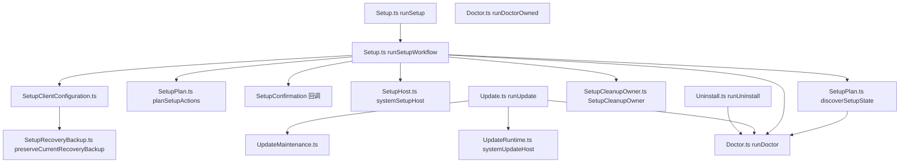

# 12 · Application 层：共享工作流

> `src/application/` 是 CLI 与 MCP **共用**的工作流层：它定义「一次分析/一次安装/一次注册」做了什么步骤、失败时保留哪些事实、产出什么 Evidence，但**不**定义引擎协议。它位于 `domain ← contracts ← provider ← application ← composition ← CLI/MCP` 的第 4 层。
>
> 边界澄清：本篇按**主题簇**走读，不按文件字母序。三件事不在本篇：装配（谁把实现塞进这些工作流）→ [11](11-Composition层-生产装配根.md)；子进程所有权原语 → [13](13-Process层-子进程监督与所有权.md)；`src/application/investigation/` 与 `javascript/` 的内部语义 → 分别见 [23](23-调查记录与重建台账.md) 与 [19](19-Web与浏览器观测.md)。

实测环境：提交 `9541eb1f26cd7d3895b62d515e0edbbae554fcde`、Node `v24.10.0`、darwin、2026-10-27。统计来自 `ls src/application/*.ts | wc -l`（191 个顶层文件）与 `ls -d src/application/*/ | wc -l`（36 个子目录）。

## 0 速览

1. 这一层不是「一堆 service」，而是 **5 个主题簇**：分析工作流、宿主生命周期（Setup/Doctor/Update/Uninstall）、client 注册与配置文档、Evidence 与工作流外壳、Port+Service 配对。§1 给总表。
2. AGENTS.md 的「`rea setup` 必须先展示计划、批准后才写文件」在源码里有**两个具体批准点**：选择阶段 `src/application/Setup.ts 函数：runSetupWorkflow 偏移：+79` 与动作阶段 `偏移：+176~+180`；未批准时返回 `status: "needs_confirmation"` 或 `"cancelled"`，而不是抛错（`偏移：+196` 起的返回分支）。
3. 「dry-run 只出计划」是同一函数的独立分支：`src/application/Setup.ts 函数：runSetupWorkflow 偏移：+164` 直接返回 `{ status: "planned", plannedActions, ... }`，**在批准检查之前**。
4. 备份是**内容寻址**的：首选 `${configPath}.rea.backup`；字节不匹配本次事务的原文时，复制到 `${configPath}.rea.backup.<sha256>.recovery` 且用 `COPYFILE_EXCL` 拒绝覆盖（`src/application/SetupRecoveryBackup.ts 函数：selectCurrentRecoveryBackup 偏移：+30` 与 `函数：copyExclusive 偏移：+0`）。
5. `DshCordis*` 不是逆向目标格式：它是 **client 注册方言**。`dsh` 客户端（`DSH_CLIENT_PACKAGE = "@deepseek-ai/dsh-mcp-client"`）用一份 Cordis 补丁 YAML `cordis.patch.yml` 声明 MCP 服务器，REA 要在其中幂等地增删自己那一条 `id: "rea-mcp"`，并且**永不执行** `!js` 表达式（`src/application/DshCordisYaml.ts Type：CordisExpression`，注释「Expression source is never a literal value and is never evaluated by REA」）。
6. 可用性判断集中在**一处**：`src/application/CapabilityInventory.ts 函数：buildCapabilityInventory 偏移：+0` 以 `TOOL_CONTRACTS` 的顺序映射，输入是一次 `sessionStatus` 观测 + `AvailabilityPolicy` + client 特性声明；`Const：HOST_RESTRICTED_FEATURES`（同文件）列出 9 项「本机跑不了」的集成。catalog 顺序不选择操作 —— 映射源是契约表本身。
7. 一次性 CLI 分析与常驻 MCP 分析共用同一批零件：`src/application/DirectAnalysis.ts 函数：runDirectAnalysis 偏移：+0` 只做「开 session → 执行 → 清理」，清理与主错误的合并交给 `src/application/DirectAnalysisCleanup.ts 函数：withSessionCleanup 偏移：+0`。
8. 每个能力子目录几乎都是 `XxxPort.ts` + `XxxService.ts` 成对：Port 是**可替换引擎边界**（含 `close()` 的重试语义），Service 是**CLI/MCP 共享的校验与 Evidence 组装**。见 §6 的原文注释证据。

## 1 主题簇总览

| 簇 | 代表文件 | 一句话职责 |
|---|---|---|
| A 分析工作流 | `AnalysisProvider.ts`、`DirectAnalysis.ts`、`EnhancedTools.ts`、`CapabilityInventory.ts`、`BinaryTargetResolver.ts`、`ProcedureAddressResolution.ts`、`EnhancedLiteralTracing.ts`、`SourceLimitations.ts` | 定义 provider 中立端口、一次性/常驻执行编排、组合工具分派、可用性与来源caveat |
| B 宿主生命周期 | `Setup.ts`、`SetupPlan.ts`、`SetupHost.ts`、`Doctor.ts`、`DoctorScope.ts`、`Update.ts`、`UpdateRuntime.ts`、`UpdateMaintenance.ts`、`Uninstall.ts` | 发现→计划→批准→应用→体检→维护→卸载，含失败恢复与回滚归属 |
| C client 注册 | `SupportedClients.ts`、`ClientRegistration.ts`、`ClientRegistrationStatus.ts`、`ClientConfigurationDocument.ts`、`ClientConfigurationPublication.ts`、`DshCordisPatch.ts`、`SkillFilePublication.ts` | 26 个受支持客户端的配置位置、方言解析、只增不删的写入事务与状态回读 |
| D Evidence 与工作流外壳 | `WorkflowEvidence.ts`、`EvidenceBundleCommands.ts`、`EvidenceBundleFiles.ts`、`EvidenceInputResolver.ts`、`FunctionAnalysisEvidence.ts`、`ProgressReporter.ts`、`JsonFiles.ts`、`JsonInputFile.ts`、`RegularFileRead.ts` | 组合工作流的 Evidence 组装/预算、bundle 导入导出与认证、大 JSON 的有界读取、进度上报边界 |
| E 宿主工具安装面 | `HopperDownload.ts`、`HopperReleaseFeed.ts`、`HopperLauncherDiscovery.ts`、`MacHopper.ts`、`LinuxHopper.ts`、`LinuxHopperPublisher.ts`、`LinuxHopperPython.ts`、`MacHopperPaths.ts` | 「下载并验证厂商包 → 得到可启动的 launcher」，与 `src/hopper/` 的协议层严格分开（→ [15](15-深度Provider-Hopper与Ghidra.md)） |
| F Port+Service 配对 | 36 个子目录里的 `*Port.ts` / `*Service.ts` | 每个能力的可替换引擎边界 + 两个适配器共享的语义外壳 |

## 2 簇 A：分析工作流

### 2.1 `AnalysisProvider.ts`：这一层的类型中枢

367 行里几乎没有流程代码，它规定的是**边界形状**：

| 符号 | 含义（注释原文要点） |
|---|---|
| `Type：AnalysisOperation`（`src/application/AnalysisProvider.ts`） | 「Closed operations accepted by provider-backed analysis sessions」—— 封闭集合，新增操作必须显式进这个联合类型 |
| `Type：AnalysisExecution` | 「Atomic successful provider observation with exact producing provenance」；其中 `xrefs` 截断标志的注释明确：`Absent when it reports nothing, which is not a completeness claim`，且该字段「Never part of Evidence or tool output」 |
| `函数：createAnalysisExecution` | 适配器边界构造被校验的观察；`rawResult` 只在 provider 表示与规范化结果不同才传，否则记 `null` 而不是每份 Evidence 里存两份完整结果 |
| `Type：AnalysisClient` | 「Provider session bound to exactly one parsed artifact」 |
| `Type：AnalysisProvider` | 「Factory and capability declaration for an analysis implementation」 |
| `Type：CapabilityDescriptor` | 带 `snapshot` 策略的能力描述：「Snapshot opts immutable, profile-bound reads into replay despite incidental private filesystem writes. Live state must always be re-observed.」 |
| `Type：ExecutionOptions` | 「Set when a procedure selector came from provider output … A provider-derived selector is never the caller's input mistake.」 |

最后一条值得单独记住：`ExecutionOptions` 里那个标志把「谁的输入错误」写进了类型 —— provider 输出里拿到的下一个 procedure 不能算调用方的错，因此不能返回 `AnalysisInputError`。[推导] 这是 Evidence 溯源与错误代数在应用层的一次合流。

### 2.2 `DirectAnalysis*`：一次性执行的四个文件

| 文件 | 导出 | 作用 |
|---|---|---|
| `src/application/DirectAnalysis.ts`（843 行） | `函数：runDirectAnalysis 偏移：+0` | 一次性分析主编排（开 session → 执行 → 清理 → 交付） |
| 同上 | `函数：runProviderAnalysis 偏移：+0` | 「Execute one provider-native semantic operation with atomic provenance」 |
| 同上 | `函数：runManagedProviderExecution 偏移：+0` | 在「只有托管元数据」的隔离会话里执行，不选深度 provider |
| 同上 | `src/application/DirectAnalysis.ts` 内的注释 `Mirror BinarySession.providerIdentity for a route not opened yet` | 未开路由也要能报 identity —— 镜像而非猜测 |
| `src/application/DirectAnalysisCleanup.ts` | `函数：withSessionCleanup 偏移：+0` | 「Await one-shot cleanup and retain either the outcome or both failures」 |
| 同上 | `函数：directAnalysisCleanupFailure 偏移：+0` | 执行与清理都落定后才投影一次性结果类型 |
| 同上 | `函数：managedAnalysisCleanupFailure 偏移：+0` | 托管观察与原始 typed failure 同时保留在诊断里 |
| `src/application/DirectAnalysisDependencies.ts`（30 行） | 依赖表类型 | 五个 `createXxxBinarySession` 的可注入面；装配实现见 [11](11-Composition层-生产装配根.md) |
| `src/application/DirectAnalysisStatus.ts` | `函数：runSessionStatus 偏移：+0` | 「Read target-free provider status and operation availability」—— 不开目标也能问可用性 |

`DirectAnalysisCleanup.ts` 只有 92 行，却是「失败也不丢事实」的样板：主结果与清理结果被同时保留，而不是让清理成功/失败覆盖主结论。

### 2.3 `EnhancedTools.ts`：组合工具的分派器

`class EnhancedTools`（`src/application/EnhancedTools.ts`）的构造只接一个 `AnalysisOperationPort`，两个入口的分工写在类注释里：

```
EnhancedTools 类注释（Direct callers use `execute`; adapters that own validation use
`executeValidated` so an MCP input is parsed exactly once.）
```

- `函数：execute 偏移：+0`：解析一次不可信输入，然后穷尽分派；`trace_feature` / `trace_call_path` 走 `#executeTracing`，`trace_native_values` 等先 `enhancedInputSchemas[name].safeParse` 再转 `executeValidated`。
- `函数：executeValidated 偏移：+0`：接收 `Type：ValidatedEnhancedCall`（`src/application/EnhancedToolTypes.ts`，注释「One enhanced call whose input was parsed at its owning adapter boundary」）—— 即「已由适配器校验」的可辨识联合。
- 解析失败统一经 `函数：invalidEnhancedInput 偏移：+0` 变成 `err(new AnalysisInputError(name, { cause }))`。

工具名在这条 switch 里可见（`EnhancedTools.ts` 的 `executeValidated` 分支）：`inspect_native_dispatch_metadata`、`get_objc_classes`、`get_objc_protocols`、`batch_decompile`、`decompile_all`、`get_call_graph`、`analyze_swift_types`、`find_xrefs_to_name`、`binary_overview`、`analyze_function`、`inspect_native_api`、`trace_feature`、`trace_call_path`、`trace_native_values`、`trace_native_ui_action`。

文件顶部的两个谓词是**能力回退的守门人**：

```
const isAnalysisCancellation = (error) => error._tag === "AnalysisCancelledError";
const permitsCapabilityFallback = (error) =>
  error instanceof AnalysisCapabilityUnavailableError && !error.cleanupIncomplete;
```

即：**清理没做完的「不可用」不允许被回退掩盖**（`src/application/EnhancedTools.ts permitsCapabilityFallback`）。

### 2.4 `CapabilityInventory.ts`：可用性的单一真相源

1051 行，输入是 `sessionStatus`（一次 target-free 观测）+ `AvailabilityPolicy` + `ClientFeatureAvailability`，输出 `ToolAvailability[]`：

- `函数：buildCapabilityInventory 偏移：+5` 先 `statusSchema.parse(sessionStatus)`，再把 `status.capabilities` 建成 `operation → descriptor` 的 Map，然后 `TOOL_CONTRACTS.map(...)` —— **遍历顺序是契约表**，与 AGENTS.md「catalog ordering must never select an operation」一致：选择靠 operation 名字查表，不靠位置。
- `Const：HOST_RESTRICTED_FEATURES`：9 项（`packetCapture`、`pcapCapture`、`signalRecording`、`evmInterface`、`binaryLayout`、`recordedCrash`、`firmwareInspection`、`firmwareExtraction`、`javascriptRecovery`）——「Integrations this host cannot run, whatever their configuration」。
- `Const：MACHO_TARGET_OPERATIONS`：5 个「只对活动 Mach-O 可执行文件成立」的原生契约（`inspect_signature`、`inspect_macho`、`list_architectures`、`observe_native_calls`、`observe_native_ui`、`capture_native_ui_scenario` 中的 Mach-O 侧子集，见 `Const：MACHO_TARGET_OPERATIONS` 所在行）。注意注释说「defined only for an active Mach-O executable」—— [推导] 它与 `AvailabilityPolicy` 里的 `requiresActiveTarget` 判定共同决定工具是否对当前目标可见。
- `Const：NAVIGATION_CONTEXT_MODES`：`current_selection` 需要 `current_document` + `current_address` + `resolve_containing_procedure`；`explicit_document` 只需要后两个 —— 这就是「显式地址可以没有当前文档」的能力侧证据。
- `src/application/CapabilityInventory.ts` `函数：compactToolAvailability 偏移：+0`（同文件有三处重载声明）把可用性压成给发现流程用的紧凑形状。

`CapabilityClientRequirements.ts`（27 行）补上 MCP 侧：`Const：NO_CLIENT_FEATURES` 是「调用方没给特性声明时的空 MCP 客户端特性」，`函数：clientRequirementsFor 偏移：+0` 把工具的 client 需求投影到协商结果上。

### 2.5 `BinaryTargetResolver.ts`：1384 行的「读一个描述符」

它不是 provider 选择器，而是**目标准入**：`函数：parseBinaryTarget 偏移：+0` 在同一个文件描述符上完成分类与哈希，`Type：BinaryTargetResolverOptions` 规定解析选项。文件内的注释把关键约束逐条写出来（都是观察级事实）：

| 证据 | 约束 |
|---|---|
| `src/application/BinaryTargetResolver.ts` 文件内注释 | 「Classify and hash the one descriptor admitted by the lifetime owner」—— 只有一个被生命周期 owner 准入的描述符 |
| 同文件内注释 | 「Preserve an earlier admission refusal over an interruption during final close」—— 早先的准入拒绝优先于最终关闭时的中断 |
| 同文件内注释 | 「Descriptor cleanup retains the physical result and binds its exact release lease」 |
| `函数：classifyBinaryTargetFilesystemFailure`（同文件） | `函数：classifyBinaryTargetFilesystemFailure` —— 把读失败**分类**而不是统一成「文件不存在」 |
| 同文件内注释 | 「Whether the leading bytes begin any executable header family, valid or not」—— 只看头字节，不判合法性 |
| 同文件内两处分段读取注释 | 「a short result means end of file」/「a short read means the file changed or ended early」—— 短读区分 EOF 与中途变更 |
| 同文件内注释 | 「ELF structure and family declarations share one descriptor before provider selection」 |
| 同文件内注释 | 「every request is at most one 64 KiB table chunk」 |
| 同文件内两处分帧注释 | Mach-O thin command 分帧证明与「跳过 payload 字节」的探测窗口 |
| 同文件内两条 FAT 注释 | FAT 切片在校验过的表与规范身份准入**之后**才验证 |

### 2.6 地址解析、追踪与上下文

| 符号 | 文件 | 关键行为 |
|---|---|---|
| `函数：resolveProcedureAddress 偏移：+0` | `src/application/ProcedureAddressResolution.ts` | 只调 `procedure_address` 操作；返回值必须是非空字符串，否则 `AnalysisOutputError("provider returned no canonical procedure address")` |
| `函数：resolveXrefsAddress 偏移：+11` | `src/application/XrefsAddressResolution.ts` | 已是十六进制形态（`/^[0-9a-f]+$/iu`、`/^0x/iu`、`/:0x/iu`）就原样返回 —— 「Resolve a CLI symbol selector without changing existing address spellings」；否则解析符号名，未知名字给 `AnalysisInputError` 并附可执行的建议文案 |
| `函数：traceLiteralFeature 偏移：+0` | `src/application/EnhancedLiteralTracing.ts` | 「Trace matching strings and procedures through provider xrefs」，输入 `interface LiteralTraceInput` |
| `函数：getNavigationContext 偏移：+0` | `src/application/AnalysisContextQueries.ts` | 「Compose the provider's volatile selection state into one coherent query」 |
| 同上 `src/application/inspectAddressContext 偏移：+0` | 同上 | 「Inspect bounded provider-neutral facets at one explicit reproducible address」 |
| `函数：resolveAnalysisDocument 偏移：+0` | `src/application/AnalysisDocument.ts` | 「Resolve an explicit or provider-selected document without guessing among candidates」 |
| `函数：workflowAnalysisProfile 偏移：+0` | `src/application/WorkflowAnalysisProfile.ts` | 「Commit a workflow result to its upstream profile and applicable semantic revision」 |
| `函数：executeProviderOperation 偏移：+0` | `src/application/ProviderOperationExecution.ts` | 经 `interface ProviderOperationPort` 执行一次已校验请求；`函数：completeProviderEvidence 偏移：+0` 「Classify completion after Evidence assembly, preserving facts on late abort」 |

`src/application/ProviderOperationExecution.ts` `函数：keepIncompleteObservation 偏移：+0`与 `completeProviderEvidence` 配对：**晚到的取消不能把已完成的观察抹掉**。

### 2.7 `SourceLimitations.ts`：provider 自己声明的caveat

62 行的三件套：`interface SourceLimitation`（「One provider-owned caveat tied to the operation that reported it」）、`函数：sourceLimitationKey 偏移：+0`（「Stable exact-provenance key for deduplication before rendering」）、`函数：renderSourceLimitations 偏移：+0`（「Render unique source caveats without losing their provider or operation」）。要点：caveat 的**归属是 provider+operation**，去重靠 provenance 键，不是靠文本相同。

## 3 簇 B：宿主生命周期

### 3.1 调用关系



节点名都是真实导出（锚点见 §3.2~§3.6 与文末索引）。

### 3.2 「计划」与「批准」的确切位置

AGENTS.md 的规则是「`rea setup` 必须在写文件或安装 Hopper 之前展示计划改动并取得批准」。落点：

1. **发现**：`函数：discoverSetupState 偏移：+0`（`src/application/SetupPlan.ts`，注释「Discover supported clients and current registrations without mutation」）返回 `interface SetupDiscovery` —— 只读事实，供选择与预检共用。
2. **选择阶段批准**：`src/application/Setup.ts 函数：runSetupWorkflow 偏移：+79` 调 `confirm(selectionActions.plannedActions, { stage: "select", ... })`；取消时走 `setupCancelled(...)`（`src/application/Setup.ts` `函数：setupCancelled 偏移：+0`）。`options.proposeHopper ?? (confirm !== undefined && !options.structured)`（`偏移：+32`）说明：**只有交互模式才自动提议安装 Hopper**。
3. **动作计划**：`src/application/Setup.ts 函数：runSetupWorkflow 偏移：+130` 调 `函数：planSetupActions 偏移：+0`（「Preflight exactly the selected clients and produce their concrete actions」）；`src/application/Setup.ts 函数：runSetupWorkflow 偏移：+140` 在 `planned.blocker` 存在时**直接失败，不做任何写**。`Const：setupPlan` 的注释是这句话的正身：「Describe every selected setup mutation before user approval」（`src/application/SetupPlan.ts` `Const：setupPlan`）。
4. **dry-run**：`src/application/Setup.ts 函数：runSetupWorkflow 偏移：+164` —— `if (options.dryRun === true) return { status: "planned", plannedActions, appliedActions, clients, doctor: summarizeDoctor(discovery.initialDoctor), clientStates, ... }`，即「计划即可交付，不需要批准，也不会写」。
5. **批准**：`src/application/Setup.ts 函数：runSetupWorkflow 偏移：+176`：

```
let approved = options.approved || plannedActions.length === 0;   // 无动作即视为已批准
if (!approved && confirm !== undefined && !options.structured) {
  const decision = await confirm?.(plannedActions, { stage: "confirm", ... });
  ...
  approved = typeof decision === "boolean" ? decision : decision.approved;
}
```

6. **未批准的返回**：`status: confirm === undefined ? "needs_confirmation" : "cancelled"` —— 二者都不是异常，且都带 `plannedActions`。`src/application/SetupTypes.ts` `函数：isSetupFailure 偏移：+0`把 `planned`/`cancelled`/`ready` 判为非失败，把 `needs_confirmation`/`needs_human` 判为失败，并用 `never` 兜住未来新增状态。
7. `src/application/SetupTypes.ts` `Type：SetupAction` 的注释是「One concrete setup mutation disclosed before approval」，`kind` 只有三种：`install_hopper` / `configure_client` / `install_skill`。
8. **宿主不可行时先拒绝再改**：`函数：hopperInstallRefusal 偏移：+0`（「Refuse a selected Hopper installation this host cannot run, before mutation」）+ `函数：hopperInstallEligibility 偏移：+0` 的注释解释「未知的 macOS 版本与无法识别的 Linux 发行版都不具备资格」，并且「决定一次，使提议、显式请求与恢复建议彼此一致」。

### 3.3 备份怎么留

```
configPath
   ├─ <configPath>.rea.backup                      ← 首次备份（可能由安装器留下）
   └─ <configPath>.rea.backup.<sha256(original)>.recovery   ← 内容寻址的第二层
```

- `函数：selectCurrentRecoveryBackup 偏移：+16` 读回 `.rea.backup` 并与本次事务的 `original` 逐字节比较；相等 → `{ backupPath: firstBackupPath, present: true }`。
- 不相等或不存在 → 用 `createHash("sha256").update(expected).digest("hex")` 生成 `.recovery` 路径（`偏移：+30`、`+31`）。
- 若 `.recovery` 已存在但字节不同 → `err({ kind: "occupied", ... })`：**绝不覆盖别人的恢复点**。
- 读文件走 `readRegularFile(path, { symlinks: "reject", resources })` —— 符号链接被拒绝，`RegularFileCleanupFailure` 被**重新抛出**而不是转成 `err`（`偏移：+18`），因为句柄清理失败的归属不能被降级成一次「不可读」。
- `函数：preserveCurrentRecoveryBackup 偏移：+13`：缺失时 `copyExclusive(source, backupPath)`（`fsConstants.COPYFILE_EXCL`），`EEXIST` 被容忍（并发写者已抢先），其它错误 `kind: "copy"`；随后**再次选择并校验**，路径或 present 不一致 → `kind: "unverified"`。
- 调用点：`src/application/SetupClientConfiguration.ts`（配置写入前）、`src/application/Uninstall.ts`（卸载移除前）、`src/application/SetupSkill.ts`（技能文件覆盖前，备份路径是 `${destination}.rea.backup`）。

### 3.4 清理归属：`SetupCleanupOwner`

254 行只干一件事：把「多个子回调的清理」变成一个有归属的报告。`class SetupCleanupOwner` 的注释是「Preserve completed peers and follow live source errors through exact retries」，类内注释「One child callback, its conjunctive completion owner, and latest failure provenance」。周边三个投影函数：`函数：setupCleanupError 偏移：+0`（「Preserve explicit cleanup capabilities when a host rejects instead of reporting」）、`函数：setupCleanupReason 偏移：+0`、私有 `setupCleanupReport`（注释「Construct a report from facts already parsed by its owning boundary」—— 不允许下游重新解释原始事实）。

### 3.5 Doctor

- `函数：runDoctor 偏移：+4`：无 host 时 → `runDoctorOwned(target, systemDoctorHost(), scope)`；有 host 时 → 直接 `inspectDoctor`。区别写在注释里：「Inspect with a host whose lifetime belongs to this operation」→ `函数：runDoctorOwned 偏移：+0` 会在异常路径上 `closeDoctorHost(host)`，并把清理失败与主错误合并成 `analysisErrorWithCleanupFailure(...).bindCleanupDependencies([cause, cleanupError])`，非 AnalysisError 时用 `AggregateError` —— **两个原因都不丢**。
- `src/application/Doctor.ts` `Type：DoctorReport` 字段：`healthy`、`environment_healthy`、`scope`、`scope_checks`、`informational_checks`、`hopperPath?`、`providerInspections?`、`checks`、`identity?`。把「范围内失败」与「信息性发现」分栏，是 doctor 报告不被噪音淹没的结构性原因。
- `src/application/Doctor.ts` `Type：DoctorProviderInspection` 的注释「Read-only provider inspection supplied by an outer composition adapter」—— Doctor 需要 provider 事实时**不接受 provider 类型导入**，而是由外层装配喂进来（`src/application/Doctor.ts` `函数：systemDoctorHost 偏移：+0`）。这正是 AGENTS.md「引擎协议不得进 application」的实现方式。
- `src/application/DoctorScope.ts`：`函数：normalizeDoctorScope 偏移：+0`（「Normalize a caller-selected readiness boundary」）与 `函数：scopeDoctorChecks 偏移：+0`（「Partition diagnostics into required and informational scope checks」）；`interface DoctorScopeReport` 是「Normalized readiness boundary included in every doctor response」。`SetupTypes.ts` 里 `SetupDoctorSummary.scope` 直接复用该形状。
- `src/application/Doctor.ts` `Type：DoctorCheck` 的 `classification` 是封闭联合，`DoctorProviderCheck.classification` 用 `Exclude<DoctorCheck["classification"], "healthy">` 强制「provider 上报的检查不可能是 healthy」—— 类型层面消除了一类误报。

### 3.6 Update 与 Uninstall

- `函数：runUpdate 偏移：+0`（`src/application/Update.ts`，注释「Identify, resolve, install, and verify REA without applying setup changes」）：主流程 `runUpdateWorkflow` 之后**总是**尝试 `host.close?.()`；主失败 + 清理失败 → `AggregateError([primaryFailure, new Error(cleanupFailure)], "Update failed and its resource cleanup remains incomplete.")`；仅清理失败 → 返回 `{ ...result, cleanupFailure }`。
- `Type：UpdateInstallation = NpmInstallation | BunInstallation`；`函数：updateInstallCommand 偏移：+0` 解析「确切的包管理器命令」。`src/application/UpdateRuntime.ts` `Const：UPDATE_COMMAND_OUTPUT_BYTES = 4 * 1024 * 1024` 是包管理器回复与诊断的原始字节保留上限。
- 「更新」与「维护既有集成」分离：`src/application/Update.ts Type：UpdateResult` 的注释是「Verified update outcome, **separate from the unapplied integration plan**」，而 `src/application/UpdateMaintenance.ts` 的 `Type：MaintenanceScope`（「Existing REA integrations selected for maintenance, without discovering new targets」）与 `Type：IntegrationMaintenance`（「Unapplied maintenance evidence produced by the updated setup executable」）说明：**新二进制自己产出维护计划，但计划仍未被应用**。
- `函数：runUninstall 偏移：+0`（`src/application/Uninstall.ts`）的文档注释是这一层最严格的一段：「Remove only REA-owned registrations and managed files… A client configuration that cannot be read safely stops the operation **before anything is removed**; one that fails during removal stops the remaining removals.」
- `src/application/Uninstall.ts` `Type：DiscoveryProbe { applicable, unresolved }` + `函数：discoveryApplicability 偏移：+0`：「a hit proves installation, a miss leaves it unproven, and any other probe failure leaves it unresolved — never absence」。注释还专门解释 `lstat` 与解析链接的差别：卸载侧用 `lstat` 保证移除安全，setup/doctor 跟随目标，因此同一 dangling link 在两处结论不同 —— 这是「证明归属与证明有效性分离」的字面实现。
- 卸载前同样先保备份：`src/application/Uninstall.ts` 调 `preserveCurrentRecoveryBackup(\`${client.configPath}.rea.backup\`, ...)`。

## 4 簇 C：client 注册与配置文档

### 4.1 位置与方言

`src/application/SupportedClients.ts`（982 行）是**唯一**的客户端位置真相源：26 个 `name`（`claude_code`、`claude_desktop`、`codex`、`cursor`、`gemini_cli`、`windsurf`、`devin`、`opencode`、`antigravity`、`copilot_cli`、`commandcode`、`qwen_code`、`kimi`、`vscode`、`trae`、`workbuddy`、`grok_build`、`omp`、`pi`、`hermes`、`qoder`、`droid`、`zcode`、`dsh`、`freebuff`、`grok_bot`），每个带 `format`（12 个 `"json"`，其余为方言专属：`claude_code`、`toml`、`opencode`、`omp`、`pi`、`hermes`、`kimi`、`copilot_cli`、`commandcode`、`vscode`、`zcode`、`grok`、`dsh`，另有 1 个 `unsupported`）。`src/application/SupportedClients.ts` `Type：SetupClient` 的注释「One supported client configuration location」。路径解析细节都放在这里：`Const：dshDirectory`/`dshHomeDirectory`（`DSH_HOME` 否则 `~/.dsh`）、`Const：dshPatchDirectory`（`cordis.patch.yml`）、XDG 空值当作未设、Windows 打包决定 Claude Desktop 读哪个文件（同文件顶部注释）。

### 4.2 文档 → 事务 → 发布 → 清理

| 文件 | 关键符号 | 语义 |
|---|---|---|
| `ClientConfigurationDocument.ts`（1863 行） | `src/application/ClientConfigurationDocument.ts` `Type：ClientConfigurationFormat`、`Type：ClientRegistrationDialect`、`interface ClientConfigurationDocument` | 「Validated client document and its server table, **preserving unrelated settings**」；`src/application/ClientConfigurationDocument.ts` 的 `environmentKey` 只能是 `"env" \| "environment"` —— 方言差异被压进一个字段 |
| `ClientConfigurationFiles.ts` | `函数：readConfigurationText 偏移：+0` | 「Preserve named read failures and **distinguish a missing source from an empty file**」；`src/application/ClientConfigurationFiles.ts` `Type：ClientConfigurationSource` 注释「A parsed layer retains its path so rereading the write target replaces only that layer」 |
| `ClientConfigPath.ts` | `函数：resolveClientConfigTransactionPath 偏移：+0` | 决定「在哪个物理路径上做事务」，返回 `undefined` 表示无法建立事务路径（调用方直接放弃写） |
| `ClientConfigurationTransaction.ts`（27 行） | `函数：withClientConfigurationTransaction 偏移：+0` | 同一路径串行化 |
| `ClientConfigurationPublication.ts` | `src/application/ClientConfigurationPublication.ts` `Type：ClientConfigurationWriteError`、`Type：ClientConfigurationSelection`、`Type：ClientConfigurationWriteProblem` | 「Preserve the operation and original cause **before publication cleanup runs**」；`interface ClientConfigurationSelection` 的注释「The original read owner's selection, before merging and preparing a backup」 |
| `ClientConfigurationCleanup.ts` | `src/application/ClientConfigurationCleanup.ts` `Type：ClientConfigurationPublicationFailure`、`函数：retryClientConfigurationCleanup 偏移：+0` | 「Adopt only capabilities carried by explicit operation outcomes, **never opaque causes**」—— 重试能力必须显式携带 |
| `ClientRegistration.ts` | `函数：parseClientRegistrationLauncher 偏移：+0`、`函数：parseClientRegistration 偏移：+0` | 「Launcher identity remains usable when unrelated readiness settings are invalid」—— 身份与就绪分离 |
| `ClientRegistrationStatus.ts` | `函数：readClientRegistrationStatuses 偏移：+0`、`Type：ClientRegistrationStatus`、`Type：UnhealthyClientRegistrationStatus` | 诊断与维护选择共用一次检视：「Project diagnostics from the same inspection used to select maintenance」 |
| `ClientRegistrationEnvironment.ts` | `函数：clientRegistrationEnvironment 偏移：+0` | 「Read explicit REA overrides **without dropping peers** when one value is invalid」；`函数：clientRegistrationEnvironmentDetails 偏移：+0` 「Retain original strings and the parser-owned timeout facts」 |
| `ClientRegistrationIdentity.ts` | `函数：invokingPackageRunner 偏移：+0`、`函数：withoutPackageRunnerIdentity 偏移：+0` | 识别 `npx`/`bunx` 启动来源（Windows 变量名大小写不敏感），并在写注册时**剥掉**该变量 |
| `SkillFilePublication.ts` | `src/application/SkillFilePublication.ts` `Type：SkillFilePublication`、`Type：SkillFilePreparationFailure`、`src/application/SkillFilePublication.ts` `Type：SkillFileSnapshot` | 「The read owner's byte-exact original and selected identity」；staged 字节在进入可能失败的发布**之前**被保留 |

### 4.3 `DshCordis*` 到底是什么

结论：**REA 为 `dsh` 这个 AI 客户端写的一份 Cordis 补丁 YAML 编辑器**，不是逆向目标格式、也不是 MCP 协议对象。

- 客户端身份：`src/application/DshCordisPatch.ts` `Const：DSH_ENTRY_ID = "rea-mcp"`、`Const：DSH_CLIENT_PACKAGE = "@deepseek-ai/dsh-mcp-client"`；配置文件位置来自 `SupportedClients.ts` 的 `dshPatchDirectory`（`<dshHome>/cordis.patch.yml`）。
- 文件形状：一个 YAML **操作列表**（`src/application/DshCordisYaml.ts 函数：DshCordisYaml 偏移：+16`：非 seq 就抛 `"Cordis patches must be a YAML operation list"`），条目里用 `insert` 字段指向一个分组，或直接用 `id` 命中 REA 自己那一条。
- `!js` 标签被解析成**源码字符串**，绝不执行：`class CordisExpression`（`src/application/DshCordisYaml.ts` `Type：CordisExpression`，注释「Expression source is never a literal value and is never evaluated by REA」）；构造时还先跑一次 `this.document.toJS()` 仅为复用 YAML 自身的 alias 展开防护，失败即 `"Unsafe Cordis YAML alias expansion"`（`DshCordisYaml.ts` 类内注释：该值被丢弃，解释权始终属于源节点）。
- `src/application/DshCordisPatch.ts` `Type：DshCordisDocument`（注释「One interpretation of identity, ordered patch applicability and source nodes」）把四件事分开算：

| 概念 | 计算方式 |
|---|---|
| 归属（owns it） | `Const：DSH_ENTRY_ID` 匹配到的 `ownedRows` = `insert` 列表里 `id === "rea-mcp"` 的下标；`direct` = 非列表且 `targetId === "rea-mcp"`；`get carriesEntry`（`src/application/DshCordisPatch.ts` 的 getter）= 任一操作 `direct \|\| ownedRows.length > 0` |
| 可编辑性 | `get editabilityError`（同文件 getter）—— 四种情形各有专属错误文案：表达式支撑的结构未知 / 结构畸形 / 插入目标分组活动性未知 / 表达式 `name` 选择器适用性未知 |
| 就绪 | `函数：ready 偏移：+0`：`#insertions === 1` 且无 `editabilityError` 且 `name === DSH_CLIENT_PACKAGE` 且 `disabled` 缺省或 `false` |
| 适用性 | `unknownApplicability = targetId !== undefined`（`src/application/DshCordisPatch.ts 函数：constructor 偏移：+18`）—— 目标是分组时，本文件无法证明它会不会生效 |

- 归属优先于合法性：`this.config = insertions === 0 ? undefined : isRecord(config) ? config : {}`（`src/application/DshCordisPatch.ts` 构造函数尾部的注释「Ownership survives malformed config so uninstall can remove the source row」）—— 畸形的自有条目仍返回 `{}` 而非 `undefined`，**保证能被卸载删除**。这正是 AGENTS.md「Malformed owned data may still be safely removable」。
- `#id()` 遇到表达式 id 直接抛错（「Expression-backed Cordis IDs have unknown ownership; use literal IDs before changing registrations」）—— 所有权未知时**拒绝改动**，而不是猜。
- 写入面：`函数：desired 偏移：+4` 先检查 `editabilityError`，再合并 env（`mergeEnvironmentOverrides`），最后 `{ ...this.config, ...dshClientRegistrationEntry(command) }`；`函数：serialize 偏移：+0` 的注释「Plan every replacement from source snapshots before changing an output tree」。`函数：dshClientRegistrationEntry 偏移：+4` 给出条目形状：`{ serverName: "rea", transport: "stdio", command, args, env? }`。
- 与方言层接线：`ClientConfigurationDocument` 用 `dialect === "dsh"` 选择这些函数（`src/application/ClientRegistrationStatus.ts`、`src/application/SetupClientConfiguration.ts`、`src/application/Uninstall.ts`），因此 `rea setup` / `rea doctor` / `rea uninstall` 三条路径看到的是同一份解释。

## 5 簇 D：Evidence 与工作流外壳

### 5.1 组合工作流的外壳

`WorkflowEvidence.ts`（312 行）是所有「多观察组合成一个结果」的工作流共用外壳：

- `函数：executeComposedWorkflow 偏移：+0`：注释「Retain the limits of exactly the observations used by one composed call」—— 只带入**本次真正用到的**观察的 limitations；`src/application/WorkflowEvidence.ts` `Type：ComposedLimitationBudget` + `函数：composedLimitationBudget 偏移：+0` 给出caveat 预算。
- `函数：createWorkflowEvidence 偏移：+0`：「Build the shared Evidence record for a successful composed binary workflow」。
- `函数：workflowSnapshotRecord 偏移：+0`：「Convert workflow Evidence into its exact replay binding, when it has a profile」—— 没有 profile 就不伪装成可回放。
- `函数：recordWorkflowUnknowns 偏移：+0`：「Retain residual workflow questions using the shared investigation policy」。

`EvidenceInputResolver.ts`（70 行）负责「把调用方给的 Evidence 引用变成记录」：`src/application/EvidenceInputResolver.ts` `Type：EvidenceLookup` 由当前调查的 ledger 提供（`src/application/investigation/EvidenceLedger.ts` → 细节见 [23](23-调查记录与重建台账.md)）；`函数：resolveEvidenceInput 偏移：+0`「Resolve an exact reference without selecting a target or running analysis」；`函数：resolvePairedEvidenceRequest 偏移：+0`「Resolve explicitly paired Evidence **without guessing another session's record**」。

`EvidenceBundleCommands.ts` / `EvidenceBundleFiles.ts` 是 bundle 的导入/导出/认证面：

| 符号 | 语义 |
|---|---|
| `函数：readEvidenceBundle 偏移：+0` | 在调用方给的路径读取并校验 |
| `函数：readImmutableEvidenceBundle 偏移：+0` | 「Read an **authenticated immutable snapshot** for a subsequent session import」 |
| `函数：authenticateEvidenceBundleValue 偏移：+0` | 认证一次，保留文件读取失败与进程捕获语义 |
| `函数：writeEvidenceBundle 偏移：+0` | 「Atomically write deterministic evidence JSON」 |
| `函数：importEvidenceBundleCommand 偏移：+0` | 校验独立 bundle 并报告**完整**的 record/revision 计数 |
| `函数：exportEvidenceBundleCommand 偏移：+0` | 校验源 bundle 后原子导出规范字节 |
| `函数：deliverAnalysisEvidence 偏移：+0` | 「Publish complete parent Evidence **before** delivering it or its linked summary」 |
| `函数：publishEvidenceDelivery 偏移：+0` | 「Publish a completed bundle and retry its exact staged-output cleanup owner」 |
| `函数：compareEvidenceBundlesCommand 偏移：+0` | 无会话状态下比较两个已校验 bundle |

`src/application/FunctionAnalysisEvidence.ts` 的 `函数：executeFunctionAnalysisEvidence 偏移：+0` 是「函数级分析」这一族的 Evidence 组装入口。

### 5.2 进度上报

`ProgressReporter.ts`（55 行）定义 `src/application/ProgressReporter.ts` `Type：ProgressUpdate`（「Provider-neutral progress observation for one ordinary request」）与 `interface ProgressReporter`（「Progress boundary shared by CLI, MCP, application workflows, and providers」）；`函数：createProgressReporter 偏移：+0` 造一个**单调、限速**的报告器包住各表面的 sink；`Const：silentProgressReporter`是「故意忽略进度但保持同一工作流 API」的表面。[推导] 后者让 CLI 与 provider 不必各写一套分支。

### 5.3 JSON 读簇

这一簇是「大输入不爆内存」的落点，五层：

| 层 | 符号 | 关键事实 |
|---|---|---|
| 字节解码 | `函数：parseUtf8Json 偏移：+0`（`Utf8JsonInput.ts`） | 「Decode JSON bytes **without confusing a runtime string limit with malformed input**」；`Const：JSON_INPUT_RESOURCE_REMEDIATION`的注释是「Recovery that preserves complete, authenticated Evidence workflow inputs」；另有 BOM 专属消息 `Const：JSON_BYTE_ORDER_MARK_MESSAGE` |
| 堆预算 | `函数：nativeJsonParseRequiredBytes 偏移：+0`（`src/application/JsonInputFile.ts`） | 注释给出估算依据：「the assembler's 64x container expansion plus byte and text copies」 |
| 成员级流式读 | `函数：readJsonObjectFile 偏移：+0` 与 `src/application/JsonInputFile.ts` `Type：JsonObjectMemberReader` | 「Scan selected members **without retaining skipped subtrees** or prior array items」；重复键「begin again with last-value semantics」 |
| 失败类型 | `src/application/JsonInputFile.ts` `Type：JsonInputPhysicalReadFailure`、`Type：JsonInputCancellationFailure` | 物理失败优先于随后到达的取消；取消时调用方的值「opaque and retained as data」 |
| 所有权封口 | `函数：sealOwnedJsonInput 偏移：+0`（`src/application/OwnedJsonInput.ts`） | 「Seal exclusively owned parser output so later schemas can share authenticated JSON subtrees」 |
| 通用读写 | `函数：readJsonFile 偏移：+0`、`函数：readJsonFileWithSource 偏移：+0`、`函数：writeTextFile 偏移：+0`（`JsonFiles.ts`） | 读在「同一个 owning regular-file boundary」拿数据与绝对路径；`interface TextWriteCancellation`是「可中断原子写的请求控制与其归属操作」；注释「Parsing owns its typed refusal even when final descriptor cleanup fails」 |
| 底层 | `函数：retryRegularFileCleanup 偏移：+0`、`函数：bindRegularFileCleanup 偏移：+0`（`RegularFileRead.ts`） | 「Retry a failed close through its retained owner and report any remaining cleanup」；`src/application/RegularFileRead.ts` `Type：RetainedRegularFileCleanupFailure` 保住「同一描述符结果与精确重试能力」 |
| 认证余量 | `JsonAuthenticationHeadroom.ts` | 认证所需额外字节的预算（与 bundle 认证配对使用） |

### 5.4 Hopper 宿主面：与 `src/hopper/` 的边界

`src/application/` 里这些文件负责**把 Hopper 装到机器上并证明它可信**；`src/hopper/`（`HopperClient.ts`、`BridgeLauncher.ts`、`HopperCleanup.ts`…）负责**运行时的引擎协议**。本篇只讲前者：

- `Const：HOPPER_DOWNLOAD_BYTES = 100_000_000` + `函数：downloadHopperPackage 偏移：+0`：「Bound observed response bytes before retaining them, **including chunked bodies**」—— 上限由 `src/application/HopperDownload.ts` `Const：HOPPER_DOWNLOAD_BYTES` 给出，被 macOS/Linux 两条安装路共用。
- `HopperReleaseFeed.ts`：厂商端点常量（`Const：HOPPER_RELEASES_URL`、`HOPPER_PUBLIC_KEY_URL`、`HOPPER_DOWNLOAD_PREFIX`）、`Const：HOPPER_LINUX_PRIMARY_FINGERPRINT`（注释「Stable publisher identity; signing subkeys are admitted through this primary」）、`Type：LinuxPackageFamily = "deb" | "rpm" | "arch"`、`Type：LinuxHopperRelease`（「Parsed once at the feed boundary; preserve the vendor's complete release row」）。
- `函数：hopperLauncherDiscovery 偏移：+0`（`HopperLauncherDiscovery.ts`）：「Select the automatic Hopper launcher candidates for one platform」—— 候选生成，不是探测结果。
- macOS：`Const：macHopperInstallDisclosure`（「Stable network and command effects disclosed **before** macOS Hopper setup」）、`type MacHopperBundleVerification`（挂载 bundle 的签名与发布者身份读取结果）。
- Linux：`函数：linuxHopperInstallDisclosure 偏移：+0`（「Describe the release and package-manager commands **without downloading or writing**」）、`Const：LINUX_HOPPER_SETUP_HOSTS`（用于 remediation 文案）、`函数：supportsReaHost 偏移：+0`。
- `class LinuxHopperPublisher`（1115 行）：「Authenticated package facts shared by setup, doctor, and the launch boundary」；`函数：retryLinuxHopperPublisherCleanup 偏移：+0`「Retry only resources retained by this producer after failed cleanup」；同文件注释还包括「Metadata/key inspection budget, independent of the compressed package budget」、「Small feed/key requests must not consume the full package-download deadline」、「Immutable cryptographic facts, bounded to eight packages for this process lifetime」。
- `函数：inspectLinuxHopperPythonRuntime 偏移：+0`（`LinuxHopperPython.ts`）：「Fresh, bounded inspection; package or interpreter changes must be observable」，并且 `class LinuxHopperPythonError` 的注释钉住一条重要口径 —— 「A failed inspection **does not establish** that a shared library is absent」；`函数：linuxHopperPythonUnavailable 偏移：+0` 把「已知失败的加载」与「未知配置」分开解释。
- `MacHopperPaths.ts`：`Const：MAC_HOPPER_APPLICATION_DIRECTORY = "/Applications"`、`MAC_HOPPER_APPLICATION_NAME`、`Const：macHopperUserApplicationPath`（用户级 `~/Applications`）、`函数：macHopperCanonicalLauncherCandidates 偏移：+0`、`函数：macHopperRenamedLauncherCandidates 偏移：+0`（「Build deterministic candidates from the discovered app bundle names」）—— 「不安装/不升级无关软件、BYO 引擎」在这里变成候选枚举与披露。

## 6 簇 F：Port + Service 配对的设计意图

36 个子目录里反复出现的形状是 `XxxPort.ts`（可替换引擎边界）+ `XxxService.ts`（CLI/MCP 共享语义外壳）。证据是注释本身：

```
src/application/wasm/WasmArtifactPort.ts —— `Type：WasmArtifactPort`
/** Replaceable offline WASM inspection engine, independent of target execution and network clients. */
export interface WasmArtifactPort {
  /** Retry removal of retained workspaces; failures preserve ownership for another attempt. */
  close(): Promise<void>;
```

对应 Service 侧：

```
src/application/wasm/WasmArtifactService.ts —— `Type：WasmArtifactService`
/** Shared artifact validation and typed inline Evidence for CLI/MCP. */
export class WasmArtifactService {
  /** Join provider cleanup during shutdown or an explicit retry. */
  close(): Promise<void> { return this.provider.close(); }
```

三条意图（前两条是观察，第三条是推导）：

1. **Port 把「失败清理」写进接口**：`close()` 的注释不是「释放资源」而是「失败保留归属以便再次尝试」，于是 [11](11-Composition层-生产装配根.md) 里静态描述符必须暴露 `close` —— 「retryable lifetimes」在类型上有个落点。
2. **Service 只做校验与 Evidence 组装**，且 `close` 直通 provider：不重新解释、不加自己的资源。
3. Port 的注释同时承担**副作用面声明**（「independent of target execution and network clients」「without refetching website assets」「no provider URL fetching」），让 reviewer 不用读实现就能判断能力边界。

Web 侧的端口注释最典型，因为它们要禁止网络：

| 文件:符号 | 注释要点 |
|---|---|
| `src/application/WebRuntimePort.ts` `Type：WebRuntimePort` | 「Provider-neutral live source attribution operations with **distinct instrumentation authority**」 |
| `src/application/WebModulePorts.ts` `Type：WebModuleArtifacts`、`Type：WebModuleArtifactPort`、`Type：WebModuleResolutionPort` | `WebModuleArtifacts`「Verified selected source and capture metadata; provider protocols stay outside」；`WebModuleArtifactPort`「Read selected local artifacts **without refetching** website assets」；`WebModuleResolutionPort`「Replaceable native resolution engine, with no provider protocol in callers」 |
| `src/application/WebSourceLocationPorts.ts` `Type：WebSourceLocationArtifacts`、`Type：WebSourceLocationArtifactPort`、`Type：WebSourceMapPort` | 「Actual selected source and local map bytes; no provider URL fetching」；`WebSourceMapPort`「receives map data and one explicit generated point」 |
| `src/application/WebNetworkCapturePort.ts` `Type：WebNetworkCapturePort` | 「Replaceable offline capture port; producer protocols remain in format adapters」 |
| `src/application/WebScriptArtifactPort.ts` `Type：WebScriptArtifactPort` | 「Read the caller-selected capture export and verify the selected source identity」 |

配对的另一半是**清理聚合器**：`函数：closeOwnedWebResources 偏移：+0`（`closeOwnedWebResources.ts`，注释「Attempt every web workflow cleanup owner and report all failures」）以及**输入一致性校验**：`函数：validateSelectedWebScript 偏移：+0`（「Bind actual source text to the selected manifest entry before analysis」）与 `函数：capturedWebManifestIdentity 偏移：+0`（「Carry reported capture context alongside **independently verified** manifest bytes」）。

## 7 36 个子目录：一句话 + 簇归属

| 子目录（文件数） | 一句话 | 簇 | 归属别篇 |
|---|---|---|---|
| `binary/`（27） | BinarySession、`AnalysisProviderRegistry`、`SessionProviderRouter`、快照缓存与会话记录 —— 本层最接近「内核」的一块 | A | 选取算法 → [05](05-会话与Provider选择.md) |
| `analysisView/`（7） | 面向视图/文件源的 Evidence 投影 | D | — |
| `adb/`（3）、`android/`（6）、`apkSignature/`（3）、`apktool/`（3）、`jeb/`（3） | 移动/桌面 App 能力的 Port+Service | F | 引擎细节 → [20](20-移动与桌面App.md) |
| `apple/`（1）、`harmony/`（1） | 单一 `ApplicationService`：Apple 应用包与 HarmonyOS 包的应用级视图 | F | — |
| `artifacts/`（6） | 制品比较、解包目标、桌面应用端口 | F | 制品身份 → [07](07-域层-制品身份与格式声明.md) |
| `binaryDiagnostics/`（35） | PE/ELF/Mach-O/内核模块/熵/布局/崩溃等**只读诊断**的 Port+Service 集中地 | F | — |
| `captures/`（2）、`pcap/`（3）、`signals/`（2） | tshark / sigrok 类宿主工具能力 | E/F | 格式解析 → [21](21-固件抓包与存储格式.md) |
| `decompileDirectory/`（7） | `decompileAll`、资源导出、函数文件写出 —— 批量反编译落盘工作流 | A | — |
| `electron/`（3） | Electron fuse 只读检视 | F | — |
| `environment/`（56） | 本层最大子目录：运行环境构建/报告/bundle 工具面 | D | 配置读取 → [22](22-配置系统.md) |
| `erlang/`（3）、`evm/`（3）、`flutter/`（4）、`go/`（3）、`gpu/`（2）、`il2cpp/`（4）、`model/`（2）、`python/`（3）、`rust/`（3）、`wasm/`（5） | 各语言/格式元数据 Reader 的 Port+Service | F | 引擎与 bridge → [18](18-Managed与语言元数据Reader.md) |
| `firmware/`（3） | 固件 provider 的应用侧 | F | → [21](21-固件抓包与存储格式.md) |
| `frida/`（5） | 动态插桩端口的应用侧（含输入错误分类） | F | → [17](17-Native与调试器Provider族.md) |
| `investigation/`（12） | `EvidenceLedger`、`InvestigationRecordPort`、组合调查记录 | D | **整簇语义 → [23](23-调查记录与重建台账.md)** |
| `javascript/`（81） | 本层最大能力目录：bundle 重建、Electron 观测证据、恢复、语义图 | F | **边界外，→ [19](19-Web与浏览器观测.md)** |
| `managed/`（5） | .NET 托管应用图、成员比较、原生验证、重建服务 | F | → [18](18-Managed与语言元数据Reader.md) |
| `native/`（16） | 原生 API/调用路由/dispatch 元数据/函数匹配等跨 provider 组合 | A | → [17](17-Native与调试器Provider族.md) |
| `process/`（2） | `ProcessCli.ts`、`ProcessEvidence.ts`：CLI 侧进程证据投影（不是 `src/process/`） | D | 监督原语 → [13](13-Process层-子进程监督与所有权.md) |
| `reverse/`（2） | BYO 反汇编命令的应用侧 service（由 [11](11-Composition层-生产装配根.md) 的 command port 喂） | A | → [17](17-Native与调试器Provider族.md) |
| `sqlite/`（5） | 快照式 SQLite 检视与能力描述 | F | → [21](21-固件抓包与存储格式.md) |

## 8 工作流分层图

```
调用方           适配器                 共享工作流（本层）              端口/实现
────────────────────────────────────────────────────────────────────────────
CLI 命令  ─┐                       ┌─ runDirectAnalysis ──┐
           ├─ createCli ──────────►│  EnhancedTools        │   AnalysisProvider
MCP tool  ─┘   (composition 绑定)  │  CapabilityInventory  │   ┌──────────────┐
                                   │  BinaryTargetResolver │──►│ provider 实现 │
setup     ─┐   ┌─ runSetup ───────►│  SetupPlan/SetupHost  │   │ (src/<eng>/)  │
doctor     ─┼──┼─ runDoctor ──────►│  DoctorScope          │   └──────────────┘
update     ─┤  └─ runUpdate ───────►│  UpdateMaintenance    │
uninstall  ─┘                       │  ClientRegistration*  │   XxxPort (close 可重试)
                                   │  WorkflowEvidence     │   XxxService (共享外壳)
                                   └─ ProgressReporter ────┘   JsonInputFile 读簇
```

## 9 边界与失败模式

| 现象 | 根因位置 | 说明 |
|---|---|---|
| `rea setup --yes` 之外没有任何写操作发生 | `src/application/Setup.ts 函数：runSetupWorkflow 偏移：+176` | 未批准 → `needs_confirmation`/`cancelled`；`plannedActions.length === 0` 才免批准 |
| 计划里有 Hopper 安装但宿主不支持 | `src/application/SetupPlan.ts 函数：hopperInstallRefusal 偏移：+0` | 决策只算一次，提议/显式请求/恢复建议三处一致 |
| 配置写入前备份被占用 | `src/application/SetupRecoveryBackup.ts 函数：selectCurrentRecoveryBackup 偏移：+46` | `kind: "occupied"`，事务不开始；不会覆盖既有恢复点 |
| 备份写入成功但校验不一致 | `src/application/SetupRecoveryBackup.ts 函数：preserveCurrentRecoveryBackup 偏移：+33` | `kind: "unverified"` —— 只「写成功」不算保留成功 |
| doctor 自身出错却只看到一个原因 | `src/application/Doctor.ts 函数：runDoctorOwned 偏移：+27` | `AggregateError` 路径专门防这件事 |
| 卸载把一个读不动的配置当不存在 | `src/application/Uninstall.ts 函数：discoveryApplicability 偏移：+0` | `unresolved: true` 阻止后续移除（「stops the operation before anything is removed」） |
| 能力回退掩盖了未完成的清理 | `src/application/EnhancedTools.ts permitsCapabilityFallback` | `!error.cleanupIncomplete` 是回退前置条件 |
| 大 JSON 输入把进程打爆 | `src/application/JsonInputFile.ts 函数：nativeJsonParseRequiredBytes 偏移：+0` | 先估堆再决定路径；成员级读取不保留被跳过的子树 |
| provider 上报的 cavaet 被去重成一条 | `src/application/SourceLimitations.ts 函数：sourceLimitationKey 偏移：+0` | 键包含 provider+operation，文本相同也不会合并 |
| `dsh` 客户端配置用了 `!js` 表达式 | `DshCordisPatch.ts` 的 `#id`/`#editabilityError` | 直接拒绝编辑并给「use literal …」建议；不会执行表达式来「试试看」 |
| 目标被中途修改 | `src/application/BinaryTargetResolver.ts` | `src/application/BinaryTargetResolver.ts` 内注释：短读被解释为「文件变化或提前结束」，不是静默截断 |

## 10 问题清单

- **P1｜`Setup.ts` 的批准语义有 4 个入口条件混在一起**：`options.approved`、`options.structured`、`options.dryRun`、`confirm === undefined`。它们的组合矩阵只在注释里隐含，源码没有一张表。→ 建议补一张状态矩阵并写进测试；当前源码无法确定「structured + 无 confirm + 非 dryRun」期望哪一种返回。
- **P2｜`enhancedInputSchemas` 的定义在 `src/contracts/enhancedInputs.js`**，本层只消费：`EnhancedTools` 的分派完整性（15 个工具名是否全部覆盖）无法只靠本层源码判断。→ 交叉核对 → [08](08-契约层-工具契约与Schema.md)
- **P2｜`update` 之后 `doctor` 由谁触发**：`Update.ts`/`UpdateMaintenance.ts` 都产出「unapplied」证据，但把维护计划真正应用的调用者不在 application 层。当前源码无法确定；方向是 `src/cli/updateCommands.ts` 与 `src/commands`（未读取）。
- **P3｜备份路径命名散落**：`.rea.backup` 字面量出现在 4 个调用点而没有单一常量（`src/application/SetupClientConfiguration.ts` 两处、`src/application/Uninstall.ts`、`src/application/SetupSkill.ts`）。谁**创建**首份 `.rea.backup` 在本层源码里看不到（只被读）。→ 待查证：可能是安装器/Incur 侧写入。
- **P3｜`environment/`（56 文件）与 `javascript/`（81 文件）体量远超其余目录**，但本篇按簇只给了归属。若继续膨胀，是否该拆成独立模块需要一次口径决策。→ 待拍板
- **[假设]** `HOST_RESTRICTED_FEATURES` 的 9 项与 `composition/` 的 `*HostSupported` 探针一一对应。源码未在本层建立映射，需要逐项核对。

## 11 已知缺口

- 风险：`DirectAnalysis.ts` 843 行、`EnhancedTools.ts` 841 行都是「一个函数很长」的形状，改动时容易把某条清理分支丢掉；现有缓解是 `DirectAnalysisCleanup.ts` 把合并逻辑抽出来。
- 设计特性：本层大量注释是**规范句**（「never absence」「without refetching」「never evaluated by REA」）。这些句子承担了 reviewer 无法从代码看出的约束 —— 删注释等于删约束。
- 未读取，不臆测：`investigation/`、`javascript/`、`environment/`、`decompileDirectory/` 的内部语义；`ClientConfigurationDocument.ts` 1863 行的方言细节；`src/contracts/enhancedInputs.ts`。
- 本篇不覆盖：`src/application/SetupHost.ts`（513 行）的具体副作用面逐项（DMG 挂载、包管理器调用），它属于 B 簇但与 14/15 篇重叠，已在 §5.4 只保留披露语义。

## 12 源码索引

| 事实 | 文件:符号:行号 |
|---|---|
| 操作封闭集合 | `src/application/AnalysisProvider.ts:AnalysisOperation:41` |
| 原子观察类型 | `src/application/AnalysisProvider.ts:AnalysisExecution:53` |
| 观察构造器 | `src/application/AnalysisProvider.ts:createAnalysisExecution:87` |
| 客户端/提供者接口 | `src/application/AnalysisProvider.ts:AnalysisClient:164` |
| 能力描述符 | `src/application/AnalysisProvider.ts:CapabilityDescriptor:259` |
| provider 工厂接口 | `src/application/AnalysisProvider.ts:AnalysisProvider:276` |
| 一次性分析主编排 | `src/application/DirectAnalysis.ts:runDirectAnalysis:116` |
| provider 语义操作执行 | `src/application/DirectAnalysis.ts:runProviderAnalysis:152` |
| 托管执行 | `src/application/DirectAnalysis.ts:runManagedProviderExecution:248` |
| 未开路由的 identity 镜像 | `src/application/DirectAnalysis.ts:Mirror:790` |
| 一次性清理合并 | `src/application/DirectAnalysisCleanup.ts:withSessionCleanup:11` |
| 无目标状态读取 | `src/application/DirectAnalysisStatus.ts:runSessionStatus:20` |
| 增强工具分派器 | `src/application/EnhancedTools.ts:EnhancedTools:115` |
| 未校验入口 | `src/application/EnhancedTools.ts:execute:119` |
| 已校验入口 | `src/application/EnhancedTools.ts:executeValidated:204` |
| 能力回退谓词 | `src/application/EnhancedTools.ts:permitsCapabilityFallback:104` |
| 已校验调用联合 | `src/application/EnhancedToolTypes.ts:ValidatedEnhancedCall:22` |
| 主机受限特性 | `src/application/CapabilityInventory.ts:HOST_RESTRICTED_FEATURES:69` |
| Mach-O 目标操作集 | `src/application/CapabilityInventory.ts:MACHO_TARGET_OPERATIONS:229` |
| 能力清单构建 | `src/application/CapabilityInventory.ts:buildCapabilityInventory:254` |
| 紧凑可用性投影 | `src/application/CapabilityInventory.ts:compactToolAvailability:342` |
| 目标解析入口 | `src/application/BinaryTargetResolver.ts:parseBinaryTarget:127` |
| 文件系统失败分类 | `src/application/BinaryTargetResolver.ts:classifyBinaryTargetFilesystemFailure:558` |
| 过程地址解析 | `src/application/ProcedureAddressResolution.ts:resolveProcedureAddress:14` |
| xrefs 地址解析 | `src/application/XrefsAddressResolution.ts:resolveXrefsAddress:14` |
| 字面量追踪 | `src/application/EnhancedLiteralTracing.ts:traceLiteralFeature:53` |
| 导航上下文 | `src/application/AnalysisContextQueries.ts:getNavigationContext:38` |
| 文档解析 | `src/application/AnalysisDocument.ts:resolveAnalysisDocument:19` |
| 工作流 profile 提交 | `src/application/WorkflowAnalysisProfile.ts:workflowAnalysisProfile:9` |
| provider 操作执行 | `src/application/ProviderOperationExecution.ts:executeProviderOperation:46` |
| 晚到取消保全事实 | `src/application/ProviderOperationExecution.ts:keepIncompleteObservation:106` |
| 来源caveat键 | `src/application/SourceLimitations.ts:sourceLimitationKey:15` |
| caveat渲染 | `src/application/SourceLimitations.ts:renderSourceLimitations:29` |
| 客户端需求投影 | `src/application/CapabilityClientRequirements.ts:clientRequirementsFor:12` |
| setup 主编排 | `src/application/Setup.ts:runSetup:41` |
| setup 工作流 | `src/application/Setup.ts:runSetupWorkflow:100` |
| Hopper 安装动作 | `src/application/Setup.ts:installHopperAction:436` |
| skill 安装动作 | `src/application/Setup.ts:installSkillAction:489` |
| 只读发现 | `src/application/SetupPlan.ts:discoverSetupState:46` |
| 动作预检 | `src/application/SetupPlan.ts:planSetupActions:145` |
| 计划披露 | `src/application/SetupPlan.ts:setupPlan:299` |
| 安装拒绝 | `src/application/SetupPlan.ts:hopperInstallRefusal:392` |
| 安装资格 | `src/application/SetupPlan.ts:hopperInstallEligibility:405` |
| 备份选择 | `src/application/SetupRecoveryBackup.ts:selectCurrentRecoveryBackup:27` |
| 备份保留 | `src/application/SetupRecoveryBackup.ts:preserveCurrentRecoveryBackup:101` |
| 排他复制 | `src/application/SetupRecoveryBackup.ts:copyExclusive:86` |
| 备份调用点 | `src/application/SetupClientConfiguration.ts:preserveCurrentRecoveryBackup:332` |
| 清理归属 | `src/application/SetupCleanupOwner.ts:SetupCleanupOwner:193` |
| doctor 入口 | `src/application/Doctor.ts:runDoctor:208` |
| doctor 自带 host | `src/application/Doctor.ts:runDoctorOwned:218` |
| doctor 报告形状 | `src/application/Doctor.ts:DoctorReport:151` |
| provider 检视注入 | `src/application/Doctor.ts:DoctorProviderInspection:95` |
| 系统 host | `src/application/Doctor.ts:systemDoctorHost:533` |
| scope 规范化 | `src/application/DoctorScope.ts:normalizeDoctorScope:40` |
| scope 分区 | `src/application/DoctorScope.ts:scopeDoctorChecks:55` |
| update 编排 | `src/application/Update.ts:runUpdate:141` |
| 安装命令解析 | `src/application/Update.ts:updateInstallCommand:87` |
| 包管理器输出上限 | `src/application/UpdateRuntime.ts:UPDATE_COMMAND_OUTPUT_BYTES:40` |
| npm 安装识别 | `src/application/UpdateRuntime.ts:detectNpmInstallation:144` |
| 维护计划类型 | `src/application/UpdateMaintenance.ts:IntegrationMaintenance:29` |
| 卸载编排 | `src/application/Uninstall.ts:runUninstall:153` |
| 归属探针 | `src/application/Uninstall.ts:DiscoveryProbe:324` |
| 适用性判定 | `src/application/Uninstall.ts:discoveryApplicability:332` |
| 系统卸载 host | `src/application/Uninstall.ts:systemUninstallHost:436` |
| 客户端位置真相源 | `src/application/SupportedClients.ts:SetupClient:17` |
| dsh 补丁路径 | `src/application/SupportedClients.ts:dshPatchDirectory:230` |
| 注册解析 | `src/application/ClientRegistration.ts:parseClientRegistration:126` |
| 注册状态读取 | `src/application/ClientRegistrationStatus.ts:readClientRegistrationStatuses:113` |
| 方言联合 | `src/application/ClientConfigurationDocument.ts:ClientRegistrationDialect:41` |
| 写错误类型 | `src/application/ClientConfigurationPublication.ts:ClientConfigurationWriteError:36` |
| 清理重试 | `src/application/ClientConfigurationCleanup.ts:retryClientConfigurationCleanup:57` |
| Cordis 表达式 | `src/application/DshCordisYaml.ts:CordisExpression:18` |
| Cordis 文档 | `src/application/DshCordisYaml.ts:DshCordisYaml:24` |
| dsh 条目 id | `src/application/DshCordisPatch.ts:DSH_ENTRY_ID:16` |
| dsh 客户端包 | `src/application/DshCordisPatch.ts:DSH_CLIENT_PACKAGE:17` |
| 补丁解释器 | `src/application/DshCordisPatch.ts:DshCordisDocument:35` |
| 归属优先于合法性 | `src/application/DshCordisPatch.ts:config:142` |
| 就绪判定 | `src/application/DshCordisPatch.ts:ready:179` |
| 目标条目形状 | `src/application/DshCordisPatch.ts:dshClientRegistrationEntry:469` |
| 组合工作流执行 | `src/application/WorkflowEvidence.ts:executeComposedWorkflow:66` |
| 工作流 Evidence | `src/application/WorkflowEvidence.ts:createWorkflowEvidence:155` |
| 回放绑定 | `src/application/WorkflowEvidence.ts:workflowSnapshotRecord:215` |
| 未知项记录 | `src/application/WorkflowEvidence.ts:recordWorkflowUnknowns:261` |
| bundle 读取 | `src/application/EvidenceBundleFiles.ts:readEvidenceBundle:38` |
| 不可变快照读取 | `src/application/EvidenceBundleFiles.ts:readImmutableEvidenceBundle:47` |
| bundle 认证 | `src/application/EvidenceBundleFiles.ts:authenticateEvidenceBundleValue:83` |
| Evidence 先于摘要交付 | `src/application/EvidenceBundleCommands.ts:deliverAnalysisEvidence:77` |
| 交付重试 | `src/application/EvidenceBundleCommands.ts:publishEvidenceDelivery:146` |
| Evidence 引用解析 | `src/application/EvidenceInputResolver.ts:resolveEvidenceInput:10` |
| 进度上报 | `src/application/ProgressReporter.ts:createProgressReporter:16` |
| 静默进度表面 | `src/application/ProgressReporter.ts:silentProgressReporter:53` |
| JSON 读取 | `src/application/JsonFiles.ts:readJsonFile:58` |
| 成员级读取 | `src/application/JsonInputFile.ts:readJsonObjectFile:145` |
| 堆估算 | `src/application/JsonInputFile.ts:nativeJsonParseRequiredBytes:121` |
| 输入封口 | `src/application/OwnedJsonInput.ts:sealOwnedJsonInput:33` |
| UTF-8 JSON 解码 | `src/application/Utf8JsonInput.ts:parseUtf8Json:18` |
| 描述符清理重试 | `src/application/RegularFileRead.ts:retryRegularFileCleanup:102` |
| Hopper 下载上限 | `src/application/HopperDownload.ts:HOPPER_DOWNLOAD_BYTES:2` |
| 厂商发布源常量 | `src/application/HopperReleaseFeed.ts:HOPPER_LINUX_PRIMARY_FINGERPRINT:16` |
| launcher 候选 | `src/application/HopperLauncherDiscovery.ts:hopperLauncherDiscovery:28` |
| macOS 披露 | `src/application/MacHopper.ts:macHopperInstallDisclosure:77` |
| Linux 披露 | `src/application/LinuxHopper.ts:linuxHopperInstallDisclosure:55` |
| 已验证发布者 | `src/application/LinuxHopperPublisher.ts:LinuxHopperPublisher:97` |
| 发布者清理重试 | `src/application/LinuxHopperPublisher.ts:retryLinuxHopperPublisherCleanup:1030` |
| Python 运行时检视 | `src/application/LinuxHopperPython.ts:inspectLinuxHopperPythonRuntime:74` |
| macOS launcher 根 | `src/application/MacHopperPaths.ts:macHopperApplicationRoots:22` |
| WASM 端口注释 | `src/application/wasm/WasmArtifactPort.ts:WasmArtifactPort:21` |
| WASM 服务外壳 | `src/application/wasm/WasmArtifactService.ts:WasmArtifactService:24` |
| Web 资源清理聚合 | `src/application/closeOwnedWebResources.ts:closeOwnedWebResources:6` |
| Web 脚本一致性校验 | `src/application/ValidateSelectedWebScript.ts:validateSelectedWebScript:12` |

## 13 相关篇

- 谁把这些工作流的实现装进来 → [11 Composition 层：生产装配根](11-Composition层-生产装配根.md)
- 这些工作流用到的子进程监督与所有权原语 → [13 Process 层：子进程监督与所有权](13-Process层-子进程监督与所有权.md)
- CLI/MCP 如何调用本层 → [09](09-Server层-MCP适配器.md)、[10](10-CLI层-一次性命令适配器.md)
- Evidence 与错误代数本体 → [06 域层：Evidence 与错误代数](06-域层-Evidence与错误代数.md)
- 调查记录 / 重建台账 / 客户端配置方言细节 / Hopper 引擎 → [23](23-调查记录与重建台账.md)、[22](22-配置系统.md)、[15](15-深度Provider-Hopper与Ghidra.md)
