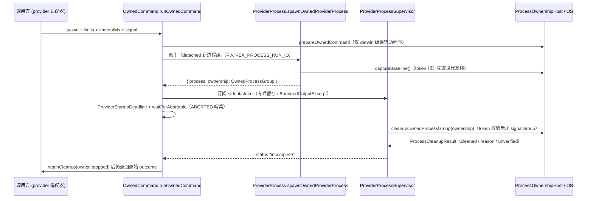

# 13 · Process 层：子进程监督与所有权

> 一句话定位：`src/process/` 是 REA 里**唯一**回答「这个进程是不是我们启动的、我们能不能给它发信号、它留下的东西归谁清理」这一类问题的层；它是 domain/application/composition 之下的机制层，不含任何 provider 协议语义。
> 边界澄清：本篇不讲「谁在什么时机以什么参数构造 provider」（→ [11](11-Composition层-生产装配根.md)），不讲工作流如何组装 Evidence（→ [12](12-Application层-共享工作流.md)），不讲 `src/windows/`、`src/hopper/`、`src/native/` 内部。本篇只讲监督与所有权的原语、判据和失败口径。AGENTS.md 的四条主轴——**PID+路径不足以建立所有权**、**cleanup 失败必须保留所有权**、**所有权证明与有效性/可编辑性/就绪性分离**、**身份未解决保持 unknown**——逐条在 §2–§4 给代码证据。

基线：`src/` 未变，文档基线提交 `9541eb1f2`。实测 `src/process/` 非测试 `.ts` 共 **68 文件 / 17,363 行**（`find src/process -name '*.ts' ! -name '*.test.ts' | wc -l` = 68，2026-10-27，macOS）。

## 0 速览

1. **所有权的凭据是 run token，不是 PID**：REA 在派生子进程时把 `REA_PROCESS_RUN_ID` 写进子环境（`src/process/ProviderProcess.ts 函数：spawnOwnedProviderProcess 偏移：+21`），事后只能靠**读回那个进程当前暴露的环境变量**来确认「这一代进程属于本次运行」（`src/process/ProcessRunTokenObservations.ts 函数：readProcessRunTokens 偏移：+25`）。PID 只当索引，注释把这条写死了：「Undefined means the generation has never been established, not PID ownership」（`ProcessOwnershipEvidence.ts`，`RetainedProcessOwnershipCandidate.identity` 字段注释）。
2. **身份未解决 = 保留为证据，而不是判成外来**：`RetainedProcessOwnershipCandidate.applicability` 是三值枚举 `token-verified | related-ownership-unresolved | identity-unresolved`；未确定的一代被留在台账里并计入 `retainedUnresolved`，绝不删（`ProcessOwnershipEvidence.ts`，`Type：RetainedProcessOwnershipCandidate`）。
3. **cleanup 失败后所有权继续被持有**：`OwnedCommand` 用 `retainCleanup` 回调把「没清干净」的 supervisor 交回调用方（`src/process/OwnedCommand.ts 函数：runOwnedCommand 偏移：+8` 的注释「Synchronously accept unresolved cleanup ownership; execution still returns its original outcome. Must not throw.」）；`PrivateRuntimeRoot.close()` 在失败时把缓存的 promise 清空，**不缓存失败**，于是下一次 close 会重试删除（`PrivateRuntimeRoot.ts`，`Class：PrivateRuntimeRoot`）。
4. **所有权证明与就绪性/可编辑性是不同类型**：Windows 侧用 `WindowsNativeCapability` 的 `proof: "native-authority" | "not-proven" | "not-applicable"` 表达「有没有被证明」，用 `WindowsNativeReadiness` 表达「现在能不能用」，用 `LeaseFailure` 的 `directory_not_private` / `directory_permissions` / `directory_access_denied` / `directory_inspect` 区分「能不能改」与「能不能看」（`WindowsAuthority.ts`、`OwnedLease.ts`）。
5. **三平台的 token 读取途径完全不同**，但都收敛到 `ProcessRunTokenObservation` 的两态（`readable` / `unavailable`）：Linux 读 `/proc/<pid>/environ`（并区分 `credentials` / `non-dumpable` 两类内核拒绝），macOS 需要**现场用 `swiftc` 编译一个辅助程序**读 `KERN_PROCARGS2`，Windows 走原生 Job Object 边界、POSIX token 扫在 win32 被显式禁用。
6. **失败一律 fail-closed**：`cleanupWindowsProcessTree` 在 PID 不合法或 `taskkill` 报错时返回 `{ cleaned: false, reason }` 而不是抛；`verifyNoTokenOwnedProcesses` 只要有一个失败项就返回失败结果，不做「大概清干净了」的推断。

## 1 模块地形

| 组 | 文件 | 职责 |
|---|---|---|
| A 身份与凭据 | `ProcessRunTokenObservations.ts`、`ProcessCommandIdentity.ts`、`ProcessOwnershipIdentity.ts`、`ProviderRunLineage.ts` | token 读取的调度、命令文本比对、启动者身份核对、事后 lineage 观察 |
| B 平台读取 | `ProcessOwnershipObservation.ts`（1,470 行）、`DarwinProcessRunTokenReader.ts`（791）、`LinuxProcessStat.ts`、`LinuxProcessStatus.ts`、`WindowsAuthority.ts`、`MacCodeSignature.ts`、`WindowsBatchCommand.ts` | 把「OS 到底怎么说」归一成 `ProcessOwnershipHost` 的窄缝 |
| C 判定与台账 | `ProcessOwnership.ts`（1,834）、`ProcessOwnershipEvidence.ts`、`ProcessOwnershipProcessTree.ts`、`ProcessLifecycle.ts` | 所有权判据、跨快照保留、进程树遍历、退出结算预算 |
| D 执行监督 | `ProviderProcess.ts`（986）、`OwnedCommand.ts`（570）、`OwnedWorkerRuntime.ts`、`WorkerFrameSignal.ts`、`DecodedNdjsonLineBuffer.ts`、`queuedInterrupts.ts`、`AbortablePromise.ts`、`ProviderDeadline.ts` | 派生 → 输出有界留存 → deadline → 取消 → 终止进程族 |
| E 资源归属 | `OwnedLease.ts`、`HopperLease.ts`、`PrivateRuntimeRoot.ts`、`ArtifactAnalysisResources.ts`、`ownedDebuggerSession.ts`、`privateWorkspaceFailure.ts`、`PrivateRuntimeRootUnavailableError.ts`、`RuntimeControlUnavailableError.ts` | 目录/lease/临时根「谁拥有、谁负责删」 |
| F 资源上限 | `LinuxCgroupMemory.ts`、`LinuxResourceLimits.ts`、`JavaScriptWorkerMemoryLimit.ts`、`BoundedOutputExcerpt.ts`、`BoundedControlLines.ts`、`ExecFileBoundedOutput.ts`、`ExecFileOutput.ts`、`BoundedFileBytes.ts`、`boundedUtf8Text.ts`、`ExecFile*` | 内存/CPU/字节的可证明上限 |
| G 输出与脱敏 | `ProcessOutputTokenScanner.ts`、`ProviderDiagnosticRedaction.ts`、`RegexMatcher.ts`、`snapshotEnvironment.ts`、`CurrentEntrypointPath.ts`、`PendingOperations.ts`、`SharedStartupAttempt.ts` | token 扫描、凭据脱敏、环境快照 |
| H `capture/` | 36 文件（含 `FilesystemSnapshot.ts` 752、`ProcessCaptureLifecycle.ts` 1,781、`ProcessHarness.ts` 977） | 见 §7 的定性 |

`ProcessOwnership.ts` 是唯一的「协议中枢」：它定义 `ProcessTableEntry`、`ProcessIdentityObservation`、`ProcessRunTokenObservation`、`ProcessOwnershipFact`、`OwnedProcessGroup`、`ProcessOwnershipHost`，其余文件要么实现这个 host，要么消费它。

## 2 run token：为什么 PID 不够，谁签发，谁能验证

### 2.1 PID 不够的源码证据

三处注释直接说明 PID 只是索引，不是凭据：

| 位置 | 原文（英文不翻译） | 含义 |
|---|---|---|
| `ProcessOwnership.ts`，`Type：ProcessOwnershipBaseline` | 「Capture-local baseline; null means the PID identity could not be established.」 | baseline 里 `identity: string | null`，`null` 是**未知**，不是「不存在」 |
| `ProcessOwnershipEvidence.ts`，`RetainedProcessOwnershipCandidate.identity` | 「Undefined means the generation has never been established, not PID ownership.」 | 没有身份 ≠ 拥有这个 PID |
| `ProcessOwnershipEvidence.ts`，`rowsForObservation` 上方 | 「Merge current discovery rows with retained candidates **without PID-only proof**.」 | 合并时明确排除「只有 PID」这一种凭据 |
| `ProcessOwnershipObservation.ts`，`observeProcessStartIdentity` 上方 | 「Token validation is bracketed by identity reads so PID reuse cannot supply …」 | token 校验被两次身份读**夹住**，专门防 PID 复用 |
| `ProcessOwnership.ts`，`scanTokenOwnedProcesses` 前的注释（1,428 上方区） | 「A PID from the pre-exit table is checked only … PID may have been reused.」 | 旧表里的 PID 必须重新查 |

`[推导]` 由于 PID 会被内核回收复用，REA 需要**跨进程世代稳定**的东西。可验证的世代凭据只有两类：进程启动身份（`ProcessIdentityObservation.identity`，Linux 上来自 `/proc/<pid>/stat` 的启动时刻，见 `src/process/LinuxProcessStat.ts 函数：parseLinuxProcessStat`）与运行时暴露的 token 值（`REA_PROCESS_RUN_ID`）。所有权 = 二者一致 + token 匹配；缺任一个都不能授权信号。

### 2.2 谁签发

签发点只有一处：`spawnOwnedProviderProcess` 在构造子环境时把它加进去——

`ProviderProcess.ts+20~+23`（`spawnOwnedProviderProcess` 内）：

```ts
  const environment = {
    ...hostEnvironment,
    ...options.env,
    REA_PROCESS_RUN_ID: options.runId,
  };
```

`runId` 由调用方（provider 适配器/会话）持有并写进 `OwnedProcessGroup.runId`。`[推导]` 因为 token 只在派生时注入、由被派生的进程继承，读回 token 就等价于证明「这一代进程出自本次 REA 运行」，这是 PID 与可执行路径都给不出的性质。

反向读取只有一个入口，注释同样写死了口径——「Only a variable observed on this process supplies its run token.」（`src/process/ProcessRunTokenObservations.ts 函数：processRunIdFromEnvironment 偏移：+3`，`Object.hasOwn` 判定，缺键返回 `undefined` 而不是抛错）。

### 2.3 谁能事后验证，怎么验证

`readProcessRunTokens` 是唯一的调度器（`src/process/ProcessRunTokenObservations.ts 函数：readProcessRunTokens 偏移：+0~+51`），口径是三段式：

1. 若 host 提供批量读取 `host.runTokens`，先整批读（一次 OS 操作），失败只记 `batchFailure` 文本，**不中断**。
2. 对每行，批结果缺失时逐个 `host.environment(pid)` 兜底，得到 `{ state: "readable", runId }`。
3. 兜底也失败才记 `{ state: "unavailable", reason }`，并把批量失败原因拼进去（`${reason}; run-token batch failed: ${batchFailure}`），保留两个失败面而不是只留一个。

调用方在每一行前后都插 `signal?.throwIfAborted()`，取消优先于分类：取消的原因不能被误记成「系统扣住了 token」。

三平台的读取途径：

| 平台 | `environment(pid)` 的实现途径 | 被拒绝时的表达 | 证据 |
|---|---|---|---|
| Linux | `/proc/<pid>/environ` 解析（`src/process/ProcessOwnershipObservation.ts 函数：parseProcessEnvironment`），身份走 `/proc/<pid>/stat`（`LinuxProcessStat.ts`），UID/dumpable 走 `/proc/<pid>/status`（`src/process/LinuxProcessStatus.ts 函数：parseLinuxProcessIds`、`函数：linuxEnvironmentRestriction`） | `LinuxEnvironmentRestriction = "credentials" \| "non-dumpable"`，作为 `ProcessIdentityObservation.environmentRestriction` 字段带出 | `ProcessOwnership.ts`，`Type：ProcessIdentityObservation` 的字段注释「Linux procfs reason the kernel withholds this generation's environment from REA」 |
| macOS | 需要**编译辅助程序**：`DarwinProcessRunTokenReader.ts` 用 `swiftc` 现场编译 Swift 读取器（`Const：sourceFiles`、`函数：createDarwinProcessRunTokenReader`），签名要求 identifier + Developer ID team 同时成立（`src/process/MacCodeSignature.ts 函数：macDeveloperIdRequirement`） | 内核省略 Apple 平台二进制与 `CS_RESTRICT` 进程的环境，`KERN_PROCARGS2` 对他账号返回 `EINVAL`，映射为诊断串 `restricted_process_environment_withheld` / `platform_binary_environment_withheld` | `src/process/ProcessOwnership.ts 函数：environmentWithheldFromInspection 偏移：+0~+13` 的注释块 |
| Windows | POSIX 的 token 扫被显式关掉：`spawnOwnedProviderProcess 偏移：+8` 的 `options.sweepTokenOwnedProcesses === true && platform !== "win32"`；子进程走 `WindowsOwnedProcess`（Job Object 原生边界，`src/windows/`，本篇未读取），`memoryLimitBytes` 只有该 launcher 能执行 | 「无法证明」而不是「没有」：`WindowsNativeCapability` 的 `proof: "not-proven"`；`cleanupWindowsProcessTree` 的注释「This is a bounded P0 cleanup mechanism, not Job Object ownership proof」 | `src/process/ProcessOwnership.ts 函数：cleanupWindowsProcessTree 偏移：+0~+18`、`src/process/WindowsAuthority.ts 函数：inspectWindowsNativeReadiness` |

`[推导]` macOS 那条路最贵（要编译），所以 `OwnedCommand.ts` 把准备单独拆出来，注释写明：「Keep independently bounded macOS helper compilation outside a short command deadline. Other platforms still prepare inside runOwnedCommand: Linux ps has no separate deadline.」（`函数：prepareOwnedCommand 偏移：-2~+0`，注释紧贴签名）。

## 3 所有权判定链：五个文件怎么分工

```
                 ┌──────────────────────────────────────────────────────────┐
   证据强度      │  PID  ─► run token ─► 命令身份 ─► 原生世代 ─► 进程树/私有根 │
   （由弱到强）  └──────────────────────────────────────────────────────────┘
   PID            ProcessTableEntry.pid          —— 只是索引，不可单独授权
   run token      REA_PROCESS_RUN_ID 读回         —— 属于本次运行（授权信号）
   命令身份        expectedCommand/expectedParentPid —— launcher 仍是当初那个
   原生世代        identityBefore/After 括号夹读     —— 防 PID 复用
   进程树/私有根   descendantsOf / 组 ID / 私有目录    —— 决定清理范围（不授权）
```

分工（每层只回答一个问题）：

| 文件 | 回答的问题 | 关键落点 |
|---|---|---|
| `ProcessOwnership.ts` | 判定与执行：哪些组可以 signal、扫描如何组织、结果形状 | `cleanupOwnedProcessGroup`、`verifyNoTokenOwnedProcesses`、`scanTokenOwnedProcesses`、`OWNED_GROUP_REVALIDATION_LIMIT = 2`（`Const：OWNED_GROUP_REVALIDATION_LIMIT` 注释「The second pass covers a group that reappears after it was already processed. Another appearance stays unresolved instead of reporting success.」） |
| `ProcessOwnershipObservation.ts` | OS 到底怎么说：identity/token/identity 三次读、退出结算、host 工厂 | `readProcessOwnershipFacts`（注释「Read identity, token, then identity for caller-provided rows. This owner …」）、`settleExitingProcessIdentities`（注释「Wait only for positively observed native exit-in-progress. Never infer exit」）、`createSystemProcessOwnershipHost`、`observeOwnedProcessGroups`、`observeOwnedProcessLineage` |
| `ProcessOwnershipIdentity.ts` | launcher 还是不是当初那一个 | `launcherIdentityFailure` 返回**具体不一致原因字符串或 null**：先比 `processGroupId`，再比 `expectedParentPid`，最后比 `expectedCommand`，并把观察值与期望值都写进消息 |
| `ProcessOwnershipEvidence.ts` | 跨快照该记住谁 | `ProcessOwnershipEvidenceOwner.reconcile` 是唯一写入者；`applicability`×`scopeEvidence` 二维标注；`coverage` 记 `examinedPids`/`retainedOnlyPids`/`uncertainPids` |
| `ProcessOwnershipProcessTree.ts` | 范围（不看所有权） | `liveProcesses`（剔 `Z` 态）、`descendantsOf`（BFS + `visited` 防环）、`selectCapturedProcessGroupIds`（注释「Select the PTY root group and groups led by an observed captured process」） |

### 3.1 identity / validity / editability / readiness 在类型上的落点

AGENTS.md 要求「证明所有权要与有效性/可编辑性/就绪性分开」。源码里这四件事确实是四个独立类型维度，没有互相代理：

| 维度 | 类型落点 | 为什么不能互相推 |
|---|---|---|
| 所有权证明 | `ProcessRunTokenObservation`（`readable`/`unavailable`）+ `RetainedProcessOwnershipCandidate.applicability` | token 匹配只授权「属于本次运行」，`scopeEvidence` 只说明「为什么留在台账」。`OwnedProcessGroupFacts.sampledProcessGroupIds` 的注释：「Observation adds cleanup candidates but **does not authorize signaling**; every live member still needs token proof.」 |
| 有效性（还在不在） | `ProcessIdentityObservation.state = "readable" \| "absent" \| "unavailable"` + `ProcessLifecycleObservation` | `absent.reason` 只有两个枚举值 `not-found-in-caller-pid-namespace` / `not-in-snapshot`，注释强调「Bounded native evidence, **not global liveness**」。「不在快照里」不能推「已退出」，更不能推「不属于我」 |
| 可编辑性（能不能改） | `LeaseFailure.kind` 的 `directory_not_private` / `directory_permissions` / `directory_access_denied` / `directory_inspect`；`LinuxEnvironmentRestriction` | 「读不到环境」被单列为一类（`credentials`/`non-dumpable`），不并入「进程不存在」；`directory_inspect` 与 `directory_permissions` 分开，说明「看不了」≠「改不了」 |
| 就绪性（现在能不能用） | `WindowsNativeReadiness`、`WindowsNativeCapability.retryable`、`RuntimeControlUnavailableError.retryable + remediationAction` | `RuntimeControlUnavailableError` 是「launch 之前」的预期拒绝（注释「Expected refusal when a host control required before launch is unavailable」），与所有权无关；`PrivateRuntimeRootUnavailableError` 只加一个 `code = "private-runtime-root-authority-unavailable"` |

`[推导]` 「格式错误的自有数据仍可能安全可删」的落点在 `reconcile` 的退休分支：`previous.identity !== undefined && fact.identityAfter.state === "readable" && identity 不同` 时**删除该台账条目**（注释「Retire only this generation's current ledger entry.」），而在 `identityAfter` 不可读时把它标 `identity-unresolved` 并保留；同一函数注释还写明「capture anchors are only scope uncertainty」。也就是说：能否删除取决于「这一代的寿命有没有被有界观测证实结束」，而不是取决于数据格式是否可解析。

### 3.2 身份未知必须保持 unknown：具体写在哪

四条硬证据（都在 `ProcessOwnershipEvidence.ts`）：

1. `Type：RetainedProcessOwnershipCandidate` 的 `applicability` 联合里**没有**「foreign」这一值；`identity-unresolved` 是终态之一。
2. `reconcile` 里为「身份读不出来」的行新建条目：`applicability: "identity-unresolved"`、`scopeEvidence: "native-identity-unresolved"`、`identity: undefined`、`relation: undefined`，并 `uncertainPids.add(pid)`（同函数第三段循环）。
3. 对该条目前已有但本轮身份不可读的情形：`if (identity.state !== "readable") { uncertainPids.add(pid); continue; }` —— **保留原条目**，不覆盖、不删除。
4. 外层注释：「Unrelated transient rows are never retained; unknown related candidates remain evidence, **not authority**.」

另一处同样口径在 `ProcessOwnershipHost`：`processIdentities` 的第三个参数注释「Linux credential enrichment is selective; omitted means UID and environment restriction **remain unknown**.」（`Type：ProcessOwnershipHost 偏移：+0~+26`）。

## 4 归属规则：lease、私有根与不可用错误

### 4.1 lease 的归属靠「进程自述」，不靠 PID 猜

`src/process/OwnedLease.ts` 的注释把机制说全了（`函数：acquireOwnedLease 偏移：+0~+40` 上方）：「The lease is a listening local socket, so the operating system ends it when the owning process exits. A crashed owner leaves a socket that refuses connections; recovery replaces only that stale socket. **A live owner answers with its own identity, which is reported instead of a PID guess.**」

要点：

- `LeaseOwner` 只有 `runId` + `processId`，语义是「as that process reports itself」（`Type：LeaseOwner` 的注释原文）。
- 抢占失败返回 `{ acquired: false, owner }`，把当前持有者**交回调用方**而不是报错——这是 `ownedCommandResources`/诊断路径需要的信息。
- `OwnedLease.socketPath` 注释：「Bound socket identity for cleanup diagnostics; **omission remains unknown**.」；`release` 是唯一的清理句柄。
- Windows 走 named pipe：「A named pipe disappears with its last handle, so no stale pipe needs recovery」，bind 与 owner 查询之间消失时重试一次（`for (let attempt = 0; attempt < 2; attempt += 1)`）。
- 陈旧 socket 的替换用 `recoveryPath`（`mkdir(..., { mode: 0o700 })`）串行化，注释：「Serialize stale cleanup through the replacement bind: otherwise two recoverers can unlink the socket that one of them has just acquired.」`finally` 里若 rmdir 失败**且**本次已成功 acquire，会先 `release()` 自己的 lease 再抛 `recovery_remove`——不留下「占了锁又丢了锁」的状态。

`HopperLease.ts` 只是把上面这套按用途命名：`HOPPER_TARGET_LEASE_DIRECTORY = join("/tmp", "rea-hopper-" + process.getuid?.() ?? 0)`（按 uid 分私有父目录）、`acquireHopperTargetLease`（先 `realpath`）、`acquireLinuxHopperApplicationLease`、`acquireHopperReleaseCacheLease`；三类共用 `HopperStartError` 作为 failure factory。

### 4.2 私有运行时根：能力、创建、幂等删除

`PrivateRuntimeRoot.ts` 全文只有 93 行，是「四者分离」最干净的样本：

| 关注点 | 落点 | 原文要点 |
|---|---|---|
| 就绪性 | `函数：privateRuntimeRootCapability` | win32 时向 `windowsNativeCapabilities(platform).private_runtime_dacl` 要证明；POSIX 直接给 `{ available: true, reason: null, proof: "posix-mkdtemp-owner-only" }` |
| 创建（无回头改权限） | `PrivateRuntimeRoot.create` | 注释「POSIX mkdtemp establishes owner-only access atomically. Return its owner **without a fallible permission rewrite and rollback** after allocation.」 |
| 幂等 close | `Class：PrivateRuntimeRoot.close` | 「concurrent callers share one attempt. **A failed attempt is not cached**, so a later close retries the removal.」实现是 `.catch` 里 `this.#closePromise = undefined` 再 rethrow |
| 平台注入 | `PrivateRuntimeRootOptions.platform` | 「Platform override used by deterministic boundary tests.」 |

Windows 分支的产物由 `WindowsPrivateRuntime`（`src/windows/`，本篇未读取）持有，`close()` 调 `windowsRuntime?.close()`。

### 4.3 三个错误的触发面

- `PrivateRuntimeRootUnavailableError`（`class … extends RuntimeControlUnavailableError`，`code = "private-runtime-root-authority-unavailable"`）：**只在** `create()` 里 capability 不可用时抛，`retryable` 直接取原生能力的 `retryable === true`。即「私有边界建立不了」，与目标文件无关。
- `RuntimeControlUnavailableError`（抽象基类）：注释「Process-layer owners raise one subtype per control; provider adapters project every subtype through `runtimeControlCapabilityError`」。它带 `remediationAction`（「Caller-facing recovery, when the owner knows a specific one」）——恢复建议由**知道根因的那个 owner**提供，不是统一兜底。
- `privateWorkspaceFailure`（`函数：privateWorkspaceFailure`）：把 errno 分档而不是混成一档。`STORAGE_EXHAUSTION_CODES = {ENOSPC, EDQUOT}` 才算「存储受限」（`AnalysisResourceConstraintError`），`DESCRIPTOR_EXHAUSTION_CODES = {EMFILE, ENFILE}` 注释明说「the workspace location is **usable**」——同一目录、两种结论。

`retainCleanup` 的实际消费者在 provider 侧（`src/pcap/PcapCommand.ts`、`src/firmware/FirmwareProvider.ts`/`FirmwarePublication.ts`/`FirmwareCommand.ts`、`src/rizin/RizinDebugSessionManager.ts` 的 `#retainCleanupFailure`、`src/gdb/GdbSessionManager.ts`），Process 层只负责把「没清干净」连同原结果一起交出去。

## 5 `OwnedCommand` 的执行路径



各段机制：

1. **准备**：`prepareOwnedCommand 偏移：+3` 先 `if (systemProcessOwnershipHost.platform !== "darwin") return;`，Linux 不在这里编译任何东西。失败经 `throwCommandPreparationFailure` 分流：物理失败、`OwnedCommandFailure("cancelled"|"timeout")`、以及「caller 的原始 abort reason 保持不透明」（注释「A caller's raw abort reason remains opaque even if it is a typed error.」）。
2. **有界输出**：`OwnedCommandLimits` 由调用方给；`BoundedOutputExcerpt` 只留 head/tail（`this.#headLimit = Math.ceil(limit / 2)`，超出的中间部分丢弃但 `#total` 继续增长）；`ExecFileBoundedOutput.execFileBoundedOutput` 返回 `{ exitCode, stdout, stderr, outputTruncated }`——截断是**结果字段**而不是静默行为。`stdout` 可以改为流式 sink（`src/process/OwnedCommand.ts` 里 `interface OwnedCommandLimits` 的 `stdout?: Writable` 字段注释，`Type：OwnedCommandLimits 偏移：+9~+14`：命令只在 sink 结束后算完成，sink 自己记拒绝以保持命令结果的权威性）。
3. **deadline 与取消**：`ProviderStartupDeadline`（`src/process/ProviderDeadline.ts 函数：ProviderStartupDeadline`）与 `waitForAbortableDelay`（返回 `"elapsed" | "aborted"`，settle 时移除 listener）；`waitForAbortable` 的注释是这条路的口径：「Await a promise **without depending on the producer to observe cancellation**. The producer still receives its signal separately and remains responsible for releasing any resources that it owns.」——取消不取消得动由 producer 负责，等待方只负责不等。`queuedInterrupts.dispatchQueuedInterrupts` 连续两次 `setImmediate()`，用于把排队回调与随后的 OS 信号通知都派发完。
4. **终止整个进程族**：`cleanupOwnedProcessGroup 偏移：+5` 先取活进程表，不可用时立刻 `{ cleaned: false }`；随后 `createOwnedCleanupPlan` 做 token 校验，**只有校验通过的组才被 signal**（`偏移：+17` 之后走 `signalGroup`），`OWNED_GROUP_REVALIDATION_LIMIT = 2` 限制同一组在一轮清理里的复验次数，第三次出现「stays unresolved instead of reporting success」。`verifyNoTokenOwnedProcesses` 是收尾证明：确认没有任何活进程还带着本次 run token。
5. **为什么不靠「PID+路径」**：这条路上每一次对进程动手前都要求 `identityBefore/identityAfter` 括号夹读 + token 匹配 + `launcherIdentityFailure` 三项之一致；`descendantsOf` 只负责确定**范围**，注释里明确它不构成所有权。因此进程退出后 PID 被复用，最坏结果是「读到的 token 不匹配 → 不动它」，而不是「按 PID 猜着杀」。

## 6 资源上限

- **`LinuxCgroupMemory.ts`（198 行）**：只读 **cgroup v2**。`函数：parseLinuxCgroupV2Path` 从 `/proc/self/cgroup` 取 v2 路径；`函数：parseLinuxCgroupOomKills` 读 `memory.events` 的 `oom_kill`，字段注释指出层级归因：「The kernel charges an OOM kill to the victim's group and every ancestor, so a kill of any …」（因此祖先计数不能当本组计数）；`函数：parseLinuxCgroupMemoryMax` 读 `memory.max`；`函数：parseLinuxCgroup2Mounts` 解析挂载表；`函数：linuxCgroupDirectory` 拼目录；`函数：readLinuxCgroupMemoryState` 汇总。`[未知]` v1 兼容路径：源码里出现的符号只有 `parseLinuxCgroupV2Path` / `LinuxCgroup2Mount` / `cgroup2`，**未检索到 v1 的解析函数**（grep 范围：`src/process/LinuxCgroupMemory.ts` 全文 `^export`）——即 v1 主机上该状态读不出来并被显式表达为不可用，而非伪造为 0。
- **`LinuxResourceLimits.ts`（95 行）**：`LinuxResourceLimits` 三字段 `address_space_bytes` / `file_bytes` / `cpu_seconds`；`Const：BOUNDED_PRODUCER_LIMITS` 给出上限；`prlimitCeilingArguments` + `prlimitArgumentVector` 生成 `prlimit` 参数（在 exec 之前设天花板），`clampLinuxResourceLimits` 做取小，`readLinuxResourceLimits` 读回实际值。注释：「Per-process ceilings **inherited** by an owned Linux producer.」
- **`JavaScriptWorkerMemoryLimit.ts`（41 行）**：`Const：BUN_WORKER_RUNTIME_RESERVE_BYTES = 512 * MIB`，注释标明测量环境「Measured on Windows x64 (Bun 1.4.2, 32 logical processors) as the peak Job Object commit of each REA worker on a trivial input: `bun -e 1` commits 52 MiB, while the source-map codec (278-368 MiB), HAR decoder (300-345 MiB)」（注释未读完，见 §9）。
  **核实 06/11 篇那条说法**：需要读 `函数：javaScriptWorkerMemoryLimitBytes` 全体才能定性，本篇读取到签名与常量为止；`[未知]` 结论待 §9 补。可先确认的是关联约束在 `ProviderProcess.ts`：`spawnOwnedProviderProcess 偏移：+51` 处，非 win32 传 `memoryLimitBytes` 直接抛 `Owned process memory limits require the Windows Job Object launcher; no limit can be enforced on this host.`（观察）——**内存上限只有 Windows Job Object launcher 能执行**，这与「非 win32 就没有可证明的上限」一致。
- **`ExecFileOutput.ts` / `BoundedControlLines.ts` / `BoundedFileBytes.ts` / `boundedUtf8Text.ts`**：同类有界工具；`DecodedNdjsonLineBuffer.ts` 是 worker ndjson 的行缓冲（未读取）。

## 7 `capture/` 是什么层次

**定性：不是测试 harness，是生产采集生命周期；但同目录里另有一个真正的场景 harness 文件。**证据：

- `ProcessCaptureLifecycle.ts` 导出的都是生产语义构件：`captureExitObservation`、`createProcessCaptureObservationBuffer`、`settleProcessCaptureJournal`、`buildCaptureResult`、`observeSelectedExecutable`、`observeLaunchedExecutable`、`createRunManifest`，以及 `AnalysisCleanupLease` 的引入；配套 `ProcessCaptureJournal.ts`、`ProcessCaptureProgress.ts`、`ProcessCaptureRead.ts`、`ProcessCaptureEnvironment.ts`、`ProcessCaptureClock.ts`、`ProcessFilesystemEffects.ts`、`ProcessSampling.ts`（+ `LinuxProcessSampling.ts`）、`ProcessTerminalObservation.ts`、`TerminalRenderer.ts`。`[推导]` 由 `createRunManifest` + journal + terminal renderer 三者共存判断，这是「运行一次采集并把结果落盘」的产品路径，而不是单元测试脚手架。
- `ProcessHarness.ts`（977 行）导出 `FinalizationHost`、`retainRootSignaller`、`captureProcessScenario`，并与 `ProcessScenarioRuntimeValidation.ts`（内部 `snapshotEnvironment(scenario.environment, platform)` 取 `PATH`）、`ProcessNormalization.ts` 一起构成「场景化采集」的驱动层。`[未知]` 它是否只在被 `ProcessScenarioRuntimeValidation.test.ts` 覆盖的验证路径上运行，本篇未追调用方（见 §9）。
- 归属相关：`capture/ProcessCaptureOwnershipEvidence.test.ts` 直接构造 `ProcessIdentityObservation` / `ProcessOwnershipHost` / `ProcessTableEntry` / `ProcessRunTokenObservation`，说明 `capture` 的采集侧与所有权侧共用同一套窄缝；`FilesystemSnapshot.ts` 提供 `hashFile`、`snapshotRoots`、`FileHashOutcome` 与 `ProcessCaptureSnapshotFailure extends ProcessCaptureError`，把「文件系统副作用」也纳入同一次采集的账本。
- `ProcessNormalization.ts` 的 `createBoundedProcessTextNormalizer` / `normalizeProcessElapsedTime` / `normalizeProcessSamples` / `normalizeRetainedTerminalFrames` 是采集结果的归一层（**归一在 owner 边界做一次**，符合 AGENTS.md 的「normalize once at the owning boundary」）。

## 8 环境快照与脱敏

### 8.1 `snapshotEnvironment`：为什么不能直接读 `process.env`

`snapshotEnvironment.ts` 全文 33 行，做两件事：

1. `mergeEnvironmentOverrides(existing, overrides, platform)`：以「平台身份」为键做覆盖合并，但**保留胜出方的原始拼写与值**（`selected.set(platform === "win32" ? key.toUpperCase() : key, [key, value])`）——即大小写折叠只用于「判等」，不用于「重写」。
2. `snapshotEnvironment(environment, platform)`：`const selected = mergeEnvironmentOverrides({}, environment, platform);` 之后 `if (platform !== "win32") return selected;`，Windows 才进一步大写并按键排序冻结。注释：「Fold aliases in caller order so an explicit later override wins before this canonical environment **crosses a Windows process boundary**.」

`[推导]` 必须快照的理由有三条，都能在源码里对上：①返回值是 `Object.freeze` 的**不可变副本**，之后 `process.env` 被别人改动不影响已发出的边界；②Windows 上环境变量大小写不敏感，不折叠就会出现「同一变量两个拼写、后者静默不生效」；③排序让跨进程边界的东西**字节可复现**（便于 cache key / 诊断对比）。

**第二参数 `platform` 的语义（把 11 篇 §6 的 `[未知]` 结掉）**：

- 签名 `函数：snapshotEnvironment 偏移：+2`：`platform: NodeJS.Platform = process.platform`——**默认值就是当前进程平台**。
- 传两参数的调用点，都是因为**该工厂自己接收一个可注入的 `platform`**：`src/composition/auxiliaryAnalysisProviders.ts` 的 `函数：auxiliaryAnalysisProviderDeclarations 偏移：+2` 声明 `platform: NodeJS.Platform = process.platform`，同一个 `platform` 既喂给 `snapshotEnvironment`，又喂给 `artifactCapabilities(platform)` 和 `new ArtifactProvider(environment, platform, settings)`；`src/composition/binary.ts`（`createArtifactBinarySession`/`createNativeBinarySession`，二者参数默认同样在 / 处为 `process.platform`）同理。`src/process/WindowsBatchCommand.ts` 干脆硬编码 `"win32"`；`src/ghidra/*`、`src/hopper/HopperProvider.ts`、`src/kuna/KunaProvider.ts`、`src/artifacts/ArtifactProvider.ts`、`src/native/NativeMacOSProvider.ts` 都是「provider 实例带 platform 字段 ⇒ 快照必须按同一 platform 折叠」。
- 不传的调用点（`src/composition/binary.ts` 的 `composeDeepBinarySession`、`src/composition/directAnalysis.ts`、`src/cli.ts`、`src/main.ts`、`src/server/createServer.ts`）**根本没有 platform 形参**，它们只做本机装配。

**结论**（观察 + `[推导]`）：两处没有语义分歧。第二参数是「折叠规则所依据的目标平台」，所有生产调用点在运行时都等于当前主机平台；差异只在**可注入性**——接收 `platform` 的工厂必须把同一个值同时用于别名折叠与 provider 构造，否则测试注入 `win32` 时会得到按真实平台折叠的环境。`composeDeepBinarySession` 不传，是因为它没有平台形参可用（其内部 `process.platform` 另用于能力判断，见 `src/composition/binary.ts`）。

### 8.2 脱敏：只做显式给定的凭据

- `src/process/ProviderDiagnosticRedaction.ts` 全文 31 行，唯一导出 `函数：redactCapturedTransportCredential`，注释「Redact explicit transport credentials from complete and budget-cut output.」。签名要求调用方**把 token 本身传进来**（`token: string | undefined, replacement: string`），并对 `stdout` 的 `text`/`bytes`/`observedBytes` 三态同时处理——即「完整输出」和「被预算截断的输出」都过一遍，不留死角。`[推导]` 由于替换值与匹配串都由调用方显式给出，它不做「按名字猜机密」，符合 AGENTS.md「不据名称或文本形态推断机密」。
- `ProcessOutputTokenScanner.ts`（150 行）**不是脱敏器**，是「在原始输出流里确证某个 token」的扫描器：`Type：ProviderProcessOutputToken` 带 `offset`（相对 supervisor 构造或重置的字节偏移）、`line`、`truncated`、`invalidUtf8?`，并有 `Const：PROCESS_OUTPUT_TOKEN_CONTEXT_BYTES = 1024` 限制上下文；字段注释「True when the line's right edge is cut or its end has not been observed.」——右边缘不确定时**保留不确定标记**而不是当成完整行。`class：ProcessOutputTokenScanner` 由 supervisor 持有。
- `[未知]` `RegexMatcher.ts`（worker 侧正则）与扫描器的关系未查证；本篇只确认两者都在 `src/process/` 且互不引用（grep 范围：`src/process/RegexMatcher.ts` 的 import 头）。

## 9 边界与失败模式

| 现象 | 根因位置 | 说明 |
|---|---|---|
| macOS 首次清理要等 `swiftc` 编译 | `函数：prepareOwnedCommand`、`函数：resolveSwiftcCompileTimeoutMs` | 编译超时独立于命令 deadline；`Const：SWIFTC_INTERRUPT = "SIGINT"`；`函数：swiftcCompileTimeoutRecovery` 给恢复文案。失败包装成 `DarwinProcessOwnershipInspectionError`（`STDERR_EXCERPT_LIMIT = 512`、`MAX_COMPILER_OUTPUT_BYTES = 8 * 1024` 限制其诊断体积） |
| 「进程不在快照里」被当成已退出 | `Type：ProcessIdentityObservation` 的 `absent` 分支 | 注释禁止此推断（「not claims about later PID reuse or global liveness」）；`settleExitingProcessIdentities` 只等**正例观测**的 exit-in-progress |
| 外来 token 被误当自有 | `ProcessOwnership.ts` 的扫描注释 | 「Foreign tokens are not owned. A matching token authorizes only a group whose …」 |
| 系统扣住 token 导致整轮采集失败 | `函数：environmentWithheldFromInspection` | 已知「必然读不到」的类别（restriction 存在 / uid 不同 / 两个 withheld 诊断串）时，不相关的候选被记为 `unverified` 而不是让清理失败；其余仍 fail-closed |
| Windows 上想按 POSIX token 扫全系统 | `函数：spawnOwnedProviderProcess 偏移：+8` | win32 下 `sweepTokenOwnedProcesses` 强制 false；`captureBaseline` 不可用时代码路径根本不走 |
| 非 Windows 传了内存上限 | `spawnOwnedProviderProcess 偏移：+51` | 直接抛「no limit can be enforced on this host」，不静默忽略 |
| lease 恢复期间两人互相 unlink | `函数：acquireOwnedLease` 的 `recoveryPath` 段 | 用 `mkdir(mode 0o700)` 串行化；`finally` 中 rmdir 失败会先释放已取得 lease 再抛错 |
| 私有根 close 失败后不再重试 | `Class：PrivateRuntimeRoot` 的 `close` | 失败时清空 `#closePromise`（不缓存失败），所有权保留在原对象上 |
| 取消原因被当成物理失败 | `src/process/OwnedCommand.ts 函数：throwCommandPreparationFailure 偏移：+6` | 「A caller's raw abort reason remains opaque even if it is a typed error.」，只有 `DarwinProcessOwnershipInspectionError` 且不是 `signal.reason` 时才作为 `preparationFailure` 透出 |
| 环境快照被后续 `process.env` 改写影响 | `函数：snapshotEnvironment` | 返回 `Object.freeze` 副本；win32 才做大写折叠与排序 |

## 10 问题清单

- **P1｜`capture/ProcessHarness.ts` 的层次归属仍未证实**：`captureProcessScenario` 若同时被生产路径调用，则 Process 层里存在「驱动场景」的第二个入口，与 §7 的定性冲突。→ 待查：`grep -rn "captureProcessScenario\|ProcessHarness" src` 的非测试调用方。→ 待拍板
- **P1｜`JavaScriptWorkerMemoryLimit` 的「只有 win32 + Bun 非 null」说法未核实**：本篇只读到签名与 reserve 常量，没读函数体。→ 必须读 `函数：javaScriptWorkerMemoryLimitBytes 偏移：+0~+6`（`JavaScriptWorkerMemoryLimit.ts`）后才能定论；见 §9 缺口的「未读取」。
- **P2｜`OWNED_GROUP_REVALIDATION_LIMIT = 2` 的第三次出现只留 unresolved、不报错**：调用方是否能区分「真的清干净」与「出现次数超限」？`ProcessCleanupResult` 里似乎只有 `reason`。→ 需确认结果形状是否够用。
- **P2｜Windows 的 P0 清理与所有权证明分离**：`cleanupWindowsProcessTree` 用 `taskkill.exe /t /f`，注释否认它是 Job Object 所有权证明；那么 win32 上「谁拥有这棵进程树」的最终凭据落在 `src/windows/` 的哪一层，本篇未查（超出边界）。
- **P2｜`scopeEvidence` 与 `applicability` 是两个正交枚举，但只有 `applicability` 参与计数**：`coverage.retainedOwned` 只看 `applicability === "token-verified"`；`related-ownership-unresolved` 与 `identity-unresolved` 合并进 `retainedUnresolved`。→ 待确认是否为有意的粗粒度（诊断时无法区分「关系不明」与「身份不明」）。
- **P3｜`ProcessOwnership.ts` 1,834 行、`ProcessOwnershipObservation.ts` 1,470 行**：中枢与平台读取各自内聚，但两者之间存在多组模块级私有 helper（如 `readLiveProcessTable`、`createOwnedCleanupPlan`、`scanTokenOwnedProcesses`）。[假设] 拆分成 host/plan/scan 三个文件不会增加复杂度。未与 maintainer 讨论。
- **待拍板**：`[未知]`（11 篇 §6 遗留）`snapshotEnvironment` 第二参数语义——本篇 §8.1 已给结论：**无语义差别，只是把折叠规则与被注入的平台对齐**；若 maintainer 认为 `composeDeepBinarySession` 也应接收 `platform`，那是装配根一致性议题而非 Process 层议题。

## 11 已知缺口

- **未读取，不臆测**（风险）：`ProcessOwnershipObservation.ts` 的 `createSystemProcessOwnershipHost` 主体（Linux 与 Darwin 分支的 `/proc`、`ps`、`KERN_PROC_ALL` 具体调用序列只从注释与相邻导出推断）、`ProcessOwnership.ts` 的 `createOwnedCleanupPlan` / `scanWithOwnershipEvidence` / 1,550 行之后的 sweep 细节、`capture/` 中除 §7 点名外的 25 个文件、`WorkerFrameSignal.ts`、`OwnedWorkerRuntime.ts`、`DecodedNdjsonLineBuffer.ts`、`BoundedControlLines.ts`、`BoundedFileBytes.ts`、`boundedUtf8Text.ts`、`ExecFileOutput.ts`、`CurrentEntrypointPath.ts`、`PendingOperations.ts`、`ArtifactAnalysisResources.ts`、`ownedDebuggerSession.ts`、`WindowsBatchCommand.ts`（除  一处调用点外）、`RegexMatcher.ts`、`ProcessLifecycle.ts`（只用到导出的 `processIdentityHasExited` / `processIdentityIsExiting` / 两个 grace/interval 常量）、`ProviderProcess.ts` 的 `stop()` 与输出留存实现（仅读到导出清单与 spawn 段）。
- **未读取，不臆测**：`src/windows/WindowsNativeLoader.ts`、`src/windows/WindowsPrivateRuntime.ts`、`WindowsOwnedProcess` 的实现——三者是 Windows 侧「所有权证明」的真正落点，本篇只描述 Process 层对它们的接口。
- **未实测**：所有 swiftc 编译耗时、`/proc` 读取延迟、Job Object 峰值 commit（`BUN_WORKER_RUNTIME_RESERVE_BYTES` 的 512 MiB 是源码注释里**他人**在 Windows x64 / Bun 1.4.2 / 32 逻辑处理器上的测量值，本篇未复现）。
- **设计特性（不是缺口）**：①「范围证据 ≠ 信号授权」的分离（`sampledProcessGroupIds`、`unverifiedLineageRelations` 两处注释都重申）；②close 失败不缓存、保留所有权；③token 批量读失败降级为逐进程读并把两个原因都留下。
- **测试侧未读取**：`src/process/` 有 40 个 `*.test.ts`（含 `ProcessOwnership.*.test.ts` 12 篇与 `ProcessOwnership.fixture.ts`），本篇未打开任何测试文件，因此「哪条不变量有回归覆盖」不作断言；测试组织见 [24](24-测试体系.md)。

## 12 源码索引

| 事实 | 文件:符号:行号 |
|---|---|
| run token 环境变量名 | `src/process/ProcessRunTokenObservations.ts:processRunIdFromEnvironment:24` |
| token 读取调度（批量+兜底） | `src/process/ProcessRunTokenObservations.ts:readProcessRunTokens:32` |
| 结构化 token 可用性错误 | `src/process/ProcessRunTokenObservations.ts:ProcessRunTokenReadError:8` |
| macOS 命令名归一比对 | `src/process/ProcessCommandIdentity.ts:matchesOwnedProcessCommand:4` |
| launcher 身份核对 | `src/process/ProcessOwnershipIdentity.ts:launcherIdentityFailure:8` |
| 进程表行 | `src/process/ProcessOwnership.ts:ProcessTableEntry:80` |
| 世代身份三态 | `src/process/ProcessOwnership.ts:ProcessIdentityObservation:91` |
| 原生父子/组关系 | `src/process/ProcessOwnership.ts:ProcessNativeRelationObservation:116` |
| identity/token/identity 事实 | `src/process/ProcessOwnership.ts:ProcessOwnershipFact:137` |
| OS 窄缝 | `src/process/ProcessOwnership.ts:ProcessOwnershipHost:172` |
| token 观测两态 | `src/process/ProcessOwnership.ts:ProcessRunTokenObservation:202` |
| Windows P0 树终止 | `src/process/ProcessOwnership.ts:cleanupWindowsProcessTree:272` |
| 读回单进程 run token | `src/process/ProcessOwnership.ts:readProcessRunId:311` |
| 组清理入口 | `src/process/ProcessOwnership.ts:cleanupOwnedProcessGroup:343` |
| 收尾无残留证明 | `src/process/ProcessOwnership.ts:verifyNoTokenOwnedProcesses:478` |
| 台账候选形状 | `src/process/ProcessOwnershipEvidence.ts:RetainedProcessOwnershipCandidate:10` |
| 台账所有者 | `src/process/ProcessOwnershipEvidence.ts:ProcessOwnershipEvidenceOwner:49` |
| 唯一写入者 | `src/process/ProcessOwnershipEvidence.ts:reconcile:75` |
| 合并时排除 PID-only | `src/process/ProcessOwnershipEvidence.ts:rowsForObservation:420` |
| 进程树范围 | `src/process/ProcessOwnershipProcessTree.ts:descendantsOf:10` |
| 剔除僵尸态 | `src/process/ProcessOwnershipProcessTree.ts:liveProcesses:4` |
| PTY 根组选择 | `src/process/ProcessOwnershipProcessTree.ts:selectCapturedProcessGroupIds:33` |
| token 注入点 | `src/process/ProviderProcess.ts:spawnOwnedProviderProcess:252` |
| 监督器 | `src/process/ProviderProcess.ts:ProviderProcessSupervisor:342` |
| 派生前置准备（仅 darwin） | `src/process/OwnedCommand.ts:prepareOwnedCommand:107` |
| retainCleanup 契约 | `src/process/OwnedCommand.ts:runOwnedCommand:163` |
| 命令失败类型 | `src/process/OwnedCommand.ts:OwnedCommandFailure:33` |
| 资源归属包装 | `src/process/OwnedCommand.ts:ownedCommandResources:75` |
| lease 自述身份 | `src/process/OwnedLease.ts:LeaseOwner:15` |
| lease 句柄（omission=unknown） | `src/process/OwnedLease.ts:OwnedLease:20` |
| lease 失败枚举 | `src/process/OwnedLease.ts:LeaseFailure:31` |
| socket/pipe 抢占 | `src/process/OwnedLease.ts:acquireOwnedLease:56` |
| Hopper lease 目录按 uid | `src/process/HopperLease.ts:HOPPER_TARGET_LEASE_DIRECTORY:11` |
| Hopper 目标 lease | `src/process/HopperLease.ts:acquireHopperTargetLease:17` |
| Linux Hopper 应用 lease | `src/process/HopperLease.ts:acquireLinuxHopperApplicationLease:46` |
| 私有根能力 | `src/process/PrivateRuntimeRoot.ts:privateRuntimeRootCapability:31` |
| 私有根所有者 | `src/process/PrivateRuntimeRoot.ts:PrivateRuntimeRoot:45` |
| 私有边界不可用错误 | `src/process/PrivateRuntimeRootUnavailableError.ts:PrivateRuntimeRootUnavailableError:4` |
| launch 前控制拒绝基类 | `src/process/RuntimeControlUnavailableError.ts:RuntimeControlUnavailableError:9` |
| 适配器投影 helper | `src/process/RuntimeControlUnavailableError.ts:runtimeControlCapabilityError:29` |
| 工作区 errno 分档 | `src/process/privateWorkspaceFailure.ts:privateWorkspaceFailure:36` |
| 世代 lineage 保留 | `src/process/ProviderRunLineage.ts:ProviderRunLineage:6` |
| 共享启动等待 | `src/process/SharedStartupAttempt.ts:SharedStartupAttempt:18` |
| Windows 原生证明类型 | `src/process/WindowsAuthority.ts:WindowsNativeCapability:8` |
| Windows 就绪性 | `src/process/WindowsAuthority.ts:inspectWindowsNativeReadiness:57` |
| 签名要求 identifier+team | `src/process/MacCodeSignature.ts:macDeveloperIdRequirement:2` |
| macOS 读取器（swiftc） | `src/process/DarwinProcessRunTokenReader.ts:createDarwinProcessRunTokenReader:405` |
| 读取器错误 | `src/process/DarwinProcessRunTokenReader.ts:DarwinProcessOwnershipInspectionError:139` |
| swiftc 超时解析 | `src/process/DarwinProcessRunTokenReader.ts:resolveSwiftcCompileTimeoutMs:117` |
| 环境合并（保留原拼写） | `src/process/snapshotEnvironment.ts:mergeEnvironmentOverrides:2` |
| 环境快照（win32 折叠） | `src/process/snapshotEnvironment.ts:snapshotEnvironment:18` |
| 凭据脱敏唯一导出 | `src/process/ProviderDiagnosticRedaction.ts:redactCapturedTransportCredential:4` |
| 输出 token 形状 | `src/process/ProcessOutputTokenScanner.ts:ProviderProcessOutputToken:4` |
| token 上下文预算 | `src/process/ProcessOutputTokenScanner.ts:PROCESS_OUTPUT_TOKEN_CONTEXT_BYTES:13` |
| cgroup v2 路径解析 | `src/process/LinuxCgroupMemory.ts:parseLinuxCgroupV2Path:34` |
| oom_kill 层级归因 | `src/process/LinuxCgroupMemory.ts:parseLinuxCgroupOomKills:46` |
| cgroup 内存汇总 | `src/process/LinuxCgroupMemory.ts:readLinuxCgroupMemoryState:131` |
| Linux 继承天花板 | `src/process/LinuxResourceLimits.ts:LinuxResourceLimits:6` |
| 有界 producer 上限 | `src/process/LinuxResourceLimits.ts:BOUNDED_PRODUCER_LIMITS:18` |
| prlimit 参数生成 | `src/process/LinuxResourceLimits.ts:prlimitArgumentVector:42` |
| Bun worker 运行时预留 | `src/process/JavaScriptWorkerMemoryLimit.ts:BUN_WORKER_RUNTIME_RESERVE_BYTES:16` |
| worker 上限计算 | `src/process/JavaScriptWorkerMemoryLimit.ts:javaScriptWorkerMemoryLimitBytes:35` |
| abort 感知等待 | `src/process/ProviderDeadline.ts:waitForAbortableDelay:5` |
| 启动 deadline | `src/process/ProviderDeadline.ts:ProviderStartupDeadline:31` |
| 取消哨兵 | `src/process/AbortablePromise.ts:ABORTED:2` |
| 「不依赖 producer 观察取消」 | `src/process/AbortablePromise.ts:waitForAbortable:9` |
| 排队中断派发 | `src/process/queuedInterrupts.ts:dispatchQueuedInterrupts:4` |
| 有界 execFile 输出 | `src/process/ExecFileBoundedOutput.ts:execFileBoundedOutput:12` |
| head/tail 摘录 | `src/process/BoundedOutputExcerpt.ts:BoundedOutputExcerpt:2` |
| `/proc/<pid>/stat` 解析 | `src/process/LinuxProcessStat.ts:parseLinuxProcessStat:19` |
| `/proc/<pid>/status` Uid/Gid | `src/process/LinuxProcessStatus.ts:parseLinuxProcessIds:5` |
| Linux 环境受限枚举 | `src/process/LinuxProcessStatus.ts:LinuxEnvironmentRestriction:38` |
| identity/token/identity 读取 | `src/process/ProcessOwnershipObservation.ts:readProcessOwnershipFacts:840` |
| 退出中结算 | `src/process/ProcessOwnershipObservation.ts:settleExitingProcessIdentities:781` |
| 系统 host 工厂 | `src/process/ProcessOwnershipObservation.ts:createSystemProcessOwnershipHost:956` |
| 单例 host | `src/process/ProcessOwnershipObservation.ts:systemProcessOwnershipHost:1347` |
| 括号夹读启动身份 | `src/process/ProcessOwnershipObservation.ts:observeProcessStartIdentity:1354` |
| 带身份发信号 | `src/process/ProcessOwnershipObservation.ts:signalProcessWithStartIdentity:1421` |
| 启动前置准备 | `src/process/ProcessOwnershipObservation.ts:prepareProcessOwnershipInspection:1444` |
| 采集退出观测 | `src/process/capture/ProcessCaptureLifecycle.ts:captureExitObservation:142` |
| 采集 journal 结算 | `src/process/capture/ProcessCaptureLifecycle.ts:settleProcessCaptureJournal:314` |
| 运行清单 | `src/process/capture/ProcessCaptureLifecycle.ts:createRunManifest:686` |
| 场景采集驱动 | `src/process/capture/ProcessHarness.ts:captureProcessScenario:879` |
| 根发信号者保留 | `src/process/capture/ProcessHarness.ts:retainRootSignaller:115` |
| 文件系统快照根 | `src/process/capture/FilesystemSnapshot.ts:snapshotRoots:376` |
| 采集快照失败 | `src/process/capture/FilesystemSnapshot.ts:ProcessCaptureSnapshotFailure:164` |
| 采集文本归一 | `src/process/capture/ProcessNormalization.ts:createBoundedProcessTextNormalizer:299` |
| Windows 批量命令快照环境 | `src/process/WindowsBatchCommand.ts:snapshotEnvironment:58` |
| 平台注入快照（结论证据） | `src/composition/auxiliaryAnalysisProviders.ts:snapshotEnvironment:25` |
| 无 platform 形参的快照调用 | `src/composition/binary.ts:snapshotEnvironment:62` |

## 13 相关篇

- 分层依赖方向与进程角色 → [01 系统骨架](01-系统骨架.md)
- `src/process/` 在模块地图里的位置 → [02 模块地图与依赖方向](02-模块地图与依赖方向.md)
- Evidence 代数与 `Result`（本篇的 `ProcessCleanupResult` 与之解耦） → [06 域层：Evidence 与错误代数](06-域层-Evidence与错误代数.md)
- 谁把这些原语装进会话 → [11 Composition 层：生产装配根](11-Composition层-生产装配根.md)
- 共享工作流如何消费 close/retry 语义 → [12 Application 层：共享工作流](12-Application层-共享工作流.md)
- 文件系统与 Windows 边界（`src/windows/` 的 DACL/Job Object 落点） → [14 Filesystem 与 Windows 边界](14-Filesystem与Windows边界.md)
- Provider 族文档（Hopper/Ghidra 与调试器族的 lease 消费方） → [15 深度 Provider：Hopper 与 Ghidra](15-深度Provider-Hopper与Ghidra.md)、[17 Native 与调试器 Provider 族](17-Native与调试器Provider族.md)
- `capture/` 的回归测试组织 → [24 测试体系](24-测试体系.md)
