# 16 · 深度 Provider：IDA、Kuna、JEB、Cutter

> 第四层「深度分析引擎」第二篇：另外四种 provider 接入形态。这四者与 15 篇的 Hopper/Ghidra 一起，把「REA 到底怎么和一个外部逆向引擎打交道」这条谱系拉满——从**完全不管进程**（JEB/Cutter 连用户已经跑着的引擎）到**每次自己起一个只活一会儿的子进程**（Kuna）到**用 stdio 拉起上游 MCP 桥**（IDA headless）。本篇的主轴是四个问题：**谁 fork/exec、谁持有会话、谁负责关闭、失败时留下什么**。边界澄清：本篇只到「接入形态 + 谁拥有生命周期 + 只读/变更承诺的执行点」，provider 的分析语义细节与路由在 03/04 与各自能力表里；Hopper/Ghidra 见 15 篇。

安全红线：不启动/调用 IDA/Kuna/JEB/Cutter，不执行 `rea setup/update`，不打开任何数据库；「引擎真机行为」一律标「未实测，待补」。环境：HEAD `9541eb1f2`、Node v24.10.0、darwin、2026-10-27。

## 0 速览

1. **四形态的「谁起进程」根本不同**：IDA headless 由 `src/ida/IdaMcpConnection.ts 函数：createIdaMcpConnection 偏移：+0` 用 `StdioClientTransport` 起**用户配置的上游桥命令**、或 `StreamableHTTPClientTransport` 连**已在跑的 HTTP 端点**；Kuna 由 `src/kuna/KunaCommand.ts 函数：runKunaCommand 偏移：+0` 每次 `runOwnedCommand` 起一个 `kuna` 子进程；JEB 与 Cutter **都不起引擎**（`src/jeb/JebMcpEndpoint.ts Const：DEFAULT_JEB_MCP_ENDPOINT` 连 `http://127.0.0.1:8425/mcp`；`bridge/cutter/rea_bridge.py 函数：publish 偏移：+0` 由装在 Cutter 里的插件自己 listen）。
2. **IDA 是「适配器」不是引擎本身**：`src/ida/IdaProviderCapabilities.ts Const：IDA_PROVIDER_IDENTITY` 的 `name:"IDA MCP adapter", version:"1"` 直白写明它包装的是**上游 ida-pro-mcp 契约**；`src/ida/IdaProvider.ts 函数：IdaProvider 偏移：+0` 的类注释「Bring-your-own IDA MCP candidate; discovery performs no provider startup」——发现阶段绝不拉起 IDA。
3. **只读承诺各有硬执行点**：IDA 在 `src/ida/IdaSessionClient.ts 函数：#closeDatabase 偏移：+1~+4` 只发 `idb_close{save:false}`，且 `偏移：+11~+16` 要求回包 `saved!==true && owned===true && backend==="worker"` 才认，否则抛错——**只关 REA 自己的 headless worker 库，绝不保存、绝不关 attached GUI**（AGENTS.md）。Kuna 能力表恒 `mutatesArtifact:false`（`src/kuna/KunaProviderCapabilities.ts 函数：kunaCapabilities 偏移：+0`）；JEB 把「引擎在自己的宿主上解析目标，REA 没亲自打开」写进 limitation（`src/jeb/JebProvider.ts 函数：JebProvider` 各 `#openProject` 等）。
4. **Cutter 是「实时桥」且命令可变更**：`src/cutter/CutterBridgeService.ts 函数：CutterBridgeService 偏移：+0` 把 `cutter_command` 跑进一个**正在运行的 Cutter 会话**，命令「may edit and persist analysis state」（`src/contracts/cutterToolContracts.ts Const：CUTTER_TOOL_CONTRACTS`）；完成不确定（`execution_state:"unknown"`）时**不自动重试**，而是留 `AnalysisOutputError` + partial Evidence（`src/cutter/CutterBridgeService.ts 函数：execute 偏移：+0`）。
5. **Kuna 每次运行前重算可执行文件摘要**：`src/kuna/KunaCommand.ts 函数：runKunaCommand 偏移：+1` 调 `verifyExecutable`（缓存按 `dev:ino:size:mtimeNs:ctimeNs` 身份键），若与 profile 承诺的 sha256 不符 → 拒绝运行并要求重开目标，防止「结果说的是 A 构建、实际跑的是 B 构建」。
6. **鉴权与传输各异**：IDA/JEB 走 MCP（stdio 或 loopback HTTP）；Cutter 走**双向 HMAC 挑战应答**（`bridge/cutter/rea_bridge.py 函数：_serve_connection 偏移：+0`：`rea-auth-v2` hello + `server_proof`/`client_proof`，令牌 `secrets.token_urlsafe(32)`），descriptor 文件 `fchmod 0o600`、目录 `0o700`，Windows 还要 `requireWindowsNativeAuthority` 验 `privateDacl`。

## 1 四维模型：一张矩阵定住四种形态

| 维度 | IDA | Kuna | JEB | Cutter |
|---|---|---|---|---|
| 谁 fork/exec | stdio 模式下 REA 起上游桥命令；attached/http 模式不起 | **每次操作起一个 `kuna` 子进程** | 不起（连已运行的 JEB MCP） | 不起（插件在已运行的 Cutter 内 listen） |
| 会话持有者 | 上游 IDA / IDA GUI（attached） | 无常驻会话：进程跑完即退 | **JEB 客户端进程**持有分析 | **Cutter 进程 + 当前文档/tab** |
| 谁关闭 | `#closeDatabase` 仅关 `backend:"worker"` 且 `save:false` | `runOwnedCommand` 超时/取消即回收进程树 | `JebProvider.close`→连接 close，**不杀 JEB** | `CutterBridgeService.close`→descriptor 资源 close，**不杀 Cutter** |
| 传输 | stdio 或 Streamable HTTP | 子进程 stdout（NDJSON 解析） | Streamable HTTP（loopback） | loopback TCP + HMAC 认证帧 |
| 目标进引擎的方式 | 上游 MCP open/save 数据库 | 私有工作区内跑 `kuna` 命令 | `open_project(file_path)` 交给引擎 | 复用 Cutter 里**已打开**的文档（`session_id`） |
| 副作用面 | `mutatesArtifact:false`，`mayWriteFilesystem: stdio\|\|headless` | `mutatesArtifact:false`, `mayWriteFilesystem:true` | 引擎侧解析，REA 不写目标 | 命令可改分析态，完成态可 unknown |

`[推导]` 这四种正好构成一条「REA 对引擎的控制力」谱：IDA(headless)≈Kuna 最强（REA 拥有私有工作区/进程，用完丢弃）→ IDA(attached) 中等（REA 只连、只读、不关 GUI）→ JEB/Cutter 最弱（引擎完全在 REA 之外，REA 只是个经认证的客户端）。

## 2 IDA：上游 MCP 的只读适配器

### 2.1 模式与传输

`src/ida/IdaConfiguration.ts` 的 registration `Const：common` 里 `mode: z.enum(["attached","headless"]).default("attached")`（`偏移：+0` 指该 const 组），`protocol: z.literal("native").optional()`。两种传输在 `函数：createIdaMcpConnection 偏移：+0`（`src/ida/IdaMcpConnection.ts`）分叉：`"command" in config` → `StdioClientTransport({command, args, env, cwd})`（**由用户提供的命令去连 IDA**，REA 起的是那命令本身），否则 `StreamableHTTPClientTransport(new URL(config.url))`。`Const：DEFAULT_IDA_REQUEST_TIMEOUT_MS = 300_000`（`src/ida/IdaConfiguration.ts`）是每请求默认预算。

`src/ida/IdaProvider.ts 函数：IdaProvider 偏移：+0` 与 `函数：inspectReadinessSnapshot`（同文件）在 headless 模式额外要求 `privateRuntimeRootCapability()` 可用（见 14 篇），否则标 unavailable——因为 headless 要在私有根里放 REA 的 worker 数据库。

### 2.2 attached GUI 只读的实现点

`src/ida/IdaSessionClient.ts 函数：IdaSessionClient 偏移：+0` 的类注释是关键：**"Serial read-only session whose lifecycle authority excludes an attached GUI."**（同文件）。上游会话类型 `Type：UpstreamSession` 带 `backend: "worker" | "gui"`，注释「a gui session belongs to an IDA instance REA does not control」。关闭逻辑：

```
#closeDatabase(database):
  response = connection.call("idb_close", { database, save:false })   ← #closeDatabase 偏移：+1~+4
  若解析失败但匹配「absent database」→ 视为已关，返回               ← 偏移：+5~+10
  除非 session_id===database 且 saved!==true 且 owned===true
                    且 backend==="worker":                            ← 偏移：+13~+16
        throw AnalysisProtocolError(...)                              ← 偏移：+17
```

`[推导]` 这四重回包校验是 AGENTS.md「never save or close an attached GUI database」的**唯一执行点**：`save:false` 保证不写盘，`backend==="worker"` 保证只动 REA 自己的 headless 库，`owned===true` 保证只动自己打开的库——GUI 库若被误发 close，回包 `backend:"gui"` 或 `owned:false` 直接触发协议错误而非静默关掉用户正在看的 IDA。

能力面：`Const：IDA_OPERATIONS`（14 个 op）、`Const：HEADLESS_ONLY_OPERATIONS`（仅 `resolve_containing_procedure`，只有现代 headless profile 支持）、`函数：idaCapabilities` 依 mode/stdio/native 生成 `effects`（`mutatesArtifact:false`，`launchesProcess: stdio||headless`，`mayShowUi` 仅 attached）。工具挂载与 profile 兼容（`missing tools` 诊断）在 `函数：IdaSessionClient` 的连接阶段核对（同文件 `modernTools`/`legacy` 选择逻辑）。

## 3 Kuna：BYO 命令行、每操作一个子进程

`src/kuna/KunaProvider.ts 函数：KunaProvider 偏移：+0` 的类注释：「Bring-your-own Kuna candidate. Discovery reads configuration and the executable's metadata only; the version probe runs when a target is opened.」——**发现只读配置与文件元数据，版本探针推迟到开目标**。

- 可用性 `函数：inspectAvailability 偏移：+0`：`readKunaConfiguration`（读 `REA_KUNA_COMMAND`）→ `accessSync(command, X_OK)` + `statSync().isFile()`，失败即 `executable_missing`，`diagnostics.version_probed:false`。
- 目标支持 `函数：inspectTargetSupport 偏移：+0`：只接 `kind:"executable"`、`format:"elf"|"mach-o"`（**拒 `mach-o-universal`**、拒 database/archive）、架构限 `Const：VERIFIED_ARCHITECTURES`（x86_64/arm64/arm）。
- profile `resolveAnalysisProfile` → `src/kuna/KunaInstallation.ts 函数：inspectKunaInstallation 偏移：+0`：realpath 解析、跑 `kuna --version` 探针、sha256 指纹；profile 里固化 `decompile-project`/`decompile-graph`/`xrefs`/`strings` 命令与 `cache_policy:"live"`。

每次执行走 `src/kuna/KunaCommand.ts 函数：runKunaCommand 偏移：+0`：先 `verifyExecutable` 重算摘要（见 §0.5），再 `runOwnedCommand({command: executable, arguments, cwd: workspace, env:{TMPDIR: workspace}, ...})`——**私有工作区即 cwd 即 TMPDIR**，进程归 `ProviderProcessSupervisor`（14 篇 `spawnOwnedProviderProcess`）。`Const：KUNA_INVENTORY_OUTPUT_BYTES = 128 MiB` 是 `kuna functions --json` 的输出缓冲上限，超限报 `AnalysisResourceConstraintError`（建议换 provider，非重试）。`KunaCommandOutcome` 的 `retained` 分支：进程树无法证明停止时，**工作区留在 caller 的 cleanup owner 上**（可能仍在写），交 `ProviderCleanupError` 投影为 `cleanup_incomplete`。

能力 `Const：KUNA_OPERATIONS`（13 个 op，含 list/search procedures、strings、pseudo_code、assembly、callers/callees、xrefs），`函数：kunaCapabilities 偏移：+0` 恒 `mutatesArtifact:false, launchesProcess:true, mayWriteFilesystem:true, mayShowUi:false, mayAccessNetwork:false, cachePolicy:"live"`。`[推导]` `mayWriteFilesystem:true` 是「写项目导出」而非「改目标」——与 mutatesArtifact:false 并存，正是 Kuna「导出到本地工程但不承诺不写盘」的取舍。

`src/kuna/KunaSessionClient.ts 函数：KunaSessionClient 偏移：+0` 是具体 op 的执行体（本篇未逐行读，见已知缺口）。

## 4 JEB：连一个正在运行的引擎客户端（纯 MCP 客户端）

`src/jeb/JebProvider.ts 函数：JebProvider 偏移：+0` 的类注释：「Serve REA's JEB operations from a running engine client over MCP.」——REA **不 fork JEB**，只连。端点解析 `src/jeb/JebMcpEndpoint.ts 函数：parseJebMcpEndpoint 偏移：+0`：默认 `Const：DEFAULT_JEB_MCP_ENDPOINT = "http://127.0.0.1:8425/mcp"`，硬约束「scheme 只能 http/https、host 只能是字面 loopback（127.0.0.1 或 [::1]）、不许内嵌凭据/查询/片段」。连接由 `src/jeb/JebMcpConnection.ts 函数：createStreamableHttpJebMcpConnection 偏移：+0` 提供（`Const：JEB_ENGINE_TOOLS` 把 4 个 REA 操作映射到引擎工具名）。

四个操作 `函数：JebProvider` 分派（`#dispatch`，同文件）：`inspect_jeb_client`→`get_client_information`、`open_jeb_project`→`open_project({file_path})`、`list_jeb_units`→`list_units`、`decompile_jeb_item`→`decode_code_item`。每次成功后调 `#engineForObservation` 补引擎元数据（version/gui_client）；若元数据取不到，**保留主回包为 partial** 而非丢弃（`函数：JebProvider` 内 `#engineForObservation` 的 `retainPartialObservation`）。

`函数：JebProvider 偏移：+0` 附近 `#requireSuccess` 是协议守卫：回包非对象 / `success` 缺失 / `success:false` 分别抛 `AnalysisProtocolError` / `AnalysisUnsupportedTargetError`——「引擎说不行」与「引擎没按协议说」是两类失败。`inspectAvailability`（同文件 `偏移：+0`）用 `listTools` + `get_client_information` 判可用，`supportedOperations` 按 `Const：JEB_ENGINE_TOOLS` 交集算，等于「引擎装了哪些工具就路由哪些」。

`[推导]` JEB 的 ownership 关键：`函数：JebProvider` 的 `close` 只 `connection.close()`，**不关 JEB 也不关它打开的 project**——因为进程与项目都在用户手里。这与 IDA attached 的「lifecycle authority excludes GUI」是同一尊重原则，只是 JEB 连「库是不是只读」都不承诺（`open_jeb_project` 的 limitation 明写「REA did not open the target itself」）。

## 5 Cutter：装在引擎里的实时桥 + 双向认证

Cutter 是四者里协议最重的：REA 侧 TS（`src/cutter/`）+ 用户装进 Cutter 插件目录的 `bridge/cutter/rea_bridge.py`。

### 5.1 谁 listen、descriptor 是什么

**Cutter 进程里的插件 listen**：`bridge/cutter/rea_bridge.py 函数：_BridgeServer 偏移：+0`（`threading.Thread`）在 `publish`（同文件 `偏移：+0`）把 `{host:"127.0.0.1", port, token, ...}` 写进 descriptor 文件；`token = secrets.token_urlsafe(32)`（`函数：_BridgeServer.__init__` 体，见 `偏移：` grep 行 623）。POSIX descriptor `fchmod 0o600`、目录 `0o700`；Windows 走 `_verify_windows_private_path` + `requireWindowsNativeAuthority` 验 `privateDacl:true`（见 14 篇 `filesystem.cc` 的 `cutter_bridge_verify_directory`/`cutter_bridge_read_descriptor`）。

REA 侧 `src/cutter/CutterBridgeClient.ts 函数：CutterBridgeClient 偏移：+0` 的 `#directory` 由 `函数：resolveBridgeDirectory 偏移：+0` 定（`REA_CUTTER_BRIDGE_DIR` 或平台默认）。发现 `函数：listSessions 偏移：+0`：读 descriptor（至多 256 个 / 16 MiB 预算、并发 8），对每个先 `#liveAuthenticatedBridge`（hello 证明是活的已认证桥）再发 `status` 请求，把 `max_request_bytes` 不符的计入 mismatch 并抛 `bridgeRequestLimitMismatchError`。

### 5.2 双向 HMAC 挑战应答（rea-auth-v2）

Cutter 帧比 Hopper/Ghidra 的「token 即能力」更进一步——**双向证明彼此持有同一 token**，token 从不上线：

```
客户端 → {"kind":"rea-auth-v2","session_id":..,"nonce":"<64hex client>"}\n
服务端 → {"session_id":..,"nonce":"<server>","proof":HMAC("rea-cutter-server-v2:"+sid+":"+cnonce+":"+snonce)}\n
客户端 → {"response":"<escaped JSON>","proof":HMAC("rea-cutter-client-v2:"+sid+":"+cnonce+":"+snonce+":"+request)}\n
服务端 → {"response":"<escaped JSON>","proof":HMAC(...)}\n            （响应同样签名）
```

服务端校验在 `函数：_serve_connection 偏移：+7`（hello kind/nonce 长 64 校验）与 `偏移：+17~+29`（`hmac.compare_digest(presented_proof, expected_proof)`，`_authenticated_proof`）。TS 侧对偶是 `src/cutter/cutterAuthenticatedResponse.ts 函数：CutterBridgeResponseFrames 偏移：+0`：状态机先收 challenge 行、再解一个认证响应帧（`{"response":"…","proof":"…"}`，PREFIX/PROOF_MARK/CLOSE 常量、64-hex proof 手写字节解码器），且**超过两帧即报错**（`偏移：` 内 `#frames>=2`）。请求侧的 proof 与预算在 `src/cutter/CutterBridgeClient.ts 函数：serializeRequest 偏移：+0`。

### 5.3 执行语义：完成态可「unknown」

`src/cutter/CutterBridgeService.ts 函数：execute 偏移：+0` 用 `Const：cutterCommandInputSchema`（`src/contracts/cutterToolContracts.ts`）：`session_id:uuid`、`expected_generation:nonneg int`、`command`（`min 1` 且**禁 `\r\n`**，即单条 Rizin 命令行）、`json:bool`。执行后按 `execution_state` 分流：`complete/failed` → 正常 Evidence；`unknown` → 造一条 `AnalysisOutputError`（`cleanup reason` 说明「UI dispatcher 完成回执未到，命令可能仍在跑」）+ 挂 partial Evidence 到 `#pendingCleanup`，并**明确要求不要自动重试**（命令可能已产生持久副作用）。`retryCleanup`（同文件 `函数：CutterBridgeService 偏移：+0`）只有拿到 `confirmCommandCompletion` 终端回执后才 `resolveCleanup`。

Evidence 的 limitations（`函数：CutterBridgeService.execute` 内）把身份不完整性写死：文档身份是 partial（插件实例 UUID + observed generation，同路径切 tab/reload 不可区分）、命令效果取决于 Rizin 命令与插件、该 IPC 协议「由 REA 实现、不是上游 Cutter API」。

## 6 四形态并置（Mermaid flowchart）

```mermaid
flowchart TB
  subgraph IDA["IDA  适配器"]
    direction LR
    IRE[REA IdaMcpConnection] -->|stdio fork 上游桥命令| IB[上游 ida-pro-mcp 桥]
    IRE -.->|Streamable HTTP 连已跑端点| IE[(IDA worker/GUI)]
    IB --> IE
    IRE -->|只关 backend=worker save:false| IE
  end
  subgraph KUNA["Kuna  命令行"]
    direction LR
    KRE[REA runOwnedCommand] -->|每次 fork/exec kuna| KP[kuna 子进程]
    KP -->|stdout NDJSON| KRE
    KRE -->|超时/取消 回收进程树| KP
  end
  subgraph JEB["JEB  纯客户端"]
    direction LR
    JRE[REA JebProvider] -->|Streamable HTTP loopback 127.0.0.1:8425| JE[(已运行的 JEB 客户端)]
    JRE -->|close 只断连接, 不杀 JEB| JE
  end
  subgraph CUT["Cutter  实时桥"]
    direction LR
    CRE[REA CutterBridgeClient] -->|连 127.0.0.1:0 + HMAC 挑战应答| CP[Cutter 进程内 rea_bridge.py 插件]
    CP -->|listen/serve 由插件, REA 不 fork| CE[(Cutter 当前文档)]
    CRE -->|execution_state=unknown 不自动重试| CP
  end
```



四张子图刻意并置，节点/边标签可回源码：IDA `函数：createIdaMcpConnection`、`函数：#closeDatabase 偏移：+1~+4`；Kuna `函数：runKunaCommand 偏移：+0`；JEB `函数：JebProvider 偏移：+0`、`函数：parseJebMcpEndpoint`；Cutter `函数：_serve_connection 偏移：+0`、`函数：CutterBridgeService.execute 偏移：+0`、`函数：CutterBridgeResponseFrames 偏移：+0`。

Cutter 的**字节级认证帧**与 Hopper/Ghidra 的**明文 NDJSON 帧**对照：

```
Hopper/Ghidra 请求： {"id":7,"token":"<hex>","method":"…","params":{…}}\n      （token 直接在帧内）
Cutter 请求：        {"response":"{\"command\":\"ij\",…}","proof":"<64hex>"}\n  （token 永不上线，proof=HMAC(nonce 绑定)）
```

`[推导]` 差异源于威胁模型：Hopper/Ghidra 是 REA **自己拉起的进程 + REA 建的私有 socket/目录**（信任域内，token 够用）；Cutter 连的是**用户机器上任意已运行 Cutter**，descriptor 文件可能被同机其它进程读到，故用挑战应答把「读过 descriptor」≠「能发命令」——nonce 使重放与窃听都失效。

## 能力表：路由真相源（四 provider 并置）

| provider | 真相源位置 | 操作数 | mutatesArtifact | launchesProcess | mayWriteFilesystem | 传输 |
|---|---|---|---|---|---|---|
| IDA | `src/ida/IdaProviderCapabilities.ts Const：IDA_OPERATIONS` + `函数：idaCapabilities` | 14 | false | `stdio\|\|headless` | `stdio\|\|headless` | stdio / HTTP |
| Kuna | `src/kuna/KunaProviderCapabilities.ts Const：KUNA_OPERATIONS` + `函数：kunaCapabilities` | 13 | false | true | true | 子进程 stdout |
| JEB | `src/jeb/JebMcpConnection.ts Const：JEB_ENGINE_TOOLS`（∩ 引擎 listTools） | 4 | 引擎侧决定（REA 不承诺） | false | false（REA 侧） | HTTP MCP |
| Cutter | `src/contracts/cutterToolContracts.ts Const：CUTTER_TOOL_CONTRACTS`（`list_cutter_sessions`/`cutter_command`） | 2 | 命令可改分析态 | false（不 fork Cutter） | 命令效果决定 | loopback+HMAC |

`[推导]` 注意「谁在能力表里写 available」也分两层：IDA/Kuna 由 **REA 源码静态声明**；JEB 由**运行时 `listTools` 交集**决定（引擎装了什么就有什么）；Cutter 只有两条固定工具、命令语义完全交给 Rizin 字符串——所以 Cutter 的能力表能承诺的只有「能连上一个活桥」，不能承诺「某条命令安全」。

## 边界与失败模式

- **IDA：误关 GUI = 响亮失败**。`函数：#closeDatabase` 的四重回包校验把「关错库」变成 `AnalysisProtocolError` 而非静默丢数据；`[假设]` 若上游回包字段缺失（老版本 profile），可能落进 `absentDatabaseCloseSchema` 的宽容分支，行为需真机核对（未实测）。
- **Kuna：进程树留不干净**。`KunaCommandOutcome:"retained"` 意味着「无法证明子进程树已停」，此时**工作区不删**、资源进 `ProviderCleanupError`；失败模式是磁盘上残留一个私有工作区直到 cleanup 被重试。
- **JEB：引擎元数据缺失时的 partial**。`函数：JebProvider` 的 `#engineForObservation` 若取 version 失败会把已完成的主回包降级为 partial 而非整条丢弃——保证「引擎确实答了」这一事实不因元数据失败而消失。
- **Cutter：unknown 是设计上的终点，不是重试信号**。`函数：CutterBridgeService.execute` 对 `execution_state:"unknown"` 明确「do not retry automatically」，因为命令可能已持久改写分析库；`retryCleanup` 只在拿到终端回执后才清 `#pendingCleanup`。失败模式：Cutter 崩溃/被杀时，REA 端连接断、descriptor 残留，直到下一次 `listSessions` 的 `#liveAuthenticatedBridge` 探活把它剔除。
- **descriptor 泄露面**：Cutter 用双向 HMAC 而非明文 token，正是为了「同机可读 descriptor」不等于「可发命令」；若降级为明文会退化成 Hopper 的信任模型（见 §6 末 `[推导]`）。

## 问题清单

- **P1（待拍板）** IDA `attached` 模式「REA 不控 GUI」但 `mayAccessNetwork:true`（HTTP 传输）；当用户用 HTTP 连一个**远程** IDA 端点时，`registrationSchema` 是否限制 host 必须 loopback？`[未知]` 本篇读到 JEB 有硬 loopback 校验，IDA 的 http url refine 未逐行读，需回 `src/ida/IdaConfiguration.ts` 的 `url` refine 段确认。
- **P1** Cutter 的 `cutter_command`「会关闭共享 MCP server 里当前活跃的二进制分析会话」（见 `Const：CUTTER_TOOL_CONTRACTS` description）——这条跨 provider 副作用由谁在路由层强制执行（先关 Ghidra？）。决策点属 03/04 篇；本篇只标「契约文本已声明」。
- **P2** Kuna `VERIFIED_ARCHITECTURES` 与拒 `mach-o-universal` 是「REA 验证过」的白名单；`[未知]` 上游 Kuna 本身是否支持更多架构/通用二进制，源码未答，属产品验证边界。
- **P2** JEB `list_jeb_units` 的 `coverage: partial` 判定用 `units.length < count`（`函数：JebProvider` 内 `#listUnits`）——`[推导]` 引擎分页上限 100，满页即可能有更多；上限是引擎行为，未实测。
- **P3** IDA native/legacy/headless 三套 profile 的「missing tools」诊断串很长（`函数：IdaSessionClient` 连接阶段），其兼容矩阵细目属 IDA 专篇主题。

## 已知缺口

- **未实测，待补**：四类引擎的真实行为全未验证——IDA GUI 是否真不被关、Kuna 子进程超时回收是否干净、JEB 引擎工具交集是否稳定、Cutter 崩溃后 descriptor 是否被正确判死——遵守红线未运行任何引擎或 addon。
- **未逐行读取，不臆测**：`src/kuna/` 26 文件仅读 `KunaProvider.ts`/`KunaProviderCapabilities.ts`/`KunaCommand.ts` 全文与 `KunaInstallation.ts`/`KunaSessionClient.ts`（1849 行）入口；`src/cutter/` 读 `CutterBridgeService.ts` 全文、`CutterBridgeClient.ts`（1232 行）关键方法与 `cutterAuthenticatedResponse.ts`，`bridge/cutter/rea_bridge.py`（1330 行）读认证/serve/状态机框架；`src/jeb/` 读 `JebProvider.ts`/`JebMcpEndpoint.ts` 全文与 `JebMcpConnection.ts` 导出签名；`src/ida/` 读 `IdaProvider.ts`/`IdaProviderCapabilities.ts`/`IdaConfiguration.ts` 关键段与 `IdaSessionClient.ts`（1069 行）关闭逻辑。各 provider 的**具体 op 实现体**（反编译/引用算法）未逐行读。
- **风险 vs 特性**：JEB/Cutter「不拥有引擎进程」是 BYO 语义的**特性**（尊重用户在跑的实例），其风险是「引擎状态由外部改变而 REA 无从感知」（Cutter 用 generation/partial identity 记录，JEB 每次重新 listTools）；Kuna「每操作一进程」是**特性**（无常驻、无跨请求脏态），其风险是重复启动开销。

## 源码索引

```
src/ida/IdaProvider.ts:IdaProvider:57
src/ida/IdaConfiguration.ts:DEFAULT_IDA_REQUEST_TIMEOUT_MS:20
src/ida/IdaMcpConnection.ts:createIdaMcpConnection:348
src/ida/IdaSessionClient.ts:IdaSessionClient:202
src/ida/IdaSessionClient.ts:#closeDatabase:946
src/ida/IdaProviderCapabilities.ts:IDA_PROVIDER_IDENTITY:8
src/ida/IdaProviderCapabilities.ts:IDA_OPERATIONS:15
src/ida/IdaProviderCapabilities.ts:idaCapabilities:70
src/kuna/KunaProvider.ts:KunaProvider:62
src/kuna/KunaCommand.ts:runKunaCommand:195
src/kuna/KunaCommand.ts:KUNA_INVENTORY_OUTPUT_BYTES:46
src/kuna/KunaInstallation.ts:inspectKunaInstallation:381
src/kuna/KunaProviderCapabilities.ts:KUNA_OPERATIONS:26
src/kuna/KunaProviderCapabilities.ts:kunaCapabilities:118
src/kuna/KunaSessionClient.ts:KunaSessionClient:267
src/jeb/JebProvider.ts:JebProvider:117
src/jeb/JebMcpEndpoint.ts:DEFAULT_JEB_MCP_ENDPOINT:7
src/jeb/JebMcpEndpoint.ts:parseJebMcpEndpoint:16
src/jeb/JebMcpConnection.ts:JEB_ENGINE_TOOLS:24
src/jeb/JebMcpConnection.ts:createStreamableHttpJebMcpConnection:105
src/cutter/CutterBridgeService.ts:CutterBridgeService:43
src/cutter/CutterBridgeClient.ts:CutterBridgeClient:261
src/cutter/CutterBridgeClient.ts:listSessions:325
src/cutter/CutterBridgeClient.ts:execute:427
src/cutter/CutterBridgeClient.ts:serializeRequest:109
src/cutter/CutterBridgeClient.ts:resolveBridgeDirectory:1149
src/cutter/cutterAuthenticatedResponse.ts:CutterBridgeResponseFrames:272
src/contracts/cutterToolContracts.ts:cutterCommandInputSchema:12
src/contracts/cutterToolContracts.ts:CUTTER_TOOL_CONTRACTS:39
bridge/cutter/rea_bridge.py:_BridgeServer:612
bridge/cutter/rea_bridge.py:publish:640
bridge/cutter/rea_bridge.py:_serve_connection:737
bridge/cutter/rea_bridge.py:_handle:485
```

## 相关篇

- 上游：14 Filesystem 与 Windows 边界（`spawnOwnedProviderProcess`/`PrivateRuntimeRoot`/`WindowsPrivateRuntime` 是 Kuna 工作区、Cutter descriptor 私有读、IDA headless 私有根的共同底座）；15 Hopper 与 Ghidra（同族另两形态，尤其 IDA 的 GUI 只读与 Ghidra 的 `-readOnly`+摘要门是同类承诺的不同实现）。
- 平行：06 域层（`ProviderCleanupError`/`AnalysisOutputError`/partial Evidence 的 retained/unknown 语义）。
- 下游：03 注册与路由（能力表→dispatcher）、22 配置（`REA_KUNA_COMMAND`/`REA_JEB_MCP_URL`/`REA_CUTTER_BRIDGE_DIR`/`REA_BRIDGE_MAX_REQUEST_BYTES`）。
