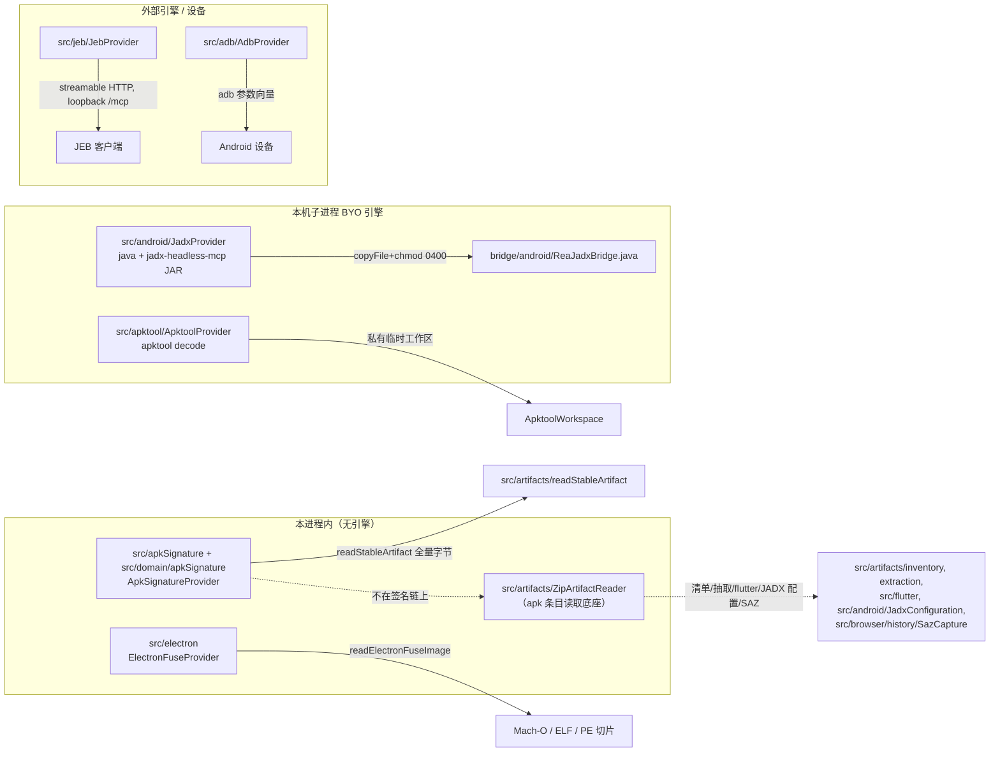
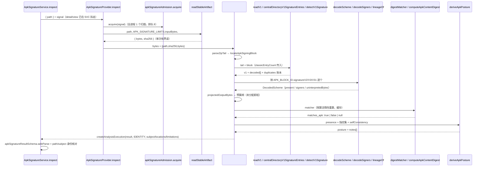

# 20 · 移动与桌面 App（adb / android / apktool / apkSignature / jeb / electron）

> 定位：本篇是 **provider 族的实现侧**走读——这六个模块各自「收什么输入、开什么进程、发不发设备命令、把什么交给 application 层」。它属于第四层（模块篇），进程归属是本机 TS 主进程；只有 `src/android/`（JADX）、`src/apktool/`、`src/jeb/` 会拉起或连接外部引擎，`src/adb/` 会把命令转发给设备。
>
> 边界澄清（不要与相邻篇重复）：**契约层结论归 [08](08-契约层-工具契约与Schema.md)**（`INSPECT_APK_SIGNATURE_CONTRACT`、effects 审计如何生成 title/annotations、catalog digest），**一条请求怎么穿过校验/handler/session 归 [03](03-最小例子-一次全路径走读.md)/[04](04-主链路拆解-请求到Evidence.md)**。本篇讲 apkSignature 的**实现侧**（domain 解码 + provider 编排 + 报告派生），并把 03/08 留的「provider 族能力表」补齐。`bridge/nativeaot/*.java` 不在本篇（→ [18 Managed 与语言元数据 Reader](18-Managed与语言元数据Reader.md)），Ghidra/IDA 桥也不在本篇（→ [15 深度 Provider：Hopper 与 Ghidra](15-深度Provider-Hopper与Ghidra.md)、[16 深度 Provider：IDA / Kuna / JEB / Cutter](16-深度Provider-IDA-Kuna-JEB-Cutter.md)）。

版本基线：`src/` 与文档提交 `9541eb1f2` 一致；**本会话未跑 build/测试/设备/外部引擎**（任务明确禁止），所以全文没有实测输出，返回值形状一律 `[推导]` 并给出依据。

## 0 速览

1. **六个模块按「副作用面」分三档，不是按平台分**：纯进程内只读（`src/apkSignature/`、`src/electron/`）、本机子进程 BYO 引擎（`src/apktool/`、`src/android/`JADX）、外部引擎网络对端（`src/jeb/`，仅 loopback）、设备通道（`src/adb/`，唯一能把命令发到 Android 设备的模块）。逐模块输入输出见 §1 表。
2. **apkSignature 的实现侧是「三层各自不信任上一层」**：`src/domain/apkSignature/*` 只做纯字节解码并返回 tagged `Result`（`src/domain/apkSignature/apkSigningBlock.ts 函数：parseZipTail 偏移：+12` 明确比 apksigner 更严）→ `src/apkSignature/ApkSignatureProvider.ts 函数：#analyze 偏移：+4` 编排并算预算 → `src/application/apkSignature/ApkSignatureService.ts 函数：inspect 偏移：+37` 把 provider 结果再 `apkSignatureResultSchema.safeParse` 一次并在 `+40` 核对 `artifact.path`。03 篇讲了这个「不信 provider」的契约侧结论，本篇讲的是 provider **交出什么**、以及 domain 如何决定这些字段。
3. **v1/v2/v3/v3.1 的 `present` 来自两套完全不同的判据**：v2/v3/v3.1 = APK Signing Block 里有没有对应 pair id（`src/apkSignature/ApkSignatureProvider.ts 函数：decodeScheme 偏移：+5`，id 表 `src/domain/apkSignature/apkSigningBlock.ts Const：APK_BLOCK_ID`）；v1 = 中央目录里 `META-INF/*.SF` 与 `*.RSA|*.DSA|*.EC` 是否成对出现（`src/domain/apkSignature/apkV1MetadataName.ts 函数：isV1SignatureBlockName`、`函数：v1SignatureFileNameForBlock`）。见 §4 判定表。
4. **「签名校验失败」与「制品被改动」在这个实现里是三条互不相交的通道**（§5）：`matches_apk: false`（声明的内容摘要 ≠ 当前字节，`src/domain/apkSignature/apkContentDigest.ts 函数：computeApkContentDigest 偏移：+11`）、`AnalysisArtifactChangedError`（**读取期间**文件变了，`src/apkSignature/apkSignatureFailures.ts 函数：artifactReaderFailure 偏移：+6` 的 `case "integrity"`）、`malformed-block`（结构本身读不出来，`src/apkSignature/apkSignatureFailures.ts 函数：mapApkBlockError 偏移：+20`）。REA 全程不做密码学校验，所以「验签失败」这个类别在源码里**不存在**。
5. **JEB 是 BYO 外部引擎，发现方式是「连一个 loopback MCP 端点」而不是找可执行文件**：`src/jeb/JebMcpEndpoint.ts 函数：parseJebMcpEndpoint 偏移：+7`（默认 `http://127.0.0.1:8425/mcp`）用五道拒绝把端点规整成「只有 scheme/host/port 选引擎」；未配置或连不上时 `src/composition/jeb.ts 函数：unconfiguredJebProvider` 只毒化 JEB 一个 provider（`src/composition/jeb.ts` 文件头注释），运行期降级为 `AnalysisCapabilityUnavailableError("jeb", …)`（`src/jeb/JebProvider.ts 函数：#providerFailure 偏移：+44`）。
6. **`ReaJadxBridge.java` 跑在 REA 自己拉起的 `java` 子进程里，不是 JADX GUI 进程**：它被 `copyFile` 进 provider 私有工作区、`chmod 0o400`、算哈希比对，再作为 `java --class-path <jadx-headless-mcp 快照.jar> <workspace>/ReaJadxBridge.java` 的**单文件源码启动参数**执行（`src/android/JadxProvider.ts 函数：… 见 §8 锚点`）；引用点只有 `src/android/`（grep 全 `src` 只有两处，见 §8），**与 `src/jeb/` 无关**。

## 1 六个模块的职责切分

### 1.1 能力表（本篇的路由真相源）

工具名与契约文件的对应（`grep -n 'name: "' src/contracts/<域>` 实测）：

| 模块 | 公开工具 | 契约文件 | 实现 provider | 引擎/进程 |
|---|---|---|---|---|
| adb | `inspect_adb_client`、`list_adb_devices`、`inspect_adb_device`、`list_adb_packages`、`pull_adb_package`、`read_adb_logcat`、`inspect_adb_package`、`pull_adb_file`、`push_adb_file`、`capture_adb_screen`、`list_adb_processes`、`list_adb_directory`、`list_adb_features`、`list_adb_services`、`inspect_adb_display`、`inspect_adb_window`、`read_adb_setting`、`collect_adb_bugreport`、`resolve_adb_packages`、`install_adb_package`、`uninstall_adb_package`、`start_adb_app`、`start_adb_activity`、`stop_adb_app`（24 个） | `src/contracts/adb/adbToolContracts.ts` | `src/adb/AdbProvider.ts 函数：AdbProvider` | 调用方选定的 `adb` 二进制（子进程） |
| android（JADX） | `inspect_android_package`、`search_android_classes`、`inspect_android_class`、`inspect_android_method`、`trace_android_references`（5 个） | `src/contracts/android/androidToolContracts.ts` | `src/android/JadxProvider.ts` | 本机 `java` + 调用方自备 `jadx-headless-mcp 0.7.1` JAR |
| apktool | `inspect_apktool_client`、`decode_android_resources`（2 个） | `src/contracts/apktool/apktoolToolContracts.ts` | `src/apktool/ApktoolProvider.ts 函数：ApktoolProvider` | 调用方自备 apktool（批处理启动器；Windows 走 cmd.exe，见 `函数：apktoolInvocation` 的拒绝分支） |
| apkSignature | `inspect_apk_signature`（1 个） | `src/contracts/apkSignature/apkSignatureToolContracts.ts` | `src/apkSignature/ApkSignatureProvider.ts` | **无**（进程内） |
| jeb | `inspect_jeb_client`、`open_jeb_project`、`list_jeb_units`、`decompile_jeb_item`（4 个） | `src/contracts/jeb/jebToolContracts.ts` | `src/jeb/JebProvider.ts 函数：JebProvider` | 运行中的 JEB 客户端（MCP over HTTP，loopback） |
| electron | `inspect_electron_fuses`（桌面 app；其余 `list_electron_targets`/`inspect_electron_page`/`capture_electron_scenario` 属 JavaScript 观察族，定义同在 `src/contracts/javascript/electronToolContracts.ts`） | `src/contracts/javascript/electronToolContracts.ts` | `src/electron/ElectronFuseProvider.ts 函数：ElectronFuseProvider` | **无**（进程内读可执行文件里的 fuse wire） |

[推导] 上表的「引擎/进程」列由三个事实合成：effects 审计里各工具的 `launchesProcess`（`src/contracts/toolEffects.ts` 的 `inspect_apktool_client: effects({ mutatesSession: true, launchesProcess: true })`、`decode_android_resources` 额外 `writesFilesystem: true`、`inspect_jeb_client` 只有 `accessesNetwork: true`、`inspect_electron_fuses: evidence`）+ 各 provider 文件的 import（`src/apktool/ApktoolProvider.ts` import `../process/PrivateRuntimeRoot.js`，`src/electron/ElectronFuseProvider.ts` 只 import `../artifacts/*`）。

### 1.2 关系图



图里每个节点在 §2..§8 都有锚点。**`ZipArtifactReader` 与签名链的隔离关系**与 03 篇 §1 同一结论、同一 grep 口径（本篇 §2.4 复述证据，不重复其理由）。

### 1.3 逐模块输入 / 输出 / owner

| 模块 | 输入（调用方给的） | 输出（交给 application 的） | 资源 owner 与 cleanup |
|---|---|---|---|
| adb | `environment`（选定的 adb 二进制与 serial）+ 每个 request 的 operation/input | `createAnalysisExecution(...)` 形式的 `AnalysisExecution`，含 parse 后的设备事实、`unparsed_lines`、coverage limitation | `readonly #resources = new ArtifactResourceScope()` 与私有 runtime root（`src/adb/AdbProvider.ts 函数：#withRuntimeRoot`）；输出目录清理由 `函数：#performOutputDirectoryCleanup` 负责，失败的目录进 `#pendingOutputDirectoryCleanup` 保留所有权 |
| android/JADX | `REA_JADX_MCP_JAR`（调用方自备 JAR 绝对路径）+ `path`/`class_name`/`method_name` | `AndroidOperation` 五种的 result schema（`src/domain/android/androidAnalysis.ts 函数：androidRequestSchema` 判别联合） | `src/android/JadxWorkspaceRoot.ts` 的工作区根 + `JadxSession` 持有的子进程；帧上限 `MAX_FRAME_BYTES`（§8） |
| apktool | 选定 apktool 启动器 + 待解码 apk 路径 + `decode_timeout_ms` | `apktoolResultSchemas`（`src/domain/apktool/apktoolResourceAnalysis.ts`）里的解码清单/字符串表投影（`src/apktool/ApktoolStringTables.ts 函数：projectApktoolStringTables`） | `src/apktool/ApktoolWorkspace.ts 函数：ApktoolWorkspace`（类头注释：`One decode's descriptors and root; removal follows confirmed child cleanup.`）；命令清理另有 `ApktoolCommandCleanup` |
| apkSignature | `{ path }`（+ 投递侧 `detail`/`view`，service 拆走） | `ApkSignatureExecution`（`result` = 完整 `apkSignatureResultSchema` 形态，见 §4） | `readonly #resources = new ArtifactResourceScope()`，注释 `Owns the selected file's descriptor, retaining it when closing fails.`（`src/apkSignature/ApkSignatureProvider.ts 函数：close 偏移：+9` 抛 `ProviderCleanupError` 并 `bindArtifactFileCleanup`） |
| jeb | `REA_JEB_MCP_URL` + `REA_JEB_MCP_TIMEOUT_MS` + 四个 operation 的入参 | `AnalysisExecution`，`engine` 字段带 `{ name, version, endpoint, gui_client }` | 连接由 `src/jeb/JebMcpConnectionOwner.ts Class：JebMcpConnectionOwner` 拥有；获取/清理失败包成 `JebMcpAcquisitionCleanupFailure`（`src/jeb/JebProvider.ts 函数：#providerFailure 偏移：+1`） |
| electron | `{ path }`（单个本地文件或 app bundle） | `ElectronFuseReport`（`artifact` + `slices` + `runtime_implications` + `limitations`，见 `src/electron/ElectronFuseProvider.ts 函数：reportFor 偏移：+5`） | 同样是 `ArtifactResourceScope`；`close()` 失败统一 `electronFuseFailure(cause, "artifact-resources")` |

## 2 apkSignature 实现侧：从 domain 文件到 service

### 2.1 domain 侧文件分工（`src/domain/apkSignature/`，9 个非测试文件）

| 文件 | 只管这件事 | 关键符号 |
|---|---|---|
| `apkSigningBlock.ts`(344 行) | ZIP 尾（EOCD/Zip64）与签名块的**分帧**；不做任何语义 | `Const：APK_BLOCK_ID`、`Type：ZipTail`、`函数：parseZipTail`、`函数：locateApkSigningBlock`、私有 `函数：centralDirectoryOffset` |
| `apkSignatureSchemes.ts`(359 行) | v2/v3/v3.1 块值里 signer 序列的**长度前缀 framing**、rotation lineage、stamp 证书、算法 id 表 | `函数：decodeSigners`、`函数：decodeSigner`、`函数：decodeSignedData`、`函数：decodeRotationLineage`、`函数：decodeSourceStampCertificate`、`函数：contentDigestAlgorithm`、`Const：PROOF_OF_ROTATION_ATTR_ID`、`Const：MAX_SIGNERS`、`Const：MAX_LINEAGE_NODES`、私有类 `Type：LeReader` |
| `apkV1Signature.ts`(487 行) | **按字节扫中央目录**取 `META-INF` 签名条目并配对 | `函数：centralDirectoryV1SignatureEntries`、`函数：detectV1Signature`、`函数：localEntryData`、`Const：MAX_V1_SIGNERS` |
| `apkV1SignatureBlock.ts`(429 行) | 单个 v1 签名块的 PKCS#7 `SignedData` ASN.1 解析 | `函数：decodeV1SignatureBlock`、`Const：MAX_ASN1_ELEMENTS` |
| `apkContentDigest.ts`(95 行) | v2/v3 内容摘要重算（三段 + 1 MiB 分块） | `函数：computeApkContentDigest`、`Type：HashFactory` |
| `apkSignatureReport.ts`(452 行) | 输出 schema + **纯函数 posture 派生** | `Const：apkSignatureResultSchema`、`Const：APK_SIGNATURE_LIMITATIONS`、`函数：deriveApkPosture`、`函数：apkSignatureMatchesSubject`、`函数：apkSignatureUninterpretedBytes` |
| `apkSignatureQuery.ts`(127 行) | 入参 schema（03/08 已述，不重复） | `Const：inspectApkSignatureInputSchema` |
| `zipEntryName.ts`(203 行) | ZIP 条目名的 canonical 字节规范化 | `函数：decodeZipName`、`函数：isCanonicalZipName` |
| `apkV1MetadataName.ts`(35 行) | v1 元数据名的**精确路径规则**（v1 侧唯一名字判据） | `函数：isV1SignatureFileName`、`函数：isV1SignatureBlockName`、`函数：v1SignatureFileNameForBlock`、`函数：isV1SignatureMetadataName`、`函数：startsWithV1MetaInfPrefix`、`Const：APK_V1_MANIFEST_PATH` |

`apkV1MetadataName.ts` 全文 35 行，是「两处规则」里的第二处（另一处 `zipEntryName.ts`）。字面规则（观察）：`BLOCK_SUFFIXES = [".RSA", ".DSA", ".EC"]`；`.SF` 名由 block 名**替换尾缀**得到（`函数：v1SignatureFileNameForBlock 偏移：+1`：`block.slice(0, block.lastIndexOf("."))` + `.SF`）；`函数：startsWithV1MetaInfPrefix 偏移：+3` 用**预编码的字节数组**逐字节比较，注释写明目的：`Test the raw central-directory name before decoding noncandidate ZIP paths.`——即先按字节筛掉非 `META-INF/` 条目，避免为整个 archive 的每条名字跑 UTF-8 fatal 解码。`[推导]` 这两处规则的共同点是「名字比较在字节层做」，因此 03 篇 P3-4（两处规则若漂移会静默漏配对）在实现侧的落点是：配对只依赖 `函数：v1SignatureFileNameForBlock` 这一个派生函数，`detectV1Signature` 不自己拼名字。

### 2.2 调用链（含函数级走读）



逐跳的函数级读法（行号取自当前 `src/`，锚点为符号+偏移）：

**`src/apkSignature/ApkSignatureProvider.ts 函数：inspect`**（编排 + 三重闸门）
- `+6` `const release = await apkSignatureAdmission.acquire(options?.signal)`：进程内串行闸门在**读文件之前**。
- `+8` `readStableArtifact(input.path, APK_SIGNATURE_LIMITS.inputBytes, options?.signal, undefined, this.#resources)`：第 5 个参数把描述符所有权直接交给 `#resources`，这是 03 篇「唯一 open 点」的调用侧。
- `+15`/`+21` 两次 `assertArtifactReadActive(options?.signal)` 夹住 `#analyze`——分析前后各确认一次取消状态。
- `+28` `return err(apkSignatureFailure(cause, input.path))`：整个 try 的**唯一**出口收敛到一个映射函数（§5、§7）。

**`函数：#analyze`**（10 步，全在同一函数里，无中途 I/O）
1. `+4` `parseZipTail(bytes)`；`+6` `locateApkSigningBlock(bytes, tail.value)`。两者的 tagged error 都走 `mapApkBlockError(tail.error, artifact.path)`。
2. `+9` `readV1(bytes, tail.value, block.value)`——**v1 先看目录，失败即整条链拒绝**（`函数：readV1 偏移：+20` 之后没有「v1 未知继续报」的分支，注释：`A directory that cannot be walked leaves v1 unknown and is refused.`）。
3. `+13`~`+18` 三次 `decodeScheme(block.value, APK_BLOCK_ID.signatureV2 / signatureV3 / signatureV31, "v2"/"v3"/"v3.1")`。
4. `+21` `projectedOutputBytes([v2,v3,v31], v1, v1Decoded, sourceStampPair(block.value)?.value)`，`+27` 超预算直接 `err(apkOutputBudgetError(projected))`——**在物化报告之前**先算上界（AGENTS.md「Account for representation expansion before allocating」的落点）。展开式是字面常量累加：`total += 512 + certificateBytes(...)`、`total += 160 + 2 * digest.digest.length`（`函数：projectedOutputBytes 偏移：+13`、`+15`）。
5. `+30` `digestMatcher(bytes, tail.value, block.value?.blockStart ?? null)`。
6. `+36`~`+41` 四个 signer 投影（`v1SignerFacts` / `baseSigner` / `v3Signer`）。
7. `+43` `deriveApkPosture({...})`，输入是 presence + `postureSigner` 指纹集 + `selfConsistency([...])`。
8. `+62` 组装 `result`（五键：`artifact`/`schemes`/`source_stamp`/`posture`/`runtime_execution: "not-performed"`）。
9. `+92`~`+106` limitations 拼装顺序：未解释字节数 → `APK_SIGNATURE_LIMITATIONS`（5 条固定）→ `LAYOUT_LIMITATION`（条件）→ `duplicateEntriesLimitation(duplicates)` → `v1SignerNotes(v1Decoded)` → `derived.notes`。
10. `+109` `Buffer.byteLength(JSON.stringify({ result, limitations }))`，`+112` 二次预算闸（注释：`The budget covers everything emitted: limitations repeat archive names.`）；`+115` 由 `zipPackageFormatForPath(artifact.path)` 决定 subject 的 `format` 是 `apk` 还是 `zip`。

**`函数：readV1`**（v1 侧）：`+12` 把 `tail.classicEntryCount` 传给中央目录扫描——这是「apksig 只读 16-bit 计数声明的前 N 条」这条口径进入实现的唯一入口；`+21` `v1.signers.length > MAX_V1_SIGNERS` 直接容量拒绝；`+24` `const entriesEnd = block?.blockStart ?? tail.centralDirectoryOffset`（注释：`Entry data lies before the signing block, or the directory without one.`，即签名块之后的字节不算条目数据）；`+29` 每个配对走 `decodeV1Signer(bytes, signer, entriesEnd)`。

**`函数：decodeScheme`**（v2/v3/v3.1 侧）：`+5` `block?.pairs.find((p) => p.id === id)`——**pair 不存在就是 `present: false`，不是错误**；`+8` `decodeSigners(pair.value, version)`；`+13` v2 不解析 lineage（`version === "v2" ? ok({ present: false }) : lineageOf(signer)`），与格式一致（proof-of-rotation 只在 v3 系）。

**`函数：digestMatcher`**（`matches_apk` 的唯一来源）：闭包内 `cache = new Map<"sha256"|"sha512", Uint8Array|null>()`，`+7` 起的 `match` 在三种情况下返回 `null`：`blockStart === null`（无签名块）、算法既不是 sha256 也不是 sha512（含 verity 与未知，`+10` 的判据），以及 `computeApkContentDigest` 自己返回 `null`；`+25` 用 `Buffer.from(computed).equals(signed)` 比较；`+27` `layoutPreventedRecompute()` 只检查「缓存里有 `null`」，这正是 §6 里 `LAYOUT_LIMITATION` 的触发条件。**注意这是内容摘要相等判断，不是验签**（`Const：APK_SIGNATURE_LIMITATIONS` 第 3 条原文已钉死）。

**`函数：locateApkSigningBlock`**（domain 分帧）：`+5` `if (!hasBlockMagic(bytes, cdOffset)) return ok(null)`——**「没有块」是值不是错误**；`+7` `trailingSize = u64(dv, cdOffset - 24)`；`+16` `blockStart = cdOffset - trailingSize - 8`；`+24` 前后 size 必须相等；`+48` `id = dv.getUint32(cursor + 8, true)`，`+52` `value: bytes.subarray(valueStart, valueStart + (length - 4))`（视图不是拷贝，见 `Type：ApkSigningBlockPair` 注释 `View over the block buffer; not copied.`）。

**`函数：parseZipTail`**（拒绝优先）：`+12` 两个各自正好结尾的 EOCD → `malformed-zip`（注释原文：`a crafted APK that apksigner verifies may be refused here, never misreported`）；`+22` 无 EOCD 但有 local header → `malformed-zip`（截断），无 local header → `not-a-zip`（不是 zip）；`+48` EOCD 声明 0 条目/0 尺寸却有 local header → `malformed-zip`（伪装的「未签名」）。私有 `函数：centralDirectoryOffset 偏移：+48` 处 `totalDisks > 1` → `zip64-unsupported`（多分卷 Zip64 明确不解）。

### 2.3 字节布局

```
文件起点                                                              文件终点
│ [0]                                                                    │
▼                                                                        ▼
┌──────────────────────┬─────────────────────┬───────────────────────────┬───────────────┬───────────┐
│ ZIP local entries    │  APK Signing Block  │     Central Directory     │ Zip64 EOCD/   │   EOCD    │
│ (dex / resources /   │                     │  (v1 侧唯一读取范围)      │ locator(可选) │ (22+BOM)  │
│  META-INF/*.SF,*.RSA)│                     │                           │               │           │
└──────────────────────┴─────────────────────┴───────────────────────────┴───────────────┴───────────┘
  ▲                    ▲                     ▲                           ▲               
  │                    │blockStart            │centralDirectoryOffset     │eocdOffset      
  │                    │                      │                           │                
  │◀── 摘要段 1 ──────▶│◀──── 被跳过（视作不存在）────▶│◀── 摘要段 2 ──▶│◀─ 段 3：EOCD，CD offset 字段改写为 blockStart ─▶│
                       │                      │                           
                       └──────────────────────┘ blockStart = cdOffset - trailingSize - 8

APK Signing Block 内部（全部 little-endian，uint64 长度 + uint32 id）：
┌────────────┬──────────────────────────────────────────────────────┬────────────┬────────────────────┐
│ uint64 size│  pair 序列：uint64 length │ uint32 id │ value[length-4] │ uint64 size│ "APK Sig Block 42" │
│ (=trailing)│                                                      │ (=leading) │ 16 字节 magic      │
└────────────┴──────────────────────────────────────────────────────┴────────────┴────────────────────┘
        +0..+7        +8..                       cursor+8 = id, cursor+12 = value      cdOffset-24..-8   cdOffset-16..
   前导尺寸              各 pair                                                 尾部尺寸            magic

pair id → 方案（Const：APK_BLOCK_ID）：
  0x7109871a  signatureV2   ─┐
  0xf05368c0  signatureV3    ├─ decodeSigners(value, "v2"|"v3"|"v3.1")
  0x1b93ad61  signatureV3.1 ─┘
  0x2b09189e  sourceStampV1  ─┐ 优先取 V2（as apksig does）
  0x6dff800d  sourceStampV2  ─┘ decodeSourceStampCertificate(value)

v2/v3/v3.1 的 value（uint32 长度前缀序列）：
  lp( signers ): [ lp(signer) … ]        lp ≤ MAX_SIGNERS = 32
      signer = lp(signedData) | (v3系: u32 minSdk, u32 maxSdk) | lp(signatures) | lp(publicKey)
      signedData = lp(digests) | lp(certificates) | (v3系: u32 minSdk, u32 maxSdk) | lp(attributes)
      digest/attribute/signature 元素 = u32 algorithmId | lp(bytes)
      attributes 元素 = u32 id | bytes；id == 0x3ba06f8c → proof-of-rotation lineage
  v3 lineage node = lp( lp(certificate) | u32 sigAlgorithm ) | u32 flags | u32 sigAlgorithm | lp(signature)

v1 侧（不看解压结果，只看目录）：
  Central Directory 记录流 ──▶ 名字以 "META-INF/" 开字节匹配（startsWithV1MetaInfPrefix）
                            ──▶ *.SF ↔ *.RSA|*.DSA|*.EC 配对（v1SignatureFileNameForBlock）
                            ──▶ 条目原始字节 → inflateRawSync（≤ 1 MiB）→ decodeV1SignatureBlock（ASN.1）
```

锚点：块的框取与 magic 见 `src/domain/apkSignature/apkSigningBlock.ts 函数：locateApkSigningBlock 偏移：+5/+7/+16/+48/+52`；pair id 表 `Const：APK_BLOCK_ID`；signer framing 与 `MAX_SIGNERS`/`PROOF_OF_ROTATION_ATTR_ID`/lineage node 见 `src/domain/apkSignature/apkSignatureSchemes.ts 函数：decodeSigners 偏移：+5`、`函数：decodeSignedData 偏移：+22`、`函数：decodeSigner 偏移：+9`、`函数：decodeRotationLineage 偏移：+6/+10`；v1 侧见 §2.2 的 `函数：readV1`；内容摘要三段见 `src/domain/apkSignature/apkContentDigest.ts` 文件头注释与 `函数：computeApkContentDigest 偏移：+28`（`sections = [bytes.subarray(0, blockStart), bytes.subarray(centralDirectoryOffset, eocdOffset), eocd]`）、`+42`（chunk 前缀字节 `0xa5`）、`+49`（top 前缀 `0x5a`）。

### 2.4 `ZipArtifactReader.ts`：apk 读取底座，但**不在签名链上**

03 篇已给结论（签名链自带中央目录解析，因为必须按字节看签名结构）。本篇复核口径独立：`grep -rln 'ZipArtifactReader' src --include='*.ts' | grep -v '\.test\.'` 命中 6 个文件——自身、`src/artifacts/inventory/reader.ts`、`src/artifacts/extraction/ArtifactExtraction.ts`、`src/flutter/FlutterBuildProvider.ts`、`src/browser/history/SazCapture.ts`、`src/android/JadxConfiguration.ts`（JADX 用它把目标 apk 做稳定哈希/快照，属 android 模块而非签名链）。

它自己怎么处理异常条目（观察，`src/artifacts/ZipArtifactReader.ts` 头部）：
- 底座是 `@zip.js/zip.js` 的 `Reader`/`ZipReader`，REA 侧写了一个 `class NodeFileReader extends Reader<string>`（`函数：NodeFileReader`）把读取挂到 **`OwnedFileHandle`** 上（import `../filesystem/OwnedFileHandle.js`、`../filesystem/RegularFile.js`），条目名解码用 **fatal UTF-8 且 ignoreBOM** 的 `TextDecoder`（`Const：ZIP_UTF8_DECODER`）。
- 失败模式是「上游错误码 → `ArtifactReaderFailure`」的映射，顶部 `@zip.js/zip.js` 的 import 块点名 17 个 `ERR_*`（依赖：`@zip.js/zip.js`），包括 `ERR_OVERLAPPING_ENTRY`、`ERR_ENTRY_DATA_OUT_OF_BOUNDS`、`ERR_INVALID_CRC32`、`ERR_AMBIGUOUS_ARCHIVE`、`ERR_UNSUPPORTED_ENCRYPTION`、`ERR_UNSUPPORTED_UINT64`、`ERR_SPLIT_ZIP_FILE`。
- 解压膨胀有预算：import 了 `ARTIFACT_EXPANSION_RATIO`、`artifactExpansionBudgetBytes`、`MINIMUM_ARTIFACT_EXPANDED_BYTES`（`../domain/artifactExpansionBudget.js`）。

**zip slip / 落盘位置**：`grep -n 'slip\|traversal' src/artifacts/ZipArtifactReader.ts` 只命中一行注释——`src/artifacts/ZipArtifactReader.ts 函数：entries 偏移：+2` 的 `A traversal owns its accounting, including overlapping or repeated passes.`，讲的是**记账**（重复/重叠遍历仍各自计数），不是路径防护。`[推导]` 该 reader 只提供 `entries()` 流与 `copyArtifactEntry`（`src/artifacts/ArtifactReader.ts`），落盘位置约束由调用方决定。调用方一侧确实有一个显式拒止符号：`src/artifacts/extraction/ArtifactExtraction.ts 函数：materializeArtifactInventoryInScope 偏移：+16`（`if (isPathWithinRoot(canonicalSource, parent)) throw new SafeOutputTreeDestinationRefusal(...)`），配套 `src/artifacts/SafeOutputTreeAdmission.ts Class：SafeOutputTreeDestinationRefusal`（`extends ArtifactReaderFailure`）与 `src/domain/localPath.ts 函数：isPathWithinRoot 偏移：+0`（注释明写「Test lexical containment on the host platform; **callers must resolve symlinks first**」，故两处都先 `realpath`）。**但这道闸的范围要读准**：它只在 `zipSource === undefined`（目录型来源）且检查的是「输出父目录是否落在来源目录内部」，防的是**目录把自己的一次输出当新成员吸进来**，不是逐条 entry 名。entry 名那一侧的闸门在清单扫描层：`src/artifacts/ArtifactPaths.ts 函数：normalizeArtifactPath 偏移：+0` 先拒 NUL / 以 `/` 开头 / 匹配 `ABSOLUTE_DRIVE_PATH`（`偏移：+1~+5`），再对 NFC 归一后的每段检查 `"" | "." | ".."` 并强制 `posix.normalize(normalized) === normalized`（`偏移：+13~+16`），任一不符抛 `ArtifactReaderFailure("path", ...)`。调用点在 `src/artifacts/inventory/scanReader.ts 函数：visitArtifactEntries 偏移：+29`（`const logicalPath = normalizeArtifactPath(...)`，同文件 `函数：scanReader 偏移：+47` 把 `parentResolution.limitations` 并进结构性 limitations）。`[推导]` 因此「恶意 entry 名写到根外」在 **inventory/extraction 这一路**被拒两次：名字本身进不来，进来了也过不了输出父目录闸。**apktool/JADX 自己的解包路径是否复用 `normalizeArtifactPath` 仍未证实**（本篇读到的是这两个 provider 直接消费上游引擎的输出目录，不经过 REA 的 ZIP reader）→ **[未知]**。

## 3 三方案（实为四套）在代码里的判定与报告结构

### 3.1 判定规则表

| 方案 | `present` 判据 | 判定代码 | 身份（证书）来源 | 未解释字节记账 |
|---|---|---|---|---|
| v1 | 中央目录里 `META-INF/*.SF` 与 `*.RSA/*/.DSA/*.EC` 成对存在（结构式，非平台适用性） | `src/domain/apkSignature/apkV1Signature.ts 函数：detectV1Signature`；名字规则 `src/domain/apkSignature/apkV1MetadataName.ts 函数：isV1SignatureMetadataName` | PKCS#7 `SignedData` 里 `SignerInfo` 按 `issuerAndSerialNumber` 或 `subjectKeyIdentifier` 命名的那一张（`src/domain/apkSignature/apkSignatureReport.ts Const：v1Signer` 的 `certificate` 可为 `null` = 身份未知） | 不记（v1 走另一套：`decode_error` 字段） |
| v2 | 块里有 id `0x7109871a` 的 pair | `src/apkSignature/ApkSignatureProvider.ts 函数：decodeScheme 偏移：+5/+6` | `signer.certificates[0]`（`函数：baseSigner 偏移：+1`） | `uninterpreted_signed_data_bytes`/`uninterpreted_signer_bytes`/每条 digest 与 signature 的 `uninterpreted_bytes` |
| v3 | id `0xf05368c0` | 同上，`version: "v3"` | 同上 + `rotation.lineage[]`（**声明而非验证**） | 同上 |
| v3.1 | id `0x1b93ad61` | 同上，`version: "v3.1"`（与 v3 共用 `apkSignerV3Schema`） | 同上 | 同上 |
| source stamp | id `0x6dff800d`(V2) 优先，其次 `0x2b09189e`(V1) | `src/apkSignature/ApkSignatureProvider.ts 函数：sourceStampPair`、`函数：sourceStampFacts 偏移：+6` | `decodeSourceStampCertificate` 取 `lp(stampData)` 里的 `lp(certificate DER)` | `decode_error`（容量失败文案：`more ${resource} than ${limit}`，`函数：sourceStampFacts 偏移：+16`） |

`函数：digestMatcher` 决定每条 digest 的 `matches_apk`（`true`/`false`/`null` 三态），`函数：selfConsistency 偏移：+4` 把三态收成 `boolean | null`（`results.length === 0` → `null`，否则 `every(Boolean)`）。

### 3.2 算法表（`函数：contentDigestAlgorithm`，签名算法 id → 内容摘要算法）

| id | 含义（源码注释） | 映射 |
|---|---|---|
| `0x0101`/`0x0103`/`0x0201`/`0x0301` | RSASSA-PSS / RSASSA-PKCS1-v1_5 / ECDSA / DSA，SHA2-256 | `"sha256"`（`函数：contentDigestAlgorithm 偏移：+4`） |
| `0x0102`/`0x0104`/`0x0202` | PSS / PKCS1 / ECDSA，SHA2-512 | `"sha512"`（`偏移：+9`） |
| `0x0421`/`0x0423`/`0x0425` | PKCS1 / ECDSA / DSA over the verity tree | `"verity-sha256"`（`偏移：+13`）——**不重算**：`函数：digestMatcher` 只接受 sha256/sha512，故 verity 的 `matches_apk` 恒 `null`，并由 `Const：APK_SIGNATURE_LIMITATIONS` 第 5 条交代 |
| 其它 | 未知 | `null` → 报告里 `algorithm: "unknown"`（`函数：digestsOf 偏移：+7` 的 `?? "unknown"`） |

v1 侧**不做算法表归一**：PKCS#7 的 `digest_algorithm_oid`、`signature_algorithm_oid` 以 OID 字符串原样进报告（`Const：v1Signer` 的 `signer_infos`），`identified_by` 才是枚举（`"issuer-and-serial" | "subject-key-identifier"`）。`[推导]` 口径差异是有意的：v2/v3 的算法 id 是 APK 格式自己定义的 32 位整数（可穷举），v1 走 X.509/PKCS#7 世界（OID 空间开放，归一会丢信息）——这与 AGENTS.md「保留源值、不因规范化丢信息」一致。

### 3.3 报告结构与 posture 派生

`posture` 九个字段（`src/domain/apkSignature/apkSignatureReport.ts Const：apkSignatureResultSchema` 的 `posture` 子对象，逐字段注释在 schema 里）与 `函数：deriveApkPosture` 的对应：

| 字段 | 级别 | 派生规则锚点 |
|---|---|---|
| `v1_only` | 观察 | `函数：deriveApkPosture 偏移：+51`：`input.v1Present && !blockPresent`（`blockPresent` 在 `+3`） |
| `strongest_scheme` | 观察 | `+4` 起的嵌套三元：`v3.1 > v3 > v2 > v1 > "none"`（`Const：SCHEME` 枚举） |
| `schemes_agree_on_signer` | 观察 | `+25` `identityUnknown`（任一 signer 指纹为 `null` 即「身份未知」）→ `+53` 处 `union.size === 0 \|\| signerSetsDiffer === null ? null : !signerSetsDiffer` |
| `signer_change_declared_by_rotation` | **声明级** | 私有 `函数：signerChangeDeclared 偏移：+3`：`if ([...signers].every((fp) => lineage.has(fp))) return true;` 且 `lineageUnknown ? null : false` |
| `v1_signers_match_block_signers` | 观察+期望 | 私有 `函数：v1MatchesBlockSigners 偏移：+6`，`Const：v1Signer` 注释解释「lowest present block scheme with signers」；v3/v3.1 有 lineage 时期望值是 lineage 的**第一个**证书（`函数：expectedV1Certificate 偏移：+15`），这是 apksig 的要求 |
| `rotation_present` | 观察 | `+63` `lineages.some((l) => l.kind !== "absent")`——注意 `undecoded` 也算 present |
| `source_stamp_present` | 观察 | 直通 `input.sourceStampPresent` |
| `self_consistent` | 观察（摘要相等） | 直通 `input.selfConsistent`（来自 `函数：selfConsistency`） |
| `notes[]` | 说明 | 只在 `v1Match.note !== null` 时有一条（`+66`），文案点名「v1_signers_match_block_signers is null: <reason>」 |

**「宁可 null + 一条 limitation，也不猜」在实现上是三处的组合**：`函数：expectedV1Certificate 偏移：+10`（lineage 解不出来 → `{ ok: false, reason }`）、`函数：v1MatchesBlockSigners 偏移：+14`（返回 `{ match: null, note }`）、以及 `certificate` 整个对象 nullable（`Const：certificate` 的注释：`the parsed X.509 facts are individually null when the platform parser cannot read the DER`）。这与 08 篇「错误契约是判别联合」和 06 篇「unknown 必须保持 unknown」的口径一致，本篇不重复其结论。

`source` 侧的证书事实不在 domain 解析：`src/apkSignature/apkCertificateFacts.ts 函数：certificateFacts`（用 `node:crypto` 的 `X509Certificate`），`sha256_fingerprint` 则由 `Const：certificate` 注释钉死为「always SHA-256 over the raw embedded DER」——指纹不依赖平台解析器是否成功。

## 4 adb / 设备侧的副作用面

### 4.1 哪些操作真的向设备发命令

`src/adb/AdbProvider.ts` 里所有设备调用都经过一个 `shell` 闭包与 `adbArguments(...)` 参数向量（观察：`grep -n '"shell"' src/adb/AdbProvider.ts` 命中十余处，集中在 1363-1972 区间与 2700-3100 区间）。

**只读采集（无 `mutatesDevice`）**：`adb shell getprop`（属性快照，见 `函数：GETPROP_MAX_OUTPUT_BYTES` 常量 2 MiB）、`adb shell ps -A`、`adb shell pm list features`、`adb shell service list`、`adb shell wm size` / `wm density`、`adb shell dumpsys package <pkg>`、`adb shell dumpsys window <section>`（含一次 fallback 重试）、`adb shell pm list packages -f`、`adb shell pm path <pkg>`、`adb exec-out screencap -p`。这些在 effects 表里统一是 `effects({ mutatesSession: true, launchesProcess: true, accessesNetwork: true })`——**没有任何一项标 `mutatesDevice`**（`src/contracts/toolEffects.ts` 的 `list_adb_processes`/`list_adb_features`/`inspect_adb_display`/`read_adb_setting` 条目）。

**会写设备**：
- `push_adb_file` → `adbArguments(input.serial, ["push", digest.path, input.device_path])`，随后 `adbArguments(input.serial, ["shell", "sha256sum", devicePath])` 做设备侧摘要回执（`src/adb/AdbProvider.ts` 2528/2569 行观测；effects 条目含 `mutatesDevice: true, idempotent: false, writesFilesystem: true`）。
- `install_adb_package` → `["install", …]`（`函数：installPackage`）；`uninstall_adb_package` → `shell pm uninstall`（`函数：uninstallPackage`）；`start_adb_app` / `start_adb_activity` → `shell am start -W …`（`函数：runAmStart`）；`stop_adb_app` → `shell am force-stop <pkg>`（`函数：stopApp`）。**这五个在 effects 表里全部 `mutatesDevice: true` + `mutatesTarget: true` + `idempotent: false`**。

**代码里体现的约束**（观察，逐条）：
1. 参数向量固定、调用方值只占位置参数并转义：文件头注释 `Every operation composes fixed adb argument vectors: caller values occupy positional arguments, escaped when adb forwards them to the device shell.`
2. 不启动模拟器、不装 platform tools、不驱动 UI：同一段注释 `The provider never starts an emulator, installs platform tools, or drives the device UI; the only device mutation is the caller-requested file push, which requires an explicit overwrite choice and verifies its transfer digest.`
3. push 的「显式覆盖选择 + 摘要回执」在类型里留下了痕迹：`Type：设备摘要回执` 是判别联合，`{ device_sha256: null, device_digest_source: "unavailable", reason }` 允许「设备摘要拿不到」作为**事实**而非失败（注释：`so a receipt cannot name sha256sum as the source of a digest that was never parsed`）。
4. 本机侧写入受拒覆盖保护：`函数：prepareOutputDirectory`（注释 `Materialize the caller's output directory, refusing existing files inside.`）与 `函数：refuseExistingTarget`；截屏另有 `函数：publishScreenExclusively`（`Exclusive-create fallback for filesystems that cannot hard-link staged files.`）。
5. 每个子命令都有输出上限（145-166 行的 13 个 `*_MAX_OUTPUT_BYTES` 常量），`am start -W` 的 limitation 明确承认状态改变却没被观测：`Starting an activity changes device state; am start -W waits for launch completion but no lifecycle observation is captured`（3029 行观测）。

**「maintainer scope decision」在源码里的体现**：`grep -rn 'scope decision\|maintainer scope' src/adb src/android src/apktool src/jeb src/electron`（排除测试）**零命中**；也没有 findX「只读属性采集」这类守卫注释把 install/start/stop 标成受限能力。**结论：当前源码无法确定这些能力在合入时是否走过 scope decision**——唯一可查的书面约束是上面第 2 条注释与 `TOOL_EFFECTS` 的 `mutatesDevice` 标记。→ 见问题清单 P1-1（注释与实现面不一致）。

## 5 JEB：BYO 外部引擎的实现侧

11 篇讲的是 `unconfiguredJebProvider` 在 composition 家族中的位置（能力宣告侧）；本篇讲 provider 内部。

### 5.1 发现（没有「找可执行文件」这一步）

`src/jeb/JebProvider.ts 函数：JebProvider 构造`：`const endpoint = parseJebMcpEndpoint(environment.REA_JEB_MCP_URL)`，`if (!endpoint.ok) throw endpoint.error`——**构造期即抛**，由 `src/composition/jeb.ts` 的 `函数：unconfiguredJebProvider` 兜住。`src/jeb/JebMcpEndpoint.ts 函数：parseJebMcpEndpoint` 的五道拒（逐条观察）：非 http(s)；host 不是字面 loopback（只接受 `127.0.0.1` 或 `[::1]`）；URL 里有 `username`/`password`（注释文案：`Embedding credentials in the JEB MCP endpoint is not supported; configure authentication with the engine`）；path 不是 `/mcp` 或 `/mcp/`；带 query 或 fragment（`函数：urlDeclaresQueryOrFragment`）。默认端点 `Const：DEFAULT_JEB_MCP_ENDPOINT`。

**[推导] loopback-only 是安全边界而非便利**：REA 会把目标路径（`open_project` 的 `file_path`）交给引擎，且引擎返回值进 Evidence；允许远端等于让 REA 把本地路径发给网络对端。源码未写这句理由（该文件头注释只说「只有 scheme/host/port 选引擎」），故此为 `[推导]`；若要确认应问作者或查提交历史。

### 5.2 能力发现与降级

`函数：inspectAvailability`：先 `this.#connection.listTools(signal)`，再 `函数：#refreshClientInformation`（引擎侧 `get_client_information`），返回 `{ status: "available", supportedOperations, diagnostics: { endpoint, engine_version } }`，其中 `supportedOperations` 是按 `JEB_ENGINE_TOOLS` 反查引擎实际 advertised 的名字集合过滤出来的（`src/jeb/JebMcpConnection.ts 函数：JEB_ENGINE_TOOLS`：`inspect_jeb_client → get_client_information` 等 4 条映射）。**catch 分支**：`status: "unavailable"`、`code: "not_configured"`、`reason: "<cause message>. <JEB_CONNECTION_REMEDIATION>"`，其中 `src/jeb/JebProvider.ts Const：JEB_CONNECTION_REMEDIATION` 的文案直接给出补救（`Start a JEB client serving MCP (default …) or set REA_JEB_MCP_URL…`，原文为英文，此处截断）；`signal?.aborted === true` 时**不降级而是抛**（`src/jeb/JebProvider.ts 函数：inspectAvailability 偏移：+22`）。

执行期降级在 `函数：#providerFailure`：`JebMcpAcquisitionCleanupFailure` → `analysisErrorWithCleanupFailure(...)` 并 `bindCleanupDependencies`/`bindCleanupResourceOwner`（`偏移：+1~+6`）；`AnalysisCancelledError`/`AnalysisTimeoutError` **原样重建并保留** `partialObservation`/`capturedOutput`/`cleanup`（`偏移：+9~+31`）；`z.ZodError` → `AnalysisProtocolError("JEB omitted or malformed required observation fields")`（`偏移：+37`）；其余 → `AnalysisCapabilityUnavailableError("jeb", operation, message)`（`偏移：+44`）。物理失败先剥一层：`const physical = cause instanceof JebMcpPhysicalFailure ? cause.cause : cause`（`偏移：+42`）。

### 5.3 超时

`REA_JEB_MCP_TIMEOUT_MS` 一个设置同时管两阶段：`src/jeb/JebMcpDeadline.ts 函数：jebMcpTimeoutGuidance` 的 `phase: "discovery" | "tools/call"`，文案逐字给出上限来源（`MAX_PROVIDER_STARTUP_TIMEOUT_MS`）与「omitted means DEFAULT_REQUEST_TIMEOUT_MSEC ms」并提醒「Allow execution, cleanup and delivery headroom in the outer MCP client deadline」。`JebProvider` 构造把 `requestTimeoutMs` 与 `discoveryTimeoutMs` 都设成同一个值（`src/composition/jeb.ts` 观测：`requestTimeout.value` 同时喂两个字段）。deadline 内部用 `SdkError(SdkErrorCode.RequestTimeout, "JEB MCP interrupted")` 作为 abort reason，注释 `SDK 2.3.1 preserves an SdkError abort reason by identity`——即超时能被下游按身份识别，而不只是一次 abort。

### 5.4 read-only 边界在哪

- REA 侧不碰目标文件：`open_jeb_project` 的 limitation 原文 `JEB resolves and analyzes the artifact on the engine host; REA did not open the target itself.`（`src/jeb/JebProvider.ts 函数：#openProject 偏移：+27`）。effects 表里四个 jeb 工具都只有 `mutatesSession` + `accessesNetwork`，**没有 `writesFilesystem`、没有 `launchesProcess`、没有 `executesForeignCode`**——REA 不启动 JEB 进程。
- `open_jeb_project` 是 `idempotent: false`（`src/contracts/toolEffects.ts` 的 `open_jeb_project: effects({... idempotent: false})`）`[推导]` 因为引擎侧会创建/改动工程状态（.jdb 持久化归 JEB 客户端所有）。**引擎侧到底写了什么、是否污染用户工程，源码无法确定**——`[未知]`，本篇未读 JEB 客户端实现（不可读）。
- 分页与隐式选择都如实标注：`list_units` 的 limitation `The engine caps unit pages at 100; a full page means more units may exist.`，且 `coverage: units.length < count ? "complete" : "partial"`（`函数：#listUnits 偏移：+28`）——**这条表达式的方向值得注意，见问题清单 P2-3**；`decompile_jeb_item` 在未给 `unit_path` 时补 `The engine selected the project's first code unit implicitly; the effective unit identity is unknown.`

### 5.5 partial facts（引擎答了但元数据没拿到）

`函数：#engineForObservation 偏移：+3`：先拿引擎结果，再去取 client information；**取不到时不丢结果**，而是 `throw this.#providerFailure(...).retainPartialObservation(createAnalysisExecutionEvidence(... { status: "partial", observation: jsonValueSchema.parse(observation), engine_metadata: null } ... rawResult: payload, limitations: ["The primary engine reply completed; client metadata was not obtained, so the full operation result could not be assembled."] ...))`。即「观察已成立、元数据未知」被建模成 partial observation + 一条 limitation。信封解码在 `src/jeb/JebMcpConnection.ts 函数：decodeJebToolResult`：优先 `structuredContent`，否则要求**恰好一个** text block，否则 `AnalysisProtocolError("JEB MCP omitted a single structured or text result; unsupported content cannot establish an empty observation.")`；`success === false` → `AnalysisUnsupportedTargetError` 并把引擎给的 `error.message ?? message ?? error.code` 当 reason（`src/jeb/JebProvider.ts 函数：#requireSuccess 偏移：+9/+15`，`函数：refusalReason`）。

## 6 JADX 桥：`bridge/android/ReaJadxBridge.java`

### 6.1 它跑在哪（读文件头 + 引用点，不按包名猜）

- 文件头第 34 行的类文档注释：`/** REA-owned metadata boundary for the unmodified jadx-headless-mcp 0.7.1 JAR. */`，类声明 `class ReaJadxBridge`（package-private，**无 package 声明**）。
- import 列表同时出现 `com.atxx.jhmcp.*`（上游 jadx-headless-mcp 的类型，含 `SessionHolder`）、`jadx.api.*`、`jadx.core.dex.nodes.*`、`io.modelcontextprotocol.kotlin.sdk.server.*`、`kotlinx.coroutines.BuildersKt`。**[推导] 它不是独立的 MCP server，也不是 JADX GUI 的插件**：它 `import` 上游 server SDK 的 server 侧类型、并直接持有 `SessionHolder`（上游 JAR 的会话对象），说明它被加载进**上游 jadx-headless-mcp JAR 的 classpath**里，作为 REA 加在引擎之上的「元数据边界」层。
- TS 侧唯一引用点（grep 范围 `src --include='*.ts'` 排除测试）：`src/android/JadxProvider.ts` 两处——`const BRIDGE_SOURCE = fileURLToPath(new URL("../../bridge/android/ReaJadxBridge.java", import.meta.url))` 与 `const bridge = join(root.path, "ReaJadxBridge.java"); await copyFile(BRIDGE_SOURCE, bridge); await chmod(bridge, 0o400)`。**`src/jeb/` 对它零引用**（同 grep），所以包名 `android` + 目录 `bridge/android` 对应的是 **JADX**，与 JEB 无关。

### 6.2 启动方式与所有权

```
java <jvmArguments> --class-path <workspace>/engine.jar <workspace>/ReaJadxBridge.java
      ▲                     ▲                                 ▲
      │                     │                                 └ 复制自 BRIDGE_SOURCE，chmod 0o400，复制后重算哈希并与 bridgeHash 比对，不等即 androidSourceChanged
      │                     └ snapshotAndroidEngine(configuration.jar, jarHash, root.path, …)：目标与引擎都先做不可变快照
      └ configuration.java（调用方自备的 full JDK；REA_JADX_MCP_JAR 指向 0.7.1 JAR，REA 不下载：JADX_JAR_CONFIGURATION_REMEDIATION）
```

`new JadxSession({ command: configuration.java, arguments: [...jvmArguments, "--class-path", engine.path, bridge], cwd: root.path, hostEnvironment: this.environment, signal: workspaceSignal }, this.launcher)`（`src/android/JadxProvider.ts` 观测）。`[推导]` 把 `.java` 文件本身作为最后一个参数交给 `java` 命令 = JDK 的单文件源码启动（source-file mode），因此 REA 不需要预编译桥；该判断的证据是 argv 形状里既没有 `.class`/`-jar` 也没有 `--module`，而 `chmod 0o400` + 复制后哈希比对说明这份源码被当成**内容固定的输入**参与缓存键（`retained = { key, root, session, snapshot, jarHash: engine.sha256, bridgeHash }`）。**是否真的用 source-file mode、以及缓存键 `key` 的完整成分** → `[假设]/[未知]`，见已知缺口。

工作区信号合并也值得一记：`const workspaceSignal = root.failureSignal === undefined ? signal : AbortSignal.any([signal, root.failureSignal])`——工作区自身故障能打断在跑的操作。

### 6.3 交接协议帧

```
TS 侧 JadxMcpTransport（implements @modelcontextprotocol/client 的 Transport）
  ── 写：serializeMessage(JSON-RPC) ─┐
                                     ├─ 子进程 stdin/stdout：换行分隔的 JSON-RPC 一行一帧
  ◀─ 读：bytes.indexOf(10) 找 \n ────┘        #frameBuffer 累积分片，直到遇到 \n 才 decode
     帧上限：MAX_FRAME_BYTES = 8 MiB（超限 `JADX MCP frame exceeds 8388608 bytes`）
     单次操作字节上限：MAX_OPERATION_BYTES = 32 MiB
     每帧交给 deserializeMessage(line) → this.onmessage?.(...)
```

（`src/android/JadxMcpTransport.ts` 观测：`函数：send`、私有帧循环里 `const newline = bytes.indexOf(10, offset)`、`函数：#appendFrame` 的指数增长缓冲；类注释 `SDK-framed stdio with REA-owned process cleanup rather than an unowned child.`。）

**payload 层是「文本 JSON + isError 位」**，不是 binary：桥里所有回复都走 `private static CallToolResult text(String value, boolean failed)` → `new CallToolResult(List.of(new TextContent(value, null, null)), failed, null, null)`，`函数：json(Object)` 就是 `text(JSON.toJson(value), false)`（`bridge/android/ReaJadxBridge.java` 观测，`类：ReaJadxBridge`）。

**失败契约的两端对齐**（这是桥最结构化的部分）：
- Java 侧 `static Object loadResult(Object result)` 在 JVM 把异常身份抹掉**之前**翻译结果：`OutOfMemoryError` 且 message 是 `"Java heap space"`/`"GC overhead limit exceeded"` → 输出 `{ kind: "jvm-memory-failure", memory_area: "heap"|"unknown", exception_type: "java.lang.OutOfMemoryError", message?, max_heap_bytes: Runtime.getRuntime().maxMemory() }` 并以 `failed = true` 返回；其它失败 → `text("load failed: " + failure.getMessage(), true)`；`CancellationException` 与非 `OutOfMemoryError` 的 `Error` **原样透传**（不翻译）。
- TS 侧 `src/android/JadxProtocol.ts` 的 `Const：jadxMemoryFailureSchema` 逐字段对上（`kind`/`memory_area`/`exception_type`/`message`/`max_heap_bytes`），另有 `Const：jadxInputFailureSchema`（`kind: "invalid-input"`，`field` 枚举 `"class_name" | "method_name" | "overload_index"`），二者合成 `Const：bridgeFailureSchema` 判别联合；`函数：parseJadxFailure` 的注释钉住原则：`Arbitrary upstream failure text stays text unless it matches a named bridge contract.`——**只有命中具名契约的文本才升级成结构化失败**，其余保持纯文本。
- Java 侧对应物是 `private static final class InputFailure extends IllegalArgumentException { final String field; }`（桥自己校验入参用的 field 名，与 TS 的 `field` 枚举同一集合）。
- 会话侧的快照事实走 `函数：loadResult` 的 `state: "LOADED"` 载荷：`apk_path`、`class_count`、`raw_class_count`、`resource_count`、`load_duration_ms`、`decompile_timeout_ms`、`threads`、`code_cache_size`、`resources`，以及**只在非空时才写键**的 `include_packages`/`exclude_packages`（`[推导]` 「空即不写」让 TS 侧能把「没给」和「给了空列表」区分开）。

### 6.4 与 android 模块其余部分的分工

`src/android/` 15 个非测试文件里：`JadxConfiguration.ts`(762 行) 管配置解析与 `inspectJadxAvailability`/`validateJadxConfiguration`/`resolveJadxOperationTimeout`；`JadxProvider.ts`(652) 管缓存键/工作区/会话；`JadxSession.ts`(331) 管子进程与 MCP client；`JadxMcpTransport.ts`(275) 管帧；`JadxProtocol.ts`(214) 管上游载荷的类型化；`JadxFailure.ts`(349) 管失败升级；`JadxJavaProbe.ts`(384) 探测 JDK；`JadxWorkspaceRoot.ts`(226) 管私有工作区根；`JadxAnalysis.ts`(389) + `AndroidManifestComponents.ts`(701) + `AndroidTargetSnapshot.ts`(361) 管把引擎事实变成 domain 事实；`JadxOperationTimeout.ts`(16)、`JadxInterruption.ts`(11)、`JadxRelease.ts`(53)、`JadxDoctor.ts`(169) 各管超时/中断/发行事实/体检。`[未知]` 本会话未逐行读这些文件（预算），细节归各自锚点，问题清单不基于未读内容下结论。

## 7 边界与失败模式（失败与降级合表）

| 场景 | 返回的 tag / 类别 | 是否保留 partial facts | 锚点 |
|---|---|---|---|
| 选的文件不是 zip | `AnalysisUnsupportedTargetError`，文案 `The selected file is not a ZIP/APK (<detail>).` + remediation `Select a local .apk/.zip/.aab archive.` | 否（还没读到东西） | `src/apkSignature/apkSignatureFailures.ts 函数：mapApkBlockError 偏移：+5`（`case "not-a-zip"`） |
| Zip64 结构超出解码范围 | `AnalysisUnsupportedTargetError`（`This archive uses a Zip64 structure this reader does not decode`） | 否 | 同上 `偏移：+12`；判据在 `src/domain/apkSignature/apkSigningBlock.ts 函数：centralDirectoryOffset 偏移：+48/+55` |
| EOCD 损坏 / 目录重叠 / 伪「未签名」 | `AnalysisInputError`（`Damaged ZIP/APK at byte N: …`，带字节偏移） | 否 | `函数：mapApkBlockError 偏移：+20`；生产点 `src/domain/apkSignature/apkSigningBlock.ts 函数：parseZipTail 偏移：+12/+48` |
| 签名块分帧不合法 | `AnalysisInputError`（`Malformed APK Signing Block at byte N: …`） | 否 | `函数：mapApkBlockError 偏移：+23`；`函数：locateApkSigningBlock 偏移：+9/+19/+27/+38` |
| signer/lineage 解码畸形 | `AnalysisInputError`，**文案点名是哪一版方案**（`Malformed APK Signature Scheme v3 block: …`） | 否 | `src/apkSignature/apkSignatureFailures.ts 函数：mapApkSchemeError 偏移：+4` |
| pair / signer / lineage / v1 条目数量超预算 | `AnalysisResourceConstraintError(…, "capacity", …)`，`details` 里带具名上限（`max_signing_block_pairs` / `max_<resource>` / `max_v1_signature_entries` / `max_v1_signers` / `max_output_bytes`） | 否 | `函数：mapApkBlockError 偏移：+26`、`函数：mapApkSchemeError 偏移：+9`、`函数：mapCentralDirectoryError`、`函数：v1SignerCapacityError`、`函数：apkOutputBudgetError` |
| **rotation lineage 畸形**（不是超预算） | 不报错：该 signer 的 `rotation.decode_error` 带上 detail，`present: true`，`lineage: []`；posture 里 `lineage: { kind: "undecoded" }` | **是**（部分事实进报告） | `src/apkSignature/ApkSignatureProvider.ts 函数：lineageOf 偏移：+10`、`函数：rotationFacts 偏移：+5`、`函数：postureSigner 偏移：+5` |
| v1 签名块读不出来 | 不报错：`v1Signer.decode_error` 非空、`certificate: null`，其余 v1 signer 照报（limitation 原文 `other v1 signers are reported as declared`） | **是** | `src/apkSignature/ApkSignatureProvider.ts 函数：duplicateEntriesLimitation 偏移：+11`；schema 侧 `src/domain/apkSignature/apkSignatureReport.ts Const：v1Signer` 的 `decode_error` 注释 |
| 中央目录走不动 | **整条拒绝**（v1 不能留 unknown）：`AnalysisInputError`/capacity | 否 | `函数：readV1 偏移：+18` → `函数：mapCentralDirectoryError` |
| 读取期间文件被改 | `AnalysisArtifactChangedError`（`case "integrity"`） | **是**：`retainPartialObservation({ kind: "file-snapshot-hash", path, sha256, bytes })` | `src/apkSignature/apkSignatureFailures.ts 函数：artifactReaderFailure 偏移：+6`；保留点 `函数：apkSignatureFailure 偏移：+6~+13`（`completedStableArtifact(cause)`） |
| 文件过大 | `AnalysisResourceConstraintError(…, "file-size", …, { max_input_bytes })` + `The size budget is fixed; select a smaller archive.` | 视 cause | `函数：artifactReaderFailure 偏移：+13` |
| 路径不存在 / EACCES | `AnalysisInputError`（带 `ENOENT/ENOTDIR/ELOOP/ENAMETOOLONG` 原文）/ `AnalysisAccessDeniedError` | 否 | `函数：primaryFailure 偏移：+12~+24` |
| cleanup 失败 | `ProviderCleanupError` 绑到主错误（`analysisErrorWithCleanupFailure` + `bindArtifactFileCleanup`），资源**留在手上** | 是 | `src/apkSignature/ApkSignatureProvider.ts 函数：close 偏移：+9`；`函数：apkSignatureFailure 偏移：+16~+24` |
| provider 结果身份漂移 | `AnalysisOutputError`（`APK signature reader returned malformed data or changed the selected artifact identity.`） | 否 | `src/application/apkSignature/ApkSignatureService.ts 函数：inspect 偏移：+37/+40` |
| JEB 未安装/连不上 | 能力面：`status "unavailable"` + `code "not_configured"`；执行面：`AnalysisCapabilityUnavailableError("jeb", …)`，`userMessage` 即补救文案 | 是（若引擎已回结果） | `src/jeb/JebProvider.ts 函数：inspectAvailability` catch、`函数：#providerFailure 偏移：+44`、`函数：#engineForObservation` |
| JEB 超时 | `AnalysisTimeoutError` 重建并保留 `partialObservation/capturedOutput/cleanup` | 是 | `src/jeb/JebProvider.ts 函数：#providerFailure 偏移：+9~+31` |
| JADX JVM OOM | 文本帧 `{ kind: "jvm-memory-failure", …, max_heap_bytes }` + `isError`，TS 侧升级成具名失败 | 是（`max_heap_bytes` 进诊断） | `bridge/android/ReaJadxBridge.java 方法：loadResult 偏移：+6~+15`；`src/android/JadxProtocol.ts 函数：parseJadxFailure` |
| JADX 帧超 8 MiB | `Error("JADX MCP frame exceeds 8388608 bytes")` → transport failure `kind: "protocol"` | 未读取 `JadxFailure.ts`，不臆测 | `src/android/JadxMcpTransport.ts 函数：#appendFrame 之前的帧循环 偏移：+240~+241`（字面 `if (frameBytes > MAX_FRAME_BYTES)`） |
| apk 里出现异常 entry（重叠/CRC/加密/分卷） | `ArtifactReaderFailure`（上游 `ERR_*` 映射），**签名链不经此处** | 由 reader owner 保留 | `src/artifacts/ZipArtifactReader.ts` 的 `ERR_*` import 块 |
| 设备不可达 / adb 拿不到东西 | 走 `analysisClientFailureForOperation`（`src/adb/AdbProvider.ts` import `../providers/AnalysisClientFailure.js`）；细节未读 | `[未知]` | 见已知缺口 |
| Electron fuse 容器不是 Mach-O/ELF/PE | `ElectronFuseFormatFailure`，文案 `Selected artifact <path> does not contain a Mach-O, ELF, or PE container.` | 否 | `src/electron/ElectronFuseReader.ts 函数：ElectronFuseFormatFailure`（`类：ElectronFuseFormatFailure`，`函数：electronFuseReadLimitation`） |
| Electron 读到一半失败 | `retainPartialObservation(createElectronFuseEvidence(input, report, identity))` | **是**：只有本 reader 的 `artifactFileCompletion(cause)` 能供 partial fuse 事实 | `src/electron/ElectronFuseProvider.ts 函数：#inspectFile 偏移：+19~+37`（注释 `Only this reader's completed physical outcome supplies partial fuse facts.`） |
| apktool decode 超墙钟 | `AnalysisTimeoutError` + `apktoolDecodeTimeoutGuidance`（`apktool decode reached its N ms wall-clock deadline (deadlineExpired).`） | 部分（捕获输出 `capturedApktoolFailureOutput`） | `src/apktool/ApktoolProvider.ts 函数：apktoolDecodeTimeoutGuidance 偏移：+3`、`函数：apktoolCommandFailure 偏移：+28` |
| apktool 输出超捕获预算 | 具名文案 + 明确「本版本无运行期覆盖」：`The apktool output capture allowance of N bytes (this release has no runtime override; decode_timeout_ms does not raise it)` | 是 | `src/apktool/ApktoolProvider.ts 函数：apktoolCommandFailure 偏移：+34/+40` |
| apktool 非零退出 | `apktool exited with code <n> for <operation>`（否则 `ProviderAdapterError("apktool", operation)`） | 是 | `函数：apktoolCommandFailure 偏移：+73` |
| Windows 下 apktool 批处理启动器无法经 cmd.exe 收路径 | 配置拒绝（`The apktool batch launcher cannot receive REA's decode paths through cmd.exe: <message>`） | 否 | `src/apktool/ApktoolProvider.ts 函数：runApktool 偏移：+17` 调用 `src/apktool/ApktoolConfiguration.ts 函数：apktoolInvocation`，`偏移：+20` 是这条观测字面文案 |

## 8 问题清单

- **P1**
  - **P1-1｜adb 的文件头注释与实现面不一致。** 注释写 `the only device mutation is the caller-requested file push`，但同一文件实现了 `install_adb_package`（`函数：installPackage`）、`uninstall_adb_package`、`start_adb_app`/`start_adb_activity`（`shell am start -W`）、`stop_adb_app`（`shell am force-stop`），且 `TOOL_EFFECTS` 对它们全部标 `mutatesDevice: true` + `mutatesTarget: true`。以注释为准会低估副作用面，以审计表为准则要重新回答「这些能力是否已获 maintainer scope decision」——本篇 §4.1 的 grep 表明**源码内没有 scope-decision 痕迹**。→ **待拍板**（改注释、还是补能力门）
  - **P1-2｜`inspectAvailability` 把「引擎不可达」与「引擎可达但缺工具」都归到 `code: "not_configured"`。** `src/jeb/JebProvider.ts` 的 catch 分支只看异常，不区分 `listTools` 失败与连接失败，用户会得到「set REA_JEB_MCP_URL」的补救建议，而真实原因可能是 JEB 已启动但没开 MCP 路由。查证方向：在 `JebMcpConnection` 的失败类型里已有的 `JebMcpPhysicalFailure` 与协议错误之间分档。→ **待拍板**
- **P2**
  - **P2-1｜v1 侧「目录走不动就整条拒」与 `matches_apk = null` 的宽容不对称。** 同样是「无法确定」，v1 目录问题变成硬错误（`函数：readV1 偏移：+18`），而内容摘要布局问题变成 `null` + limitation（`Const：LAYOUT_LIMITATION`）。二者都合理，但缺少一条把两种「unknown 处理策略」写在一起的说明；后续读者容易误判成 bug。锚点：`src/domain/apkSignature/apkSigningBlock.ts 函数：parseZipTail 偏移：+48`、`src/apkSignature/ApkSignatureProvider.ts` 的 `readV1` 文档注释。
  - **P2-2｜`projectedOutputBytes` 的展开常量是魔数。** `4096`、`512`、`160 + 2 * digest.length`、`160 * signatures.length`、`192 + certificateBytes(...)` 没有任何注释解释来源（`src/apkSignature/ApkSignatureProvider.ts 函数：projectedOutputBytes 偏移：+6~+19`）。它是「拒绝而非截断」的唯一依据，估算若偏小就会在第二次闸门（序列化后）才失败，偏大则误拒合法报告。→ 建议注明来源与单位。
  - **P2-3｜`list_jeb_units` 的 `coverage` 表达式反直觉。** `src/jeb/JebProvider.ts 函数：#listUnits 偏移：+28` 写的是 `units.length < count ? "complete" : "partial"`：请求 `count = 50` 只回 50 条会判 `partial`（因为不 `<`），而回 49 条判 `complete`。结合 limitation「满页意味着可能还有更多」，`[推导]` 意图应是「拿到的比要的少 ⇒ 到底了 ⇒ complete」，即表达式与文案自洽但与「数量少于请求 = 被截断」的直觉冲突；且当引擎返回**多于** `count` 条时也会落 `partial`，这属于引擎违约。→ 建议加注释或改名 `exhausted`。
  - **P2-4｜JEB 的 `#engineForObservation` 用 `throw` 携带 partial observation。** 语义是「操作已成立，元数据未知」，但通过 `throw this.#providerFailure(...)` 表达，依赖下游把 `partialObservation` 再投影成可见 Evidence（`函数：#engineForObservation 偏移：+5`）。跨层是否真的投递出去，取决于 12 篇的 partial observation 通道；本篇未验证。→ 待核实
- **P3**
  - **P3-1｜`SCHEME` 只用于 `strongest_scheme`，而 `schemes` 的键集合是另一份真值**（`Const：apkSignatureResultSchema`），二者靠「v1/v2/v3/v3.1」四个字符串各自硬写维持一致。新增 v4 需要同时改两处。锚点：`src/domain/apkSignature/apkSignatureReport.ts 函数：deriveApkPosture 偏移：+4`。
  - **P3-2｜`electron` 目录里只有一个工具（`inspect_electron_fuses`），而 `src/contracts/javascript/electronToolContracts.ts` 里 `inspect_electron_fuses` 与 Electron **运行时观察**工具混在同一文件**（`list_electron_targets`/`inspect_electron_page`/`capture_electron_scenario`）。契约分组与实现分组不一致，读者定位成本高。
  - **P3-3｜桥用 source-file mode 启动（§6.2 `[推导]`）意味着每次冷启都要编译 Java 源码。** 若 JIT/编译成本进 JADX 会话冷启时间，应体现在 `JadxOperationTimeout`/doctor 的测量里；本会话未实测（禁跑），成本未量化。
- **待拍板**
  - **D-1｜「ZIP 表示两套」的收口决定**（03 篇 P1 的模块侧复述）：`src/artifacts/ZipArtifactReader.ts`（zip.js + 膨胀预算 + `ERR_*` 映射）与 `src/domain/apkSignature/apkV1Signature.ts`（自带中央目录字节扫描，因必须读原始字节）对 Zip64/重名/加密位各有独立判定。**同一个 APK 在 `decode_android_resources` 与 `inspect_apk_signature` 里可能一个被接受、一个被拒**（`函数：parseZipTail 偏移：+12` 明确「宁可拒」）。是否接受「按正确性要求分两套 + 用一条跨工具回归锁住差异」，还是抽公共层？→ 需 maintainer 决定
  - **D-2｜adb 的 install/start/stop 是否需要与 push 同级的「显式覆盖/回执」护栏。** push 有 overwrite choice + `sha256sum` 回执（§4.1 第 2/3 条），`am force-stop`/`am start` 只有一条 limitation 承认「没观测生命周期」（`src/adb/AdbProvider.ts` 3029 行观测）。护栏不对称是否是有意？→ **待拍板**

## 9 已知缺口

1. **风险｜未逐行读**：`src/android/` 的 `JadxAnalysis.ts`/`AndroidManifestComponents.ts`/`AndroidTargetSnapshot.ts`/`JadxFailure.ts`/`JadxJavaProbe.ts`/`JadxDoctor.ts`/`JadxOperationTimeout.ts`，`src/adb/` 的 `AdbShellOutput.ts`/`AdbDeviceOutput.ts`/`AdbInputSnapshot.ts`/`AdbConfiguration.ts` 等 9 个文件，`src/apktool/` 的 `ApktoolDecodeOutput.ts`/`ApktoolStringTables.ts`/`ApktoolConfiguration.ts`，`src/electron/` 的 `ElectronFusePath.ts`，`src/domain/adb/adbDeviceAnalysis.ts`、`src/domain/electron/electronFuses.ts`（481 行）。因此 §1.3 与 §7 里 android/adb 的**具体字段级**结论只在已观测锚点内成立。
2. **风险｜`ReaJadxBridge.java` 只读了前 130 行**（约 1000+ 行的文件），后半（class/method 快照、`ManifestSnapshot`、XML 解析、`SessionHolder` 交互）未读；§6.3 的 payload 事实只覆盖 `loadResult`/`load`/`text`/`json` 四个方法。文件剩余部分「未读取，不臆测」。
3. **已收敛（原「zip slip 未证实」）**：REA 自读的 ZIP 路径有两道显式闸（§2.4）——entry 名由 `src/artifacts/ArtifactPaths.ts 函数：normalizeArtifactPath 偏移：+0` 拒 `..`/`.`/空段/绝对路径/非规范形态，落盘位置由 `src/artifacts/extraction/ArtifactExtraction.ts 函数：materializeArtifactInventoryInScope 偏移：+16` 的 `Class：SafeOutputTreeDestinationRefusal` 拒「输出父目录在来源目录内部」。**残余风险**：apktool/JADX 走的是上游引擎自己的解包，不经过这两道闸，是否复用 `normalizeArtifactPath` 未证实。查证方向：一条恶意 entry 名的回归，覆盖 `decode_android_resources` 与 apktool 输出目录。
4. **风险｜设备侧真实行为未实测**：本会话按要求不连设备、不跑 adb、不启动任何引擎。所有 adb/JADX/JEB/electron 的真实返回、超时数值、内存峰值均**未实测，待补**。
5. **风险｜JadxProvider 缓存键 `key` 的成分**只观测到它由 `jarHash`/`bridgeHash`/`snapshot` 共同出现，未读到构造 `key` 的表达式（AGENTS.md 要求 cache key 覆盖所有影响结果的输入）。查证方向：`src/android/JadxProvider.ts` 里 `key` 的赋值点（在 563 行之前的区间，本会话未读）。
6. **设计特性（不是缺口）**：REA 不验签（`Const：APK_SIGNATURE_LIMITATIONS` 第 2 条），JEB 的 lineage/stamp 只报「APK 声明了什么」，`runtime_execution` 在类型层写死 `"not-performed"`——这些是刻意的保守表达，不应被当成实现缺失。
7. 相邻篇的分工：**未读** `docs/` 既有 provider 文档作为事实来源；Ghidra/IDA/nativeaot 的 4 个 `ReaGhidra*.java`（`grep bridge -type f` 时观测到 `bridge/ghidra/*.java`）与 `bridge/hopper_bridge.py`、`bridge/pwntools/*`、`bridge/cutter/rea_bridge.py`、`bridge/native/*` 均不属本篇（18 篇与各自 provider 篇）。

## 10 源码索引

（绝对行号 `grep -n`/`Read` 实测，仅作跳转便利，不作论据。）

| 事实 | 文件:符号:行号 |
|---|---|
| 签名块分帧与 EOCD | `src/domain/apkSignature/apkSigningBlock.ts:APK_BLOCK_ID:31` |
| `ZipTail`（含 `classicEntryCount`） | `src/domain/apkSignature/apkSigningBlock.ts:ZipTail:59`、`parseZipTail:207`、`locateApkSigningBlock:287`、`centralDirectoryOffset:118` |
| v2/v3/v3.1 signer framing | `src/domain/apkSignature/apkSignatureSchemes.ts:decodeSigners:248`、`decodeSigner:205`、`decodeSignedData:164`、`decodeRotationLineage:286`、`decodeSourceStampCertificate:327`、`contentDigestAlgorithm:339`、`MAX_SIGNERS:69`、`PROOF_OF_ROTATION_ATTR_ID:61` |
| 内容摘要三段与 `0xa5`/`0x5a` | `src/domain/apkSignature/apkContentDigest.ts:computeApkContentDigest:42` |
| v1 元数据名规则 | `src/domain/apkSignature/apkV1MetadataName.ts:isV1SignatureBlockName:13`、`v1SignatureFileNameForBlock:16`、`startsWithV1MetaInfPrefix:26` |
| 报告 schema 与 posture 派生 | `src/domain/apkSignature/apkSignatureReport.ts:apkSignatureResultSchema:128`、`APK_SIGNATURE_LIMITATIONS:244`、`deriveApkPosture:371`、`v1MatchesBlockSigners:345`、`expectedV1Certificate:320`、`apkSignatureMatchesSubject:444` |
| provider 编排 | `src/apkSignature/ApkSignatureProvider.ts:inspect:372`、`#analyze:404`、`readV1:537`、`decodeScheme:600`、`digestMatcher:108`、`projectedOutputBytes:185`、`lineageOf:166`、`rotationFacts:244`、`duplicateEntriesLimitation:324`、`LAYOUT_LIMITATION:344`、`sourceStampPair:572` |
| 失败映射 | `src/apkSignature/apkSignatureFailures.ts:mapApkBlockError:38`、`mapApkSchemeError:75`、`mapCentralDirectoryError:91`、`apkOutputBudgetError:115`、`apkSignatureFailure:128`、`artifactReaderFailure:195` |
| 应用层复核 | `src/application/apkSignature/ApkSignatureService.ts:inspect:37` |
| ZIP 底座与错误码 | `src/artifacts/ZipArtifactReader.ts:ZIP_UTF8_DECODER:52` |
| adb 只读/写设备命令 | `src/adb/AdbProvider.ts:installPackage:2656`、`pushFile:2449`、`runAmStart:2945`、`stopApp:3035`、`captureScreen:3069`、`collectBugreport:3194`、`pullPackage:1955`、`pullFile:2352`、`execute:1262`、`inspectAvailability:893` |
| adb 能力表 | `src/contracts/adb/adbToolContracts.ts:inspect_adb_client:12`、`push_adb_file:127`、`install_adb_package:288`、`stop_adb_app:368` |
| adb 副作用审计 | `src/contracts/toolEffects.ts:push_adb_file:374`、`install_adb_package:437`、`start_adb_app:453`、`read_adb_setting:420` |
| apktool provider 与工作区 | `src/apktool/ApktoolProvider.ts:APKTOOL_PROVIDER_IDENTITY:74`、`ApktoolProvider:270`、`apktoolDecodeTimeoutGuidance:85`、`apktoolCommandFailure:170` |
| apktool 工作区 owner | `src/apktool/ApktoolWorkspace.ts:ApktoolWorkspace:32` |
| apktool 能力表与审计 | `src/contracts/apktool/apktoolToolContracts.ts:inspect_apktool_client:12`、`decode_android_resources:22`、`src/contracts/toolEffects.ts:decode_android_resources:309` |
| android（JADX）能力表 | `src/contracts/android/androidToolContracts.ts:inspect_android_package:15`、`search_android_classes:36`、`trace_android_references:85` |
| Android operation 判别联合 | `src/domain/android/androidAnalysis.ts:androidRequestSchema:71` |
| JEB provider | `src/jeb/JebProvider.ts:JEB_PROVIDER_IDENTITY:43`、`JebProvider:117`、`inspectAvailability:152`、`#engineForObservation:254`、`#requireSuccess:461`、`#providerFailure:484` |
| JEB 端点与超时 | `src/jeb/JebMcpEndpoint.ts:DEFAULT_JEB_MCP_ENDPOINT:7`、`parseJebMcpEndpoint:16`、`src/jeb/JebMcpDeadline.ts:jebMcpTimeoutGuidance:17` |
| JEB 引擎工具映射 | `src/jeb/JebMcpConnection.ts:JEB_ENGINE_TOOLS:24`、`JebMcpConnection:32` |
| JEB 装配（只毒化 JEB） | `src/composition/jeb.ts:unconfiguredJebProvider:46`、`createJebAnalysisProvider:14` |
| JEB 能力表与审计 | `src/contracts/jeb/jebToolContracts.ts:inspect_jeb_client:12`、`open_jeb_project:22`、`src/contracts/toolEffects.ts:open_jeb_project:318` |
| JADX 桥的引用点 | `src/android/JadxProvider.ts:BRIDGE_SOURCE:51`、`ReaJadxBridge.java` 复制点 `:563` |
| JADX 发行与 BYO 边界 | `src/android/JadxRelease.ts:JADX_JAR_CONFIGURATION_REMEDIATION:17`、`src/server/registerSessionTools.ts:435` |
| 桥协议帧 | `src/android/JadxMcpTransport.ts:JadxMcpTransport:37`、`send:103`、`#appendFrame:258` |
| 桥失败契约（TS 侧） | `src/android/JadxProtocol.ts:bridgeFailureSchema:25`、`parseJadxFailure:31` |
| 桥（Java 侧） | `bridge/android/ReaJadxBridge.java:ReaJadxBridge:35`、`loadResult:63`、`text:56` |
| electron fuse | `src/electron/ElectronFuseProvider.ts:ElectronFuseProvider:34`、`#inspectFile:58`、`reportFor:103`、`src/electron/ElectronFuseReader.ts:ELECTRON_FUSE_LIMITS:31`、`readElectronFuseImage:85` |
| electron 能力表与审计 | `src/contracts/javascript/electronToolContracts.ts:inspect_electron_fuses:174`、`src/contracts/toolEffects.ts:inspect_electron_fuses:683` |

## 11 相关篇

- 契约与 effects 审计如何生成 → [08 契约层：工具契约与 Schema](08-契约层-工具契约与Schema.md)
- `inspect_apk_signature` 一次全路径（适配器 → service → provider）→ [03 最小例子：一次全路径走读](03-最小例子-一次全路径走读.md)
- 通用请求主链路与 Evidence 投递 → [04 主链路拆解：请求到 Evidence](04-主链路拆解-请求到Evidence.md)
- 模块地图与依赖方向（六模块的入度/体量口径）→ [02 模块地图与依赖方向](02-模块地图与依赖方向.md)
- 装配根与各 provider 的可用性声明（含 `unconfiguredJebProvider`）→ [11 Composition 层](11-Composition层-生产装配根.md)
- 子进程监督与所有权（JADX/apktool/adb 的孩子）→ [13 Process 层](13-Process层-子进程监督与所有权.md)
- native 引擎与 `.java` 桥的对照（Ghidra 桥、`bridge/nativeaot/*.java`、IDA/Kuna/JEB/Cutter 的上游 MCP）→ [15 深度 Provider：Hopper 与 Ghidra](15-深度Provider-Hopper与Ghidra.md)、[16 深度 Provider：IDA / Kuna / JEB / Cutter](16-深度Provider-IDA-Kuna-JEB-Cutter.md)、[18 Managed 与语言元数据 Reader](18-Managed与语言元数据Reader.md)
