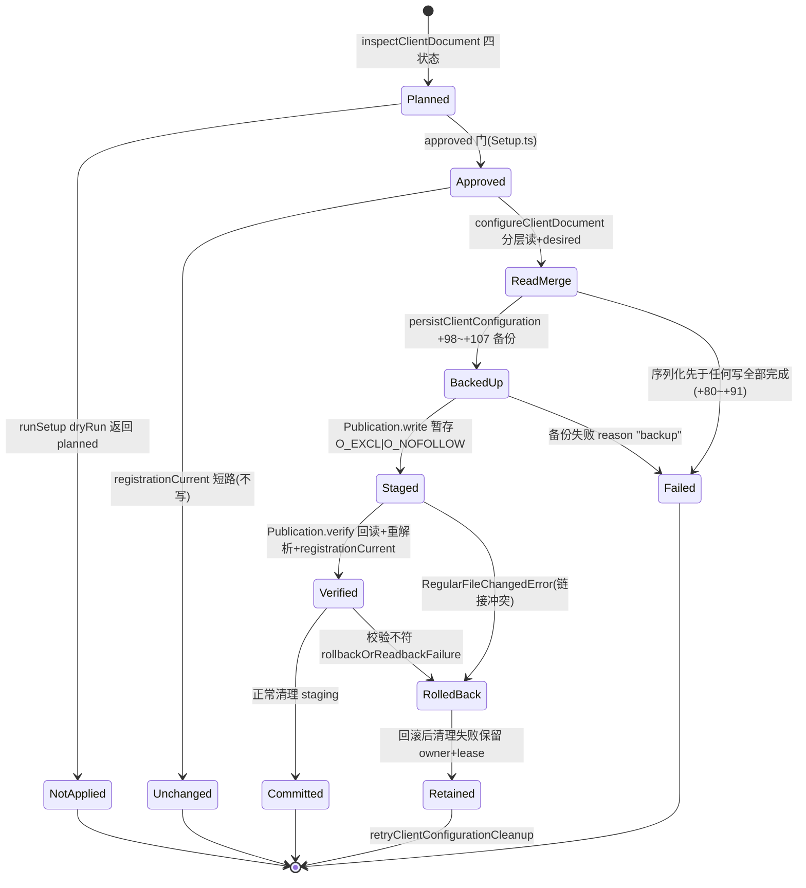

# 22 · 配置系统

> 一句话定位：REA 语境下的"配置"是三类互不可替的载体——(a) 决定本进程行为的启动环境变量（`src/config/`，24 个非测试文件）；(b) REA 自己的运行期分析设置（内存态 `AnalysisSettings`，经 `update_analysis_settings` 调整，从不写盘）；(c) 写入**其它 AI 客户端**配置文件的注册动作（TOML/JSON/JSONC/YAML/Cordis-patch，带事务）。本篇属于第四层模块篇，只讲源码机制；安装与使用说明在 `docs/client-configuration.md`，那是文档不是事实来源。
> 版本基线：提交 `1173c0a`（2026-10-26），rea-agents 6.8.0。写作过程中**未执行** `rea setup`/`rea update`/`rea uninstall`，未触碰任何真实客户端配置文件；一切"配置怎么被读写"的结论只来自源码。

## 0 速览

1. 三类配置的所有者、写入者、校验点完全不同，混用会得出错误结论；对比见 §1 表格。任务书把 (b) 指向 `src/config/client-verification.ts`——**该文件不存在**（`ls src/config/` 与 `grep -r "client-verification" src/` 均无结果），(b) 的真实载体是 `src/identity.ts Const：PRODUCT_IDENTITY` 与 AnalysisSettings 一族（§3）。
2. 环境变量校验的信条是"报约束、不报值"：`src/config/environment.ts 函数：parseEnvironmentValues 偏移：+28` 注释 "Zod messages name the constraint, never the rejected value."；NUL 字节准入甚至先于 schema 剥除未知键（`+8~+25`）。
3. 写客户端配置走单一条事务链：路径解析→进程内串行→分层读→方言解析→additive upsert→备份→暂存独占写→回读校验→提交或回滚，主体在 `src/application/SetupClientConfiguration.ts 函数：persistClientConfiguration 偏移：+98~+171`。
4. 备份是两级阶梯：首个 `.rea.backup` 只在**字节相等**时沿用，否则转内容寻址 `.rea.backup.<sha256>.recovery`，复制用 `COPYFILE_EXCL` 绝不替换既有文件——`src/application/SetupRecoveryBackup.ts 函数：selectCurrentRecoveryBackup 偏移：+27~+31` 与 `函数：preserveCurrentRecoveryBackup 偏移：+13~+26`。
5. 运行期设置是三层模型（launch env → AsyncLocalStorage 快照 → 每调用参数），`update_analysis_settings` 只改内存快照：`src/application/AnalysisSettings.ts 函数：update 偏移：+69~+70` 恒返 `active_work_changed:false`、`rea_restart_required:false`；类注释（`函数：AnalysisSettings 偏移：+0` 上方 doc）明言 "never writes configuration"。
6. 事务队列只是**进程内** Map（`src/application/ClientConfigurationTransaction.ts` 文件头注释），跨进程并发无锁——`[推导]` 其防护手段是暂存写的 link/rename 语义与回读校验，而非互斥锁。

## 1 三类不可互替的"配置"

| 维度 | (a) 进程环境变量与启动预算 | (b) REA 自身运行期设置 | (c) 写入其它客户端配置文件 |
|---|---|---|---|
| 载体 | `process.env` 字符串表 | 内存 `AnalysisSettingsSnapshot`（revision+overrides） | 各客户端自己的 TOML/JSON/JSONC/YAML/Cordis-patch 文件 |
| 读写者 | 用户/父进程设置；REA 只读（`src/config/parseConfig.ts 函数：parseConfig`） | MCP 工具 `update_analysis_settings` 写、`inspect_analysis_settings` 读；不落盘 | REA setup/doctor 写（`SetupClientConfiguration.ts`），客户端自己读 |
| 校验点 | zod `src/config/environment.ts Const：environmentSchema` + NUL 准入 + 组合约束（`src/config/environment.ts 函数：parseEnvironment 偏移：+8~+23`） | `src/domain/analysisSettingDefinitions.ts Const：ANALYSIS_SETTINGS` 每设置的 min/max/unit/appliesAt；update 一次一条（`src/application/AnalysisSettings.ts 函数：update 偏移：+29~+40`） | 方言解析（`src/application/ClientConfigurationDocument.ts 函数：parseDocument`）+ 写后回读再解析 + `函数：registrationCurrent` 四条件与 `函数：clientConfigurationAligned 偏移：+34~+35` 的"不可读视为未对齐" |
| 备份策略 | 无（进程环境不可变；AGENTS.md 禁"把环境固化进子进程设置"，落点在 `clientConfigurationDesired 偏移：+41~+43` 注释） | 无（快照 `Object.freeze`，revision 单调） | `.rea.backup` 字节匹配 → `.rea.backup.<sha256>.recovery`（`SetupRecoveryBackup.ts`） |
| 失败后果 | `ConfigurationError` 拒绝启动/该操作，消息列 setting+constraint 不列值 | 冲突返 `expected_revision` 错误让 agent 先 inspect；无效启动值仅由它所约束的那个操作拒绝（`src/config/runtimeAnalysisSettings.ts 函数：runtimeNativeMatchingAllowance 偏移：+0` doc） | 备份失败→整个客户端 reason "backup" 不写；写/校验失败→经句柄 `restore` 回滚；回滚清理失败→保留 owner+lease 抛 `ClientConfigurationPublicationFailure` |

### 1.1 (a) 与 (b) 的分界

同一数值（如 `ghidra.startup_timeout_ms`）可以有三层来源：环境变量（`src/config/analysisSettings.ts 函数：launchAnalysisSetting 偏移：+15~+16` 返回 `source:"default"`，`偏移：+29` 返回 `source:"setting"`）→ 运行期 override（`runtimeAnalysisConfig` 把来源改写成 `"runtime"`）→ 单次调用参数（`AnalysisSettingLimit.source` 联合含 `"request"`，`src/domain/analysisSettings.ts Type：AnalysisSettingLimit`）。三层互不覆盖载体而只改"生效视图"，这是 (a)/(b) 不可混的第一层含义。

### 1.2 AGENTS.md 条款在类型与事务边界上的落位

| AGENTS.md 要求 | 源码落点 | 级别 |
|---|---|---|
| 配置变更 additive | `src/application/ClientConfigurationDocument.ts 函数：withClientServers 偏移：+0` 只做 upsert；`函数：upsertTomlServerSection` 保注释插入；`src/application/ClientRegistration.ts Const：managedConnectionKeys`（doc +1~+3）限定 REA 只碰连接键 | 观察 |
| 配置变更 idempotent | `src/application/SetupClientConfiguration.ts 函数：registrationCurrent 偏移：+0` 四条件短路 + `函数：clientConfigurationValuesEqual/函数：normalize` 键序无关比较；`selectCurrentRecoveryBackup` 字节匹配复用备份 | 观察 |
| 变更前备份 | `src/application/SetupRecoveryBackup.ts 函数：preserveCurrentRecoveryBackup 偏移：+13~+38`：不验证不进写；`persistClientConfiguration 偏移：+98~+107` 失败即中止 | 观察 |
| `rea setup` 须展示计划并经批准 | `函数：inspectClientConfiguration 偏移：+0` 先于批准做 preflight；`src/application/Setup.ts 函数：runSetupWorkflow 偏移：+163~+199` dryRun/`approved` 门与 `needs_confirmation`/`cancelled` 返回（`函数：runSetup` 只是包住它的 try/catch 与 host 清理的外壳） | 观察 |
| 不把环境驻留值固化进子进程设置 | `函数：clientConfigurationDesired 偏移：+41~+43` 注释；`src/config/providerStartupTimeout.ts 函数：providerStartupTimeoutSchema 偏移：+0` doc "without reading the ambient process environment"；`函数：clientRegistrationEnvironmentDetails 偏移：+41~+42` "no defaults" | 观察 |
| 凭据脱敏、不因名字推断敏感性 | `函数：parseEnvironmentValues 偏移：+28`（消息不带被拒值）；`environmentSchema` 内 `REA_REFERENCE_SECRET_PATTERNS_JSON` 是模式表而非密钥本身 | 观察 |
| 保留调用方选择的输入 | `函数：refreshClientRegistration 偏移：+15~+20` launcher 等价形态保留；`函数：editJsonMember 偏移：+2~+5` 拒绝激活影子成员；ZCode fallback 抑制（`函数：readEffectiveClientRegistrationConfiguration 偏移：+0`） | 观察 |

### 1.3 与既有文档的漂移（交叉印证，非事实源）

任务书把 (b) 指向 `src/config/client-verification.ts` + `docs/client-verification.md`。代码侧该文件不存在（见 §0 第 1 条）；`docs/client-verification.md` 实际内容是客户端验证泳道矩阵（如 FreeBuff 未经原生客户端验证、`rea mcp doctor --json` 的覆盖边界、Pi 声明渲染器 16,000 字符默认上限与 compact profile 的关系），与"provider 设置"无关。该文档对 `COMPACT_INPUT_SCHEMA_BUDGET_BYTES` 的动机补充了 Pi 侧上限叙事 `[推导]`（文档转述，未回读 Pi 代码验证）。

## 2 (a) 进程环境变量与启动预算：`src/config/`

24 个非测试文件（`ls src/config` 实测；任务书清单漏列 `kunaCacheDirectory.ts`，属文档漂移）按职责分四组：

- **解析链**：`types.ts`（`Type：AppConfig`）、`environment.ts`、`parseConfig.ts`、`parsers.ts`、`environmentName.ts`、`homeDirectory.ts`、`processStart.ts`
- **预算/上限**：`mcpStartupBudgets.ts`、`mcpResponseBudget.ts`、`bridgeMaxRequestBytes.ts`、`providerStartupTimeout.ts`、`mcpHttpEndpoint.ts`、`mcpInputSchemaProfile.ts`、`mcpOutputSchemaProfile.ts`、`asarHeaderAdmission.ts`、`captureDecoderHeap.ts`、`regexWorkerHeapRequest.ts`、`regexMatchingDeadline.ts`、`nativeMatchingAllowance.ts`
- **provider 专项**：`ghidraLanguageOverride.ts`、`ghidraDisabledAnalyzers.ts`、`kunaCacheDirectory.ts`
- **(a)→(b) 桥**：`analysisSettings.ts`（launch 层求值）、`runtimeAnalysisSettings.ts`（把内存快照回灌成 AppConfig 视图）

### 2.1 解析次序：先字节准入，后 schema，再组合约束

`src/config/environment.ts`：

1. `Const：environmentSchema`（顶层 zod object）逐键定义：`REA_ANALYSIS_PROVIDER` 默认 `"auto"`（schema 内 +1）、6 个 `refine(isAbsolute)` 的路径项（`REA_IDA_MCP_CONFIG`、`GHIDRA_INSTALL_DIR`、`JAVA_HOME`、`REA_GHIDRA_NATIVEAOT_JAR`、`REA_GHIDRA_SEED_FILE`、`REA_ILSPY_CMD_PATH`）、`HOPPER_TARGET_KIND` 默认 `"executable"`（schema 内 +61）、`REA_REFERENCE_SECRET_PATTERNS_JSON` 默认 `"[]"`（schema 内 +64）。注意：`REA_JEB_MCP_TIMEOUT_MS` 走 `Const：providerStartupTimeoutSchema`，但 JEB 超时在 provider 组合边界单独解析（`函数：parseJebMcpTimeoutMs 偏移：+0` doc "Parse the JEB-only timeout at its isolated provider-composition boundary"）。
2. `函数：parseEnvironmentValues 偏移：+8~+25`：在 schema `safeParse` **之前**扫描所有键（含 `unresolvedSettings` 并入的键名）的 NUL 字节，注释（+5~+7）说明理由——未知客户端专有项由 registration owner 保留并会跨子进程边界，所以其字节准入必须先于"schema 剥除"检查；错误项只报 `constraint: "Environment variable names and values must not contain NUL bytes"`。
3. `函数：parseEnvironment 偏移：+9~+23`：组合约束——`REA_GHIDRA_COMPILER_SPEC_ID` 必须伴随 `REA_GHIDRA_LANGUAGE_ID`（Ghidra analyzeHeadless 的 `-cspec` 只在带 `-processor` 时有效，注释 +9），但若 language-id 处于 `unresolvedSettings`（Cordis 表达式未求值）则放行。

`src/config/parseConfig.ts 函数：parseConfig 偏移：+8~+58` 用"条件展开键"模式把 env 映射成 `AppConfig`（`src/config/types.ts Type：AppConfig`）：值为 `undefined` 与键**缺席**是两回事（`...(env.X === undefined ? {} : { y: env.X })`），这样下游 `Object.hasOwn` 能区分"未设置"与"显式 undefined"。`偏移：+64~+83` 三个桥预算把来源标成 `source:"setting"` 或落到 `Const：DEFAULT_BRIDGE_MAX_REQUEST` 等默认对象。`AppConfig` 里 `ghidraStartupTimeoutMs`/`hopperStartupTimeoutMs` 是**非可选**字段（schema 已给默认），而 `ghidraDecompileTimeoutSeconds` 走条件键（`Type：AppConfig` 内字段注释）。

第 4 步是"隔离带"：`src/config/parseConfig.ts Const：nativeAnalysisEnvironment` 在聚合准入前剥掉 `REA_JEB_MCP_TIMEOUT_MS`，其函数 doc 写明 "JEB validates its own timeout during optional provider composition; that setting must not block unrelated CLI/MCP startup. Registration validation still checks it directly."——JEB 超时坏不会拖垮整个 CLI/MCP 启动，但注册校验路径（§5.4 `函数：parseClientRegistrationLauncher 偏移：+0` doc 与之呼应）仍然拒它。`函数：inspectNativeAnalysisConfiguration 偏移：+16~+17` 进一步处理 mixed-invalid：聚合可能被别的 setting 先拒，此时显式配置的 Hopper 超时事实仍用同一 schema 单独给出，不丢诊断。

辅助件：
- `src/config/homeDirectory.ts 函数：homeDirectoryFromEnvironment 偏移：+0`：win32 依次 `USERPROFILE` → `HOMEDRIVE`+`HOMEPATH` → `HOME`；其它平台 `HOME` → `USERPROFILE` → `userInfo().homedir()`（`偏移：+19` 兜底）。
- `src/config/environmentName.ts Const：ENVIRONMENT_NAME_CONSTRAINT`：变量名字节规则单点定义。
- `src/config/processStart.ts Const：blocksProcessStart`：注释（`函数：blocksProcessStart 偏移：+0` 上方）说明该配置"required in every Doctor scope"——缺它连 Doctor 都不起。
- `src/config/parsers.ts 函数：parseLoaderArgs`：用 `nulFreeStringSchema` 保留空 argv 项（空字符串参数是合法 loader arg）。

### 2.2 预算常量里的"物理理由"

这一族文件的价值在注释给出的**测量/平台依据**，全部观察自源码：

- `src/config/mcpStartupBudgets.ts Const：MCP_PHASE_BUDGET_MAXIMUM_MS = 2_147_483_647`：注释说明 Node 会把更大 setTimeout 钳到 1ms，所以封顶 `2^31−1`；下限是 `Const：MCP_PHASE_BUDGET_FLOOR_MS = 1`。`Const：PHASES` 定义四阶段默认：initialize 15000 / toolsList 5000 / firstCatalog 20000 / doctor 30000。`函数：parseMcpStartupBudgets 偏移：+0` 把**全部**无效项一次性报出，无静默回退默认；`函数：mcpPhaseBudgetRecovery 偏移：+0` 生成给用户的恢复文案。
- `src/config/mcpResponseBudget.ts Const：MINIMUM_RESPONSE_BYTES`：stdio 接收下限 10MiB；`函数：nodeStringCeilingRecovery` 的 recovery 文案解释 Node 字符串上限。
- `src/config/bridgeMaxRequestBytes.ts Const：MINIMUM_BRIDGE_MAX_REQUEST_BYTES = 7464`：上方注释记录这来自实测最大 Cutter 请求帧；`Const：MAXIMUM_BRIDGE_MAX_REQUEST_BYTES` 封顶 Node 单字符串上限−1（`Const：NODE_MAX_STRING_LENGTH`）。`函数：bridgeMaxRequestBytesRecovery 偏移：+7~+9` 对 Ghidra 单独给出建议（其它 provider 建议调低请求，Ghidra 建议调高预算）。三个 oversize/mismatch 错误构造器（`函数：bridgeRequestOversizeError`、`函数：bridgeRequestLimitMismatchError`、`函数：bridgeResponseOversizeError`）构成请求/响应/两端上限不一致三种失败形。
- `src/config/mcpInputSchemaProfile.ts Const：COMPACT_INPUT_SCHEMA_BUDGET_BYTES = 13KiB`：注释（+2~+6）指向 Moonshot 对 tool 声明尺寸的上限（issue#1484）；`函数：resolveMcpInputSchemaProfile 偏移：+0` 的缺省档是 `"compact"`。`src/config/mcpOutputSchemaProfile.ts` 的 `"off"` 只省略 output schema 声明，**不**跳过出参规范校验（`Const：mcpOutputSchemaProfileSchema` 上方注释 +7~+8）。
- `src/config/mcpHttpEndpoint.ts Const：DEFAULT_MCP_HTTP_HOST = "127.0.0.1"`：其上方注释限定 loopback-only；`Const：DEFAULT_MCP_HTTP_PORT = 0` 即临时端口。`函数：parseMcpHttpEndpoint 偏移：+0` precedence 为 overrides > env > default；该端点**不进** `AppConfig`（`parseConfig` 返回值无对应键，观察）——调用者是 `src/main.ts` 的 MCP HTTP 启动（经 `src/process/snapshotEnvironment.ts 函数：snapshotEnvironment 偏移：+0` 先做环境快照再传入，呼应 AGENTS.md "never inherit ambient"）与 `src/cli/environmentCommands.ts`。
- `src/domain/analysisResourceLimits.ts Const：DEFAULT_ASAR_MAX_HEADER_BYTES`（16MiB）与 schema 上限 256MiB（同名两个值由 `src/config/asarHeaderAdmission.ts` 原样 re-export，声明不在那里）；`src/config/captureDecoderHeap.ts`、`regexWorkerHeapRequest.ts`、`regexMatchingDeadline.ts`、`nativeMatchingAllowance.ts` 是同一模板（SETTING 名、schema、parse、resolve、recovery）。
- `src/config/nativeMatchingAllowance.ts Const：NATIVE_MATCHING_ALLOWANCE_SETTING` **不在** `src/config/environment.ts Const：environmentSchema` 里（对照 §2.1 清单），它由 `函数：parseNativeMatchingAllowance` 单独解析——拒绝分支的 `remediationAction`（`函数：parseNativeMatchingAllowance 偏移：+10`）直接内嵌一段 `update_analysis_settings` 调用 JSON；`函数：nativeMatchingAllowanceRecovery 偏移：+6` 明言该预算 "not a bound on total RSS"。

### 2.3 recovery 文案：(a) 向 (b) 交棒的接口

`src/config/captureDecoderHeap.ts 函数：captureDecoderHeapRecovery 偏移：+3` 指示 agent 使用 `update_analysis_settings` 改 `capture.decoder_old_generation_mib`；`src/config/regexWorkerHeapRequest.ts 函数：regexWorkerHeapRequestRecovery 偏移：+4` 点名 `regex.worker_heap_request_mib` 并说明与 `--max-old-space-size`（NODE_OPTIONS）的优先级（`+6`）；`src/config/regexMatchingDeadline.ts 函数：regexMatchingDeadlineRecovery 偏移：+5` 点名 `regex.matching_deadline_ms`。即：**启动值无效不再要求改环境重启，而是走内存态热修**——这是 §3 三层模型存在的原因。

### 2.4 超时缺省、"不读 ambient" 与 launcher 兜底

- `src/config/providerStartupTimeout.ts` 顶部是从 `src/domain/analysisResourceLimits.ts` 的**纯再导出**（`DEFAULT_GHIDRA_STARTUP_TIMEOUT_MS` 等 3 项）——资源上限的真相源在 domain，config 层只做 zod 包装。`函数：providerStartupTimeoutSchema 偏移：+0` 的 doc："Parse the optional setting **without reading the ambient process environment**"：schema 本身不吃 `process.env`，读 env 的动作只发生在 `parseEnvironmentValues`，这保证同一 schema 可用于注册文件片段校验（§5.4）。`Const：DEFAULT_SWIFTC_COMPILE_TIMEOUT_MS = 120_000` 上方注释记录依据："Fresh Swift SDK cache took ~88s on the supported Intel macOS VM"（注释自述的测量环境；本篇未实测）。`函数：ghidraDecompileTimeoutSchema 偏移：+0` doc："absent keeps Ghidra decompiles unbounded"——**缺席=无界**而不是缺席=默认，这是 decompile 超时可以为 `null` 的语义根源（§3.1）。
- `src/config/parseConfig.ts 函数：defaultHopperLauncherPath 偏移：+0`：委托 `hopperLauncherDiscovery` 生成候选、逐个 `函数：executableAvailable 偏移：+0`（`X_OK`+`isFile` 双条件）探测，macOS 应用包重命名候选兜底，最终**永远返回** `discovery.fallback`——launcher 解析不抛错，坏路径在后续启动失败时以运行期错误暴露。
- `src/config/processStart.ts Const：processStartConfigurationSchema` 定义 `REA_LOG_LEVEL`（经 `函数：parseLogLevel 偏移：+0`）与进程启动许可；`函数：blocksProcessStart 偏移：+0` 的 doc 说明该配置 "required in every Doctor scope"——Doctor 只读诊断也带这套门。
- `src/config/parsers.ts 函数：parseLoaderArgs 偏移：+0`：Hopper loader 参数以 JSON 字符串进入（`HOPPER_LOADER_ARGS_JSON`），`函数：parseConfiguredStringArray 偏移：+0` 解析且允许空 argv 项——**空字符串参数是合法值**，不能被 filter 掉。

## 3 (b) REA 自身运行期设置：三层模型

### 3.1 定义与域类型

- `src/domain/analysisSettings.ts Type：AnalysisSettingValues`：12 个 setting id（asar.max_header_bytes、ghidra/hopper.startup_timeout_ms、ghidra.decompile_timeout_seconds（唯一 `number|null`）、jadx.operation_timeout_ms、regex.matching_deadline_ms、regex.worker_heap_request_mib、capture.decoder_old_generation_mib、javascript.analysis_timeout_ms、javascript.max_heap_mb、wasm.command_timeout_ms、native.matching_representation_bytes）。
- `Type：AnalysisSettingsSnapshot`：`revision` + 部分覆盖表；`Type：AnalysisSettingLimit`：给 agent 的极限事实——`applies_at` 三值（`next_operation`/`next_worker`/`next_startup`）、`agent_editable:true`、`scope:"rea-runtime"`、`rea_restart_required:false`。
- `src/domain/analysisSettingDefinitions.ts Const：ANALYSIS_SETTINGS`：每条带 provider 归属与受影响 MCP 操作清单，例如 `asar.max_header_bytes` 列 7 个工件/JS/Electron 操作；ghidra/hopper 两个 `startup_timeout_ms` `appliesAt:"next_startup"` 并枚举 11 个 native 操作；`regex.matching_deadline_ms` 关联 ida/hopper/kuna 的 `search_strings`/`search_procedures`；`native.matching_representation_bytes` 关联 `match_native_functions`。`函数：analysisSettingValueSchema 偏移：+0` 只对 `ghidra.decompile_timeout_seconds` 允许 `null`（显式重置）。

### 3.2 launch → runtime 的桥

`src/config/analysisSettings.ts`：`Const：environmentSchemas` 8 个 env→数值 schema（含**不在** environmentSchema 的 `REA_JADX_OPERATION_TIMEOUT_MS`）；`函数：launchAnalysisSetting 偏移：+4~+9` 特判 `native.matching_representation_bytes` 走 §2.2 的独立解析；默认路径 `偏移：+15~+16` 返回 `definition.defaultValue` + `source:"default"`。

`src/config/runtimeAnalysisSettings.ts`：`函数：runtimeAnalysisConfig 偏移：+0` 用 getter 覆盖 `AppConfig`——每次读都从 `AnalysisSettingsReader` 取当前快照，来源翻成 `"runtime"`；`偏移：+21~+28` 处理 `ghidra.decompile_timeout_seconds` 的 `null`＝显式重置→回到 `undefined`（键缺席）。`函数：runtimeNativeMatchingAllowance 偏移：+0` 的函数 doc 给出关键语义：无效 launch 值**只拒绝它约束的那个操作**，因此运行期 override 能修复会话而无需重启。

### 3.3 事务性更新与工具面

`src/application/AnalysisSettings.ts`：`class AnalysisSettings`（偏移：+0）的函数 doc 声明 "One runtime's admitted overrides and operation snapshots; never writes configuration."；`#accepted` 是 `AsyncLocalStorage`（相对类首 +1），操作经 `函数：run 偏移：+0` 注入快照、`函数：read 偏移：+0` 在操作内读取。`函数：update 偏移：+10~+28` 做 revision 乐观并发（`expected_revision` 不符即报 "Settings revision conflict: expected X, current Y. Inspect settings before retrying."），`偏移：+29~+40` 保证每个 setting 在一次请求里只出现一次（set/reset 混合原子拒绝），`偏移：+49~+56` 只在实际变化时冻结新快照并递增 revision，`偏移：+69~+70` 结果恒带 `active_work_changed:false, rea_restart_required:false`。

影响半径由每条定义的 `appliesAt` 决定（`Type：AnalysisSettingLimit` 三值）：`next_operation` 下一操作即用新快照；`next_worker` 要等 worker 池重建；`next_startup` 要等 provider 子进程重启——`Const：ANALYSIS_SETTINGS` 里 ghidra/hopper 两个 `startup_timeout_ms` 正是 `next_startup`（并枚举 11 个 native 操作）。`[推导]` 因此 `update` 恒返 `rea_restart_required:false` 只说明"REA 自身不用重启"，不意味着新值对每个 provider 立即生效。可变更范围也**不含** provider 选择（`REA_ANALYSIS_PROVIDER`）、HTTP 端点、bridge 上限等：它们只在 (a) 层，工具面无入口（`Type：AnalysisSettingValues` 的 12 个 id 是唯一集合）。

工具挂载：`src/server/registerAnalysisSettingsTools.ts 函数：registerAnalysisSettingsTools 偏移：+12` 注册 `inspect_analysis_settings`（inspect 时合并 `src/server/analysisSettingsConstraints.ts Const：analysisSettingsConstraints` 的 5 条环境约束，按 authority 区分 `operator|external|fixed`——[推导] `external` 条目表示"值由外部真值决定、REA 只报约束"）与 `update_analysis_settings`。契约在 `src/contracts/analysisSettingsContracts.ts`：`函数：updateAnalysisSettingsInputSchema 偏移：+0` 的 per-setting 判别联合把 set/reset 的字面量类型钉死；`Const：ANALYSIS_SETTINGS_TOOL_CONTRACTS` 内含两工具面向 agent 的描述文本。

### 3.4 与客户端配置文件的边界

`AGENTS.md` 的"运行期设置绝不写进客户端 env/文件"落点在两处：`AnalysisSettings` 类注释 "never writes configuration"；`src/application/SetupClientConfiguration.ts 函数：clientConfigurationDesired 偏移：+41~+43` 注释 "Preserve explicitly configured server settings, never the ambient process environment"——写进 `dsh/codex/…` 的 env 块只保留注册属主原有字符串（`src/application/ClientRegistrationEnvironment.ts 函数：clientRegistrationEnvironmentDetails 偏移：+41~+42`："no defaults"，未知键一并保留）。

## 4 (c) 写入其它客户端配置文件：一次事务的完整生命周期

AGENTS.md 的两条规则在这里获得类型级落位：**"additive + idempotent + backups"** = desired 计算只做 upsert（`函数：withClientServers`）、幂等短路（`函数：registrationCurrent`）、备份阶梯（§4.4）；**"show planned changes and require approval"** = `函数：inspectClientDocument` 的 `invalid|create|already_current|update` 四状态计划 + `函数：runSetupWorkflow` 的 dryRun/approved/confirm 门（`src/application/Setup.ts 函数：runSetupWorkflow 偏移：+163~+199`：dryRun 直接返回 `status:"planned"` 不执行；`approved = options.approved || plannedActions.length === 0`；交互确认取消→`"cancelled"`，无确认器→`"needs_confirmation"`，两条路径 `plannedActions` 原样带回）。



图中每个节点都有正文锚点；`Planned/Approved` 见本节首段，其余见 §4.3~§4.6。

### 4.1 路径确定与串行域

- `src/application/ClientConfigPath.ts 函数：resolveClientConfigTransactionPath 偏移：+0` doc（+1~+6）：用户配置若是符号链接则对**目标**成事务；父目录别名允许；文件缺席仍是首写候选。`函数：resolveOwnedConfigSymlink 偏移：+22~+24`：只接受 **uid 相同**的符号链接目标，探测失败静默（best-effort catch）。`函数：canonicalRegularConfigPath 偏移：+14~+15`：拒绝含 `..` 的段。
- `src/application/ClientConfigurationTransaction.ts 函数：withClientConfigurationTransaction 偏移：+0` doc："Serialize the full read/merge/publish operation for one resolved configuration path"——按解析后路径排队，**队列是进程内 Map**；跨进程无锁 `[推导]`（见边界与失败模式）。

### 4.2 分层读与生效视图

`src/application/ClientConfigurationFiles.ts`：`Type：ClientConfigurationSource` 每源声明保留规则；`函数：readConfigurationText 偏移：+0` 把 ENOENT 映射为 `undefined`（缺席≠空文件）；`函数：readClientConfigurationFiles 偏移：+0` doc："Read every applicable user file; malformed lower-priority files also stop setup"——低优先级层坏了同样中止，防止"半生效"；`函数：effectiveClientConfiguration 偏移：+33~+45`：注册 env 与进程 env 用 `函数：mergeEnvironmentOverrides` 合并，规则是显式值优先、绝不把 ambient env 固化；`函数：readEffectiveClientRegistrationConfiguration 偏移：+0` 在存在真实层时抑制 ZCode fallback。

### 4.3 方言解析与 additive 编辑（`ClientConfigurationDocument.ts`，1864 行）

- **格式判定**：`函数：parseDocument 偏移：+6~+9 / +14~+17 / +23~+27` 按客户端注释选择 strict-JSON 还是 JSONC——例如 Cursor 系会加载 JSONC 所以 REA 也必须容忍注释（+14~+17 处注释），而某客户端用 `JSON.parse` 所以 JSONC 尾逗号必须拒（+23~+27）。`函数：parseClientConfiguration 偏移：+8` 先走 dsh 分支（§6.4）；`偏移：+15~+30` ZCode 嵌套 `mcp.servers`；`偏移：+31~+62` opencode V1/V2 判别联合（含 `type` 加引号歧义处理）。
- **TOML**：`函数：parseTomlTableHeader 偏移：+1~+4`：带引号表段保持一个键；`函数：tomlStringModeAfter 偏移：+0` 跟踪字符串态防误判 `#`；`函数：upsertTomlServerSection 偏移：+0` doc（+1~+7）承诺**注释保留契约**：BOM 原位保留（+7）、全 CRLF 文件新节用 CRLF（+10~+11）、待写空行挂起防吞注释（+23~+25）、内联 server-table 整体替换（+116~+140）；grok 的 `disabled_mcp_servers` 数组用 `函数：disabledServerListEdit 偏移：+0` 删除同名项，且相邻的注释保留辅助函数按 doc "Retain comment trivia from removed code without promoting string contents" 只从代码区收注释、不把字符串内容当注释。`src/application/ClientRegistration.ts Const：registrationSchema` 对 TOML 超时用 `函数：tomlTimeoutSchema 偏移：+0` 容忍 BigInt。
- **JSON 重复键（shadowed members）**：`函数：effectiveJsonProperty 偏移：+1~+5` 注释点破 `JSON.parse` 保留**最后一个**重复成员而 `jsonc-parser` 的 `findNode` 返回**第一个**——两个方言真值不一致。`函数：shadowedClientServers 偏移：+10~+14` 用单 token 计数快路径检出；`函数：editJsonMember 偏移：+2~+5` 拒绝会**激活**影子成员的行内编辑；唯一的清除授权是 `Type：ClientConfigurationEditOptions` 的 `removeShadowedMembersAt`，且 `persistClientConfiguration 偏移：+76~+77` 表明它只对 legacy 路径启用——把"迁移时消歧"限定成一次性动作。
- **序列化**：`函数：serializeClientConfiguration 偏移：+18~+24` 新建 JSON 用 2 空格+LF；每方言分派回读可解析性检查；`函数：clientRegistrationEntry 偏移：+0` 是各 dialect 的条目形状字典（写什么长什么样，单点定义）。
- **Codex 专项**：`函数：serializeCodexConfiguration 偏移：+1~+4`：优先做**保留注释**的文本 upsert；若 `函数：tomlTextHolds 偏移：+0` 的 round-trip 校验不过则整体重写，注释明言代价 "keeps every value but not comments"。
- **enabled/disabled 语义**：`函数：effectiveClientServer 偏移：+12~+18` 处理 `enabled→disabled` 迁移；`函数：clientServerForcedEnabled 偏移：+0`/`函数：clientServerListedDisabled 偏移：+0` 服务 OMP（1279/1291 的 forced/disabled 键表）与 grok/dsh 的禁用清单。

### 4.4 备份阶梯（`SetupRecoveryBackup.ts`）

`函数：selectCurrentRecoveryBackup 偏移：+27~+28`：首个 `<config>.rea.backup` 存在且与本事务 original **字节相等**才沿用；`偏移：+30~+31` 否则计算 `sha256(original)` 生成 `<firstBackupPath>.<digest>.recovery`；`偏移：+44~+49` 内容寻址路径若已含**不同数据**→ `kind:"occupied"` 拒绝（防哈希碰撞/人为占用误覆盖）。`函数：preserveCurrentRecoveryBackup 偏移：+13~+26`：不在场才复制，`Const：copyExclusive` 用 `COPYFILE_EXCL` 语义 EEXIST 即视为并发完成；`偏移：+27~+38` 复制后**再选一次**并验证路径一致且在场，否则 `kind:"unverified"`——备份不是 best-effort，不验证就不进写阶段（`persistClientConfiguration 偏移：+98~+107` 失败即中止，客户端状态 reason `"backup"`）。备份树形态（ASCII，路径拼法来自上述两个函数）：

```text
<目标配置文件路径>
└── <目标路径>.rea.backup                        ← 第一备份：仅当与原字节一致才复用
    <目标路径>.rea.backup.<sha256(原)>.recovery   ← 复用失败时的内容寻址备份（EXCL 写入）
```

### 4.5 暂存独占写与原子发布（`ClientConfigurationPublication.ts`）

`函数：write 偏移：+19`：`mkdtemp` 于目标父目录（前缀 `.rea-config-`，保证同文件系统 rename 原子）；`偏移：+27~+37` open 标志 `O_RDWR|O_CREAT|O_EXCL|O_NONBLOCK|O_NOFOLLOW`、mode `0o600`；`偏移：+40` `函数：preserveConfigurationAttributes 偏移：+0` 先 `chown` 再 `chmod`（原 mode 缺省取 input&0o7777），失败映射到资源保留；`偏移：+41` fsync；`偏移：+42~+43` 拒 `ino===0`；`偏移：+45~+47` 写前再 stat 断言未漂移。发布二选一：
- 目标**不存在**→ `偏移：+48~+61` `link`（注释 +49："An exclusive link cannot overwrite a file created after absence was checked."），EEXIST 即抛 `RegularFileChangedError`——把 TOCTOU 转化为可回滚错误而非覆盖。
- 目标**存在**→ `偏移：+62~+66` `rename` 并记录 publishedRename（注释 +63："rename never follows its final symlink"）。
- 任何失败 `偏移：+74~+77` 走 `函数：releaseStaging 偏移：+0` 保留资源属主信息。

`函数：assertRequestedConfigurationPath 偏移：+10~+14`：允许"父目录别名"重定向（`函数：isParentAliasRetarget 偏移：+0`），拒绝其它换靶。`函数：selectedConfiguration 偏移：+0` 要求当前文本==事务 original。暂存→发布的空间布局（ASCII，字段来自 `函数：write 偏移：+0` 函数体）：

```text
<目标父目录>/
├── .rea-config-XXXXXX/          ← mkdtemp，同文件系统保证 rename 原子
│   └── <staged 字节文件>        ← O_RDWR|O_CREAT|O_EXCL|O_NOFOLLOW, 0o600
│                                 chown→原属主, chmod→原mode??input&0o7777, fsync
└── 目标配置文件
      发布：目标不存在 → link(staged, 目标)   EEXIST → RegularFileChangedError
            目标已存在 → rename(staged, 目标)  不追最终符号链接
```

### 4.6 校验、回滚与所有权（`src/application/SetupClientConfiguration.ts 函数：persistClientConfiguration`）

- 写前置：`偏移：+13~+28` Claude Desktop MSIX 目标若被改判 `target_changed`；`偏移：+30~+33` legacy 文件替换注释；`偏移：+44~+61` OMP 禁用清单过滤；`偏移：+62~+79` 把**所有**待编辑路径先序列化完（`偏移：+80~+91`：任何序列化失败发生在第一次写之前——不存在"写到第 3 个文件失败、前 2 个已脏"的中间态）；`偏移：+92~+97` 检出 `shadowed_member` 状态直接进计划态而非写。
- 写：`偏移：+109~+118` `Publication.write` mode `0o600`；冲突/写失败错误对象携带 `backupPath`。
- 校验：`偏移：+133~+171` `函数：verify 偏移：+1`（doc："Keep all publication resources owned through the complete operation"）内做 readback→`函数：assertCurrent`→重解析→`函数：registrationCurrent`→fallback-peer 相等，全链一致才提交；任何一环失败进 `rollbackOrReadbackFailure`。
- 回滚：`函数：restore 偏移：+0` 的函数 doc "State checks do not exclude a concurrent writer to the same inode."——回滚**经已属有的文件句柄**写字节，而非按路径删写；`偏移：+19~+22` 首写事务（无 original）拒绝删除："First-run configuration recovery requires manual removal; pathname deletion cannot prove ownership"。回滚成功后清理 staging；若清理失败，`偏移：+156~+163` 把原异常与 cleanup 异常包成 `ClientConfigurationCleanupRollbackFailure`，owner+lease 保留；`src/application/ClientConfigurationCleanup.ts Type：ClientConfigurationPublicationFailure`（doc +1："Completion and exact staging owner retained when publication cleanup fails"；构造内以 `AggregateError` 同时保留两个 cause）与 `函数：retryClientConfigurationCleanup 偏移：+1`（"Adopt only capabilities carried by explicit operation outcomes, never opaque causes"）给后续显式重试——**清理失败永不静默，也永不吞 cause**。

### 4.7 幂等判据

`函数：registrationCurrent 偏移：+0` 四条件合取：文件可解析、REA 条目与 desired 深度相等（`函数：clientConfigurationValuesEqual 偏移：+0` + `函数：normalize 偏移：+0` 键按码点排序——键序永不影响对齐判定）、dsh 时 `函数：ready 偏移：+0`、存在禁用清单时 `函数：clientServerListedDisabled 偏移：+0`。成立则 `configureClientDocument 偏移：+91` 短路返回 `already_current`，**连备份都不创建**。`函数：clientConfigurationAligned 偏移：+34~+35`：不可读配置视为未对齐，交给 setup 修复——"读不懂"不会被当成"没问题"。

### 4.8 崩溃中点矩阵

| 进程在何处崩溃 | 磁盘留下什么 | 之后由谁收敛 | 锚点 |
|---|---|---|---|
| 计划/批准之间 | 无变化 | 无需收敛（`runSetup 偏移：+256~+259` 拒绝路径连 staging 都不建） | `函数：runSetup 偏移：+256~+259` |
| 备份完成、写未开始 | `.rea.backup` 或 `.rea.backup.<sha>.recovery` | 下次 setup：字节匹配直接沿用备份（`函数：selectCurrentRecoveryBackup 偏移：+27~+28`） | `函数：persistClientConfiguration 偏移：+98~+107` |
| mkdtemp 后、link/rename 前 | 父目录残留 `.rea-config-*` 临时目录 | `[未知]` 进程死掉后句柄与 lease 同灭，`函数：retryClientConfigurationCleanup` 需要显式 outcome 才收养；是否存在开机清扫路径未读到，方向：查 `releaseStaging`/`OwnedRegularFile` 的消费者 | `函数：write 偏移：+19` |
| link 成功（首写）、verify 前 | 目标=新内容（link 原子） | 下次 inspect 依 `函数：registrationCurrent 偏移：+0` 判 `already_current`/`update`，幂等收敛 | `函数：write 偏移：+48~+61` |
| rename 成功、verify 前 | 目标=新内容（rename 原子且不追符号链接） | 同上 | `函数：write 偏移：+62~+66` |
| verify 失败、restore 半途 | 目标=新内容，备份在场 | 下次 setup 把不可读/不对齐视为待修（`函数：clientConfigurationAligned 偏移：+34~+35`） | `函数：restore 偏移：+0` |
| restore 成功、staging 清理失败 | 正确旧内容 + 残 staging | `Type：ClientConfigurationPublicationFailure` 保留 owner+lease；进程存活期内可重试，进程退出后同第 3 行 `[未知]` | `函数：persistClientConfiguration 偏移：+156~+163` |

## 5 客户端注册与身份

### 5.1 注册表与路径

`src/application/SupportedClients.ts Type：SetupClient` 字段含 `sharedRegistration`，其字段注释（`Type：SetupClient` 内）明言 "only a recognizable REA-owned row in it proves ownership"——共享存储里只认得出 REA 行的才算 REA 的。`Const：SUPPORTED_CLIENT_DEFINITIONS` 26 客户端/16 种 format：claude_code、claude_desktop(json+quitBeforeSetup)、codex(toml)、cursor、gemini_cli(json+geminiSettings)、windsurf、devin、opencode(分层 configPaths)、antigravity、copilot_cli、commandcode、qwen_code、kimi、vscode(servers 格式)、trae、workbuddy、grok_build(grok)、omp、pi、hermes(yaml)、qoder、droid、zcode(嵌套 mcp.servers)、dsh(cordis.patch.yml)、freebuff(`sharedRegistration:true`)、grok_bot(`Const：GROK_BOT_MANUAL_REGISTRATION_REMEDIATION`：宿主连接器，无本地文件可写)。
| 覆盖变量 | 读取者（helper） | 缺省与特殊规则 |
|---|---|---|
| `CLAUDE_CONFIG_DIR` | `函数：claudeCodeConfigDirectory 偏移：+0`、`函数：claudeCodeMarkerDirectory 偏移：+0` | marker 目录为 `<home>/.claude` |
| `CODEX_HOME` | `函数：codexDirectory 偏移：+0` | `~/.codex` |
| `KIMI_CODE_HOME` | `函数：kimiDirectory 偏移：+0` | `~/.kimi-code` |
| `QODER_CONFIG_DIR` | `函数：qoderDirectory 偏移：+0` | `~/.qoder` |
| `QWEN_HOME` | `函数：qwenCodeDirectory 偏移：+1` | 覆盖值走 `~` 展开规则 |
| `GROK_HOME` | `函数：grokDirectory 偏移：+0` | `~/.grok` |
| `DSH_HOME`/`DSH_AGENTS_HOME` | `函数：dshDirectory 偏移：+0`、`函数：dshPatchDirectory 偏移：+0` | `~/.dsh`（patch 文件所在）与 `~/.agents`（skills） |
| `GEMINI_CLI_HOME`、`GEMINI_CLI_SYSTEM_SETTINGS_PATH`、`GEMINI_CLI_SYSTEM_DEFAULTS_PATH`、`GEMINI_CLI_TRUSTED_FOLDERS_PATH`、`GEMINI_RESTRICTED_MODE`、`GEMINI_CLI_TRUST_WORKSPACE` | `函数：geminiSettings 偏移：+0`（同文件） | `函数：geminiSettings 偏移：+13~+27`：trustOverride 三态——`"false"`→不信任、`"true"`→信任、其它→未覆盖；trustedFolders 缺省 `<GEMINI_CLI_HOME\|\|home>/.gemini/trustedFolders.json` |
| `XDG_CONFIG_HOME` | `函数：xdgConfigHome 偏移：+0`、devin 条目 | `\|\|` 语义：**空串==未设置**，回退 `~/.config` |
| （profile 类） | `函数：ompAgentDirectory 偏移：+0`：根为 `PI_CONFIG_DIR \|\| .omp`，profile 取 `OMP_PROFILE ?? PI_PROFILE` 并有 `Const：OMP_PROFILE_NAME`/`Const：OMP_RESERVED_PROFILE` 校验；`函数：piAgentDirectory 偏移：+0`：模拟 Pi 公开 `getAgentDir()/normalizePath` 语义（其上方注释自述 "Pi's public getAgentDir()/normalizePath semantics, not OMP's profiles"），覆盖变量 `PI_CODING_AGENT_DIR`，win32 下做 `/mnt/`、`/cygdrive/` 盘符转换 | hermes 无 env 覆盖，走 `函数：hermesDirectory 偏移：+0` → §6.5 |

`函数：supportedClients 偏移：+0` 路径解析失败返回 `configPathError` 而**不猜**默认路径；`函数：registrationWriteBlocker 偏移：+0` 在 redirected/unknown 进程视图下拒写（配合 `函数：appDataRedirection 偏移：+0`）。证据路径三分：`函数：clientEvidencePaths`（存在证据）、`函数：clientOwnershipEvidencePaths`（属主证据）、`函数：clientSharedRegistrationPaths`（共享注册，fail-closed 区分注释 +1~+5）。

### 5.2 启动命令身份（owned|foreign|unknown）

`src/application/ClientRegistrationIdentity.ts`：`函数：npxRegistrationCommand 偏移：+0` 生成标准 `npx -y rea-agents@<ver> mcp` 形态；`函数：packageRunnerRegistrationCommand 偏移：+8~+9` win32 用 `cmd.exe /d /c` 包裹；`函数：invokingPackageRunner 偏移：+0` 靠 `npm_config_user_agent` 识别 bunx。分类三层：`函数：inspectClientRegistrationCommand 偏移：+6~+15`——包名 bare/`@latest`/钉版本/any-valid-semver 全判 `owned`（[推导] 语义是"由 REA 决定装哪个版本即算 REA 所有"）；`函数：directEntrypointIdentity 偏移：+6~+9` shebang 双重解释落 `unknown`；`函数：inspectDirectRegistrationCommand 偏移：+42~+48` 裸 `rea mcp` 判 owned、其余直启判 `foreign`。等价性：`函数：equivalentClientRegistrationCommands 偏移：+0` + `函数：sameFileExecutableAlias 偏移：+0`（PATH 别名仅当**证明同文件**）供 `refreshClientRegistration` 保留用户既有启动形态。`Type：ClientRegistrationCommandFacts` 注释（+2~+3）强调"launch form 与 ownership 是两个维度"。

### 5.3 patch-not-rebuild 的刷新

`src/application/ClientRegistration.ts`：`Const：managedConnectionKeys`（doc +1~+3）："These fields select REA's connection and activation. Everything else belongs to the caller/client, including future policy keys."——刷新只换 command/args/env/type/transport，客户端自有点（`headers`、`disabled` 等）原样保留。`函数：refreshClientRegistration 偏移：+15~+20` 保留 launcher 等价形态；`偏移：+35~+39` codex/grok_build 注入 `startup_timeout_sec`、`偏移：+40~+43` codex `tool_timeout_sec`（由 `recommendedMcpToolTimeoutSeconds` 从 §5.4 的 timeout inputs 推导）、`偏移：+44~+51` kimi 毫秒字段。`函数：setupPreservesDisabledActivation 偏移：+0` doc：共享存储里 `enable:false` 必须保留。
`函数：parseClientRegistrationLauncher 偏移：+0` doc："Launcher identity remains usable when unrelated readiness settings are invalid"——启动器解析与超时表达式解耦。

### 5.4 超时输入与表达式值

`src/application/ClientRegistrationEnvironment.ts Const：TIMEOUT_INPUT_SETTINGS`：5 个支撑超时推导的 env 设置；`函数：clientRegistrationEnvironmentDetails 偏移：+41~+42`：原样保留注册字符串（含未知键、**不**填默认）。`函数：clientRegistrationEnvironmentDetailsWithBudget 偏移：+21~+33`：若超时设置仍是 Cordis 表达式 backing（或无 timeout inputs），拒绝推导预算并报错 "Resolve this setting to a literal before deriving a request budget"——未知值不许被当成默认值。

### 5.5 状态面

`src/application/ClientRegistrationStatus.ts`：`函数：readClientRegistrationStatuses 偏移：+0` 输出 `Type：ClientRegistrationStatus` 联合；`函数：readClientRegistrationInspections 偏移：+58` 内部经 `函数：readEffectiveClientRegistrationConfiguration 偏移：+0` 用**生效视图**（而非单层片段）判定状态。激活判定 `函数：registrationActivation 偏移：+0` 是四个析取支的布尔式：非 grok 且客户端不忽略 disabled 键时 `disabled===true`；`enabled===false` 且不被 `函数：clientServerForcedEnabled 偏移：+0` 强制启用；`函数：sharedEnableFlagBinds 偏移：+0`（zcode/zcode_fallback/sharedRegistration 行上 `enable:false` **绑定共享存储的所有读取者**）；命中 `函数：clientServerListedDisabled 偏移：+0` 禁用清单。`Const：ignoresDisabledKey`（codex、kimi）与 `Const：ignoresEnabledKey`（devin）的上方注释给出方言依据：codex/kimi 只认 `enabled`、devin 只认 `disabled`。`函数：sharedDisabledActivationRemediation 偏移：+0` 的修复文案强调"setup 会保留该 flag，所以 `rea setup` 不会改这行——用禁用它的产品重新启用或手工删除"——**修复建议与事务行为一致**（additive 承诺不反悔）。`函数：timeoutAdvisory`、`函数：packageVersionRemediation`、`函数：unknownEntryPointRemediation` 输出建议文本；该模块全程只读（观察：无 `Publication`/`write` 调用）。

## 6 特殊客户端形态

### 6.1 Codex（TOML）
见 §4.3：注释保留 upsert + round-trip 校验 + 降级重写三步走；Int64 处理契约在 `函数：parseClientToml 偏移：+0` 的函数 doc。

### 6.2 Claude Desktop（MSIX / 共享存储）
`src/application/ClaudeDesktopConfigLocation.ts Const：CLAUDE_DESKTOP_PACKAGE_FAMILY`（包 `Claude_pzs8sxrjxfjjc`）；`函数：resolveWindowsClaudeDesktopLocation 偏移：+19~+27`：私有包内副本在场则**私本优先**、新注册也进私本；识别到 foreign 身份**不回退** AppData。`函数：processView 偏移：+1~+11` doc 记录 2.42304.0.0 manifest 版本证据（checked on 2026-10-18），`偏移：+34~+41` 双查探测对抗 TOCTOU；漫游目录上溯有界（`Const：PROCESS_VIEW_PROBES` 与相邻漫游深度上限常量的 doc）。

### 6.3 Gemini CLI（双文件 + 信任策略）
`src/application/GeminiClientSettings.ts`：`函数：readClientPolicyBlock 偏移：+11~+23` 按 defaults→user→system 层序加载，workspace 文件插到 system 之前；`偏移：+62~+66`/`+86~+93` 检出 `mcpServers` 浅覆盖并报告 "REA does not modify system or workspace settings"——策略冲突只提示不改系统文件。`函数：workspaceTrusted 偏移：+31~+49` 最长路径规则胜出；`Const：trustRulesSchema` 三值 `TRUST_FOLDER|TRUST_PARENT|DO_NOT_TRUST`；`函数：normalizedPath 偏移：+0` 在 mac/win 大小写不敏感。`geminiServerPolicyBlock`（`偏移：+5~+9`）做名称归一化后与 allowlist 求交。

### 6.4 dsh 与 `DshCordis*`（定性，非望文生义）
**`DshCordisPatch.ts`/`DshCordisYaml.ts` 处理的是 DeepSeek Harness（`dsh`）的 MCP 注册文件 `~/.dsh/cordis.patch.yml`：一个 Cordis 框架 patch 操作**列表**（不是 map 型配置文件），REA 条目以 selector id `"rea-mcp"`、name `"@deepseek-ai/dsh-mcp-client"` 定位。** 依据：`src/application/DshCordisPatch.ts Const：DSH_ENTRY_ID / Const：DSH_CLIENT_PACKAGE`。
- `class DshCordisDocument` 构造走 patch 列表：`函数：ready 偏移：+0` 要求恰一个插入且 name 匹配且未禁用；`函数：editabilityError 偏移：+0` 对表达式结构/畸形/组目标/选择器情形分层拒绝，其相邻 doc 表明 malformed 不否定 config ownership；`函数：carriesEntry 偏移：+0`。
- `src/application/DshCordisYaml.ts Type：CordisExpression`（doc +1："never evaluated"）：表达式值原样保留，落入 `parseEnvironmentValues` 的 `unresolvedSettings`（与 §2.1、§5.4 闭环）；`class DshCordisYaml`（`函数：DshCordisYaml 偏移：+0`）保留 `!js` tag 源文（相对类首 +8~+11）、**错误与警告都拒**（+12~+15）、空文档视作 `[]`（+16~+17）、并对 `document.toJS()` 前的**alias 展开做准入守卫**（+23~+31 "Unsafe Cordis YAML alias expansion"）。
- `函数：serialize 偏移：+1`（doc："Plan every replacement from source snapshots before changing an output tree"）：detach/失效 anchor 检测、 carried-once 插入、纯 selector 空操作保留（+43~+49）；`函数：#entry 偏移：+24~+25` 保留 tags/spelling，只覆写 `LAUNCHER_KEYS` 白名单字面量，`偏移：+42~+48` win32 env 名做大小写别名映射。
- 读侧投影：`函数：parseDshCordisDocument 偏移：+0` 把列表折叠成 `servers:{rea:config}` 供通用文档层使用。

### 6.5 Hermes（YAML + profile 解析）
`src/application/HermesConfigurationYaml.ts`：`Const：SOURCE_SCALAR_TAGS` 保留标量原始拼写；`函数：timestampTag 偏移：+1~+2` doc 说明 ruamel 按 YAML-1.1 解日期，故 `函数：parseHermesTimestamp`+`函数：civilDay 偏移：+0`（proleptic Gregorian）自算；`函数：editHermesConfigurationYaml 偏移：+0` 是编辑入口，`函数：retainHermesScalarSource`/`函数：copyHermesAliasSource`/`函数：retainHermesAliasConsumers` 保证改写不破坏锚引用。`src/application/HermesClientHome.ts 函数：expandedDirectory 偏移：+0`：`$VAR`/`{VAR}`/win `%VAR%`/`~` 与命名 home——`偏移：+27~+53` 表明命名 home 展开只允许当前账户的 `userInfo` 规则；`Const：PROFILE_MARKERS`（config.yaml/.env/SOUL.md/profile.yaml/auth.json/state.db）+ `函数：liveProfile 偏移：+0`（`.deleted` 墓碑排除）+ `函数：resolveHermesClientHome 偏移：+0` 的 sticky `active_profile` 语义。

### 6.6 其它客户端专项
- ZCode：`src/application/ClientConfigurationDocument.ts 函数：parseZcodeFallbackConfiguration 偏移：+0` 解析 fallback 视图；真实层在场时由 `函数：readEffectiveClientRegistrationConfiguration 偏移：+0` 抑制 fallback（§4.2）；`enable:false` 行的绑定语义见 §5.5。
- opencode：`函数：parseClientConfiguration 偏移：+31~+62` 的 V1/V2 判别联合决定 `mcp` 段落形态，configPaths 分层读（§4.2）。
- freebuff：`Const：SUPPORTED_CLIENT_DEFINITIONS` 中 `sharedRegistration:true` 条目；判定属主走 `函数：clientSharedRegistrationPaths 偏移：+0` 的 fail-closed 区分（注释 +1~+5）与 `Type：SetupClient` 的 `sharedRegistration` 字段 doc（§5.1）。
- grok_build：`disabled_mcp_servers` 数组经 `函数：disabledServerListEdit 偏移：+0` 增删；`函数：registrationActivation 偏移：+0` 对 `format==="grok"` 跳过 `disabled` 键判定（§5.5 布尔式第一支）。
- grok_bot：`Const：GROK_BOT_MANUAL_REGISTRATION_REMEDIATION`——hosted connector 无本地文件，setup 只给手工修复文案不写配置（观察：`registrationWriteBlocker` 之外无写入分支）。
- `src/application/SkillFilePublication.ts`：技能文件发布复用同一暂存家族——`函数：prepare 偏移：+7` mkdtemp 前缀 `.rea-skill-`；`偏移：+38~+45` 注释解释"连 open 失败也要保留 staging 属主"；`函数：restore 偏移：+0` doc 与 §4.6 同款："Restore through the owned descriptor; a changed name never grants write authority"。
- `src/application/homebrew.ts 函数：probeHomebrew 偏移：+1~+4` doc 定义三态：`undefined`=brew 不可用、falsy=探测成功；`函数：installedCaskAppdir 偏移：+1~+5` 直读 `Caskroom/*.metadata/config.json` 以避开会刷新缓存的 `brew` 命令（只读边界）。
- `src/identity.ts Const：PRODUCT_IDENTITY`：`mcpCommand` 钉 npx 形态、`mcpServerKey "rea"`、`configFileName "rea.json"`——后者在 src/scripts/tests 均无消费者 `[未知]`（方向：问作者或查 git 历史；本篇不臆测用途）。

## 边界与失败模式

1. **跨进程并发**：事务队列只在进程内（§4.1）。两个 `rea` 进程同时写同一文件时，防线只剩 link/rename 的原子性 + readback 校验；`restore` doc 明言句柄校验不排除同 inode 并发写者——存在"都写成功、后验者回滚"的活窗 `[推导]`。
2. **首写不可回滚**：无 original 的事务失败后拒绝按路径删除（§4.6），配置文件留在盘上需人工移除——设计特性（防误删他人文件），代价是半状态可见。
3. **JSON 重复键方言分裂**：客户端 `JSON.parse` 取最后成员、REA 编辑器取首成员（§4.3）；REA 的策略是拒绝制造/激活影子成员，唯一例外是 legacy 迁移的 `removeShadowedMembersAt`。
4. **备份不验证即中止**：`.recovery` 路径被不同内容占用、或复制后回读不符，都会让该客户端整体跳过写入（`kind:"occupied"`/`"unverified"`）。
5. **低优先级层损坏全局停**：分层客户端（opencode 等）任一坏文件都阻断该客户端 setup（§4.2），不做"跳过坏层"。
6. **表达式值永不可求值**：dsh 的 CordisExpression 在 REA 内是未知（§6.4）；凡需要字面量的推导（超时预算）都会显式报错而非默认化（§5.4）。
7. **环境固化禁令**：写客户端 env 块只保留注册属主原字符串（§3.4），因此运行期 `update_analysis_settings` 的效果**不会**外溢到任何客户端文件——这是 (b)/(c) 的第二层不可混含义。
8. **多路径边界未逐行读**：`函数：persistClientConfiguration 偏移：+62~+79` 显示一个客户端可产生多个编辑路径（current + legacy）；每个路径是否独立备份/校验/回滚的循环骨架未逐行确认 `[未知]`，方向：重读 `persistClientConfiguration` 循环体与 `serializeClientConfiguration` 的 `editedPaths` 消费。
9. **失败定位靠枚举不靠文本**：`src/application/ClientConfigurationPublication.ts Type：ClientConfigurationWriteProblem` 的 `operation` 字段是 `"serialize"|"publish"|"preserve_ownership"|"preserve_mode"` 枚举，`class ClientConfigurationWriteError`（其 doc "Preserve the operation and original cause before publication cleanup runs"）在清理前保留 cause——哪一步失败由类型判别，不从异常消息猜阶段（观察）。

## 问题清单

- **P1** `PRODUCT_IDENTITY.configFileName:"rea.json"` 无消费者——遗留、预留还是文档层使用？`[未知]`，方向：git 历史/问作者（锚点：`src/identity.ts Const：PRODUCT_IDENTITY` 的 `configFileName` 字段）。
- **P1** 跨进程文件级并发无互斥（问题清单#1 的活窗）是否属于有意的"以原子发布代替锁"决策？源码未直说。`[推导]`，待拍板：确认是否需要 flock 级防护。
- **P2** `restore` 失败 + `releaseStaging` 失败叠加时，`ClientConfigurationPublicationFailure` 的 lease 由谁、何时回收？`retryClientConfigurationCleanup` 只收养显式 outcome，进程退出后资源去向未读（`src/filesystem/` 层未展开）。
- **P2** `analysisSettingsConstraints` 中 `external` authority 的确切来源（外部真值如何注入）未逐条读（`src/server/analysisSettingsConstraints.ts` 仅观察了 5 控制形状）。
- **P2** `函数：claudeCodeConfigDirectory 偏移：+0` 无覆盖时回落 `home` 而非 `~/.claude`（marker 目录才是 `.claude`）——命名与语义关系存疑，方向：读 claude_code 条目对该 helper 的组合用法。
- **P2** 崩溃矩阵第 3/7 行的 staging 残留（`.rea-config-*`）在进程退出后是否有开机清扫，`[未知]`。
- **P3** `Hermes` timestamp 自算与 ruamel 差异是否覆盖 YAML-1.2 行为？未实测，待补。
- **P3** `Const：DEFAULT_SWIFTC_COMPILE_TIMEOUT_MS` 的 ~88s 证据注明"supported Intel macOS VM"，未在其它平台复核；跨平台是否偏紧？未实测，待补。
- **待拍板** 本篇未读 `ClientRegistrationStatus.ts` 全部 619 行分支（§5.5 只覆盖顶层符号）；若后续需要状态机图需补读。

## 已知缺口

- 未读取：`src/filesystem/OwnedRegularFile.js` 底层句柄语义、`src/composition` 的 env 注入顺序、`docs/client-verification.md` 所述流程与代码的映射（文档可能漂移，本篇一律以代码为准）。
- 设计特性而非风险：link-if-absent/rename-if-exists 双策略、内容寻址备份、shadowed-member 拒绝激活。风险而非特性：跨进程无锁（见上）。
- 任务书与代码的三处漂移：`client-verification.ts` 不存在；`src/config` 实为 24 个非测试文件（漏 `kunaCacheDirectory.ts`）；`REA_GHIDRA_SEED_FILE` 等绝对路径 refine 实为 6 个（此前笔记记 8，按当前源码观察修正）。

## 源码索引

- `src/config/environment.ts:parseEnvironmentValues:133`、`parseEnvironment:193`、`environmentSchema:36`
- `src/config/parseConfig.ts:parseConfig:96`
- `src/config/mcpStartupBudgets.ts:parseMcpStartupBudgets:145`、`PHASES:42`
- `src/config/bridgeMaxRequestBytes.ts:MINIMUM_BRIDGE_MAX_REQUEST_BYTES:26`、`bridgeMaxRequestBytesRecovery:122`
- `src/config/captureDecoderHeap.ts:captureDecoderHeapRecovery:87`
- `src/config/analysisSettings.ts:launchAnalysisSetting:27`
- `src/config/runtimeAnalysisSettings.ts:runtimeAnalysisConfig:19`、`runtimeNativeMatchingAllowance:125`
- `src/domain/analysisSettings.ts:AnalysisSettingValues:2`、`AnalysisSettingLimit:25`
- `src/domain/analysisSettingDefinitions.ts:ANALYSIS_SETTINGS:50`
- `src/application/AnalysisSettings.ts:update:67`
- `src/contracts/analysisSettingsContracts.ts:updateAnalysisSettingsInputSchema:19`
- `src/server/registerAnalysisSettingsTools.ts:registerAnalysisSettingsTools:9`
- `src/application/SetupClientConfiguration.ts:persistClientConfiguration:233`、`inspectClientDocument:486`、`registrationCurrent:742`、`clientConfigurationDesired:754`
- `src/application/Setup.ts:runSetup:41`
- `src/application/SetupRecoveryBackup.ts:selectCurrentRecoveryBackup:27`、`preserveCurrentRecoveryBackup:101`
- `src/application/ClientConfigurationPublication.ts:write:79`、`verify:160`、`restore:185`
- `src/application/ClientConfigurationTransaction.ts:withClientConfigurationTransaction:9`
- `src/application/ClientConfigurationFiles.ts:readClientConfigurationFiles:89`
- `src/application/ClientConfigurationDocument.ts:parseDocument:146`、`upsertTomlServerSection:1054`、`effectiveJsonProperty:1408`、`serializeClientConfiguration:1648`
- `src/application/SupportedClients.ts:SUPPORTED_CLIENT_DEFINITIONS:505`
- `src/application/ClientRegistration.ts:refreshClientRegistration:212`、`managedConnectionKeys:184`
- `src/application/ClientRegistrationIdentity.ts:npxRegistrationCommand:74`
- `src/application/ClientRegistrationEnvironment.ts:clientRegistrationEnvironment:63`
- `src/application/ClientRegistrationStatus.ts:readClientRegistrationStatuses:113`、`sharedEnableFlagBinds:389`、`registrationActivation:408`
- `src/process/snapshotEnvironment.ts:snapshotEnvironment:18`
- `src/application/DshCordisPatch.ts:DshCordisDocument:35`、`src/application/DshCordisYaml.ts:CordisExpression:18`
- `src/application/GeminiClientSettings.ts:readClientPolicyBlock:117`
- `src/application/HermesConfigurationYaml.ts:editHermesConfigurationYaml:426`
- `src/application/ClaudeDesktopConfigLocation.ts:resolveWindowsClaudeDesktopLocation:92`
- `src/identity.ts:PRODUCT_IDENTITY:6`

## 相关篇

- 01/02：分层与依赖方向（`src/config` 高扇入见 02）。
- 06：`Result`/`ConfigurationError` 错误代数。
- 23-调查记录与重建台账：运行期设置之外的证据侧。
- `docs/client-configuration.md`（交叉印证用，非事实来源）。
