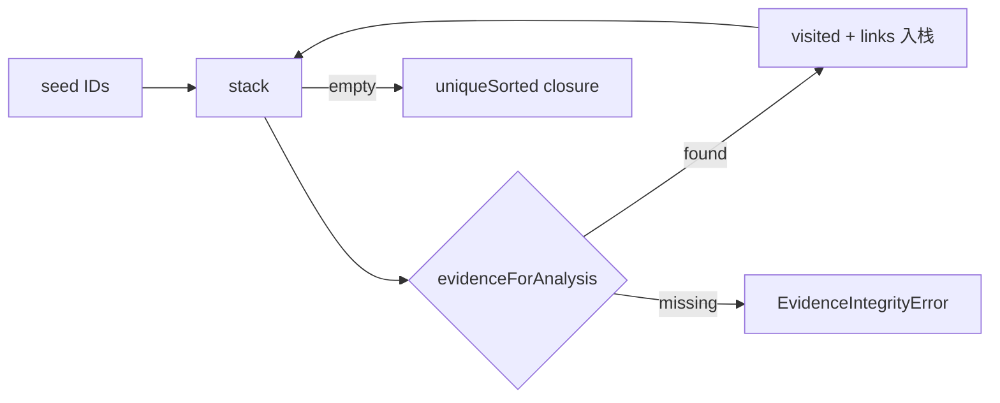
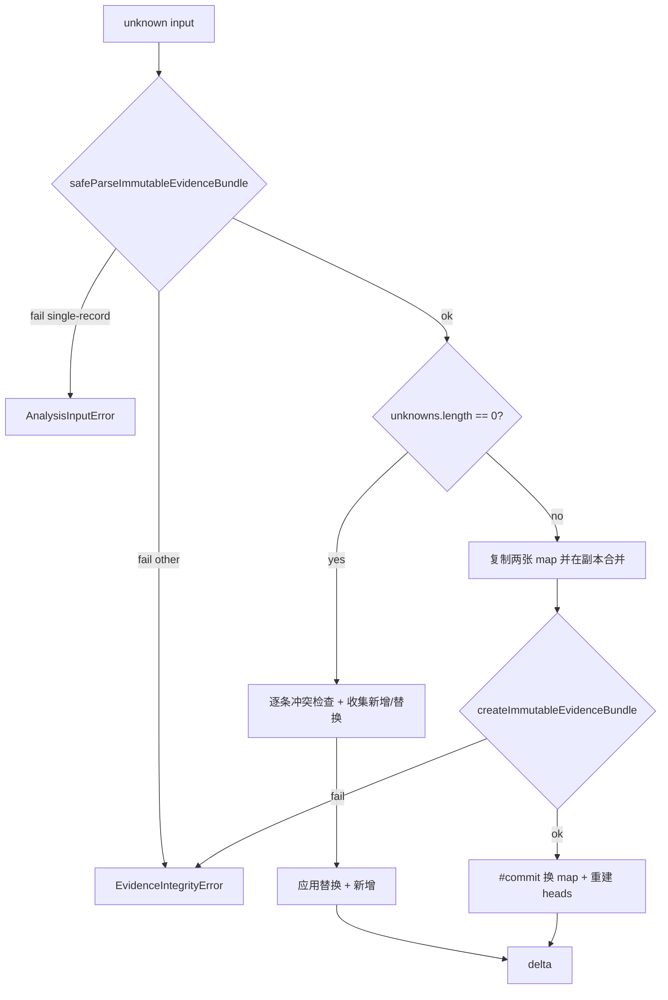
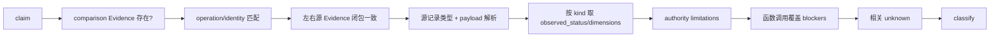
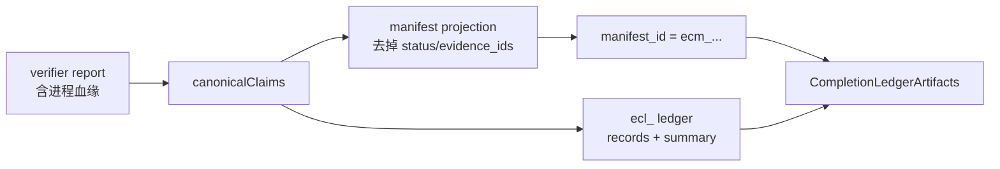
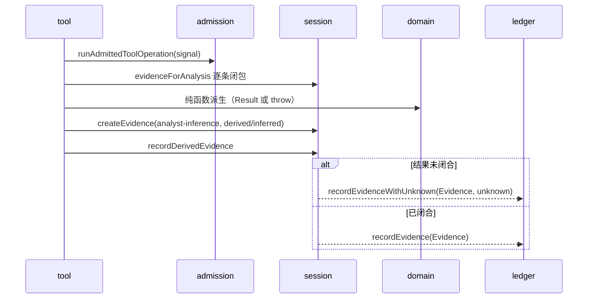

# 23 · 调查记录与重建台账

> 本篇覆盖「调查产出的记录如何被拥有与提交」以及「重建结论如何被清单化、闭合与验收」两半内容：前者是 `src/application/investigation/`（`InvestigationRecords`、四个端口、`EvidenceLedger`）与四个调查工具；后者是 `src/domain/reconstruction*`、`src/domain/evidenceCompletionLedger.ts`、`src/domain/completionLedgerGeneration.ts` 及其 `src/application/Reconstruction*` 生成/评估入口。边界澄清：Evidence 的字段语义与错误代数在 06 篇；工具契约与 Schema 在 08 篇；Server 注册机制在 09 篇；本篇只讲这些记录/台账**自己的**所有权、原子性、派生规则与闭合语义。

## 0 速览

1. 会话内只有一个记录所有者：`InvestigationRecords` 用 `readonly #evidence = new EvidenceLedger()` 组合出四个端口（读、写、Evidence+Unknown 同写、Unknown 注册表），自身**没有任何旁路状态**（`src/application/investigation/InvestigationRecords.ts Class：InvestigationRecords`）。
2. `EvidenceLedger` 的写入不是「逐条塞 map」：`import` 先整包认证，再分「仅记录」快速路径与「含 Unknown」全量路径；全量路径先在**副本**上合并、用 `createImmutableEvidenceBundle` 校验整个候选图、成功后才 `#commit` 换掉三个 map（`src/application/investigation/EvidenceLedger.ts 函数：import 偏移：+10~+50`、`函数：#commit 偏移：+0~+19`）。
3. 语义身份相同、展示元数据不同的记录**不是冲突**：`recordsAgree` 比语义内容，`displayMetadataAgree` 只比 `subject.name`、`subject.local_path`、`caller_input_path`；后者的差异被记为 `kind: "metadata"` 的替换项随导入增量返回（`src/application/investigation/EvidenceLedger.ts 函数：displayMetadataAgree 偏移：+0~+2`）。
4. Unknown 的每次写入都必须携带一条已认证的 mutation Evidence；`updateUnknown` 以 `expected_revision` 做乐观并发，`recordWithUnknown` 把 Evidence 与 Unknown 放进同一次增量提交（`src/application/investigation/InvestigationRecords.ts 函数：recordEvidenceWithUnknown 偏移：+0~+12`、`src/application/investigation/InvestigationRecords.ts 函数：updateUnknown 偏移：+0~+5`）。
5. 重建覆盖（coverage）是**按 boundary 求闭包**：边界点名的 surface 与 claim 所引用的 surface 先取并集，再沿 `dependency_surface_ids` 传递闭包；缺失依赖按「依赖它的 surface」逐条记 `dependency-surface-missing`（`src/domain/reconstructionCoverageScope.ts 函数：reconstructionCoverageScope 偏移：+10~+24`、`函数：reachableSurfaces 偏移：+8~+22`）。
6. 覆盖结论有 25 个 reason code 与四级状态，优先级固定为 `failed > unknown > partial > ready`；`partial` 不是兜底，而是「有缺口但既不失败也不未知」的显式档（`src/domain/reconstructionCoverage.ts 函数：closureStatus 偏移：+2~+31`）。
7. 义务台账（obligation ledger）是**自证一致**的：`status`、`summary`、`coverage`、`reports`、`ownership_graph`、`dependency_graph`、`closure_digest`、`evidence_links` 全部由 obligations 重算并在 `superRefine` 中逐项对拍，任何一项漂移都拒绝解析（`src/domain/reconstructionObligationLedgerSchemas.ts Const：reconstructionObligationLedgerSchema`）。
8. 重建验证只回答**被显式声明的有限 claim**：claim 的 `kind` 决定比较操作与源 Evidence 类型，`fail > unknown > pass` 汇总；通过不代表全局等价，这句话是结果里的固定 limitation（`src/domain/reconstructionVerification.ts 函数：verifyReconstruction 偏移：+49~+79`）。
9. 完成台账把「claim 结果」压成 `ecl_` 台账与 `ecm_` 清单：记录/摘要/ID 互相重算，manifest 只保留 claim 的静态投影并重算内容 ID；verifier run 必须带进程血缘（`src/domain/completionLedgerGeneration.ts 函数：createCompletionLedgerArtifacts 偏移：+0~+38`）。
10. 四个调查工具（`find_changed_behavior`、`build_call_path`、`correlate_static_and_runtime`、`verify_reconstruction`）共用同一条管道：准入 → 解析会话 Evidence 闭包 → 纯函数派生 → 包成 `analyst-inference` 的派生 Evidence → 原子记录（必要时附带 high 严重度 Unknown）（`src/server/registerInvestigationTools.ts 函数：registerInvestigationTools 偏移：+0~+25`）。

## 1 记录层：四个端口与唯一账本

### 1.1 端口把「读」「写」「同写」「问未知」拆开

`src/application/investigation/InvestigationRecordPort.ts` 定义五个类型，其中四个是能力端口，最后一个把四者收在一起：

| 端口 | 方法面 | 用途 |
|---|---|---|
| `EvidenceReader` | `hasEvidence`、`evidenceById`、`evidenceForAnalysis`、`exportEvidenceBundle`、`immutableEvidenceBundle` | 只读；`evidenceForAnalysis` 借出**已认证不可变**记录，避免调用方先 clone 再解析 |
| `EvidenceWriter` | `recordEvidence`、`mergeEvidenceBundle`、`clear` | 幂等写入与整包合并 |
| `EvidenceUnknownWriter` | `recordUnknown`、`recordEvidenceWithUnknown`、`updateUnknown`、`listUnknowns`、`listUnknownsPage`、`verifyUnknownResolution` | 未知项状态机 |
| `UnknownRegistryPort` | `recordUnknown`、`updateUnknown`、`listUnknowns`、`listUnknownsPage`、`verifyUnknownResolution` | 给只关心未知注册表的消费者用的窄视图 |
| `InvestigationRecordPort` | 上述并集 | 会话级组合契约 |

对应锚点：`src/application/investigation/InvestigationRecordPort.ts Type：EvidenceReader`、`Type：EvidenceWriter`、`Type：EvidenceUnknownWriter`、`Type：UnknownRegistryPort`、`Type：InvestigationRecordPort`。

端口拆分的实际效果是**消费者按最小能力取参数**：闭包解析只声明 `Pick<EvidenceReader, "evidenceForAnalysis">`（`src/application/investigation/InvestigationEvidence.ts 函数：resolveInvestigationEvidenceClosure 偏移：+3~+5`），义务台账工具只声明 `EvidenceWriter["recordEvidence"]` 的一个可选函数（`src/application/investigation/recordEvidenceSources.ts 函数：recordEvidenceSources 偏移：+5~+9`）。这些函数因此可以直接被测试替身或非会话调用方复用，而不需要伪造整套接口。

### 1.2 `InvestigationRecords` 是纯委托，不是第二份真相

`InvestigationRecords` 的每个公开方法都只做三件事之一：转发给账本、为 Unknown 写入构造 mutation Evidence、或把结果原样返回。没有缓存、没有二次索引、没有事件总线：

```text
recordEvidence          → #evidence.record
recordEvidenceWithUnknown → #evidence.recordWithUnknown(evidence, input, mutationEvidence)
recordUnknown(target?)  → unknownMutationEvidence(target, {...}) → #evidence.recordUnknown
updateUnknown(target?)  → unknownMutationEvidence(target, {...}) → #evidence.updateUnknown
export/immutableBundle  → 直接转发
```

`target` 参数只在构造 mutation Evidence 时使用：目标存在就把 `subject` 绑到该二进制，不存在就写 `null`（`src/application/investigation/UnknownEvidence.ts`）。因此「记录一个未知」与「更新一个未知」在会话层总是留下可追溯的 mutation 证据，账本层不需要区分调用者是谁。

### 1.3 闭包解析：只沿会话引用走，不导出无关记录

`resolveInvestigationEvidenceClosure` 从种子 ID 出发做**迭代式深度优先**：弹栈 → `resolveEvidenceInput({kind:"retained-evidence"})` → 把该记录的 `evidence_links` 继续压栈；`visited` 集合同时承担去重与断环；最终返回 `uniqueSorted` 后的完整 ID 集（`src/application/investigation/InvestigationEvidence.ts 函数：resolveInvestigationEvidenceClosure 偏移：+6~+22`）。

这条规则的意义在四个调查工具里最清楚：它们把派生结果所依赖的 Evidence **精确闭包**写进新 Evidence 的 `evidence_links`，而不是把整个会话 bundle 挂上去。于是「一条派生记录能独立重放」与「会话里其余记录不被顺带发布」同时成立。



## 2 `EvidenceLedger` 的写入协议

### 2.1 单条写入：语义相同即重复

`record` 先查同 ID 记录：不存在则直接放入并返回 `"added"`；存在且 `recordsAgree` 为真返回 `"duplicate"`；存在但语义内容不同返回 `EvidenceIntegrityError("Conflicting evidence record")`（`src/application/investigation/EvidenceLedger.ts 函数：record 偏移：+0~+18`）。注意它**不会**因为 `caller_input_path` 不同而报冲突——那是 §2.3 的展示元数据替换。

### 2.2 整包导入：两条路径，一个提交点

`import` 的输入是不可信 `unknown`：

1. `safeParseImmutableEvidenceBundle` 失败时按错误种类分流：`single-record` → `AnalysisInputError`（调用者把单条记录当整包传），其余 → `EvidenceIntegrityError`（包结构/认证失败）。
2. **仅记录包**（`bundle.unknowns.length === 0`）走快速路径：逐条查冲突、收集新增，展示元数据不同则收集替换；最后先应用替换、再应用新增，返回 `recordsAdded/unknownsAdded/changed/replacements`。这条路径不改 Unknown 图，所以不需要整图重校验。
3. **含 Unknown 包**走全量路径：在 `pending = new Map(this.#records)` 与 `pendingUnknowns = new Map(this.#unknownRevisions)` 两份副本上合并；任何 ID 语义冲突立即失败；Unknown 按 `unknown_id:revision` 键去重，同键不同 `revision_digest` 报 `Conflicting unknown revision`。
4. `#validateCandidate(pending, pendingUnknowns)` 调 `createImmutableEvidenceBundle` 对**整个候选图**做认证（包括未知依赖环、证据资格等），失败包成 `EvidenceIntegrityError("Evidence bundle unknown registry failed")`。
5. `#commit` 一次性重建 `#records`、`#unknownRevisions`、`#unknownHeads`（heads 取每个 `unknown_id` 的最大 revision），然后返回增量。



### 2.3 展示元数据替换为什么单独建模

`displayMetadataAgree` 只比较三项：`subject.name`、`subject.local_path`、`caller_input_path`（`函数：displayMetadataAgree 偏移：+0~+2`）。这三项都在 `evidenceSemanticContent` 之外（06 篇 §2.1），所以同一 `ev_` ID 可以携带不同的路径拼写。账本不覆盖旧记录，而是把 `{kind:"metadata", previous, current}` 作为 `replacements` 返回给拥有者；快速路径与全量路径都会在提交时用 `current` 覆盖 map 值。这样「语义身份不变」与「展示信息更新」被分开处理，既不会误报冲突，也不会让调用方以为记录被重新认证。

### 2.4 Unknown 的三个写入面

- `recordUnknown`：先 `readLedgerEvidence(mutationEvidence)` 认证，再 `createResidualUnknown(input, mutation_id, subject_digest)`；`ZodError` 转成 `analysisInputErrorFromIssues("record_unknown", …)`；如果 `#unknownHeads` 已有该 ID，返回 `UnknownRegistryError("already-exists")`（`函数：recordUnknown 偏移：+0~+25`）。
- `recordWithUnknown`：认证派生 Evidence 与 mutation Evidence；若同 ID Evidence 已存在且语义冲突则失败；若该 unknown revision 已存在且摘要一致，则只追加 Evidence 并返回 `null`（幂等重放）；否则把 `[evidence, mutation]` 与 unknown 一起追加（`src/application/investigation/EvidenceLedger.ts 函数：#appendIncremental 偏移：+0~+40`）。
- `updateUnknown`：取出 head，先比对 `expected_revision`，不匹配立即 `revision-conflict`；再用 `updateResidualUnknown(current, input, mutationEvidence.evidence_id)` 生成新 revision；最后与 mutation Evidence 一起追加。

三者最终都落到 `#appendIncremental`：它先检查同 ID Evidence 语义冲突；再检查 unknown revision 键是否已存在（存在即 `UnknownRegistryError("integrity")`）；然后用一个「新记录 ∪ 旧记录」的只读视图调用 `validateResidualUnknownAddition`，只在全部通过后才写入记录与 revision/head（`函数：#appendIncremental 偏移：+0~+40`）。这里的顺序很重要：**先验证、后写入**，中途失败不会留下半条记录。

### 2.5 读、分页与清理

`listUnknownsPage` 先把 heads 按过滤器筛出，再按 `compareUnicodeCodePoints` 排序；`offset` 超过长度时 `start = length`；`limit` 省略表示取到末尾；`next_offset` 只在「还有下一页」时给整数，否则 `null`（`函数：listUnknownsPage 偏移：+0~+29`）。`listUnknowns` 只是取第一页的 `items`，因此默认不分页调用会拿到全部——调用方要分页必须显式走 `listUnknownsPage`。

`verifyUnknownResolution` 把「登记有效」与「答案真实」分开：`valid = status === "resolved"`，`truthVerified = resolution?.disposition === "verified"`，二者可以一真一假（`函数：verifyUnknownResolution 偏移：+0~+12`）。`clear` 只在拥有者关闭会话时调用，清三张 map；账本不自行决定生命周期。

## 3 重建覆盖：从 boundary 到闭包

### 3.1 数据文档的十一段

`reconstructionCoverageDataSchema` 是一份**调用方提供的完整快照**，不是增量：

| 段 | 作用 |
|---|---|
| `evidence_bundle` | 所有引用必须能在此包内解析 |
| `artifacts` | artifact_id、sha256、version、environment、evidence_ids |
| `surfaces` | 可重建表面；含 `dependency_surface_ids` 与 `evidence_ids` |
| `owners` | 每个 surface 的归属；`implemented` 或 `external/non-goal` 判别联合 |
| `claims` | 有限 claim：kind、surface_ids、required_dimensions、required_authority |
| `verifier_contracts` | 验证器契约：覆盖 claim/dimension、authority、max_age、minimum_repeats、normalization/contract 摘要 |
| `verifier_results` | 单次观察：status、covered_*、artifact/owner 摘要、repeats、evidence_ids |
| `residual_unknown_ids` | 仍然活跃的未知项 |
| `contradictions` | active/resolved 矛盾及其 surface/claim/evidence |
| `package_proofs` | build/clean-install/package-contents/runtime-routing/authority-independence |
| `boundaries` | 本次闭合的边界：required surface/claim、允许的 disposition、允许的未知、必需 proof 种类 |

`readReconstructionCoverageData` 先解析文档，再 `validateCoverageReferences` 建立全部查找索引并检查引用完整性（唯一 ID、引用存在、surface 的 artifact 存在、owner 指向的 surface 存在等），返回 `ParsedReconstructionCoverage`——一份「文档 + 六个只读 map」的所有权对象（`src/domain/reconstructionCoverage.ts 函数：readReconstructionCoverageData 偏移：+0~+20`、`Type：ParsedReconstructionCoverage`）。

### 3.2 scope：边界 + claim 表面 + 依赖闭包

`reconstructionCoverageScope` 的输入只有 `parsed` 与一个 boundary：

1. `claimIds = boundary.required_claim_ids`。
2. 对每个 claim，把它声明的 `surface_ids` 做传递闭包，得到 `claimSurfaceIds`。
3. 把 `boundary.required_surface_ids` 与所有 claim 闭包并集再做一次传递闭包，得到本次评估的 `surfaceIds`。
4. `missingDependencies` 记录「某个被引用但不在文档里的依赖 ID → 引用它的 surface 集合」，供后续把缺失归因到依赖方。

`reachableSurfaces` 用索引式 BFS（`for index < pending.length`）而不是递归，输入顺序不影响结果；缺失依赖仍会被加入 `surfaceIds`，这样评估阶段能区分「surface 本身缺失」与「依赖缺失」（`src/domain/reconstructionCoverageScope.ts 函数：reachableSurfaces 偏移：+0~+30`）。

### 3.3 四组检查与 25 个 reason

`evaluateParsedReconstructionClosure` 固定按顺序跑四组检查，再把 reason 排序、汇总状态并生成探针（`src/domain/reconstructionCoverage.ts 函数：evaluateParsedReconstructionClosure 偏移：+10~+42`）：

| 组 | 检查 | reason 家族 |
|---|---|---|
| 表面/归属 | 每个 scope surface 存在；有且仅有一个 owner；`implemented` owner 的路径/分发/authority 路由状态 | `surface-missing`、`dependency-surface-missing`、`owner-missing`、`owner-duplicate`、`disposition-not-allowed`、`owner-path-missing/unknown`、`owner-undistributed`、`owner-distribution-unknown`、`authority-routing-detected/unknown` |
| claim/验证器 | claim 存在；恰好一个契约覆盖；有最新结果；同刻结果不矛盾；有可比 authority；契约匹配；未过期；结果 pass | `claim-missing`、`verifier-missing`、`verifier-duplicate`、`verifier-result-missing`、`verifier-result-ambiguous`、`verifier-result-incompatible`、`verifier-result-stale`、`verifier-failed`、`verifier-unknown` |
| 风险 | 未允许的 residual unknown；影响 scope 的 active contradiction | `active-unknown`、`active-contradiction` |
| 包证明 | 每种必需 proof 都有 applicable 结果；fail/pass/unknown/missing 分流 | `package-proof-missing`、`package-proof-failed`、`package-proof-unknown` |

owner 的检查表是按「布尔 → code → 文案」写成元组的（`函数：evaluateOwner 偏移：+8~+40`），所以六种状态彼此独立、可以同时产出多条 reason；`external/non-goal` 分支只检查 `allowed_dispositions`，不要求路径或分发。

### 3.4 最新验证结果的选取：时间组、歧义、可比性、契约匹配、新鲜度

`latestVerifierObservationsByVerifier` 不使用数组顺序：它解析每个 `observed_at` 为 `OffsetDateTimeInstant`，保留每个 verifier 的**最新时间戳整组**（同一时刻可有多条），并把 assessment 内容做一次「忽略时间与来源拼写」的 JSON 身份比较（`src/domain/reconstructionCoverageVerifierResults.ts 函数：latestVerifierObservationsByVerifier 偏移：+0~+24`、`函数：sameVerifierAssessment 偏移：+0~+8`）。

`evaluateVerifierResult` 的顺序是固定的（`src/domain/reconstructionCoverageEvaluation.ts 函数：evaluateVerifierResult 偏移：+0~+91`）：

1. 无结果 → `verifier-result-missing`。
2. 同刻多条 assessment 不一致 → `verifier-result-ambiguous`。
3. 组内没有任何一条引用「契约 authority 且 confidence 合格」的 Evidence → `verifier-result-incompatible`。
4. 取第一条可比结果，检查 contract/normalization 摘要、claim/dimension 覆盖、artifact/owner 摘要、repeats、authority 全部匹配（`函数：verifierResultMatchesContract 偏移：+0~+50`）。
5. 观测时间晚于 `now` 或早于 `now - max_age_ms` → `verifier-result-stale`。
6. `fail` → `verifier-failed`；其他非 `pass`（unknown/unsupported/truncated/skipped）→ `verifier-unknown`。

「可比 Evidence」的资格表写在 `src/domain/reconstructionCoverageEvidence.ts`：`shipped-artifact → [shipped-artifact]`、`controlled-replay → [controlled-replay]`、`live-observation → [controlled-replay, external-service]`、`external → [external-service]`；并且只接受 `observed`，唯一例外是 `shipped-artifact` 也接受 `derived`（`函数：verifierHasComparableEvidence 偏移：+0~+9`、`函数：hasComparableEvidence 偏移：+0~+14`）。包证明另有按 kind 的 authority 表（`函数：packageProofHasComparableEvidence 偏移：+0~+8`）。

### 3.5 状态与探针

`closureStatus` 的三级短路：

```text
reasons 为空                → ready
任一 failed 家族 code       → failed
任一 unknown 家族 code      → unknown
否则                        → partial
```

`failed` 家族是：`verifier-failed`、`active-contradiction`、`authority-routing-detected`、`owner-path-missing`、`owner-undistributed`、`package-proof-failed`；`unknown` 家族是：stale/incompatible/ambiguous、verifier-unknown、active-unknown、owner-*-unknown、package-proof-unknown（`函数：closureStatus 偏移：+0~+35`）。

reason 按 `(code, subject_id)` 的 Unicode 码点序排序（`函数：reasonOrder 偏移：+0~+4`）；`evidence_ids` 只收集检查过程中真正引用的记录。探针不是「下一步建议」的自由文本，而是 reason 到操作的**机械映射**：owner-/authority-routing- → `reconcile_reconstruction_owner`，verifier- → `run_reconstruction_verifier`，package-proof- → `verify_reconstruction_package`，active-contradiction → `resolve_contradiction`，active-unknown → `probe_residual_unknown`，其余 → `update_authoritative_inventory`（`src/domain/reconstructionCoverageEvaluation.ts 函数：probeOperation 偏移：+0~+10`）。

## 4 义务台账：自证一致的清单

### 4.1 三种输入

`ReconstructionObligationLedgerInput` 只有三段：`evidence_bundle`、`reviewed_obligations`、`manifest`（`src/domain/reconstructionObligationLedgerSchemas.ts Const：reconstructionObligationLedgerInputSchema`）。请求解析时先认证 bundle，再逐条检查 `review_evidence_ids` 是否都能在 bundle 中找到，缺失即带精确 JSON path 的 `AnalysisInputError`（`src/application/ReconstructionObligationLedgerRequest.ts 函数：resolveReconstructionObligationLedgerRequest 偏移：+27~+48`）。

### 4.2 obligation 不是一份自由文档，而是「候选 + 绑定 + 诊断」的求值结果

| 概念 | 来源 | 语义 |
|---|---|---|
| `origin: generated/reviewed` | 生成器或调用方 | 生成候选由图/进程 Evidence 推导；reviewed 由调用方声明 |
| `authority_references` | 生成器/评审 | 每个引用带 `evidence_id`、authority、state（candidate/observed/reviewed/unknown）、location |
| `observed_cases` | 生成器或 manifest | 原始行为的逐条观察 |
| `binding` | manifest 的 `reconstructionObligationManifestBindingSchema` | owner、parser_type、original_cases、fixtures、verifier |
| `status` | 求值 | unowned/characterized/implemented/verified/contradicted/blocked/out-of-scope/unknown |
| `diagnostics` | 求值 | 26 个 code 的稳定集合 |

`application_layer` 固定 10 档（cli/protocol/electron/persistence/process/runtime/packaging/native-abi/application/other）；`required_case_kinds` 固定 5 档（positive/negative/malformed/cancellation/teardown）；proof authority 固定 8 档（unit/integration/protocol/renderer/packaged-process/native-abi/live-observation/external）；original authority 固定 4 档（static/runtime/process/external）（`src/domain/reconstructionObligationLedgerSchemas.ts Const：obligationLayerSchema`、`Const：obligationCaseKindSchema`、`Const：obligationProofAuthoritySchema`、`Const：obligationOriginalAuthoritySchema`）。

### 4.3 候选推导：图、进程与评审三条来源

`deriveReconstructionObligationCandidates` 遍历 bundle 的每条记录：应用图 Evidence 走 `deriveApplicationCandidates`，进程捕获 Evidence 走 `deriveProcessCandidate`，最后把 reviewed 声明并入（`src/application/ReconstructionObligationCandidates.ts 函数：deriveReconstructionObligationCandidates 偏移：+5~+25`）。

- **应用图**只接受三个 operation：`analyze_javascript_application`、`reconcile_javascript_runtime`、`project_managed_application_graph`；解析失败的 Evidence 不丢弃，而是转成 limitation。节点种类由 `APPLICATION_NODE_POLICIES` / `SEMANTIC_NODE_POLICIES` 映射到固定策略：package/installer → packaging，context-bridge/ipc → electron，endpoint → protocol，storage → persistence，worker/service-worker/child-process/stdio/signal/timer/promise/task → process，native-addon/native-export/pinvoke → native-abi，config-source/request/response/boundary → 带 `parser_type` 要求的应用层（`src/application/ReconstructionObligationPolicies.ts Const：APPLICATION_NODE_POLICIES`、`Const：SEMANTIC_NODE_POLICIES`）。
- **进程捕获**只有在 `manifest.executable_sha256` 非空时才生成一个 packaged-process-lifecycle 义务；`observed_cases` 由退出码、settlement、signal/reason 机械推导；截断捕获只加 limitation，不伪造「没发生」（`src/application/ReconstructionObligationCandidates.ts 函数：deriveProcessCandidate 偏移：+0~+85`）。
- **合并**同一 `obligation_id` 时，authority references / observed cases / residual unknowns 等取并集并排序；两个 generated 候选共享 ID 视为「同一 claim 被多条记录看到」，不累加 `definitionCount`；只有 reviewed 参与才可能产生重复定义（`函数：addCandidate 偏移：+0~+45`）。

`obligation_id` 不是随机号：`obl_` + 规范化摘要，摘要对象含 `schema` 与推导键（应用节点、语义节点、进程 scenario 等）（`函数：obligationId 偏移：+0~+2`）。

### 4.4 求值：26 个诊断与状态优先级

`evaluateReconstructionObligationLedger` 先按 ID 排序候选、找孤儿 manifest 项、建上下文，然后逐个求值、做依赖传播、生成六个派生视图与 limitations，最后交给 schema 对拍（`src/application/ReconstructionObligationLedgerEvaluation.ts 函数：evaluateReconstructionObligationLedger 偏移：+0~+55`）。

诊断按证据链路分组：

| 组 | code |
|---|---|
| 定义/归属 | `duplicate-definition`、`missing-owner`、`ambiguous-owner` |
| parser/类型 | `missing-parser-type` |
| 原始用例 | `missing-original-case`、`weak-original-case-authority` |
| fixture | `missing-case`、`weak-fixture-authority`、`inapplicable-fixture-proof`、`fixture-failed` |
| verifier | `missing-verifier`、`verifier-does-not-enumerate`、`missing-verifier-result`、`weak-verifier-authority`、`verifier-failed`、`verifier-unavailable`、`inapplicable-verifier-proof` |
| 原始权威 | `static-only` |
| 矛盾 | `contradiction`、`contradiction-evidence-missing` |
| 未知/依赖 | `residual-unknown`、`dependency-missing`、`dependency-open` |
| 显式处置 | `unavailable-authority`、`blocked`、`out-of-scope` |

`obligationStatus` 的优先级是固定的（`函数：obligationStatus 偏移：+0~+18`）：

```text
out-of-scope → out-of-scope
blocked → blocked
contradiction → contradicted
duplicate-definition | residual-unknown | unavailable-authority → unknown
binding == null → unowned
diagnostics 为空 → verified
否则 → implemented
```

依赖诊断跑一个不动点循环：每轮把当前 status 传给所有依赖边，缺失依赖记 `dependency-missing`、未 verified 记 `dependency-open`；任何依赖问题把非 contradicted/out-of-scope 的义务降为 `blocked`，直到不再变化（`函数：applyDependencyDiagnostics 偏移：+0~+38`、`函数：dependencyStatus 偏移：+0~+6`）。这解决「A 依赖 B、B 依赖 C」时一轮传播不够的问题。

### 4.5 台账 schema 把「派生字段」变成硬约束

`reconstructionObligationLedgerSchema` 的 `superRefine` 逐项重算：

| 字段 | 对拍函数 | 失败消息 |
|---|---|---|
| `status` | `reconstructionObligationLedgerStatus` | Ledger status does not match its obligations |
| `summary` | `summarizeReconstructionObligations` | Ledger summary does not match its obligations |
| `closure_digest` | `reconstructionObligationLedgerClosureDigest` | Ledger closure digest does not match its contents |
| `coverage` | `reconstructionObligationCoverage(limitations)` | Ledger coverage does not match its limitations |
| `reports` 四项 | `reconstructionObligationReports` | Ledger report does not match its obligations |
| `ownership_graph` | `reconstructionObligationOwnershipGraph` | Ownership graph does not match its obligations |
| `dependency_graph` | `reconstructionObligationDependencyGraph` | Dependency graph does not match its obligations |
| `evidence_links` | 去重 + 覆盖 `reconstructionObligationEvidenceIds` | unique / omit Evidence referenced by an obligation |

`closure_digest` 不是台账 ID 的摘要，而是**闭包承诺**：对 `schema:"ReconstructionObligationClosure"` 加 status/coverage/summary/reports/两张图/obligations/evidence_links/limitations 取规范化摘要（`src/domain/reconstructionObligationLedgerIntegrity.ts 函数：reconstructionObligationLedgerClosureDigest 偏移：+0~+25`）；`ledger_id` 则只摘 bundle 记录 ID、义务 ID 与 closure_digest（`src/application/ReconstructionObligationLedgerEvaluation.ts 函数：evaluateReconstructionObligationLedger 偏移：+40~+55`）。

`summary.by_evidence_authority` 的 `.describe` 明说：一条义务在每个不同 authority 下各计一次，所以分项之和可以大于 `total`；`by_source_state` 才是一义务一计。`countBy` 的实现用 `new Set` 对每条记录的 key 去重后再累加，正是这条语义（`函数：countBy 偏移：+0~+14`）。

台账状态另有独立规则：空义务 → `unknown`；任一必需义务 contradicted 或带 verifier-failed/fixture-failed → `failed`；有 limitations → `unknown`；必需义务 status 为 unknown → `unknown`；否则全 verified → `ready`，尚有必需未验证 → `open`（`函数：reconstructionObligationLedgerStatus 偏移：+0~+22`）。

### 4.6 证明与台账证据是两份东西

`reconstructionObligationProofSchema` 是**调用方产生的证明**：每个 binding 带 `obligation_id`、`obligation_version`、`owner_sha256`，以及逐 fixture/verifier 的 `passed` 布尔（`src/domain/reconstructionObligationProof.ts Const：reconstructionObligationProofSchema`）。它必须作为一条 `confidence:"observed"`、`predicate_type:"rea.reconstruction-proof"`、`operation:"verify_reconstruction_obligations"` 的 Evidence 被提交；`parseReconstructionProofEvidence` 对 confidence/predicate/operation/schema 做四道认证，`qualifyReconstructionProof` 再逐层过滤 obligation → owner → revision → claim，任何一层不匹配都有独立拒绝原因（`src/application/ReconstructionObligationAuthority.ts 函数：parseReconstructionProofEvidence 偏移：+0~+16`、`函数：qualifyReconstructionProof 偏移：+0~+35`）。

authority 不是「等于」而是「至少」：`proofAuthoritySatisfies` 把强证明用于弱要求（如 `integration` 可满足 `unit` 要求），但 `native-abi` 与 `external` 只接受自身（`函数：proofAuthoritySatisfies 偏移：+0~+22`）。

## 5 残差未知与有限重建验证

### 5.1 未知的选择规则

`reconstructionUnknownHeads` 取每个 `unknown_id` 的最大 revision。`reconstructionClaimUnknowns` 做三件事：

1. **scope 过滤**：unknown 无 `comparison_conclusion_scope` 表示全局适用；有 scope 时要求 `comparison_evidence_id` 等于当前比较证据，且 `dimensions` 命中 claim 的维度（`overall` 视为全命中）。
2. **证据相邻**：supporting/contradicting 证据必须与当前比较证据或任一源证据相交。
3. **关系闭包**：沿 `relationships` 扩展未解决依赖，但**跳过 `related-to`**——相关不等于阻塞（`src/domain/reconstructionUnknowns.ts 函数：reconstructionClaimUnknowns 偏移：+0~+55`）。

结果按 Unicode 码点序排序，resolved 未知永不出现在结果里。

### 5.2 探针聚合

`reconstructionProbes` 只处理 status 为 `unknown` 的 claim：收集其 unknown 的 `recommended_probes`；若为空，按 claim kind 落默认探针——behavioral → `capture_process_scenario`，structural-function → `analyze_function`，structural-artifact → `inspect_artifact`。探针按 `(operation, rationale)` 聚合，把多个 claim/unknown 合并到同一条，并对 `claim_ids`/`unknown_ids` 排序去重（`函数：reconstructionProbes 偏移：+0~+40`、`函数：defaultProbe 偏移：+0~+18`）。

### 5.3 claim 是有限、带类型的

`reconstructionClaimSchema` 是三种 kind 的判别联合，每种的 `dimension` 取值不同：

| kind | 比较操作 | dimension |
|---|---|---|
| `behavioral` | `compare_process_captures` | `overall` + `PROCESS_COMPARISON_DIMENSIONS` |
| `structural-function` | `compare_functions` | `overall` + 函数比较维度 |
| `structural-artifact` | `compare_artifacts` | 仅 `overall` |

规格还要求 claim ID 唯一、`kind:comparison_evidence_id:dimension` 选择器唯一（`src/domain/reconstructionVerificationSchemas.ts Const：reconstructionSpecificationSchema`）。

### 5.4 验证管道

`verifyReconstruction` **抛异常而不是返回 Result**：规格解析失败抛 `AnalysisInputError`，bundle 读取失败抛其错误。随后：



关键校验：

- 比较 Evidence 的 `evidence_links` 必须恰好等于左右源 ID 并集，否则视作闭包与参数不一致的完整性错误（`src/domain/reconstructionVerification.ts 函数：evaluateClaim 偏移：+12~+30`）。
- 源 Evidence 的 `operation`/`predicate_type` 必须匹配 claim kind：behavioral 只接受 `capture_process_scenario` + `rea.process-capture`；structural-function 只接受 `analyze_function` + `rea.analysis`；structural-artifact 只接受 `inventory_artifact|inspect_artifact` + `rea.analysis`（`函数：readValidatedSourceFacts 偏移：+0~+22`）。
- behavioral 要求源 Evidence 为 `controlled-replay` 且 `observed`，两侧环境 JSON 完全一致；structural 要求 `shipped-artifact`，function 额外接受 `inferred` 置信度；structural 源缺 subject 会记 limitation；同一源出现在两侧会记「缺少独立观察」（`函数：authorityLimitations 偏移：+0~+45`）。
- 函数 `calls` 维度（或 overall 且没有独立函数变化）会把源 dossier 的调用覆盖 blocker 提为 limitation（`函数：sourceCallCoverage 偏移：+0~+22`）。

### 5.5 分类与总体状态

`classify` 的优先级是（`函数：classify 偏移：+0~+12`）：

```text
任何 limitation（权威、环境、调用覆盖、未知…） → unknown
observed ∈ {changed, added, removed, contradiction} → fail
observed ∈ {unknown, truncated} 或存在相关未解决 unknown → unknown
否则 → pass
```

**limitation 先于 fail**：即使观测到了 `changed`，只要证据权威不足，结论仍是 `unknown` 而不是 `fail`。总状态再按 `fail > unknown > pass` 汇总，`specification_sha256` 对「claims 按 ID 排序后的规格」取摘要，`evidence_links` 是所有 claim 链接的并集，`limitations` 至少包含固定句「Pass means every declared claim passed; it does not establish global implementation equivalence.」（`函数：verifyReconstruction 偏移：+49~+79`）。结果 schema 的 `superRefine` 还强制 `total = passed+failed+unknown = behavioral+structural`、`claims.items.length = total`、`status` 与计数一致（`src/domain/reconstructionVerificationSchemas.ts Const：reconstructionVerificationResultSchema`）。

## 6 完成台账与清单

### 6.1 `ecl_`：结果台账

`evidenceCompletionRecordSchema` 是 `{claim_id, status, evidence_ids}`，status 五值（pass/fail/unsupported/truncated/unknown），每条记录至少一个 Evidence ID。`summarize` 统计五档并把 `complete` 定义为「全部 pass」（`src/domain/evidenceCompletionLedger.ts 函数：summarize 偏移：+0~+16`）。`ledgerIssues` 四项互锁：claim ID 排序唯一、每条 Evidence ID 排序唯一、summary 与重算完全相等、`ledger_id` 与重算相等（`函数：ledgerIssues 偏移：+0~+28`）。创建侧先排序再校验，重复 ID 直接 `TypeError`，最后交给 schema 二次认证（`函数：createEvidenceCompletionLedger 偏移：+0~+18`）。

注意 `complete` 只看 pass 数量，不看 `unsupported/truncated` 的语义差异；需要区分「不支持」与「截断」的消费者必须自己读 `summary` 分项，不能只看布尔。

### 6.2 `ecm_`：验证器运行的清单

`completionVerifierReportSchema` 要求：

- `verifier` 与 `environment` 有 id/version/platform/architecture/runtime。
- `verifier_run` 带 `run_id`（uuid）、`verifier_pid`、`parent_pid` 与 `process_lineage`；lineage 的 `launcher_pid` 必须等于 `verifier_pid`、`launcher_parent_pid` 必须等于 `parent_pid`，否则 `superRefine` 报错（`src/domain/completionLedgerGeneration.ts Const：completionVerifierReportSchema`、`Const：verifierRunSchema`）。
- 每条 claim 有场景、artifact 摘要、provider 身份、status、evidence_ids；pass 的 claim 必须至少提交一个 artifact 摘要。

`createCompletionLedgerArtifacts` 把 report 规范化为两张产物：manifest 去掉 `status/evidence_ids` 并排序 claim/artifact/skill，`manifest_id = ecm_ + digestCanonicalValue(projection)`；ledger 复用 §6.1 的构造器（`函数：createCompletionLedgerArtifacts 偏移：+0~+38`）。`manifestIssues` 再次检查 claim ID、skill ID、artifact 摘要的排序唯一性与 ID 重算（`函数：manifestIssues 偏移：+0~+32`）。



这两张台账都不引用本地路径：claim 用 ID/摘要/Evidence，environment 用离散标识，因此可以跨机器比较。它们也不含「谁跑的」以外的身份信息——进程 PID 只在 report 里，进入 manifest 的只有 verifier 身份与环境。

## 7 Provider 身份与四个调查工具

### 7.1 Provider 常量是结果的可比较身份

`src/domain/investigationProviders.ts` 定义了 24 个冻结的 `{id, name, version:"1"}` 常量；本领域直接用到四个：

| 常量 | id | 用于 |
|---|---|---|
| `CHANGED_BEHAVIOR_PROVIDER` | `rea-changed-behavior` | `find_changed_behavior` |
| `CALL_PATH_PROVIDER` | `rea-call-path` | `build_call_path` |
| `STATIC_RUNTIME_PROVIDER` | `rea-static-runtime-correlation` | `correlate_static_and_runtime` |
| `RECONSTRUCTION_PROVIDER` | `rea-reconstruction-verifier` | `verify_reconstruction` |

另外，`build_reconstruction_obligation_ledger` 的 Evidence 使用 `JAVASCRIPT_APPLICATION_WORKFLOW_PROVIDER`（`rea-javascript-application-workflows`），因为它复用应用图工作流的身份（`src/application/ReconstructionObligationLedgerService.ts 函数：createLedgerEvidence 偏移：+0~+18`）。

### 7.2 四工具的共同管道



具体差异：

| 工具 | 派生输入 | confidence | 何时附带 Unknown | Unknown 问题 / 要求 |
|---|---|---|---|---|
| `find_changed_behavior` | 调用方给的对比 Evidence ID | derived | `behavior_status` 为 unknown/truncated | 是否在完整受控回放中行为一致；要求 controlled-replay/observed |
| `build_call_path` | 函数 Evidence + 起止地址 | derived | 结果 status 为 unknown | 能否从完整分析建立调用路径；要求 shipped-artifact/derived |
| `correlate_static_and_runtime` | 静态与运行时比较 Evidence | inferred | status 为 unknown/truncated | 运行时行为是否匹配静态分析；authority 要求为 null |
| `verify_reconstruction` | 规格 + 会话不可变 bundle | derived | status 为 unknown | 重建是否满足每个声明 claim；authority 要求 null/derived |

四个工具都先把结果依赖的 Evidence 解析成精确闭包，再把这个闭包作为新 Evidence 的 `evidence_links`；这样后续任何消费者都能从一条派生记录追溯到它用到的全部原始观察。`verify_reconstruction` 还额外把 `specification_sha256` 与 claim ID 列表写进 `parameters`，使「同一规格、同一 bundle」可复现（`src/server/registerInvestigationTools.ts 函数：registerReconstruction 偏移：+0~+40`）。

`recordWorkflowEvidence` 决定「记录 + 未知」是否原子：未闭合时先由 `workflowUnknownInput` 把 Evidence ID 拼进问题文本、把该 Evidence 设为唯一 supporting evidence，再走 `session.recordEvidenceWithUnknown`；已闭合时只 `recordEvidence`（`src/server/registerInvestigationTools/helpers.ts 函数：recordWorkflowEvidence 偏移：+0~+30`、`src/application/investigation/WorkflowUnknown.ts 函数：workflowUnknownInput 偏移：+0~+18`）。因此不存在「Evidence 已记录、Unknown 没记录」的中间态。

## 8 边界与失败模式

1. **只读快路径不做全图校验**：`import` 的 record-only 分支信任 bundle parser 已认证每条记录与 manifest，只查同 ID 语义冲突。若调用方绕过 bundle 认证直接构造 `EvidenceBundle`，账本不会重复校验未知图——未知图本就不变，这是有意的性能取舍。
2. **同 ID 不同语义一律拒绝，不尝试合并**：记录、unknown revision、import 全路径都如此；只有「语义相同、展示元数据不同」允许替换。
3. **`#appendIncremental` 的写入顺序**：先收集 additions、再校验 unknown、最后才写三张 map；任何一步失败都不会留下 Evidence 已写而 Unknown 未写的状态。
4. **`recordWithUnknown` 的重放语义**：同 revision digest 视为已记录，只补 Evidence 并返回 `null`；只有 digest 不同才报 `already-exists`。调用方必须区分 `null` 与 `ResidualUnknown`——`null` 表示「这次没有新建未知」。
5. **`updateUnknown` 的乐观并发是「读后比」而非锁**：两个并发调用都读到同一 revision 时，后写者会因 head 已变而拿到 `revision-conflict`；账本不重试。
6. **coverage 的缺失分两类**：surface 自身缺失记 `surface-missing`，被引用的依赖缺失记到**依赖方** `dependency-surface-missing`。调用方若要修，前者补 surface，后者补依赖或删引用。
7. **verifier 结果不用「最后一条」**：同一 verifier 的最新时间戳可能有多条，内容不一致即 `ambiguous`；数组顺序完全不影响结论。
8. **过期判断包含未来时间**：`observed_at > now` 也算 stale，避免预填的未来结果被当成新鲜证据。
9. **package proof 宁严勿松**：任何 applicable fail → failed；全部 applicable pass 才继续；存在 proof 但没有 applicable → unknown；完全不存在 → missing。混合结果不会被「多数 pass」掩盖。
10. **obligation 的依赖传播用不动点**：单轮遍历会在链式依赖上留下错误状态；实现最多跑 `obligations.length` 轮并在无变化时提前退出。
11. **`summary.by_evidence_authority` 会超过 total**：这是 `.describe` 明示的语义，不是 bug；按义务数汇总的消费者应使用 `by_source_state` 或 `total`。
12. **重建验证的 limitation 优先于 fail**：权威不足时观测到 `changed` 只得到 `unknown`。这是「不把不确定当反例」的刻意选择。
13. **`verifyReconstruction` 用异常表达输入/完整性问题**：缺比较证据、源闭包不一致、源类型错误都会抛出，而不是逐 claim 记 unknown；调用方必须先保证输入的 Evidence 闭包完整。
14. **completion ledger 的 `complete` 不等于「全部有结论」**：`unsupported/truncated` 都让 `complete=false`，但 `summary` 仍分项保留；只读布尔会丢失信息。
15. **台账工具与覆盖工具的记录语义不同**：`build_reconstruction_obligation_ledger` 会把自己引用的 bundle 源记录写回会话（`recordEvidenceSources`），然后交付新 Evidence；`evaluate_reconstruction_coverage` 是纯内联评估，不产生会话 Evidence（`src/server/registerApplicationTools/coverage.ts 函数：registerCoverageTools 偏移：+0~+18`）。

## 9 问题与风险清单

### P1

- **reason code 与状态家族是两份手工清单**：`closureReasonSchema` 的 25 个 code 与 `closureStatus` 里的 failed/unknown 列表、`probeOperation` 的前缀映射各自维护。新增 code 时若忘记加入任一清单，会静默落到 `partial` 或 `update_authoritative_inventory`。源码没有 `satisfies` 式全覆盖约束，建议把三处收敛为一张「code → 状态 → 操作」表。
- **义务台账的派生字段全靠 `superRefine` 兜底**：所有派生视图都必须由调用方先算好再传入；schema 只能拒绝不一致，不能自动修复。任何绕过 `evaluateReconstructionObligationLedger` 的构造者都要重复实现 8 个派生函数，容易产生漂移。
- **`verifyReconstruction` 的异常通道混用**：规格错误是 `AnalysisInputError`，bundle 读取错误是 `EvidenceFileError/EvidenceIntegrityError`，缺源是 `AnalysisInputError`，源类型错误是 `EvidenceIntegrityError`。工具层只把 `Result` 转成调用结果，抛出会被准入层捕获；但库消费者需要知道这不是 `Result` API。

### P2

- **`countBy` 的「一义务多 authority」语义只在 `.describe` 里**：类型上是普通计数数组，没有 `sum ≤ total` 的静态约束。消费方若按数组求和做比例，会得到大于 100% 的结果。
- **候选合并的 `definitionCount` 规则依赖 origin**：两个 generated 不累加，generated+reviewed 或两个 reviewed 才累加。这个规则写在 `addCandidate` 的注释与三元表达式里，没有独立测试可读的类型表达。
- **`latestVerifierObservationsByVerifier` 用 `JSON.stringify` 做 assessment 身份**：键顺序由对象字面量固定，当前安全；但若未来字段变成可选/插入顺序变化，比较可能悄悄失效。
- **`recordWithUnknown` 的幂等分支只比较 revision digest**：若同一 unknown revision 的 mutation Evidence 不同（例如不同 subject），不会报冲突，只补 Evidence。这是「相同语义结论、不同观察来源」的容忍，但调用方可能误以为 mutation 也被唯一绑定。

### P3

- **`listUnknowns` 默认取全量**：没有 limit 的列表调用在大会话上可能返回大量对象；`listUnknownsPage` 已提供分页，但默认入口仍是全量。
- **`displayMetadataAgree` 只比三项**：若未来 Evidence 增加其他展示字段，需要同步扩展，否则新字段差异会被静默忽略。
- **`verifyUnknownResolution.truthVerified` 只看 disposition**：不校验 resolution 的证据资格；「verified」是登记状态，不是独立复核。

## 10 已知缺口

- 本篇没有覆盖 `ReconstructionObligationCandidates.ts` 中应用图/语义图的全部节点种类与 `JavaScriptApplicationEvidenceGraph` 的解析细节——那是 12 篇（共享工作流）与 19 篇（Web/JS）的边界；本篇只说明策略表与候选推导的接口。
- `evaluate_reconstruction_coverage` 的输入 schema `reconstructionCoverageEvaluationInputSchema` 定义在 `src/domain/reconstructionCoverageInput.ts`，本篇只使用了它的外层形状，没有逐字段展开；其 `boundary_id`/`coverage` 的请求语义属于 08 篇契约范围。
- 四个调查工具依赖的 `findChangedBehavior`、`buildCallPath`、`correlateStaticAndRuntime` 三个纯函数的算法细节不在本篇：`callPath` 的图搜索在 07 篇 §5 有接口级走读，changed-behavior 与 static/runtime 相关算法分散在 12/19 篇的候选范围，本篇未逐行读取其比较维度实现。
- `WorkflowUnknown` 之外的自动 Unknown 生成（例如各 provider 自己的 residual unknowns）不在本篇范围；本篇只覆盖「调查工具结果未闭合时」这一条路径。
- 完成台账的消费方（发布流程如何写文件、如何校验签名）属于 25 篇；本篇只到 `CompletionLedgerArtifacts` 的生成。

## 11 源码索引

```text
src/application/investigation/InvestigationRecordPort.ts:EvidenceReader:16
src/application/investigation/InvestigationRecordPort.ts:EvidenceWriter:27
src/application/investigation/InvestigationRecordPort.ts:EvidenceUnknownWriter:34
src/application/investigation/InvestigationRecordPort.ts:UnknownPage:41
src/application/investigation/InvestigationRecordPort.ts:UnknownQuery:48
src/application/investigation/InvestigationRecordPort.ts:UnknownRegistryPort:57
src/application/investigation/InvestigationRecordPort.ts:InvestigationRecordPort:81
src/application/investigation/InvestigationRecords.ts:InvestigationRecords:27
src/application/investigation/InvestigationRecords.ts:recordEvidence:37
src/application/investigation/InvestigationRecords.ts:recordUnknown:81
src/application/investigation/InvestigationRecords.ts:recordEvidenceWithUnknown:92
src/application/investigation/InvestigationRecords.ts:updateUnknown:107
src/application/investigation/InvestigationRecords.ts:listUnknownsPage:129
src/application/investigation/InvestigationRecords.ts:verifyUnknownResolution:134
src/application/investigation/EvidenceLedger.ts:EvidenceMetadataReplacement:37
src/application/investigation/EvidenceLedger.ts:EvidenceImportDelta:44
src/application/investigation/EvidenceLedger.ts:EvidenceLedger:57
src/application/investigation/EvidenceLedger.ts:record:62
src/application/investigation/EvidenceLedger.ts:import:84
src/application/investigation/EvidenceLedger.ts:recordUnknown:218
src/application/investigation/EvidenceLedger.ts:recordWithUnknown:252
src/application/investigation/EvidenceLedger.ts:updateUnknown:305
src/application/investigation/EvidenceLedger.ts:listUnknownsPage:352
src/application/investigation/EvidenceLedger.ts:verifyUnknownResolution:384
src/application/investigation/EvidenceLedger.ts:#appendIncremental:419
src/application/investigation/EvidenceLedger.ts:#validateCandidate:462
src/application/investigation/EvidenceLedger.ts:#commit:483
src/application/investigation/InvestigationEvidence.ts:resolveInvestigationEvidenceClosure:8
src/application/investigation/recordEvidenceSources.ts:recordEvidenceSources:7
src/application/investigation/WorkflowUnknown.ts:workflowUnknownInput:9
src/server/recordDerivedEvidence.ts:recordDerivedEvidence:8
src/server/registerInvestigationTools.ts:registerInvestigationTools:31
src/server/registerInvestigationTools.ts:registerChangedBehavior:57
src/server/registerInvestigationTools.ts:registerCallPath:125
src/server/registerInvestigationTools.ts:registerStaticRuntime:198
src/server/registerInvestigationTools.ts:registerReconstruction:272
src/server/registerInvestigationTools/helpers.ts:recordWorkflowEvidence:21
src/server/registerApplicationTools/coverage.ts:registerCoverageTools:13
src/server/registerApplicationTools/obligationLedger.ts:registerReconstructionObligationLedgerTool:17
src/domain/reconstructionCoverage.ts:reconstructionCoverageDataSchema:170
src/domain/reconstructionCoverage.ts:ParsedReconstructionCoverage:192
src/domain/reconstructionCoverage.ts:readReconstructionCoverageData:218
src/domain/reconstructionCoverage.ts:closureReasonSchema:248
src/domain/reconstructionCoverage.ts:reconstructionClosureResultSchema:280
src/domain/reconstructionCoverage.ts:evaluateParsedReconstructionClosure:306
src/domain/reconstructionCoverage.ts:validateCoverageReferences:352
src/domain/reconstructionCoverage.ts:closureStatus:494
src/domain/reconstructionCoverage.ts:reasonOrder:530
src/domain/reconstructionCoverageScope.ts:ReconstructionCoverageScope:7
src/domain/reconstructionCoverageScope.ts:reconstructionCoverageScope:14
src/domain/reconstructionCoverageScope.ts:reachableSurfaces:41
src/domain/reconstructionCoverageEvaluation.ts:recommendedReconstructionProbes:23
src/domain/reconstructionCoverageEvaluation.ts:probeOperation:32
src/domain/reconstructionCoverageEvaluation.ts:evaluateReconstructionSurfaces:53
src/domain/reconstructionCoverageEvaluation.ts:evaluateOwner:82
src/domain/reconstructionCoverageEvaluation.ts:evaluateReconstructionClaims:155
src/domain/reconstructionCoverageEvaluation.ts:createVerifierIndexes:221
src/domain/reconstructionCoverageEvaluation.ts:evaluateVerifierResult:253
src/domain/reconstructionCoverageEvaluation.ts:verifierResultMatchesContract:345
src/domain/reconstructionCoverageEvaluation.ts:evaluateReconstructionCoverageRisks:396
src/domain/reconstructionCoverageEvaluation.ts:evaluateReconstructionPackageProofs:425
src/domain/reconstructionCoverageVerifierResults.ts:latestVerifierObservationsByVerifier:17
src/domain/reconstructionCoverageVerifierResults.ts:sameVerifierAssessment:40
src/domain/reconstructionCoverageEvidence.ts:verifierHasComparableEvidence:31
src/domain/reconstructionCoverageEvidence.ts:packageProofHasComparableEvidence:39
src/domain/reconstructionObligationLedgerSchemas.ts:obligationStatusSchema:44
src/domain/reconstructionObligationLedgerSchemas.ts:obligationLayerSchema:55
src/domain/reconstructionObligationLedgerSchemas.ts:obligationCaseKindSchema:68
src/domain/reconstructionObligationLedgerSchemas.ts:obligationProofAuthoritySchema:76
src/domain/reconstructionObligationLedgerSchemas.ts:obligationOriginalAuthoritySchema:87
src/domain/reconstructionObligationLedgerSchemas.ts:reconstructionObligationManifestBindingSchema:162
src/domain/reconstructionObligationLedgerSchemas.ts:reconstructionObligationManifestSchema:171
src/domain/reconstructionObligationLedgerSchemas.ts:reviewedReconstructionObligationSchema:181
src/domain/reconstructionObligationLedgerSchemas.ts:reconstructionObligationSchema:234
src/domain/reconstructionObligationLedgerSchemas.ts:reconstructionObligationLedgerSchema:306
src/domain/reconstructionObligationLedgerSchemas.ts:reconstructionObligationLedgerInputSchema:448
src/domain/reconstructionObligationLedgerIntegrity.ts:summarizeReconstructionObligations:12
src/domain/reconstructionObligationLedgerIntegrity.ts:reconstructionObligationLedgerStatus:65
src/domain/reconstructionObligationLedgerIntegrity.ts:reconstructionObligationCoverage:87
src/domain/reconstructionObligationLedgerIntegrity.ts:reconstructionObligationReports:93
src/domain/reconstructionObligationLedgerIntegrity.ts:reconstructionObligationOwnershipGraph:107
src/domain/reconstructionObligationLedgerIntegrity.ts:reconstructionObligationDependencyGraph:124
src/domain/reconstructionObligationLedgerIntegrity.ts:reconstructionObligationEvidenceIds:137
src/domain/reconstructionObligationLedgerIntegrity.ts:reconstructionObligationLedgerClosureDigest:185
src/domain/reconstructionObligationLedgerIntegrity.ts:countBy:213
src/domain/reconstructionObligationProof.ts:reconstructionObligationProofSchema:10
src/application/ReconstructionObligationLedgerRequest.ts:resolveReconstructionObligationLedgerRequest:36
src/application/ReconstructionObligationLedgerService.ts:buildReconstructionObligationLedgerEvidence:16
src/application/ReconstructionObligationLedgerService.ts:buildResolvedReconstructionObligationLedgerEvidence:25
src/application/ReconstructionObligationLedgerEvaluation.ts:evaluateReconstructionObligationLedger:55
src/application/ReconstructionObligationLedgerEvaluation.ts:evaluateObligation:178
src/application/ReconstructionObligationLedgerEvaluation.ts:evaluateBinding:252
src/application/ReconstructionObligationLedgerEvaluation.ts:evaluateVerifier:336
src/application/ReconstructionObligationLedgerEvaluation.ts:evaluateAuthority:408
src/application/ReconstructionObligationLedgerEvaluation.ts:obligationStatus:499
src/application/ReconstructionObligationLedgerEvaluation.ts:dependencyStatus:518
src/application/ReconstructionObligationCandidates.ts:deriveReconstructionObligationCandidates:38
src/application/ReconstructionObligationCandidates.ts:deriveApplicationCandidates:61
src/application/ReconstructionObligationCandidates.ts:deriveProcessCandidate:180
src/application/ReconstructionObligationCandidates.ts:addCandidate:410
src/application/ReconstructionObligationPolicies.ts:applicationObligationPolicy:117
src/application/ReconstructionObligationPolicies.ts:semanticObligationPolicy:122
src/application/ReconstructionObligationAuthority.ts:proofAuthoritySatisfies:63
src/application/ReconstructionObligationAuthority.ts:parseReconstructionProofEvidence:98
src/application/ReconstructionObligationAuthority.ts:qualifyReconstructionProof:116
src/application/ReconstructionObligationAuthority.ts:evidenceSupportsOriginalAuthority:158
src/application/ReconstructionObligationLedgerDiagnostics.ts:groupManifestBindings:12
src/application/ReconstructionObligationLedgerDiagnostics.ts:uniqueObligationDiagnostics:44
src/application/ReconstructionObligationLedgerDiagnostics.ts:contradictionDiagnostics:61
src/application/ReconstructionObligationOriginalCases.ts:originalCasesFor:11
src/application/ReconstructionObligationOriginalCases.ts:originalCaseDiagnostics:32
src/application/ReconstructionObligationLedgerProjection.ts:obligationLedgerEvidenceLinks:8
src/application/ReconstructionCoverageService.ts:evaluateReconstructionCoverage:20
src/domain/reconstructionUnknowns.ts:reconstructionUnknownHeads:14
src/domain/reconstructionUnknowns.ts:reconstructionClaimUnknowns:27
src/domain/reconstructionUnknowns.ts:reconstructionProbes:87
src/domain/reconstructionUnknowns.ts:defaultProbe:131
src/domain/reconstructionVerificationSchemas.ts:reconstructionClaimSchema:38
src/domain/reconstructionVerificationSchemas.ts:reconstructionSpecificationSchema:45
src/domain/reconstructionVerificationSchemas.ts:reconstructionVerificationInputSchema:66
src/domain/reconstructionVerificationSchemas.ts:reconstructionClaimResultSchema:70
src/domain/reconstructionVerificationSchemas.ts:reconstructionVerificationResultSchema:93
src/domain/reconstructionVerification.ts:comparisonOperationsByClaimKind:36
src/domain/reconstructionVerification.ts:verifyReconstruction:49
src/domain/reconstructionVerification.ts:evaluateClaim:112
src/domain/reconstructionVerification.ts:readValidatedSourceFacts:186
src/domain/reconstructionVerification.ts:validateComparisonIdentity:256
src/domain/reconstructionVerification.ts:comparisonObservation:273
src/domain/reconstructionVerification.ts:authorityLimitations:351
src/domain/reconstructionVerification.ts:sourceCallCoverage:401
src/domain/reconstructionVerification.ts:classify:425
src/domain/evidenceCompletionLedger.ts:evidenceCompletionStatusSchema:15
src/domain/evidenceCompletionLedger.ts:evidenceCompletionRecordSchema:24
src/domain/evidenceCompletionLedger.ts:summarize:62
src/domain/evidenceCompletionLedger.ts:computeLedgerId:80
src/domain/evidenceCompletionLedger.ts:ledgerIssues:84
src/domain/evidenceCompletionLedger.ts:evidenceCompletionLedgerSchema:118
src/domain/evidenceCompletionLedger.ts:createEvidenceCompletionLedger:126
src/domain/completionLedgerGeneration.ts:verifierRunSchema:36
src/domain/completionLedgerGeneration.ts:completionVerifierReportSchema:97
src/domain/completionLedgerGeneration.ts:completionManifestObjectSchema:116
src/domain/completionLedgerGeneration.ts:computeManifestId:125
src/domain/completionLedgerGeneration.ts:manifestIssues:129
src/domain/completionLedgerGeneration.ts:completionManifestSchema:164
src/domain/completionLedgerGeneration.ts:createCompletionLedgerArtifacts:187
src/domain/investigationProviders.ts:CHANGED_BEHAVIOR_PROVIDER:154
src/domain/investigationProviders.ts:CALL_PATH_PROVIDER:161
src/domain/investigationProviders.ts:STATIC_RUNTIME_PROVIDER:168
src/domain/investigationProviders.ts:RECONSTRUCTION_PROVIDER:175
src/domain/investigationProviders.ts:JAVASCRIPT_APPLICATION_WORKFLOW_PROVIDER:140
```

## 12 相关篇

- 06 篇：Evidence 的语义身份、三态、错误代数与 bundle 认证；本篇 §2 的所有「语义相同」判断都建立在它之上。
- 07 篇：artifact 身份/图、符号与调用图；本篇 §7 的 `build_call_path` 使用 07 篇 §5 的图算法。
- 08 篇：`evaluate_reconstruction_coverage` 与 `build_reconstruction_obligation_ledger` 的契约、输入/输出 schema 与 advertised examples。
- 09 篇：`registerInvestigationTools` / `registerApplicationTools` 如何被装配、准入与交付编码。
- 12 篇：共享工作流的通用模式；本篇的四个工具是该模式在调查领域的实例。
- 19 篇：应用图 Evidence 的来源（JavaScript/Electron 观测）；义务候选的应用节点策略依赖这些 operation。
- 24 篇：本篇涉及模块的测试覆盖与回归选择（尤其是 `EvidenceLedger.*`、`ReconstructionObligation*`、`reconstructionVerification.*`）。
