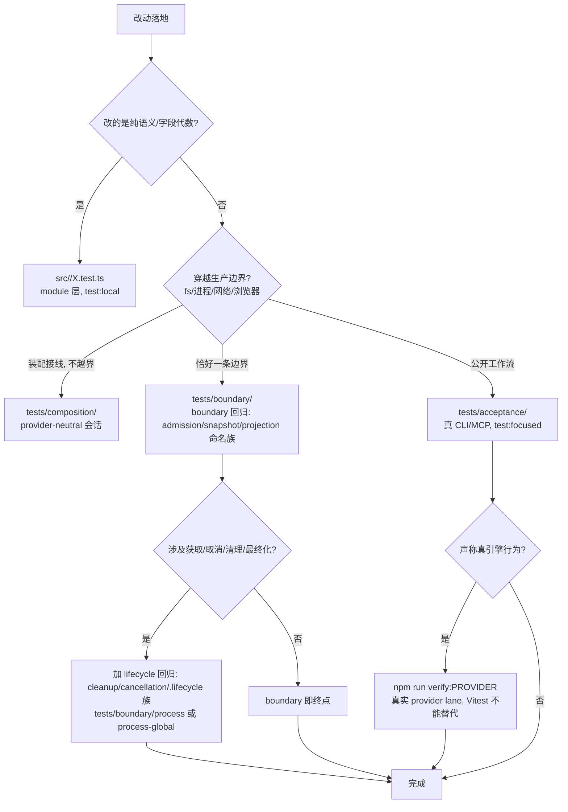

# 24 · 测试体系

> REA 的测试是**按「判据强度」分层的多项目 Vitest 体系**：与源码同目录的 `src/**/*.test.ts` 锁单元语义，`tests/` 的九个目录按「composition → boundary → acceptance → process-global」逐级穿过真实生产边界，真实引擎行为则**不在 Vitest 里证明**，只由 `verify:*` 通道证明。
>
> 边界澄清：本篇讲测试的组织、选择与资源治理机制；**不**讲各 provider 协议本身（见 15~21），**不**讲 CI workflow 的作业图（见 [25 构建与发布](25-构建与发布.md)）。

**测量环境**：提交 `9541eb1f26cd7d3895b62d515e0edbbae554fcde`（2026-10-27，比 00 篇基线 `1173c0a9d` 新），Node v24.10.0（本机；`.nvmrc` 固定 `24.22.1`），macOS darwin。工作副本**没有 `node_modules/`**，因此本篇所有文件计数来自 `find`/`grep` 实读，**所有 npm 命令均未实测**，命令语义一律从脚本源码推导并标注。

## 0 速览

1. 两套位置分工明确：`src/**/*.test.ts` 实测 **968** 个文件（domain 363 / application 175 / 其余 provider 适配 430），`tests/**.test.ts` 实测 **1528** 个；前者是「模块公开面」级判据，后者按项目分成 composition/boundary/acceptance/process-global/conformance/evaluation 等八组，判据强度逐级升高（[docs/testing.md Behavioral depths 表]，回源码验证见 §2）。
2. 分组的**唯一真相源**是 [scripts/lib/test-projects.mjs](../../../scripts/lib/test-projects.mjs) `Const：SOURCE_TEST_PROJECTS` / `Const：BUILT_TEST_PROJECTS`：六个 source 项目（domain/services/adapters/composition/conformance/evaluation）不需要构建产物，六个 built 项目（boundary/cli-boundary/process-boundary/mcp-boundary/acceptance/process-global）需要。`函数：projectForTest +10~+21` 强制**每个测试路径恰好被一个项目拥有**，多主人或无主人直接抛错。
3. 三个 vitest 配置各司其职：`vitest.config.ts` 是全量多项目主配置（runner 统一挂 `processOwnershipRunner`，`Const：MAX_TEST_WORKERS = min(2, availableParallelism())`）；`vitest.reverse-tools.config.ts` 与 `vitest.reverse-tools-semantics.config.ts` 是为**变异测试与覆盖归因**单列的两套窄配置（§4）。
4. boundary/lifecycle 回归在文件命名里有可数实体：`*admission*` 29 个、`*cleanup*` 84 个、`*cancellation*` 52 个、`*snapshot|replay*` 39 个、`*projection*` 12 个、`*.lifecycle*` 28 个、`*.closure*` 2 个（`find src tests -name '*.test.ts' | grep -iE …` 实测计数，判据见 §5）。
5. 模拟 provider 不等于真实 provider：`tests/fixtures/` 里的 `fakeLauncher.mjs`+`fakeHopper.mjs`（Hopper）、`fakeGhidra.mjs`（Ghidra）、`cutterBridgeProtocol.ts`（Cutter）、`fakeCdpBrowser.ts`（浏览器 CDP）、`idaMcp.ts`/`jebMcp.ts`（IDA/JEB MCP）伪装的是**引擎的协议面**，多个测试文件用注释显式声明其证明边界（§6）。
6. 变异测试（Stryker 双配置）只覆盖 reverse-tools 族 9 个源文件的**选定符号区间**，`thresholds.break = null` 意味着它是**报告制**门禁，不卡分数（§7）。
7. `test:local` / `test:focused` / `check:pr` 的差别在 [scripts/lib/development-tests.mjs](../../../scripts/lib/development-tests.mjs) `函数：parseDevelopmentTestRequest` 与 `函数：developmentTestPlan` 里是定义级的：local 只允许 source 组路径、focused 允许任意组且 built 路径会先触发 `artifacts:skills`（经 `dependsOn: compile` 连带编译）（§8）。

## 1 两套测试位置

### 1.1 与源码同目录：`src/**/*.test.ts`（968 个）+ `src/**/*.fixture.ts`（40 个）

归属 source 组三个项目（[scripts/lib/test-projects.mjs](../../../scripts/lib/test-projects.mjs) `Const：SOURCE_TEST_PROJECTS +5~+24`）：

| 项目 | include | 池 | 隔离 |
|---|---|---|---|
| `domain` | `src/{contracts,domain}/**/*.test.ts` | threads | `isolate: false` |
| `services` | `src/application/**/*.test.ts` | threads | `isolate: false` |
| `adapters` | `src/*.test.ts` + 30 个 provider/适配目录列举 | forks | 每文件隔离 |

`adapters` 的 include 是**目录白名单**（`android…windows` 共 33 项，另有顶层 `src/*.test.ts`），新目录不加进 `test-projects.mjs` 就会被 `verify:test-discovery`（[scripts/verify-test-discovery.mjs](../../../scripts/verify-test-discovery.mjs)，用 `vitest list --filesOnly` 对 `git ls-files`）抓到「有测试文件没项目拥有」。`src/cli/` 实测 **0** 个同目录测试——CLI 的判据全在 `tests/boundary/cli/`。

走读两例：

- [src/domain/providerCleanupError.test.ts](../../../src/domain/providerCleanupError.test.ts)（首个 `it`）：锁死**错误代数的字段语义**——`ProviderCleanupError` 的默认 `operation` 是 `"close_binary"`，非二进制操作必须显式传 `{ operation: … }` 才能被 `projectAnalysisError` 投影成 `code: "cleanup_incomplete"` 且 `details.operation` 保留原值。纯函数断言，无 fs、无会话。
- [src/application/binary/CompositeProvider.test.ts](../../../src/application/binary/CompositeProvider.test.ts)：用自造 `identity()` / `operationCapability()` 替身（该文件 +15~+28）锁**组合 provider 的子所有权**——「composed child ownership」正是 docs/testing.md Lifecycle regressions 末段点名的代表回归。它同目录放置是因为被测单元就是这一个类；它不构造 session、不起子进程（符合 testing.md `Behavioral depths` 对 module 层的约束：「通过其窄公开面测一个 domain/service/adapter」）。

同目录的 `*.fixture.ts`（40 个）是「一族测试共用的不可变构造器」，被 `tsconfig.build.json#exclude` 与 turbo `compile#inputs` 双重排除出生产构建（`turbo.json#tasks.compile.inputs` 的 `!src/**/*.test.ts`、`!src/**/*.fixture.ts`）。

### 1.2 `tests/` 九目录（1528 个测试文件）

实测分布（`find tests/<dir> -name '*.test.ts' | wc -l`）：

| 目录 | 测试文件数 | 总文件数 | 组 |
|---|---|---|---|
| `acceptance` | 242 | 243 | built |
| `boundary` | 1135 | 1151 | built（四子项目） |
| `composition` | 26 | 26 | source |
| `conformance` | 24 | 119 | source |
| `evaluation` | 20 | 25 | source |
| `process-global` | 81 | 81 | built |
| `fixtures` | 0 | 286 | —— |
| `support` | 0 | 37 | —— |
| 根：`ciTestSequencer.ts`、`processOwnershipRunner.ts` | — | — | 基础设施 |

`boundary` 内部再分四项目（`Const：BUILT_TEST_PROJECTS +4~+40`）：泛 `boundary`（含 `realHopperSearch`，filesystem 272 / providers 185 等）、`cli-boundary`（183）、`process-boundary`（100）、`mcp-boundary`（227）。

各挑一例走读，说明「锁死哪一级不变量」：

- [tests/composition/directAnalysisCleanup.test.ts](../../../tests/composition/directAnalysisCleanup.test.ts)（source 组）：从 `src/composition/binary.js` 造 `createArtifactBinarySession`，用 node:fs 只做 fixture 物化，断言**取消/清理在装配后的会话上语义正确**（`AnalysisCancelledError` 等错误代数 survive）。它穿过 composition，但**不碰生产进程边界**。
- [tests/boundary/process/processCaptureCancellationAdapters.test.ts](../../../tests/boundary/process/processCaptureCancellationAdapters.test.ts)：真 `spawn`/`execFile` 子进程 + `InMemoryTransport` 的 MCP server + `cleanupOwnedProcessGroup`，marker schema（+26~+29）校验 rootPid/childPid/runId——锁的是「取消落在采集各阶段时，被拥有进程族确实被清」。docs/testing.md 把它列为 SIGINT 清理时机的代表性回归。
- [tests/acceptance/tools/localToolContracts.test.ts](../../../tests/acceptance/tools/localToolContracts.test.ts)：把 `scripts/rea.mjs` 当**真 CLI** 执行（+19 `const cli = …rea.mjs…`），同时经 `connectLocalToolsMcp` 走 MCP，两侧对比——公开工作流级判据（「prefer real public CLI/MCP workflows」的最强可 CI 层）。
- [tests/process-global/electronFuseCleanup.test.ts](../../../tests/process-global/electronFuseCleanup.test.ts)：`import { syncBuiltinESMExports } from "node:module"` + `vi` mock + `afterEach(() => { vi.restoreAllMocks(); syncBuiltinESMExports(); })`（+16~+19）——它**必须**独占进程，因为篡改了内建 ESM 导出；这正是 `tests/process-global/` 的准入判据（testing.md：「demonstrated dependency on process-global state」）。
- [tests/conformance/providerCompletion.test.ts](../../../tests/conformance/providerCompletion.test.ts)：用 `webSourceLocationFixture`、`BINARY_LAYOUT_TEST_PROVIDER` 等**录制 provider** 参数化验证共享契约与显式 opt-out。`tests/conformance/README.md` 另说明 source-built 语义神谕（`verify:fixtures` 编译进被忽略的 `build/conformance/`）。

### 1.3 `tests/support/`：boundary/acceptance 共用的 37 个 seam 文件

`tests/support/` 实测 **0 个测试文件、37 个支持文件**（`find tests/support -name '*.test.ts' | wc -l`＝0）。它们不是替身（那是 `fixtures/`），而是**把真边界包成可复用夹具**的库，导出的 API 名即各目录测试的公共词汇：

| 支持文件 | 关键导出 | 为哪类测试提供什么 |
|---|---|---|
| [tests/support/cli/cliFixture.ts](../../../tests/support/cli/cliFixture.ts) | `Const：cliTest`（`processTest.extend` 组合子）、`函数：createSharedMcpSession`、`函数：runFileCli` | `tests/acceptance` 与 `tests/boundary/cli` 的「真 CLI 子进程 + 共享 MCP 会话」入口；`sharedMcpSessionClosed` 守卫「会话关闭后不得再调用」 |
| [tests/support/cli/cliCommandSession.ts](../../../tests/support/cli/cliCommandSession.ts) | `函数：createCliCommandSession`、`Type：CliCommandRequest/Result` | 交互式命令会话（多帧 stdin/stdout），配 `cliCommandSessionFrames.mjs/.d.mts` + `cliCommandSessionWorker.mjs` 帧协议双端 |
| [tests/support/mcp/mcpFixture.ts](../../../tests/support/mcp/mcpFixture.ts) | `Type：TestMcp`、`Type：McpClientIdentity` | `tests/boundary/mcp` 的客户端夹具 |
| [tests/support/mcp/productionSession.ts](../../../tests/support/mcp/productionSession.ts) | `函数：openProductionTarget` | 连**生产装配根**的 MCP 会话（acceptance 级） |
| [tests/support/mcp/streamableHttpProcess.ts](../../../tests/support/mcp/streamableHttpProcess.ts) | `函数：startListeningProcess`、`函数：startMcpHttpProcess`、`Type：McpHttpProcess` | 真监听端口的 Streamable HTTP 进程 |
| [tests/support/workspace/workspaceFixture.ts](../../../tests/support/workspace/workspaceFixture.ts) | `函数：createTestWorkspace`、`函数：removeTestWorkspace`、`Type：TestWorkspace` | 临时工作区所有权（与 `tests/fixtures/temporaryDirectory.ts` 的 `函数：createTestTempDirectory` 分层） |
| [tests/support/process/observePosixProcess.ts](../../../tests/support/process/observePosixProcess.ts) | `函数：observePosixProcess` | 真 `ps` 级进程树观测——`process-boundary` 项目的「被拥有进程族确实存在/消失」判据 |
| [tests/support/hostCleanup.ts](../../../tests/support/hostCleanup.ts) | `函数：expectUnverifiedHostCleanup`、`函数：expectSerializedUnverifiedHostCleanup` | 「宿主清理未验证时必须显式承认」的断言对——与 §6 的模拟≠真实同一口径 |
| [tests/support/failFileReadAfterAbort.ts](../../../tests/support/failFileReadAfterAbort.ts) / [holdFirstFileRead.ts](../../../tests/support/holdFirstFileRead.ts) | `函数：failFileReadAfterAbort`、`函数：holdFirstFileRead` | **故障注入**：让第 N 次文件读失败/挂起，喂给取消与准入回归 |
| [tests/support/reverseEngineeringMcpHarness.ts](../../../tests/support/reverseEngineeringMcpHarness.ts) 等 `reverse*`/`owned*` 6 个 | 组合/服务级 harness 与参数化证据测试工厂（`ownedRizinCommandEvidenceTests.ts`） | `tests/boundary/providers` 的调试器族复用装配 |

判读规则：`support/` 无测试文件 ⇒ 它本身不进任何 vitest 项目的 include；它被 boundary/acceptance 测试 import，因此自动继承引用者所在项目的池与隔离策略。

## 2 层级表（必读）

| 层级 | 位置 | 判据强度（锁死什么） | 需要真实引擎？ | 需要 `dist/`？ |
|---|---|---|---|---|
| Module | `src/**/*.test.ts` | 单模块窄公开面的字段/错误/纯语义 | 否 | 否（source 组） |
| Composition | `tests/composition/**` | 装配根产出的会话/注册表接线 + 端口语义 | 否（provider-neutral） | 否 |
| Conformance | `tests/conformance/**` | 共享 provider 契约、能力参数化、神谕 fixture | 否（`realHopperSearch` 例外，见 §6） | 是（归入 built `boundary` 项目） |
| Boundary | `tests/boundary/**` | **恰好一条**生产边界（fs/进程/网络/浏览器/CLI/MCP） | 否（替身 + 真 OS 语义） | 是 |
| Acceptance | `tests/acceptance/**` | 编译后的公开 CLI/MCP 全旅程（注入 provider 仍是 integration） | 否 | 是（`test:acceptance` 前置 `build:cached`） |
| Process-global | `tests/process-global/**` | 依赖进程全局状态的生命周期/退出码/环境 | 否 | 是 |
| Evaluation | `tests/evaluation/**` | 评测器、CI 选择器、lint 规则等元逻辑的确定性判定 | 否 | 否 |
| Real-provider | `npm run verify:*` + `real-*.yml` lanes | 真引擎行为、宿主、清理 | **是** | 是 |

层级判据的来源：`docs/testing.md#behavioral-depths` 表 + `test-projects.mjs` 的 include 实况（两者一致；文档仅作交叉印证）。

## 3 三个 vitest 配置与两个 tsconfig 变体

### 3.1 `vitest.config.ts`（全量主配置）

- `Const：MAX_TEST_WORKERS`（偏移 +0：`Math.min(2, availableParallelism())`）：本地与 CI 并发都被钉在 2，注释明言「bounded by the runner rather than command locks」。
- 项目策略 `Const：PROJECT_POLICIES`：纯语义组（domain/services/composition/conformance/evaluation）`isolate:false` 共享模块图省启动；adapters/boundary/acceptance/process-global 用 forks + 每文件隔离；`process-boundary` 额外 `fileParallelism: false` + `groupOrder: 1`（进程树采样共享宿主资源，串行跑）；`cli-boundary` 带 `execArgv: ["--max-old-space-size=512"]`（注释记录了 384 MiB 在 CI 实测耗尽的历史）。
- 全局：`runner: "./tests/processOwnershipRunner.ts"`、`retry: 0`、`testTimeout: 30_000`（开覆盖时 `60_000`）、`env.TMPDIR` 归一为 `realpathSync(tmpdir())`（`vitest.config.ts Const：CANONICAL_TEMPORARY_DIRECTORY`，杜绝 `/var`→`/private/var` 双路径导致的临时目录所有权判异）。
- 覆盖开关不是环境变量而是**选项回读**：`Const：COVERAGE_ENABLED` / `Const：COVERAGE_SHARD` 用 `parseCLI(["vitest", ...argv], {allowUnknownOptions:true})` 解析自家命令行（注释原文「so explicit false and spaced shard values retain their meaning」），再用 `Const：COVERAGE_ENABLED`/`Const：COVERAGE_SHARD` 决定超时与阈值集。
- 覆盖率落 `provider: "v8"` 且 `coverage.reportsDirectory` 是 `rea-vitest-coverage-<pid>` 临时目录——报告不进 `.cache/`，天然按进程隔离。
- 配置文件里 `reporters: ["default"]`；JUnit/blob 报告器由命令行注入：`package.json#scripts.test:ci` 追加 `--reporter=junit --outputFile.junit=test-results.xml`，`#scripts.test:ci:shard:run` 用 `--reporter=blob` 且把四个 `--coverage.thresholds.*=0` 也直接写在命令行（与 `vitest.config.ts Const：ZERO_COVERAGE_THRESHOLDS` 双保险），`#scripts.test:ci:merge` 再 `--merge-reports --coverage.enabled` 统一判定阈值。
- Android/Termux 特判在配置顶部：`platform === "android"` 且未设 `PLAYWRIGHT_BROWSERS_PATH` 时按 `XDG_CACHE_HOME` 推导 `ms-playwright` 路径（注释原文「Playwright's registry does not derive a cache directory for Termux's `android` platform」）——生产 CLI 的同名回退在此提前对齐，先于任何 worker import 浏览器模块。
- 项目生成段 `函数：projects.map`（`Const：TEST_PROJECTS` 展开 12 项目）对每个项目做 `PROJECT_POLICIES` 查表，**查不到即抛** `Missing test runner policy`——新增项目必须同时登记策略，杜绝「默认并发跑重边界测试」。
- 排序器只在 `REA_CI_TEST_HISTORY` 存在时挂 `CiTestSequencer`（`vitest.config.ts` `Module：default` 内 `...(process.env.REA_CI_TEST_HISTORY ? { sequence… } : {})`）。
- 覆盖率阈值（非分片运行时）：整体 statements 65 / branches 60 / functions 60 / lines 68；`src/domain/**` 80/75/75/80；`src/contracts/**` 85/80/80/85。分片时换 `Const：ZERO_COVERAGE_THRESHOLDS`（全 0），由 `test:ci:merge` 合并后再卡阈值。

### 3.2 `vitest.reverse-tools.config.ts` 与 `…-semantics.config.ts` 为什么单列

`vitest.reverse-tools.config.ts`：`include` 是**手选 37 个文件**（gdb/rizin/cutter/objdump/debugger-session/reverse 组合与边界测试），`Const：REVERSE_TOOL_MODULES` 列出 13 个被测源模块作为 `coverage.include`；`runner` 仍指向 `tests/processOwnershipRunner.ts`，`testTimeout: 60_000`。用途有二：`test:coverage:reverse-tools` 单独量这族模块的覆盖；[stryker.config.mjs](../../../stryker.config.mjs) 的 `vitest.configFile` 指到它并开 `related: true` + `coverageAnalysis: "perTest"`——变异测试需要「哪些测试覆盖这个 mutant」的精确归因，主配置的 12 项目大图不适合。
`vitest.reverse-tools-semantics.config.ts`：只含 4 个超时语义文件（`CutterBridgeClient`、`RizinCommandTimeout`、`RizinTimeoutEvidence`、`rizinPendingOutput`），供 [stryker.semantics.config.mjs](../../../stryker.semantics.config.mjs) 用 `commandRunner` 整体重跑（`coverageAnalysis: "off"`）。
[推导] 两者拆开的直接证据是配置键本身：per-test 归因（related 过滤）与全量重跑（off）无法在同一配置里共存；超时/deadline 变异的杀伤证明依赖跨文件时序，逐测试归因会漏。`[未知]` 拆分决策的过程记录不在源码里。

### 3.3 两个 tsconfig 变体

- [tsconfig.reverse-tools-mutation.json](../../../tsconfig.reverse-tools-mutation.json)：`include` 精确列举 13 个源模块 + 那批 reverse-tools 测试 + `src/frida/frida-bindings.d.ts`，是 Stryker 的 **typescript checker 作用域**（两份 stryker 配置的 `tsconfigFile` 都指它）——编译/类型检查只覆盖会被变异的图，避免全仓 typecheck 拖慢每个 mutant。`frida-bindings.d.ts` 在列是因为该族源文件引用其类型（当前源码无法确定具体引用点，`[推导]` 自其被纳入窄作用域这一事实）。
- [tsconfig.frida-verification.json](../../../tsconfig.frida-verification.json)：`files` 只有 `src/frida/frida-bindings.d.ts` 与 `scripts/verify/fridaBindingsCompatibility.ts`，`noEmit: true`；被 `package.json#scripts.verify:frida:bindings`（`node scripts/run-typescript.mjs --noEmit -p …`）使用——单独验证「宿主 Frida 绑定声明 vs 兼容脚本」这一对，不进主 typecheck。

## 4 变异测试：范围、阈值、抓什么

两份配置的公共键（字面读取）：`checkers: ["typescript"]`、`typescriptChecker.prioritizePerformanceOverAccuracy: true`、`thresholds: { break: null }`（**无失败分数阈值，纯报告**）、`concurrency: 2`、`timeoutMS: 30000`、`ignorePatterns: ["/.cache/rea-command-locks/**", "/coverage/**"]`、json/html 报告落 `reports/mutation/`（`.gitignore` 规则 `reports/mutation/` 忽略）。

`mutate` 不是「整文件」而是**符号区间**，选择器由 [scripts/lib/reverse-tools-mutation-targets.mjs](../../../scripts/lib/reverse-tools-mutation-targets.mjs) `函数：mutationRanges +0` 用 TypeScript AST 解析，`kind` 有 `method / constructor / guard / declaration / try / call / expression / command-handler`（从两份配置的实选值枚举）。两份配置分工：

- `stryker.config.mjs`：9 个源文件——`ReverseEngineeringService`（`inspectWithObjdump`、`executeRizinCommand`、`#observe`、`retryCleanup`、`#observeProvider` 的守卫/声明/try）、`ExecFileOutput`、`providerEnvironment`、`registerReverseEngineeringTools`、`GdbSessionManager`（含 `close`、`#startProtocol` 的 stdio 事件 call 点）、`ownedDebuggerSession.waitForInferiorDetach`、`RizinDebugSessionManager`、`src/cli/reverseEngineeringCommands.ts` 的 `debugWithGdb`/`debugWithRizin` handler、`src/cutter/CutterBridgeClient.ts` 的两处 `current_file === undefined` 表达式（status 分支与响应分支，`kind: "expression"` 区间）。
- `stryker.semantics.config.mjs`：2 个文件 5 个区间（`isRizinCommandDeadlineExpired`、超时快照/证据构造 + 同样的两个 `current_file` 表达式）。

**覆盖不到的**：`src/domain`、`application` 大部、其余全部 provider、bridge Python/Java——即变异门禁只被拿来守 reverse-tools 这族「测试最容易被写成假绿」的调试器/桥代码。CI 侧通过 `.github/workflows/ci.yml` job `reverse-tools-quality`（同源注释担忧见 `tests/boundary/cli/nativeEfficiencyComparison.test.ts`：`it.each` 场景表 `"binds the DOS model grade to its observed load image: %s"` 的回调体首行注释标注 synthetic transcripts 不属 real-provider）只做 `--dryRunOnly` 预飞 + `test:coverage:reverse-tools`；完整扫描是 `.github/workflows/mutation.yml`（`#on.schedule` cron `47 4 * * *`，矩阵两套、`max-parallel: 2`，报告 artifact 保留 7 天）。[scripts/prepare-reverse-tools-mutation.mjs](../../../scripts/prepare-reverse-tools-mutation.mjs) 把仓内 `typescript6` symlink 进两个 Stryker 包的 `node_modules/typescript`，防止 checker 用第三方自带版本。

## 5 boundary 回归与 lifecycle 回归的实体清单

AGENTS.md 要求改 parser/inventory/snapshot/projection 选 **boundary regressions**、改生命周期选 **lifecycle regressions**。文件系统里的实际体现（判据：文件名子串实测计数，含 `src/`+`tests/`）：

| 回归类 | 命名标记 | 实测文件数 | 代表文件 |
|---|---|---|---|
| 格式声明/准入（parser/inventory 的入口形状） | `admission` | 29 | `src/domain/jsonShape.admission.test.ts`、`src/artifacts/RegularFileAdmission.test.ts`、`src/javascript/sourceMaps/SourceMapAdmission.test.ts`、`tests/boundary/filesystem/asarHeaderAdmission.test.ts`、`tests/boundary/providers/RizinDebugSessionAdmission.test.ts` |
| 快照/回放（缓存与比较） | `snapshot` / `replay` | 39 | `src/ghidra/GhidraSnapshotCache.test.ts`、`src/browser/CdpSnapshotNodes.test.ts`、`src/application/environment/environmentReplay.test.ts`、`tests/acceptance/derivedEvidenceReplay.test.ts`、`tests/boundary/mcp/workflowSnapshotReplayMcp.test.ts` |
| 投影（projection） | `projection` | 12 | `src/domain/analysisErrorProjection.test.ts`、`src/domain/javascript/javascriptSemanticProjection.test.ts`、`src/inspector/V8InspectorCaptureProjection.test.ts` |
| 所有权/清理（lifecycle） | `cleanup` | 84 | `tests/process-global/electronFuseCleanup.test.ts`、`tests/boundary/cli/gdbStartupCleanupCli.test.ts`、`tests/boundary/cli/wasmCleanupCli.test.ts` |
| 生命周期整体 | `.lifecycle` / `lifecycle` | 28 | `src/application/Doctor.lifecycle.test.ts`、`src/apktool/ApktoolWorkspace.lifecycle.test.ts`、`tests/boundary/browser/cdpBrowserProvider.lifecycle_failures.test.ts`、`tests/boundary/process/processCaptureLifecycle.test.ts` |
| 取消 | `cancellation` | 52 | `tests/boundary/process/processCaptureCancellationAdapters.test.ts`、`tests/composition/reverseEngineeringCancellation.test.ts`、`tests/process-global/dmgCancellationReason.test.ts` |
| 账本闭合 | `closure` | 2 | `src/application/ReconstructionObligationLedger.closure.test.ts`、`src/application/environment/environmentStateWriteDisclosure.test.ts`（`Write disclosure`，闭合披露语义） |
| 清理错误代数 | 专名 | 1 | `src/domain/providerCleanupError.test.ts`（§1.1） |

判据说明：这套命名**不是被源码强制的注册表**（没有任何脚本解析文件名），而是 docs/testing.md「Boundary regressions / Lifecycle regressions」两张失败类表与既有文件名的对应关系；`projectForTest` 只强制「归属唯一」。`[推导]` 「文件名即回归分类索引」是从计数与 docs/testing.md 的指认（如把 `hopperClient.handshakeRecovery.test.ts`、`lldbCallTracerFailures.test.ts`、`wasmCleanupCli.test.ts` 点名为代表回归）交叉得出的。

## 6 假 provider 与真实 provider 的口径边界

`tests/fixtures/`（286 个非测试文件）伪装各引擎的**协议面**（架构图 `docs/architecture.mermaid` `TESTS` 节点原文：`fixtures/ holds fake launcher, bridge, and CDP seams`）：

| 替身 | 伪装对象 | 伪装到哪一层 |
|---|---|---|
| `fakeLauncher.mjs` + `fakeHopper.mjs` | Hopper 的 Python bootstrap + Unix socket 桥 | launcher 校验 bootstrap 必须先于 action（stderr 原文 `Python bootstrap must precede the Hopper action`，命中即 `exit(2)`），再 spawn 真 socket 服务端说桥协议 |
| `fakeGhidra.mjs` | Ghidra 启动握手 | 读 `REA_GHIDRA_FIXTURE_CONFIG`，校验 token/runId/profileDigest/targetSha256，transport 只认 `unix-socket`/`authenticated-loopback-tcp`（+18~+26） |
| `tests/fixtures/cutterBridgeProtocol.ts` `函数：authenticatedServer` | Cutter 实时桥 | 真 `node:net` server，**先验 HMAC v2 帧再派发受控回复** |
| `fakeCdpBrowser.ts`（+types/results/events/targets 四件套） | 用户浏览器 CDP | 真 HTTP/WS server（`WebSocketServer`），注释原文「Start a real HTTP/WebSocket fake at the same seams as a user-owned browser」 |
| `idaMcp.ts` / `jebMcp.ts` | IDA/JEB 的 MCP 服务 | jebMcp 用 `createVerifierHttpServer` 走真 HTTP MCP 传输，工具名来自 `JEB_ENGINE_TOOLS` 契约 |
| `pcap/tshark-stub.sh|cmd`、`capinfos-stub.*`、`captureGhidraLaunch.mjs|cmd` | tshark/binwalk 等命令行工具 | `#!/bin/sh`/`.cmd` 桩（`- [假设]` 无） |

显式声明「模拟 ≠ 真实」的测试注释（逐条 grep 实读）：

- [tests/evaluation/model-evals/AgentEvaluationScenarios.ts](../../../tests/evaluation/model-evals/AgentEvaluationScenarios.ts) `Const：nativeProviderScenario` 上方的 doc 注释：`Routing/cleanup trial; it does not establish real-engine analysis correctness.`
- `tests/acceptance/applications/javascriptFactoryCompletion.test.ts`（函数体内注释）：`… the stub does not establish real Electron runtime behavior.`
- `tests/boundary/cli/nativeEfficiencyComparison.test.ts`：`Synthetic transcripts exercise grading; they are not real-provider or …`
- `tests/boundary/filesystem/thirdPartyInventory.test.ts`：`Fixture text; this test does not establish real package attribution.`
- `src/artifacts/apple/AppleAssetCatalogAnalysis.test.ts`：`Supplied metadata tests the post-engine join; it does not establish native catalog validity.`
- 结构性证据：`tests/conformance/providers/hopper/realHopperSearch.test.ts` 被 `Const：SOURCE_TEST_PROJECTS.conformance.exclude` 摘出 source 组、塞进 built `boundary` include（`test-projects.mjs +36`、`+52`）——即便它本身只是对 `scripts/lib/real-hopper-search.mjs` 的搜索验证逻辑做纯逻辑测试（不 spawn Hopper），仓库也不肯让它在「无构建」的快车道里跑。真引擎证明一律在 `verify:hopper`、`verify:ghidra` 等通道（`package.json#scripts` 共 227 条，其中 `verify:*` 实测 109 条）。

## 7 测试资源治理

- [tests/processOwnershipRunner.ts](../../../tests/processOwnershipRunner.ts) `类：ProcessOwnershipRunner 函数：onBeforeRunFiles +1~+8`：自定义 Vitest runner，在每个隔离 worker 停止时调用 `systemProcessOwnershipHost.close?.()` 退役原生缓存；用 `WeakSet` 防重复注册；**池不支持 worker 清理就抛错**——宁可整条 lane 失败，也不留无主进程族。这是 AGENTS.md「被停进程要能杀掉自己拥有的进程族」在测试侧的落点。
- [tests/ciTestSequencer.ts](../../../tests/ciTestSequencer.ts)：`函数：readTestDurations` 读 CI 发布的耗时 JSON（zod 锁 `version:1, success:true`），`函数：seedLoaderOwnershipDurations` 为一次已退役的三分片拆分做权重回填（54+46×3 例的账，注释原文保留），`函数：allocateByDuration` 按「先长后短 + 每 shard 墙钟最小」装箱，`类：CiTestSequencer 函数：shard` 只在 `REA_CI_TEST_HISTORY` 与 `--shard` 同时存在时接管（否则回退 `super.shard`）。CI 接线在 `.github/workflows/ci.yml` job `test-shard`（fast tier 1/8~8/8，full tier 1/6~6/6，env `REA_CI_TEST_HISTORY: .cache/ci-test-history/test-results.json`）。它自己也有测试：`tests/boundary/filesystem/ciTestSequencer.test.ts`。
- 三条命令的定义级差别（[scripts/lib/development-tests.mjs](../../../scripts/lib/development-tests.mjs) + [scripts/run-development-tests.mjs](../../../scripts/run-development-tests.mjs)）：
  - `test:local [PATH…]`：`parseDevelopmentTestRequest("local")`——路径必须匹配 `^(src|tests)/.+\.test\.ts$` 且其项目 `group === "source"`，built 路径直接报 `Use test:focused for built test projects`（`函数：parseDevelopmentTestRequest +22~+23`）；无路径则 `--changed --passWithNoTests`。执行时始终带六个 `--project`（source 组）过滤。不构建。
  - `test:focused PATH…`：允许任意组；`函数：developmentTestPlan` 若任一 `projectForTest(path).group === "built"` 则 `needsBuild`，先 `run-exclusive artifacts → run-turbo run artifacts:skills`（turbo 经 `artifacts:skills dependsOn compile` 连带编译），再按 `artifactConsumers` 表补 `artifacts:mcp-catalog`/`product-catalog`/`managed-evidence`；最后走 [scripts/run-exact-tests.mjs](../../../scripts/run-exact-tests.mjs)（注释：CLI 文件过滤器是子串匹配，这里按 discovered specification **身份**精确选取）。
  - `check:pr`：`run-exclusive artifacts` 持锁下 `turbo run typecheck lint:built format:check knip metadata:check test:run`（`test:run` 在 `turbo.json` 里 `cache: false`，恒重跑）再串 `test:python`、`docs:check`、`jscpd`、`scan:todos`、`knip:production`、`lint:typed`。细节定义见 [25 篇 §6](25-构建与发布.md)。
- 锁：`run-exclusive.mjs` spawn 分离的 `run-exclusive-command.mjs` 监督进程，SQLite（`node:sqlite DatabaseSync`）事务锁落 `.cache/rea-command-locks/<name>.sqlite`（`Const：lockRoot +1`），锁名正则 `^[a-z][a-z0-9-]*$`；POSIX 取消保留进程组所有权，Windows 用 Job Object 持有工件锁到全部后代退出（CONTRIBUTING 交叉印证）。

## 8 `tests/evaluation/`（20 个测试）

评的是**评测与元工具本身**，不是分析质量：

- `ciTestSelection.test.ts`：测 `scripts/ci/test-selection.mjs` 的 `planTestSelection`/`compareTestSelection`（CI 该跑哪些测试的选择器）。
- `analysisEfficiencyComparison.test.ts`：造合成 left/right 交付目录，`spawnSync(process.execPath, ["experiments/analysis-efficiency/compare.mjs", …])`——测对比器对 Evidence 交付/覆盖/unknowns 的评分语义；不跑 REA 本体。
- `model-evals/`：[CodexAgentEval.ts](../../../tests/evaluation/model-evals/CodexAgentEval.ts) 的 `interface CodexMcpCall`/`CodexAgentMetrics` 定义了对 **Codex JSONL 会话转录**的打分（首个工具是否正确、重复调用数、token 数、是否引用 Evidence ID、术语覆盖……）；`agentEvaluationReport.test.ts` 用 `spawnSync` 起子 Node 调 `scripts/lib/agent-evaluation-report-gate.mjs` 的 `assertAgentEvaluationReportPassed` 验证报告门禁；`openAiModelFixture.test.ts` 用 `scripts/verify/clients/model-fixture.mjs` 起**回环 OpenAI 格式桩**验证路由按 pathname 而非 query。
- 其余是 lint 规则回归（`noSharedModuleMockRule`、`positionalToolContractRule`、`evidenceJsonPreadmissionRule`、`fixtureRootCleanupRule`、`moduleBoundaries`、`testDiscovery`）。

跑它需要什么：**仅 Node + vitest + 仓库源文件**（source 组，无需构建；外部触碰只有子 `node` 进程与回环 HTTP）。真实模型试用是人工的，Vitest 只测确定性评分逻辑——这点从测试文件不含任何引擎 spawn 可证。

## 9 一个修复该选哪层测试（决策树）

## 10 边界与失败模式

- **快车道假阴性**：`test:local`/`test:changed` 只覆盖 import 图可达的 source 测试；docs/testing.md 明言「changed selection can miss runtime registration, generated data, shell entrypoints, bridges」。空选择＝没选到测试，≠验证通过。
- **`realHopperSearch` 的双身份**：它在 `tests/conformance/` 目录、却归 built `boundary` 项目——按目录直觉跑 `test:fast` 会漏它（`test-projects.mjs` 的 exclude/include 是唯一裁决）。
- **变异扫描不设卡**：`thresholds.break: null`，报告为空或分数低都不会红 CI；把 mutation 当门禁的人会被 `mutation.yml`（仅定时）与 `ci.yml`（仅 dryRun）的组合误导。
- **覆盖阈值分片陷阱**：带 `--shard` 时 `ZERO_COVERAGE_THRESHOLDS` 全 0，单看某个 shard 的绿色覆盖不代表任何东西；阈值判定只在 `test:ci:merge` 合并后进行。
- **`isolate:false` 项目禁用模块 mock**：lint 规则 `rea/no-shared-module-mock` 在无每文件隔离的项目里拒绝 `vi.mock`（docs/testing.md 与 `.oxlintrc.json`），把 mock 写错项目是编译期看不见的坑。
- **未实测**：本篇没有跑过任何 npm 测试命令（无 `node_modules/`）；所有命令语义来自脚本源码。

## 11 问题清单

- **P2｜reverse-tools/semantics 拆分动机只有配置侧证据**。为什么 4 个超时文件必须整体重跑而非 per-test 归因，`stryker.semantics.config.mjs` 的 `coverageAnalysis: "off"` 是事实，动机 `[未知]`（需问作者或翻 PR 史）。
- **P3｜`ciTestSequencer.test.ts` 住在 `tests/boundary/filesystem/`** 但被测对象是排序器（不碰 fs）——层级归属与目录直觉不符；是有意为之（要真文件读？）还是历史遗留，源码未答。→ 待拍板
- **P3｜`seedLoaderOwnershipDurations` 的魔法数**（54/46/192）绑定一次已退役的分片拆分；拆分彻底稳定后这段 seeding 是否该删，无 TODO 标记（`scan:todos` 保证零标记）。
- **[假设]** `verify:test-temp-hygiene` 与 `tests/fixtures/temporaryDirectory.ts` `函数：createTestTempDirectory` 共同构成临时目录所有权闭环，但其仅在手动命令中运行、未进 `check:pr`（脚本清单核对：`check:pr` 字符串中无该项）。

## 12 已知缺口

- 风险：`src/**/*.test.ts` 968 个中 `adapters` 项目是目录白名单——新 provider 目录若忘登记，`verify:test-discovery` 会拦，但**登记错误目录**不拦。
- 设计特性：`retry: 0` 全局（vitest.config 与两份 reverse-tools 配置一致）——任何抖动都是真 bug，不做重跑消音。
- 未读取，不臆测：`tests/support/**` 37 个文件逐个的 seam 细节（只走读了 `cli/cliFixture.ts`、`mcp/mcpFixture.ts`、`workspace/workspaceFixture.ts` 的名字与引用点）。

## 13 源码索引

| 事实 | 文件:符号:行号 |
|---|---|
| 测试项目唯一所有权 | `scripts/lib/test-projects.mjs:projectForTest:92` |
| source/built 双组定义 | `scripts/lib/test-projects.mjs:SOURCE_TEST_PROJECTS:4` / `BUILT_TEST_PROJECTS:46` |
| realHopperSearch 改道 | `scripts/lib/test-projects.mjs:SOURCE_TEST_PROJECTS(conformance exclude):36`、`BUILT_TEST_PROJECTS(boundary include):52` |
| worker 上限/池策略/512MiB | `vitest.config.ts:MAX_TEST_WORKERS:36`、`PROJECT_POLICIES:39`、`execArgv:68` |
| 覆盖阈值 | `vitest.config.ts:ZERO_COVERAGE_THRESHOLDS:98`、`coverage.thresholds:157~176` |
| reverse-tools 13 模块 | `vitest.reverse-tools.config.ts:REVERSE_TOOL_MODULES:3` |
| semantics 4 文件 | `vitest.reverse-tools-semantics.config.ts:test.include:5~10` |
| 变异范围选择器 | `scripts/lib/reverse-tools-mutation-targets.mjs:mutationRanges:140` |
| stryker 阈值 | `stryker.config.mjs:thresholds:20`、`vitest:10~13` |
| sequencer 装箱 | `tests/ciTestSequencer.ts:allocateByDuration:217`、`CiTestSequencer.shard:259` |
| runner 所有权退役 | `tests/processOwnershipRunner.ts:onBeforeRunFiles:9` |
| local/focused 判定 | `scripts/lib/development-tests.mjs:parseDevelopmentTestRequest:4`、`developmentTestPlan:56` |
| 精确测试选取 | `scripts/run-exact-tests.mjs:parseCLI:8` |
| SQLite 命令锁 | `scripts/run-exclusive-command.mjs:lockRoot:14` |
| fake Ghidra 配置面 | `tests/fixtures/fakeGhidra.mjs:configuration:4` |
| Cutter 认证桩 | `tests/fixtures/cutterBridgeProtocol.ts:authenticatedServer:7` |
| 模拟≠真实注释 | `tests/evaluation/model-evals/AgentEvaluationScenarios.ts:56`、`tests/boundary/cli/nativeEfficiencyComparison.test.ts:53` |

## 14 相关篇

- 命令与任务图 → [25 构建与发布](25-构建与发布.md)
- 被测对象本体 → [13 Process 层](13-Process层-子进程监督与所有权.md)、[06 域层](06-域层-Evidence与错误代数.md)、[15~21 Provider 族](02-模块地图与依赖方向.md)
- CLI/MCP 公开面（acceptance 的靶子）→ [09](09-Server层-MCP适配器.md)、[10](10-CLI层-一次性命令适配器.md)
