# 25 · 构建与发布

> REA 的构建是**单包 Turbo 任务图 + 五步 compile 链**：`tsc 镜像编译 → 目录摘要录制 → rolldown 打包六个入口`；发布是 **release-please 提案 PR → 合并触发 qualification/rehearsal/publish 链**。`scripts/` 实测 **170** 个文件同时兼任分发器（`rea.mjs`）、生成器、校验器与验证通道。
>
> 边界澄清：本篇讲任务图、产物映射、生成物归属与发布链；**不**讲运行时如何消费这些产物（见 [01 系统骨架](01-系统骨架.md)），**不**讲测试分层本身（见 [24 测试体系](24-测试体系.md)）。

**测量环境**：提交 `9541eb1f26cd7d3895b62d515e0edbbae554fcde`（2026-10-27），macOS darwin，Node v24.10.0（本机）。工作副本无 `node_modules/`，**未执行任何 npm 命令**；全部结论来自 Read/Grep 源码与配置，命令语义均为「读脚本得」，未实测。

## 0 速览

1. 工具链三处钉死：`package.json#packageManager = npm@11.16.0`、`#engines.node = ^22.23.4 || ^24.22.1 || >=26.12.1`、[.nvmrc](../../../.nvmrc) = `24.22.1`（与 00 篇「会话可用 v24.18.0」不同口径：`.nvmrc` 钉的是 24.22.1）。编译器不止一个：`typescript@7.0.2`（官方稳定）、`tsrs@0.18.0-ts7.1.0-dev…`（Rust 编译器，Linux/macOS 加速）、`typescript6`（alias `npm:typescript@6.0.3`，Stryker/AST 脚本用）、`typescript-termux`（alias `npm:typescript@5.9.3`，`compile:termux` 用）。
2. `src→dist` 映射现在是**证实的**（补实 01 篇 §5 的 `[推导]`）：`tsconfig.build.json` `Const：rootDir = "src"` + `tsconfig.json` `键 compilerOptions.outDir = "dist"` ⇒ tsc 逐文件镜像 `src/<p>.ts → dist/<p>.js`（排除 `*.test.ts`/`*.fixture.ts`）；随后 `scripts/bundle-runtime.mjs` 用 rolldown 把 6 个入口再打成 `dist/mcp/`、`dist/cli-runtime/` 两套 bundle，**镜像产物保留不删**（`scripts/prepack.mjs` 的无-src 分支同时检查 `dist/main.js` 与 `dist/cli.js` 等镜像文件和 bundle 文件，见 §3）。
3. 昂贵命令统一被 `run-exclusive.mjs` → `run-exclusive-command.mjs` 的 SQLite 事务锁（`.cache/rea-command-locks/<name>.sqlite`）串行化；turbo 任务图里 `test:run` 是 `cache: false` 的恒重跑节点。
4. 生成物归属分两类：**忽略产物**（`.gitignore` 里相邻的四条 `/skills/`、`/docs/public/product-catalog.json`、`/docs/verification/managed-conformance-manifest.json`、`/docs/verification/managed-conformance-ledger.json`，外加 `.cache/` 一条；五条规则逐条实测）与**跟踪但查新**（`src/generatedPackageMetadata.ts`、`docs/error-contract.schema.json`、`licenses/npm-dependencies.txt` —— `git ls-files` 实测在册，靠 `--check` 模式保鲜）。
5. `check:pr` = 锁下 turbo 跑 `typecheck lint:built format:check knip metadata:check test:run`，再串 `test:python → docs:check → jscpd → scan:todos → knip:production → lint:typed`（`package.json#scripts.check:pr` 原文）。
6. 发布链：main push → `release.yml` job `merged-release` 跑 `googleapis/release-please-action@v4.4.1` 生成/更新 Release PR（版本写回 4 个 extra-files），合并后同一条链继续 `qualification`（workflow_call 调 `ci.yml`）→ `rehearsal` → `publish`（`npm publish .cache/verified-package/package.tgz --ignore-scripts`）→ `verify-npm` → `publish-mcp`。
7. `scan:todos` 的策略是**零容忍**：任何 `TODO/FIXME/HACK` 标记直接 exit 1，无例外清单（[scripts/scan-todos.mjs](../../../scripts/scan-todos.mjs) `Module：patterns` 之后无 skip 逻辑）。

## 1 Turbo 任务图

`turbo.json` 顶层：`#cacheMaxAge = "7d"`、`#cacheMaxSize = "500MB"`、`#globalDependencies = [".nvmrc", ".npmrc"]`、`#globalPassThroughEnv = [GOMAXPROCS, GOMEMLIMIT, UV_THREADPOOL_SIZE, REA_TYPESCRIPT_COMPILER]`（执行控制不进哈希，产物内容不变 ⇒ 跨宿主复用缓存）。

任务节点（键路径逐条实读）：

| 任务 | dependsOn | inputs 要点 | outputs | 缓存 |
|---|---|---|---|---|
| `compile` | `metadata:check` | `src/**` 排除 test/fixture、两份 tsconfig、compile 链 5 个脚本 | `dist/**` | 默认 |
| `typecheck` | — | src+**tests**+scripts d.ts+`.github/actions` TS+docs 代码 | `[]` | 默认 |
| `metadata:check` | — | package.json/lock、SKILL.md 版本行、`src/generatedPackageMetadata.ts` | — | 默认 |
| `lint` | — | 全部 JS/TS 目录（website/docs/experiments 含） | `.cache/static-checks/oxlint.json` | 默认 |
| `lint:built` | `compile` | 同 lint | 同上 | 默认 |
| `format:check` | — | `turbo.json#tasks.format:check = {}`（空定义） | — | `[未知]` 空定义在 turbo 2.11.7 的默认输入集，需查安装包内文档；未实测 |
| `knip` | `compile` | `knip.json`、workflow yml、vitepress config | — | 默认 |
| `jscpd` | — | `src/**`、`tests/**`、`.jscpd.json` | `.cache/static-checks/jscpd/jscpd-report.json` | 默认 |
| `scan:todos` | — | bridge java/py、scripts、src、tests | — | 默认 |
| `test:run` | 4 个 `artifacts:*` | 未声明 inputs | — | **`cache: false`** |
| `docs:check:built` | product-catalog、managed-evidence、skills | 生成器脚本 + docs + `dependencyOutputs` 模式的 glob（`skills/**`、两个 json） | — | 默认 |
| `artifacts:mcp-catalog` | `compile` | 生成器脚本 | `.cache/mcp-tool-catalog.json` | 默认 |
| `artifacts:skills` | `compile` | `.agents/skills/reverse-engineer-anything/**` | `skills/**` | 默认 |
| `artifacts:product-catalog` | `compile` | `scripts/lib/**/*.mjs`、`.oxfmtrc.json` | `docs/public/product-catalog.json` | 默认 |
| `artifacts:managed-evidence` | `artifacts:skills` | `scripts/verify/managed/**`、`scripts/fixtures/managed/**` | 两份 `managed-conformance-*.json` | 默认 |
| `artifacts:error-schema` | `compile` | 生成器 + format lib | `docs/error-contract.schema.json` | 默认 |
| `mcp-catalog:check:built` / `evidence:check:built` | 对应 artifacts | `dependencyOutputs` | — | 默认 |

要点：`docs:check:built` 用 `#tasks.docs:check:built.inputs[mode=dependencyOutputs]` 把依赖任务的产物并入自己的哈希输入——校验任务消费的是**构建任务真实产出的字节**，不是重新扫描工作树（这是 AGENTS.md「生成物只由 owner 产出」口径的机制化）。

### 四个 run-* 包装脚本

- [scripts/run-turbo.mjs](../../../scripts/run-turbo.mjs)：先 `process.env.REA_TYPESCRIPT_COMPILER = resolveTypeScriptCompiler().identity`（`Module：scripts/run-turbo.mjs` 顶层语句，位于 `import { resolveTypeScriptCompiler } from "./run-typescript.mjs"` 之后、任何 turbo 解析之前），**再** `require.resolve("turbo/bin/turbo")` 并 import——编译器身份在任何任务哈希/缓存恢复之前算出，防止「不同编译器共用一条缓存」。
- [scripts/run-typescript.mjs](../../../scripts/run-typescript.mjs)：`函数：selectTypeScriptCompiler +0~+12`（win32 → 官方 `typescript`；有 `@tsrs/<platform>-<arch>` 可选包 → `tsrs`）；`函数：resolveTypeScriptCompiler` 拼 `identity = <compiler>@<version>`；`函数：main` 里若 `TURBO_HASH` 存在而 `REA_TYPESCRIPT_COMPILER` 不匹配当前身份 ⇒ **抛错拒跑**（不支持模糊的「成功」缓存项）；tsrs 默认注入 `--checkers min(2, cpus)` 与 `--maxMemory 3G`（仅 `--noEmit` 检查）。
- [scripts/run-exclusive.mjs](../../../scripts/run-exclusive.mjs)：把命令交给分离的监督进程 `run-exclusive-command.mjs`，SIGINT/SIGTERM 经 IPC 转发，退出码 130/143 语义保留。
- [scripts/run-exclusive-command.mjs](../../../scripts/run-exclusive-command.mjs)：`Const：lockRoot`（偏移 +1：`.cache/rea-command-locks`）；用 `node:sqlite DatabaseSync` 事务做跨进程锁，锁名正则 `^[a-z][a-z0-9-]*$`；注释原文「SQLite owns acquisition and OS-backed lock release, including process death」；Windows 分支持 Job Object 到全部命令后代退出（+168~+173）。
- [scripts/check-dependency-install.mjs](../../../scripts/check-dependency-install.mjs)：`函数：dependencyInstallProblems +0` 把 `package-lock.json` 与 `node_modules/.package-lock.json` 里**根包直接依赖**（dependencies+devDependencies）逐项比版本，任何漂移 ⇒ 打印 `Run \`npm ci\`, then retry.` 并 exit 1。所有 `pre*` 钩子（`prebuild`/`precheck`/`precheck:pr`…）都挂它。
- [scripts/run-development-tests.mjs](../../../scripts/run-development-tests.mjs)：`test:local`/`test:focused`/`test:changed` 的调度器（详 [24 篇 §7]）；`--changed` 模式先解析 `git merge-base HEAD origin/main`。

## 2 `compile`：src → dist 的真实映射

`package.json#scripts.compile`（原文顺序，即 turbo `compile` 任务命令）：

```
clean-build-output.mjs → run-typescript.mjs -p tsconfig.build.json
→ record-catalog-digests.mjs → record-mcp-catalog.mjs → bundle-runtime.mjs
```

1. **清**：`clean-build-output.mjs` 就一件事——`rm dist/`（全文 7 行）。
2. **镜像编译**：`tsconfig.build.json` `Const：rootDir=src` + `include: ["src/**/*.ts"]` + `exclude: ["src/**/*.fixture.ts","src/**/*.test.ts","tests",…]`，继承 `tsconfig.json#compilerOptions.outDir=dist` ⇒ **每个非测试非 fixture 源文件一条 dist 镜像**（`src/domain/x.ts → dist/domain/x.js`）。01 篇 §5 表末行的 `[推导]` 到此补实。
3. **录制摘要**（在 bundling 之前，注释原文「after default identity has been recorded and before bundling」）：
   - [scripts/record-catalog-digests.mjs](../../../scripts/record-catalog-digests.mjs)：import 刚编译的 `dist/catalogIdentity.js` 的 `createCatalogDigestProfiles()`，写 `dist/recordedCatalogDigests.js`（`export const RECORDED_CATALOG_DIGEST_PROFILES = Object.freeze({…})`，只留哈希、逐层冻结）。
   - [scripts/record-mcp-catalog.mjs](../../../scripts/record-mcp-catalog.mjs)：起**真 MCP 会话**（`InMemoryTransport` 连 `createServer(createBinarySession(parseConfig(env)))`，临时 HOME）跑 `tools/list`/`listPrompts`，写 `dist/mcp-catalog.json`（compact）与 `dist/mcp-catalog-full.json`（full），并把两份 SHA-256 写进 `dist/recordedMcpCatalog.js`（`RECORDED_MCP_CATALOG_SHA256`）。清理失败用 `AggregateError` 保住临时 home。
4. **打包**：[scripts/bundle-runtime.mjs](../../../scripts/bundle-runtime.mjs) `函数：bundleRuntime +12~+34` 的入口表就是产物清单：

```
["mcp",         { main: "main.js" }]
["cli-runtime", { cli: "cli.js", cliOutput: "cliOutput.js",
                  cliBuiltinArguments: "cliBuiltinArguments.js",
                  cliResultOutput: "cli/cliResultOutput.js",
                  mcpDoctor: "mcpDoctor.js" }]
```

   rolldown 配置（`函数：bundleRuntime` 内 write 段）：`platform: node`、`treeshake: false`、external = 一切非相对导入（依赖保持外部）+ 例外放行 `dist/generatedPackageMetadata.js`（`函数：paths` 把它重写为 `../generatedPackageMetadata.js`——**CLI 与 MCP 两套 bundle 共享同一份发布身份模块**，注释原文「share one release-identity owner」）；`entryFileNames: "[name].js"`；`chunkFileNames`：mcp 用 `[name]-[hash].js`，cli-runtime 用「相对路径按 `__` 拼接 + hash」以区分同名懒加载 chunk；`minifyInternalExports` 仅 mcp；`codeSplitting + strictExecutionOrder` 开、sourcemap 关。插件 `preserve-compiled-module-locations` 把 `import.meta.url` 改写为指回**原编译位置**的 `new URL("../<srcpath>", import.meta.url)`——桥与 `createRequire` 因此仍按原目录解析（`函数：bundleRuntime 偏移：+46~+94`，AST 遍历+越界即抛「Runtime bundle input is outside dist」）。

   最终 dist 顶层同时存在：tsc 全镜像（01 篇的 6 个入口镜像 `dist/main.js`、`dist/cli.js` 等**仍在**）+ 2 份录制 json + 2 个录制 js + `dist/mcp/`、`dist/cli-runtime/` bundle。`scripts/prepack.mjs` 的无-src 分支清单（+47~+60）逐字核对这双层结构，包括 `skills/reverse-engineer-anything/SKILL.md`。

`Const：SIGPIPE` 分发器只 import 打包后的六个 bundle 入口（`scripts/rea.mjs Const：runtimeFiles`）——这解释了「镜像保留但没人执行镜像入口」：镜像是 bundle 的输入与 prepack 的校验面。`[推导]`（由 compile 链顺序 + bundle 输入路径得出）。

## 3 生成物归属（逐条验证，非照抄 AGENTS.md）

| 产物 | 语义源 | 生成脚本（turbo 任务） | git 状态（实测） | 保鲜/校验 |
|---|---|---|---|---|
| `skills/reverse-engineer-anything/**` | `.agents/skills/reverse-engineer-anything/**` | `scripts/generate-skill-metadata.mjs`（`artifacts:skills`，outputs `skills/**`） | 忽略：`.gitignore` 的 `/skills/` 条目 | `--check` 在 `docs:check:built`、`prepack`；`package.json#files` 含 `skills` ⇒ 发布而非提交 |
| `docs/public/product-catalog.json` | 编译后 contracts/domain 元数据 | `generate-product-catalog.mjs`（`artifacts:product-catalog`） | 忽略：`.gitignore` 条目 | `--check` 在 `docs:check:built` |
| `docs/verification/managed-conformance-{manifest,ledger}.json` | `scripts/verify/managed/**` + `scripts/fixtures/managed/**` + skills 产物 | `generate-completion-ledger.mjs`（`artifacts:managed-evidence`，dependsOn `artifacts:skills`） | 忽略：`.gitignore` 条目 | `evidence:check:built` / `--check` |
| `.cache/mcp-tool-catalog.json` | 编译后 SDK 注册（`artifacts:mcp-catalog` dependsOn compile） | `generate-mcp-tool-catalog.mjs` | 忽略：`.gitignore` 的 `.cache/` 条目 | `mcp-catalog:check:built`；类型由**跟踪**的 `tests/fixtures/mcpToolCatalog.ts` 提供 |
| `src/generatedPackageMetadata.ts` | `package.json`+lock+SKILL.md 版本 | `generate-package-metadata.mjs`（`metadata:generate`；turbo `metadata:check` 校验） | **跟踪**（`git ls-files` 实测） | `compile` 前置 `metadata:check`；release-please 直接 bump 它（extra-files） |
| `docs/error-contract.schema.json` | 域错误契约 zod | `generate-error-schema.mjs`（`artifacts:error-schema`） | **跟踪** | `docs:check:built` 的 `--check` |
| `licenses/npm-dependencies.txt` | `package-lock.json` + `licenses/upstream-sources.json` | `generate-third-party-inventory.mjs`（`licenses:generate`） | **跟踪** | `licenses:check`（`docs:check:built` 末项） |
| `dist/mcp-catalog*.json`、`dist/recorded*.js` | 编译后运行时 | record-* 两脚本 | 忽略：`.gitignore` 的 `dist/` 条目 | `compile` 链内置 |
| `build/conformance/**` | `tests/conformance` 源 + 本机工具链 | `build-conformance-fixtures.mjs`（`build:fixtures`） | 忽略：`.gitignore` 的 `build/` 条目 | `verify:fixtures` 校验哈希+工具链 manifest |

AGENTS.md 只点名前四个忽略产物；上表把「跟踪但查新」的 `src/generatedPackageMetadata.ts`、`docs/error-contract.schema.json`、`licenses/npm-dependencies.txt` 与忽略产物区分开（CONTRIBUTING「Generated files and command ownership」原文亦如此：「Reviewed source metadata … remains tracked and checked for freshness」）。

## 4 skill 打包链（构建侧）

 authored 源 → 产物 → 安装的三段分工：

1. **源**：`.agents/skills/reverse-engineer-anything/SKILL.md`——版本行必须由作者维护（`^  version: "…"$`，`函数：generate-skill-metadata 的 Const：versionLine`）；**禁止**在源里手写 `tool_count`/`catalog_digest`（正则命中即抛「Catalog metadata belongs in the generated skill, not the authored source」）。
2. **产物**：`generate-skill-metadata.mjs` import **编译后**的 `dist/catalogIdentity.js`（`FULL_CATALOG_IDENTITY.counts.mcp_tools`）与 `dist/identity.js`（`PRODUCT_IDENTITY.packageSpecifier` → `registrationPackageSpecifier`），注入 tool_count 并把 `@latest` 一律换成**固定版本 specifier**（注释原文「A shipped skill must run the version it ships with」）；先 `rm -rf` 输出目录再全量重建（「so removed references cannot survive a build」）。这就是 `turbo.json#tasks.artifacts:skills` 的 `dependsOn: compile` 的原因。
3. **安装**：`verify:package` 用 Skills 1.7.2 以仓库根发现安装该 bundle 并逐文件核对（CONTRIBUTING 记载 `[推导]`，脚本为 [scripts/verify-package.mjs](../../../scripts/verify-package.mjs)，本篇未逐行读）；运行期安装细节归 `SetupSkill.ts`/`SkillFilePublication.ts`（[12](12-Application层-共享工作流.md)/[22](22-配置系统.md) 篇）。

## 5 发布链

### 5.1 release-please 配置

- [release-please-config.json](../../../release-please-config.json)：`#release-type = "node"`、**`#versioning = "always-bump-minor"`**（永不自动 major——破坏性变更靠 `!`/`BREAKING CHANGE:` 进 changelog 文本而非版本号）、`#include-v-in-tag = false`（tag 不带 v）；`#changelog-sections` 把 Conventional Commit 类型映射到 8 个分组，其中 `chore` `hidden: true`。`#packages.".".extra-files` 四处版本回写：`docs/installation.md`、`src/generatedPackageMetadata.ts`（generic 文本替换）与 `server.json` 的 `$.version`、`$.packages[0].version`（jsonpath）。
- [.release-please-manifest.json](../../../.release-please-manifest.json)：`{".": "6.8.0"}`——唯一版本真相，和 `package.json#version` 同步。
- [CHANGELOG.md](../../../CHANGELOG.md)：实测 **461,472 字节**。
- [patches/release-please+17.3.0.patch](../../../patches/release-please+17.3.0.patch)：给 `release-please@17.3.0` 的 `build/src/github.js` 打补丁——仅当调用方 `retryInternalErrors`  opted-in 时，把 GraphQL「Something went wrong while executing your query」内部错误按 502 同等重试。应用者是 `npm run prepare` → [scripts/prepare.mjs](../../../scripts/prepare.mjs)（源检出且有 dev 依赖时）→ `scripts/lib/release-proposal.mjs 函数：applyReleasePleasePatch`，版本不等于 `17.3.0` **直接抛错**（无 patch-package，自研 git apply）。
- `scripts/release-notes.mjs`（`release:notes`）：从 pin 住的 git 历史生成/校验分组发布说明与贡献者致谢（`lib/release-notes.mjs` 的 `requireCompleteReleaseHistory`、`verifyReleaseNotes` 等）；对应仓库技能 `rea-changelog-update`。

### 5.2 `release.yml` 作业图（实测 job 名与条件）

| job | 触发/条件（字面读取） | 干什么 |
|---|---|---|
| `merged-release` | `push.branches:[main]` 或 `pull_request.closed` 且 head ref 以 `release-please--branches--main--` 开头 | 跑 `googleapis/release-please-action@5c625bf…(v4.4.1)` 建/消费 Release PR，输出 sha |
| `release-please` | `workflow_dispatch`（inputs `release_branch` + `phase: prepare\|publish`） | 手动 `release/VERSION` 检查点：prepare 提案或 publish 已审合并 |
| `release-proposal` | 同上分支 | 编辑性校验（step id `editorial`），筛 Release PR 号 |
| `qualification` | needs `[merged-release, release-please]`，publish 需 `release_created == 'true'` | `uses: ./.github/workflows/ci.yml`（`source_sha` 钉死 + 可选 `remote_cache_write`） |
| `rehearsal` | needs qualification | 检出精确 SHA，产出 `.cache/verified-package/package.tgz`（step id `package`） |
| `publish` | needs rehearsal | `npm publish .cache/verified-package/package.tgz --ignore-scripts` |
| `verify-npm` | needs publish | 从 registry 装回来复验 |
| `publish-mcp` | needs `[merged-release, release-please, verify-npm]` + publish phase | 按 `server.json` 发 MCP Registry |

普通 main push **不能**发布包（`publish` 条件要求 release-please 产出 release tag）；`release-recovery.yml` 为纯手动「验证已发布包」通道。`prepack` 在 `npm pack/publish` 时执行：有 src ⇒ `build:cached` + `generate-skill-metadata --check`；无 src（从已构建目录打包）⇒ 逐文件 `access()` 清单（§2）。`prepublishOnly` 再跑 `verify:windows-native:artifact`。

### 5.3 CI 作业清单（34 个 workflow 实测）

- `ci.yml`（name CI）：trigger `push:main` / `pull_request:main+release/*` / 两条 cron（`23 0-2,4-23 * * *` 与 `23 3 * * *`）/ dispatch / `workflow_call`。job 30 个：`changes`（分类 tier fast/full 与 lanes）→ `static`、`static-deep`、`test-source`、`test-shard`（fast 1/8~8/8，full 1/6~6/6，接 `REA_CI_TEST_HISTORY`，见 [24 篇 §7]）、`reverse-tools-quality`（覆盖+dryRun 预飞）、`build`、`sqlite-runtime`、`test`（合并 blob 报告+coverage）、`conformance-fixtures`、`windows-native-build`、`package-e2e`、`apple-artifacts`、`reconstruction-readiness`、`windows-curated`、`docs`、真实引擎组（`browser`/`binary_layout`/`evm`/`apk_signature`/`javascript_recovery`/`recorded_crash`/`web_network`/`web_runtime`/`web_source_map`/`agentenv`/`nativeaot`/`ghidra_bridge`）、`website`、`required`（汇聚）。
- `ci-full-pr.yml`：`pull_request types:[labeled]` 且 label `ci:full` ⇒ workflow_call 全量 `ci.yml`。
- `mutation.yml`：cron `47 4 * * *` + dispatch，矩阵 `reverse-tools` / `reverse-tools-semantics` 两配置（细节见 [24 篇 §4]）。
- `ci-timings.yml`（schedule+dispatch）、`cache-retention.yml`（`workflow_run`）。
- `pr-readiness.yml`（`pull_request_target`+dispatch，写 commit status，对应 CONTRIBUTING 的 human-readiness 声明）、`pr-title.yml`（`pull_request`，Conventional 标题）。
- 真实 provider lane 独立 workflow：`real-hopper.yml`、`real-hopper-linux.yml`、`real-ghidra-windows.yml`、`real-browser.yml`、`real-cutter.yml`（含 `windows-native-artifact` job、`repository_dispatch`）、`real-android-metadata.yml`（push+dispatch+call）、`real-apk-signature.yml`、`real-binary-layout.yml`、`real-evm-interface.yml`、`real-go-binary.yml`、`real-javascript-recovery.yml`、`real-packet-capture.yml`、`real-recorded-crash.yml`、`real-signal-recording.yml`、`real-termux.yml`、`real-web-network-captures.yml`、`real-web-runtime.yml`、`real-web-source-map.yml`、`real-agentenv.yml`、`sqlite-runtime.yml`、`nativeaot-fixtures.yml`、`ghidra-bridge-sources.yml`（多 dispatch/call）。
- 站点：`pages.yml`（手动 VitePress 构建、**不发布**）、`website-pages.yml`（main 上手动 GitHub Pages）、`website-check.yml`。
- 钩子：`.husky/pre-commit` = `npx --no-install lint-staged`（`package.json#lint-staged`：TS/JS ⇒ `oxlint --fix`+`oxfmt`；json/md/yml ⇒ `oxfmt`）；`.husky/pre-push` = `npm run check:fast`。CI 全部置 `HUSKY: "0"`。

## 6 质量门禁清单（`check:pr` 逐项）

| 项 | 防什么 | 配置与已知例外（实测） |
|---|---|---|
| `typecheck` | 全仓（含 tests、docs 代码、`.github/actions` TS）类型一致 | `scripts/run-typescript.mjs --noEmit`；tsrs/官方双编译器按身份分缓存条目 |
| `lint:built` | 语法级 lint + 仓库自研 `rea/*` 规则 + import 边界 | `oxlint 1.87.0`（`.oxlintrc.json`：`rea/no-buffer-deep-equality`、`rea/cancellation-cause` 等 error；规则实现在 [scripts/lint/index.mjs](../../../scripts/lint/index.mjs)）+ `verify:module-boundaries.mjs`；`dependsOn compile` |
| `format:check` | 格式漂移 | `oxfmt 0.72.0 --check .`（`.oxfmtrc.json` printWidth 80；ignore `dist/`、`build/`、`docs/api/`、`CHANGELOG.md`、`package-lock.json`、`_reference/`、`third_party/`） |
| `knip` | 未用文件/导出/类型/依赖 | `knip.json#rules` 十项全 `error`；entry 白名单含 `tests/processOwnershipRunner.ts`；`ignoreDependencies: [@stryker-mutator/command-runner, electron, esbuild, webpack]`（fixture 依赖非运行时） |
| `metadata:check` | `src/generatedPackageMetadata.ts` 过期 | `generate-package-metadata.mjs --check` |
| `test:run` | 全量确定性 Vitest（恒不缓存） | `turbo.json#tasks.test:run.cache = false` |
| `test:python` | bridge 生产者契约（**不**跑真调试器/代理） | 3 个 unittest 模块（`bridge/native/test_rea_lldb_tracer.py`、`bridge/pwndbg/test_core_context.py`、`bridge/mitmproxy/test_capture.py`，文件实测存在）+ `experiments/analysis-efficiency` 的 `test_*.py` discover |
| `docs:check` | 生成文档/目录/许可/错误 schema 过期 + README 一致性 | turbo `docs:check:built`（7 个 `--check`+`check-doc-facts`+`licenses:check`）+ `test:local -- tests/conformance/readmeConsistency.test.ts` |
| `jscpd` | src/tests 复制粘贴 | `.jscpd.json`：`threshold 4`、`minLines 5`、`minTokens 50`、`gitignore: true`；ignore `tests/fixtures/**`、`third_party/**`、`docs/**`、conformance 的 `.c/.m/.swift/.xib`。阈值语义方向由 jscpd 工具定义（`[推导]`，本仓只透传 exit code 并记 `reaCheck.exitCode`，[scripts/ci/static-check-report.mjs](../../../scripts/ci/static-check-report.mjs) `duplicates` 分支） |
| `scan:todos` | 技术债标记入库 | 正则 `TODO|FIXME|HACK`（`scripts/scan-todos.mjs Const：patterns`）扫 src/tests/scripts/bridge(py,java)；**发现即 exit 1，零例外**——当前源码无法确定是否存在豁免机制（通读全文无） |
| `knip:production` | 生产不可达导出 | `knip.production.json`：入口 `!` 钉死 20 个（含 4 个 worker 进程文件），`include` 只查死代码类；输出 `.cache/static-checks/production-reachability.json` 为 **advisory**（执行/报告错误才 fail） |
| `lint:typed` | 类型感知错误（floating promises、misused promises、穷尽性） | `oxlint-tsgolint 7.0.2005` 串行；默认 `GOMAXPROCS=2`、`GOMEMLIMIT=1024MiB`（docs/testing.md 交叉印证） |

比 `check:pr` 少的是 `check:fast`（`turbo run typecheck lint`，**不建产物、不持 artifacts 锁**）与 `check`（static + `verify:architecture-guards` + `knip:production` + `lint:typed`，无测试）。

## 7 第三方与许可

- `third_party/` 目录实测 11 项。[third_party/README.md](../../../third_party/README.md) 记录 **bring-your-own 引擎的上游钉版**：jadx-headless-mcp `v0.7.1` commit `5844800…`、Binwalk `v3.1.0` commit `4fdab3d…`、Unblob `26.6.4` commit `1fcc7a0…`（另有 wakaru、wabt、pwntools、pwndbg、ghidra-nativeaot、evmole、web-network-captures 目录）。submodule 不进包：`package.json#files` 只收 README/LICENSE 类文本（`third_party/evmole/LICENSE` 等 8 条实测在列）。
- 「未改动上游」在**代码里的体现**：`src/evm/EvmoleInterfaceProvider.ts 类：EvmoleInterfaceProvider` 的类注释 `Run unchanged EVMole/WASM in an owned worker; no target, chain or network execution.`；`src/javascript/sourceMaps/SourceMapDecoder.ts 类：SourceMapDecoder` 的类注释 `Integrate the pinned upstream codec through an independently bounded owned process.`——构建没有把上游字节卷进 src：两者都以**锁定 npm 依赖**（evmole@0.9.3）或 owned worker 子进程方式消费，`THIRD_PARTY_NOTICES.md` 表逐行说明保留哪份许可证（实测含 pefile 派生表、NativeAOT parser、MinGW-w64 静态链接 + GPLv3 + Runtime Library Exception、Node 22.19.0 头、evmole 补档、两个缺 license 档案的声明式补文）。
- `licenses/` **21 个文件**（`ls -A licenses | wc -l` 实测 2026-10-27）= 17 份上游许可/声明全文 + `README.md` + `npm-dependencies.txt`（生成）+ `npm-runtime-notices.txt`（生成）+ `upstream-sources.json`（手写源清单，生成器输入）。`.gitattributes` 三条规则实测（去掉注释与空行）：`* text=auto eol=lf`、`*.cmd text eol=crlf`、`licenses/npm-runtime-notices.txt whitespace=-blank-at-eol`（保上游通告原文空白）。
- `server.json` = MCP Registry 描述符（`io.github.morluto/rea`），与 `package.json#mcpName`、`version` 的一致性由 `scripts/verify-mcp-registry-metadata.mjs`（`mcp-registry:check`）校验。
- `examples/github-actions/rea-analysis.yml`：给用户复制到默认分支的 dispatch 示例 workflow（ubuntu-24.04）。
- `website/`：Cloudflare Workers 站点（`wrangler.toml`、`public/`、`locales/*/messages.po` 翻译源、`_site/` 为生成物）；`docs/.vitepress/config.ts` 是 docs 站导航源（`docs:dev/build/preview`）。发布站点与 GitHub Pages 是两条独立手动通道（§5.3）。

## 8 任务图（npm ci → check:pr → release）

```mermaid
flowchart LR
    CI0[npm ci] --> PREP["prepare.mjs<br/>应用 release-please 补丁"]
    PREP --> FAST["check:fast<br/>turbo: typecheck+lint<br/>(无锁, 不构建)"]
    FAST --> BC["build:cached<br/>run-exclusive artifacts<br/>turbo: artifacts:skills"]
    BC --> COMPILE["compile 链<br/>clean → tsc镜像 →<br/>record-digests → record-catalog →<br/>rolldown bundle"]
    COMPILE --> ART["artifacts:<br/>mcp-catalog / product-catalog /<br/>managed-evidence / error-schema"]
    ART --> PR["check:pr（持锁）<br/>typecheck lint:built format:check<br/>knip metadata:check test:run<br/>+ test:python docs:check jscpd<br/>scan:todos knip:production lint:typed"]
    PR --> PUSH[push main / PR]
    PUSH --> CIYML["ci.yml<br/>changes→static/test-shard→<br/>test合并coverage→required"]
    CIYML --> RP["release.yml merged-release<br/>release-please 建/合 Release PR"]
    RP --> QUAL["qualification<br/>ci.yml workflow_call<br/>source_sha 钉死"]
    QUAL --> REH["rehearsal<br/>package.tgz"]
    REH --> PUB["publish<br/>npm publish --ignore-scripts"]
    PUB --> VNPM[verify-npm]
    VNPM --> VMCP["publish-mcp<br/>server.json"]
```



## 9 边界与失败模式

- **缓存投毒防线在身份而非路径**：直接裸跑 turbo 编译器任务而无 `REA_TYPESCRIPT_COMPILER` 身份会**失败**（`scripts/run-typescript.mjs 函数：main`），不会发布模糊缓存项；`run-turbo.mjs` 必须先被用来注入身份（`package.json` 里所有 turbo 调用都经它）。
- **依赖陈旧静默漂移**：所有入口先跑 `check-dependency-install.mjs`；但它只比**直接**依赖版本，transitive 漂移靠 `npm ci` 自身。
- **锁与取消语义**：构建/文档写入共享 `artifacts` 锁；POSIX 取消保留进程组所有权至结算、Windows 等 Job Object 关闭（CONTRIBUTING + `run-exclusive-command.mjs` 注释）。`.cache/rea-command-locks/` 是锁不是垃圾——「never remove them while commands run」。
- **prepack 双分支**：从源码树打包 ⇒ 现场 `build:cached`，构建失败带不出半成品；从已构建目录打包 ⇒ 逐文件存在性检查。两分支都不能替代 `verify:package`。
- **`format:check` 缓存语义未证实**：`turbo.json#tasks.format:check` 空定义在 turbo 2.11.7 下的输入集，未读安装包文档、未实测。`[未知]`
- **Windows 源检出**：`native/windows/build/*.node` 是**忽略且不由 npm 构建**的（CONTRIBUTING），`run-exclusive` 的 Job Object 能力在源检出上不可用——门禁结果与 Linux 不同口径。

## 10 问题清单

- **P2｜`always-bump-minor` 与 major 语义的关系**：Conventional `!`/`BREAKING CHANGE:` 会进 changelog 文本，但版本号永不进 major——这是产品决策还是暂缺 release 自动化？源码未答。→ 待拍板
- **P3｜`metadata:generate` 只重新生成 package metadata，但 turbo `metadata:check` 任务输入含 SKILL.md 版本行**：改 skill 版本后忘跑 `evidence:generate` 时 managed-evidence 产物何时过期，链路靠 `docs:check:built` 兜底，无独立门禁。
- **P3｜`verify-package.mjs` / `generate-product-catalog.mjs` 内部逻辑未逐行读**：本篇只证「谁调、输出、被谁校验」；catalog 字段语义归 [08](08-契约层-工具契约与Schema.md)。

## 11 已知缺口

- `[未实测]` 一切 turbo 缓存命中/失效行为（`cacheMaxAge 7d`、remote cache `local:rw,remote:rw` 切换）——无 node_modules 未跑任何命令。
- 风险：`prepublishOnly` 只验 windows 原生工件；`publish` 的 tgz 正确性完全依赖 `rehearsal`+`verify-npm` 两道事后验。
- 设计特性：`test:run` 不缓存 + `retry: 0`（24 篇）⇒ 「绿色的 test:run」永远是新鲜事实；这与 AGENTS.md「previous test pass 不能替代 current validation」一致。
- 未读取，不臆测：`scripts/` 其余 ~120 个 verify/* 通道脚本的逐个语义。

## 12 源码索引

| 事实 | 文件:符号:行号 |
|---|---|
| 编译器身份注入 | `scripts/run-turbo.mjs:REA_TYPESCRIPT_COMPILER:9` |
| tsrs/官方选择 | `scripts/run-typescript.mjs:selectTypeScriptCompiler:10` |
| SQLite 命令锁 | `scripts/run-exclusive-command.mjs:lockRoot:14` |
| 依赖安装校验 | `scripts/check-dependency-install.mjs:dependencyInstallProblems:17` |
| compile 五步链 | `package.json#scripts.compile` |
| 镜像编译 rootDir | `tsconfig.build.json:rootDir:4`、`tsconfig.json:outDir:14` |
| 摘要录制 | `scripts/record-catalog-digests.mjs:writeFile:28`、`scripts/record-mcp-catalog.mjs:recordCatalog:25` |
| bundle 入口表 | `scripts/bundle-runtime.mjs:bundleRuntime:22~34` |
| 发布身份共享 | `scripts/bundle-runtime.mjs:external/paths:36、119` |
| skill 元数据注入 | `scripts/generate-skill-metadata.mjs:Module:13~50` |
| 生成文件比对 | `scripts/lib/generated-file.mjs:ensureGeneratedFile:17` |
| prepack 双分支 | `scripts/prepack.mjs:Module:39~62` |
| release-please 补丁应用 | `scripts/lib/release-proposal.mjs:applyReleasePleasePatch:16` |
| 版本分节/回写 | `release-please-config.json#versioning、#changelog-sections、#packages.".".extra-files` |
| 发布作业链 | `.github/workflows/release.yml:jobs:36~500` |
| mutation 定时扫描 | `.github/workflows/mutation.yml:on.schedule:4` |
| 测试分片+历史 | `.github/workflows/ci.yml` 的 `test-shard` job |
| 零标记 TODO 门禁 | `scripts/scan-todos.mjs` 的 `Const：patterns` |
| 上游钉版记录 | `third_party/README.md` 的 jadx/Binwalk/Unblob 表 |
| 忽略规则 | `.gitignore` 的 `.turbo/`、`.cache/`、`docs/.vitepress/cache/`、`docs/.vitepress/dist/`、`/skills/`、`/docs/public/product-catalog.json`、`/docs/verification/managed-conformance-*.json` 条目 |

## 13 相关篇

- 分发器只认 `dist/` 六入口 → [01 系统骨架 §5](01-系统骨架.md)
- 测试选择与命令语义 → [24 测试体系](24-测试体系.md)
- 目录写入与所有权机制 → [14 Filesystem 与 Windows 边界](14-Filesystem与Windows边界.md)
- 配置写入的加性/幂等约束 → [22 配置系统](22-配置系统.md)
