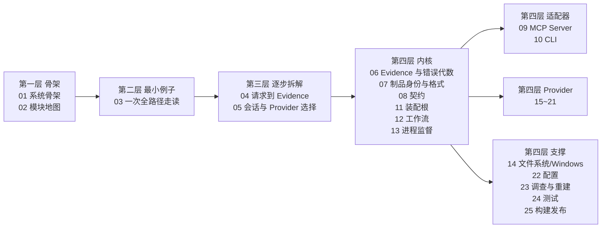

# REA 源码阅读库（sourceReader）

REA（`rea-agents`）是一个**仅本地运行**的逆向工程工具，同一套工作流同时暴露给 CLI 与 MCP 两个适配器。本目录是为读懂它的 `src/`（2111 个非测试 TypeScript 文件 / 501,535 行）、`bridge/`（Python + Java）、`scripts/`、`tests/` 而写的分层源码走读库。

- 规范与锚点约定见 [00-docs-style-guide.md](00-docs-style-guide.md) —— **先读它**。
- 版本基线：`1173c0a9d` / `rea-agents@6.8.0` / 2026-10-27。

## 学习路径



## 目录

| # | 文档 | 层级 | 覆盖范围 | 状态 |
|---|---|---|---|---|
| 00 | [文档规范与定位约定](00-docs-style-guide.md) | — | 锚点、事实分级、骨架、口径 | 已完成 |
| 01 | [系统骨架](01-系统骨架.md) | L1 | dispatcher → CLI/MCP 双入口 → composition → application → provider → domain；进程模型 | 已完成 |
| 02 | [模块地图与依赖方向](02-模块地图与依赖方向.md) | L1 | 50 个 `src/*` 模块的职责、实测入度、行数、依赖方向核查与架构图口径缺口 | 已完成 |
| 03 | [最小例子：一次全路径走读](03-最小例子-一次全路径走读.md) | L2 | 选一个真实最小成功场景，从命令入口追到 Evidence 输出 | 已完成 |
| 04 | [主链路拆解：请求到 Evidence](04-主链路拆解-请求到Evidence.md) | L3 | 参数校验 → schema → handler → session → provider → cleanup；deadline 与错误传播 | 已完成 |
| 05 | [会话与 Provider 选择](05-会话与Provider选择.md) | L3 | 一个目标一个不可变深度绑定、无 fallback 的选取算法；辅助 provider 路由 | 已完成 |
| 06 | [域层：Evidence 与错误代数](06-域层-Evidence与错误代数.md) | L4 | `src/domain/` 的 evidence、Result/tagged error、jsonShape、canonicalDigest | 已完成 |
| 07 | [域层：制品身份与格式声明](07-域层-制品身份与格式声明.md) | L4 | artifactIdentity/Inventory/Integrity、binaryTarget、ELF/PE/DOS 头 | 已完成 |
| 08 | [契约层：工具契约与 Schema](08-契约层-工具契约与Schema.md) | L4 | `src/contracts/` 契约注册、catalog 顺序、errorSchemas、advertised examples | 已完成 |
| 09 | [Server 层：MCP 适配器](09-Server层-MCP适配器.md) | L4 | `src/main/` + `src/server/` createServer、register* 家族、结果编码、progress、stdio/HTTP | 已完成 |
| 10 | [CLI 层：一次性命令适配器](10-CLI层-一次性命令适配器.md) | L4 | `src/cli.ts` + `src/cli/` 命令注册、取消、输出格式化、completions | 已完成 |
| 11 | [Composition 层：生产装配根](11-Composition层-生产装配根.md) | L4 | `src/composition/` 工厂、可选 provider 独立加载、JS worker 进程 | 已完成 |
| 12 | [Application 层：共享工作流](12-Application层-共享工作流.md) | L4 | `src/application/` AnalysisProvider、DirectAnalysis、Doctor、Setup/Update/Uninstall | 已完成 |
| 13 | [Process 层：子进程监督与所有权](13-Process层-子进程监督与所有权.md) | L4 | `src/process/` OwnedCommand、run token、private root、cgroup 内存、cleanup 重试 | 已完成 |
| 14 | [Filesystem 与 Windows 边界](14-Filesystem与Windows边界.md) | L4 | `src/filesystem/`、`src/windows/`、`native/windows/src/` Node-API | 已完成 |
| 15 | [深度 Provider：Hopper 与 Ghidra](15-深度Provider-Hopper与Ghidra.md) | L4 | `src/hopper/`、`src/ghidra/`、`bridge/hopper_bridge.py`、`bridge/ghidra/*.java` | 已完成 |
| 16 | [深度 Provider：IDA / Kuna / JEB / Cutter](16-深度Provider-IDA-Kuna-JEB-Cutter.md) | L4 | 上游 MCP 契约适配、BYO 引擎发现与版本探针、Cutter 实时桥 | 已完成 |
| 17 | [Native 与调试器 Provider 族](17-Native与调试器Provider族.md) | L4 | `src/native/`（pwntools/pwndbg）、`src/gdb/`、`src/rizin/`、`src/objdump/`、`src/frida/` 及其 bridge | 已完成 |
| 18 | [Managed 与语言元数据 Reader](18-Managed与语言元数据Reader.md) | L4 | `src/dotnet/`、`il2cpp`、`go`、`rust`、`python`、`erlang`、`flutter`、`wasm`、`evm`、`gpu`、`model` | 已完成 |
| 19 | [Web 与浏览器观测](19-Web与浏览器观测.md) | L4 | `src/browser/`、`src/javascript/`、`src/inspector/`、web capture/scenario/source map、mitmproxy bridge | 已完成 |
| 20 | [移动与桌面 App](20-移动与桌面App.md) | L4 | `src/adb/`、`android`、`apktool`、`apkSignature`、`jeb`、`electron`；`bridge/android/*.java` | 已完成 |
| 21 | [固件 / 抓包 / 存储格式](21-固件抓包与存储格式.md) | L4 | `src/firmware/`、`pcap`、`captures`、`signals`、`sqlite`、`reference` | 已完成 |
| 22 | [配置系统](22-配置系统.md) | L4 | `src/config/` Zod env 解析、client TOML 读写事务、配置只增不删与备份 | 已完成 |
| 23 | [调查记录与重建台账](23-调查记录与重建台账.md) | L4 | InvestigationRecord 组合、reconstruction coverage / obligation ledger | 已完成 |
| 24 | [测试体系](24-测试体系.md) | L4 | `tests/`（acceptance/boundary/conformance/composition/process-global）、vitest 多配置、stryker | 已完成 |
| 25 | [构建与发布](25-构建与发布.md) | L4 | `scripts/`（170 个）任务图、生成物归属、turbo pipeline、release-please、skill 打包 | 已完成 |

## 进度

- 2026-10-27：建立目录，写入 [00 规范](00-docs-style-guide.md) 与 [01 系统骨架](01-系统骨架.md)、[02 模块地图](02-模块地图与依赖方向.md)。
- 2026-10-27：完成 03~25 全部模块篇，共 26 篇；全库锚点校验 `docs: 27  issues: 0`，链接校验 `files: 27  broken links: 0`。
- 2026-10-27：逐篇回源码抽检并修补：02 篇入度改为路径解析口径（前缀 grep 会把 `src/domain/native/` 误计成 `src/native/`），同步修正 01/02/03/04/05/14/17 的入度与目录计数；01/02/20 补齐必备章节；08/09/21/25 修正契约数、server 测试数、HostSupported 数量与裸行号引用。
- 覆盖范围：`src/` 的 TypeScript 主链路与全部 provider 族、`bridge/`（Python/Java/Swift）、`scripts/`、`tests/`；非 TS 源在 15/16/17/19/20 与 24/25 篇中各有专节。

## 校验与维护约定

```bash
node docs/adrian/sourceReader/tools/anchor-check.mjs docs/adrian/sourceReader
node docs/adrian/sourceReader/tools/link-check.mjs docs/adrian/sourceReader
```

- 锚点校验为 0 不代表有覆盖面：先跑一次故意写错的负样本，确认工具会报错（正对照），再相信 0。
- 代码漂移后先跑锚点校验定位失效引用，再回源码核对语义；不要只改偏移不改结论。
- 新增篇目时同步更新本表、学习路径图与「进度」；篇内章节顺序遵循 [00 规范](00-docs-style-guide.md) 的骨架。
