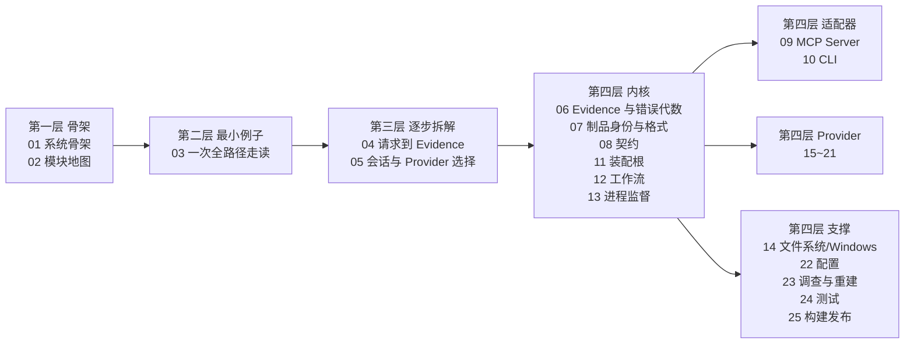

# REA 源码阅读库（sourceReader）

REA（`rea-agents`）是一个**仅本地运行**的逆向工程工具，同一套工作流同时暴露给 CLI 与 MCP 两个适配器。本目录是为读懂它的 `src/`（2111 个非测试 TypeScript 文件 / 501,535 行）、`bridge/`（Python + Java）、`scripts/`、`tests/` 而写的分层源码走读库。

- 规范与锚点约定见 [00-docs-style-guide.md](00-docs-style-guide.md) —— **先读它**。
- 版本基线：`1173c0a9d` / `rea-agents@6.8.0` / 2026-10-27。

## 学习路径

## 目录

| # | 文档 | 层级 | 覆盖范围 | 状态 |
|---|---|---|---|---|
| 00 | [文档规范与定位约定](00-docs-style-guide.md) | — | 锚点、事实分级、骨架、口径 | 已完成 |
| 01 | [系统骨架](01-系统骨架.md) | L1 | dispatcher → CLI/MCP 双入口 → composition → application → provider → domain；进程模型 | 已完成 |
| 02 | [模块地图与依赖方向](02-模块地图与依赖方向.md) | L1 | 50 个 `src/*` 模块的职责、实测入度、行数、依赖方向核查与架构图口径缺口 | 已完成 |
| 03 | 最小例子：一次全路径走读 | L2 | 选一个真实最小成功场景，从命令入口追到 Evidence 输出 | 待写 |
| 04 | 主链路拆解：请求到 Evidence | L3 | 参数校验 → schema → handler → session → provider → cleanup；deadline 与错误传播 | 待写 |
| 05 | 会话与 Provider 选择 | L3 | 一个目标一个不可变深度绑定、无 fallback 的选取算法；辅助 provider 路由 | 待写 |
| 06 | 域层：Evidence 与错误代数 | L4 | `src/domain/` 的 evidence、Result/tagged error、jsonShape、canonicalDigest | 待写 |
| 07 | 域层：制品身份与格式声明 | L4 | artifactIdentity/Inventory/Integrity、binaryTarget、ELF/PE/DOS 头 | 待写 |
| 08 | 契约层：工具契约与 Schema | L4 | `src/contracts/` 契约注册、catalog 顺序、errorSchemas、advertised examples | 待写 |
| 09 | Server 层：MCP 适配器 | L4 | `src/main/` + `src/server/` createServer、register* 家族、结果编码、progress、stdio/HTTP | 待写 |
| 10 | CLI 层：一次性命令适配器 | L4 | `src/cli.ts` + `src/cli/` 命令注册、取消、输出格式化、completions | 待写 |
| 11 | Composition 层：生产装配根 | L4 | `src/composition/` 工厂、可选 provider 独立加载、JS worker 进程 | 待写 |
| 12 | Application 层：共享工作流 | L4 | `src/application/` AnalysisProvider、DirectAnalysis、Doctor、Setup/Update/Uninstall | 待写 |
| 13 | Process 层：子进程监督与所有权 | L4 | `src/process/` OwnedCommand、run token、private root、cgroup 内存、cleanup 重试 | 待写 |
| 14 | Filesystem 与 Windows 边界 | L4 | `src/filesystem/`、`src/windows/`、`native/windows/src/` Node-API | 待写 |
| 15 | 深度 Provider：Hopper 与 Ghidra | L4 | `src/hopper/`、`src/ghidra/`、`bridge/hopper_bridge.py`、`bridge/ghidra/*.java` | 待写 |
| 16 | 深度 Provider：IDA / Kuna / JEB / Cutter | L4 | 上游 MCP 契约适配、BYO 引擎发现与版本探针、Cutter 实时桥 | 待写 |
| 17 | Native 与调试器 Provider 族 | L4 | `src/native/`（pwntools/pwndbg）、`src/gdb/`、`src/rizin/`、`src/objdump/`、`src/frida/` 及其 bridge | 待写 |
| 18 | Managed 与语言元数据 Reader | L4 | `src/dotnet/`、`il2cpp`、`go`、`rust`、`python`、`erlang`、`flutter`、`wasm`、`evm`、`gpu`、`model` | 待写 |
| 19 | Web 与浏览器观测 | L4 | `src/browser/`、`src/javascript/`、`src/inspector/`、web capture/scenario/source map、mitmproxy bridge | 待写 |
| 20 | 移动与桌面 App | L4 | `src/adb/`、`android`、`apktool`、`apkSignature`、`jeb`、`electron`；`bridge/android/*.java` | 待写 |
| 21 | 固件 / 抓包 / 存储格式 | L4 | `src/firmware/`、`pcap`、`captures`、`signals`、`sqlite`、`reference` | 待写 |
| 22 | 配置系统 | L4 | `src/config/` Zod env 解析、client TOML 读写事务、配置只增不删与备份 | 待写 |
| 23 | 调查记录与重建台账 | L4 | InvestigationRecord 组合、reconstruction coverage / obligation ledger | 待写 |
| 24 | 测试体系 | L4 | `tests/`（acceptance/boundary/conformance/composition/process-global）、vitest 多配置、stryker | 待写 |
| 25 | 构建与发布 | L4 | `scripts/`（170 个）任务图、生成物归属、turbo pipeline、release-please、skill 打包 | 待写 |

## 进度

- 2026-10-27：建立目录，写入 [00 规范](00-docs-style-guide.md)。

## 未完成时的续写约定

中断后继续：先查本表状态列，从未完成的第一篇续写，不重写已完成的篇目；每完成一篇立即回填状态列与本节。
